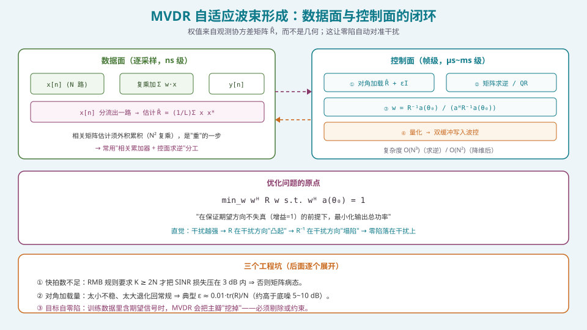
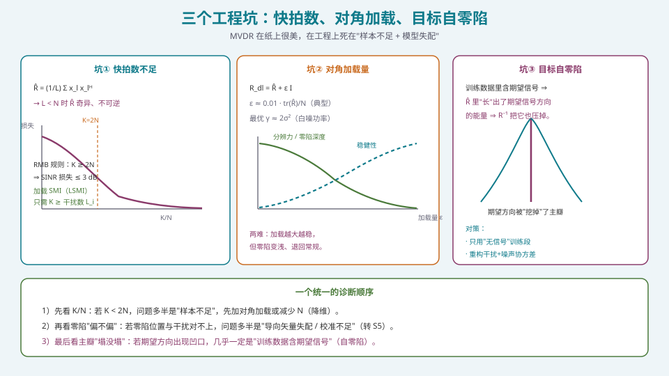

## 本篇要解决什么

[常规波束形成](pa-conventional-beamforming.html)的权值与数据无关，所以它**永远不知道干扰在哪**。要让系统"自动"把零陷对准干扰，就必须让权值**从观测数据里学出来**——这就是自适应波束形成。

核心问题只有一个：

**在保证期望方向不失真的前提下，如何让输出总功率最小？**

答案就是 MVDR（Minimum Variance Distortionless Response），也叫 **Capon 波束形成器**。这一篇要把它的推导、工程坑与实现路径讲清楚。它是 S4 里**最像"纯算法"**、也**最容易在工程上翻车**的一篇。

---

## 一、MVDR：从优化问题到闭式解



*图 1：数据面持续做复乘加并累积 R̂；控制面周期性地加载、求逆、解算 w，再双缓冲写回。*

### 1.1 优化问题

设阵列输出 \(y=\mathbf{w}^{\mathsf H}\mathbf{x}\)，输出功率 \(P=\mathbf{w}^{\mathsf H}\mathbf{R}\,\mathbf{w}\)，其中 \(\mathbf{R}=\mathbb E[\mathbf{x}\mathbf{x}^{\mathsf H}]\) 是观测协方差矩阵。MVDR 的准则：

\[
\min_{\mathbf{w}}\ \mathbf{w}^{\mathsf H}\mathbf{R}\,\mathbf{w}\quad \text{s.t.}\quad \mathbf{w}^{\mathsf H}\mathbf{a}(\theta_0)=1 .
\]

**约束的含义**：期望方向 \(\theta_0\) 上的响应（增益）恒为 1——即"无畸变响应"（distortionless）。在这个约束下最小化总功率，等价于"最大化输出 SINR"。

### 1.2 用拉格朗日乘子求闭式解

构造拉格朗日函数

\[
\mathcal L(\mathbf{w},\lambda)=\mathbf{w}^{\mathsf H}\mathbf{R}\mathbf{w}+\lambda\big(1-\mathbf{w}^{\mathsf H}\mathbf{a}\big),
\]

令 \(\partial \mathcal L/\partial \mathbf{w}^{*}=0\)：

\[
\mathbf{R}\mathbf{w}=\lambda \mathbf{a}\ \Rightarrow\ \mathbf{w}=\lambda \mathbf{R}^{-1}\mathbf{a}.
\]

代入约束 \(\mathbf{w}^{\mathsf H}\mathbf{a}=1\) 解出 \(\lambda=1/(\mathbf{a}^{\mathsf H}\mathbf{R}^{-1}\mathbf{a})\)，于是

\[
\boxed{\ \mathbf{w}_{\text{MVDR}}=\frac{\mathbf{R}^{-1}\mathbf{a}(\theta_0)}{\mathbf{a}^{\mathsf H}(\theta_0)\,\mathbf{R}^{-1}\mathbf{a}(\theta_0)}\ }
\]

对应的 Capon 空间谱（把上式的 \(\theta_0\) 扫一遍）为

\[
P_{\text{Capon}}(\theta)=\frac{1}{\mathbf{a}^{\mathsf H}(\theta)\,\mathbf{R}^{-1}\mathbf{a}(\theta)} .
\]

### 1.3 直觉：为什么零陷会自动对准干扰

关键观察：**MVDR 用的是实际观测到的 \(\mathbf{R}\)，不是阵列几何**。

- 若某方向存在强干扰，\(\mathbf{R}\) 在该方向"凸起"（能量大）；
- 求逆后 \(\mathbf{R}^{-1}\) 在该方向"塌陷"；
- 权值 \(\mathbf{w}\propto \mathbf{R}^{-1}\mathbf{a}\) 于是**在那个方向自动下压**，形成零陷。

**这就是"自适应"二字的物理来源**：不需要显式知道干扰角度，\(\mathbf{R}\) 已经把干扰"编码"进去了。

### 1.4 MVDR 比常规"锐"在哪

常规波束形成的主瓣宽度由**孔径**决定（下限约 \(\lambda/(Nd)\) rad）；MVDR **没有这个下限**——在无噪单源极限下主瓣可无限窄；有噪时有效波束宽度由**SNR**决定：高 SNR 更锐，低 SNR 退化回常规。

> 这解释了一个常见困惑：**"为什么我的 MVDR 看起来和常规没差？"** —— 因为你的 SNR 太低，或对角加载太重，或快拍太少。MVDR 的"锐"是需要条件换来的。

---

## 二、LCMV：把"约束"一般化

MVDR 只约束了一个方向（期望信号）。工程上常常还要：

- 在若干**已知干扰方向**预先置零（确定性零陷）；
- **主瓣保形**（多个角度点约束，防止主瓣被"啃"）；
- 对特定方向的增益做"上下界"约束。

这就得到**线性约束最小方差**（LCMV）：

\[
\min_{\mathbf{w}}\ \mathbf{w}^{\mathsf H}\mathbf{R}\mathbf{w}\quad\text{s.t.}\quad \mathbf{C}^{\mathsf H}\mathbf{w}=\mathbf{f},
\]

其中 \(\mathbf{C}=[\mathbf{a}(\theta_1),\dots,\mathbf{a}(\theta_L)]\) 是约束方向矩阵，\(\mathbf{f}\) 是期望响应向量（"1"=保形、0=置零）。其解为

\[
\boxed{\ \mathbf{w}_{\text{LCMV}}=\mathbf{R}^{-1}\mathbf{C}\big(\mathbf{C}^{\mathsf H}\mathbf{R}^{-1}\mathbf{C}\big)^{-1}\mathbf{f}\ }
\]

**特例校验**：取 \(\mathbf{C}=\mathbf{a}(\theta_0)\)、\(\mathbf{f}=1\)，LCMV 退化为 MVDR——两者是同一框架的两种参数化。

### 2.1 约束数量与自由度的关系

\(N\) 元阵有 \(N\) 个复自由度。每个等式约束消耗 1 个自由度。因此：

\[
\text{可同时处理的"波束 + 零陷"} \lesssim N-1 .
\]

这条粗算极其重要——它与 [DOA 估计](pa-doa-music-esprit.html) 里"可分辨源数 ≤ N−1"、"混合架构只有 N_RF 个自由度"是同一条约束的不同说法。**自由度是相控阵里最硬的通货。**

### 2.2 常用变体：相位约束（只调相位）

若硬件只能调相位（模拟移相器），则加约束 \(|\mathbf{w}_n|=1/\sqrt N\)，得到**相位约束波束形成**——代价是零陷"更浅、更慢"，但可直接落到 AESA 上。这是"算法向硬件妥协"的典型例子（见 [四种架构的选型](pa-architecture-selection.html)）。

---

## 三、三个工程坑



*图 2：快拍数、对角加载、目标自零陷——MVDR 翻车的三大主力。*

### 3.1 坑①：快拍数不足（样本支撑）

实际中 \(\mathbf{R}\) 未知，只能用 \(K\) 个快拍估计：

\[
\hat{\mathbf{R}}=\frac{1}{K}\sum_{k=1}^{K}\mathbf{x}_k\mathbf{x}_k^{\mathsf H}.
\]

**Reed–Mallett–Brennan（RMB）规则**：\(K\ge 2N\) 时，SMI（Sample Matrix Inversion）自适应波束形成的平均 SINR 损失不超过 **3 dB**。

- \(K<N\)：\(\hat{\mathbf{R}}\) **秩亏、奇异，不可逆** ⇒ MVDR 直接失效；
- \(K\approx 2N\)：可用，但仍有约 3 dB 损失；
- \(K\gg 2N\)：接近理论性能，但要求**干扰与信道在采集窗内平稳**。

**关键工程结论**：快拍数与阵元数是**一对矛盾**。大阵（N 大）要求 \(2N\) 个快拍，而快拍越多、采集时间越长，场景就越可能不平稳。这直接催生了下面两条"降维"思路。

- **降维（部分自适应）**：在波束域/子阵域做自适应，把 \(N\) 降到 \(B\ll N\)，快拍需求降为 \(2B\)（见 [DOA 估计](pa-doa-music-esprit.html) 的波束域 MUSDR 与 [混合波束成形](pa-hybrid-beamforming.html) 的子阵自由度）；
- **加载 SMI（LSMI）**：加对角加载后，收敛只需 \(K\ge\)**干扰数** \(L_i\)（通常 \(2N\gg L_i\)）⇒ **加载能大幅放宽快拍要求**。

### 3.2 坑②：对角加载量

\[
\hat{\mathbf{R}}_{\text{dl}}=\hat{\mathbf{R}}+\varepsilon\mathbf{I}.
\]

作用有三：**消除秩亏**（保证可逆）、**限制噪声增益**（\(\|\mathbf{w}\|^2\) 不再爆炸）、**抗导向矢量失配**（最操作上重要的一条）。

经验取值：

- \(\varepsilon\approx 0.01\cdot \mathrm{tr}(\hat{\mathbf{R}})/N\)（"平均特征值的 1%"，常见工程值）；
- 也可取"高于底噪 5~10 dB"的加载电平；
- 白噪场景下最优加载量近似 \(\gamma\approx 2\sigma^2\)（\(\sigma^2\) 为白噪功率）。

**两难**：加载越大越稳，但**零陷变浅、分辨力退化**，极端时退回常规波束形成。**没有解析最优解**——必须在具体场景上扫一遍 \(\varepsilon\) 曲线来找工作点（图 2 中间那张权衡曲线）。

### 3.3 坑③：目标信号自零陷

若训练数据里**含期望信号**，则 \(\hat{\mathbf{R}}\) 中期望信号方向的能量会"长"进协方差，\(\mathbf{R}^{-1}\) 会把**期望方向也压掉**——表现为**主瓣中间出现凹口**（自零陷 / self-nulling）。

**对策**：

1. **只用"无信号"的静默期训练**（最干净，但需要协议配合）；
2. **重构干扰+噪声协方差**：先用 DOA 估计出干扰方向，再在干扰方向重构 \(\hat{\mathbf{R}}_{i+n}\)（现代稳健算法的标准做法）；
3. **加主瓣约束**（LCMV 的多点约束），强迫期望方向附近保持增益；
4. **对角加载 / 子空间投影**作为兜底。

> 判别口诀：**零陷"偏"⇒ 导向失配；主瓣"塌"⇒ 训练数据含信号。** 这两类故障的症状完全不同，诊断路径也应不同。

---

## 四、实现：从协方差估计到权值回写

### 4.1 协方差估计的工程实现

\[
\hat{\mathbf{R}}=\frac{1}{K}\sum_{k}\mathbf{x}_k\mathbf{x}_k^{\mathsf H}\quad\Rightarrow\quad
\hat{\mathbf{R}}_{k+1}=\hat{\mathbf{R}}_k+\mathbf{x}_k\mathbf{x}_k^{\mathsf H}\ \text{（递推）}.
\]

**实现要点**：

- \(\mathbf{x}_k\mathbf{x}_k^{\mathsf H}\) 是 \(N\times N\) 外积，需要 **\(N^2\) 次复乘**——这是数据面里比"复乘加"更贵的操作；
- 工程上**用滑动窗（sliding window）或指数遗忘（forgetting factor）**递推更新，避免存全部快拍；
- 只有当阵**大**时才用"相关累加器（correlator）+ 控面求逆"的分工；小阵可整条链路放 FPGA。

### 4.2 求逆：\(O(N^3)\) 的代价与降维

直接求逆是 \(O(N^3)\)。工程上两类做法：

1. **QR / Cholesky 分解 + 回代**：数值更稳，且可流水化（尤其 Cholesky 利用 \(\hat{\mathbf{R}}\) 的 Hermitian 正定）；
2. **降维后求逆**：把 \(N\) 投影到 \(B\) 维波束域/子阵域，复杂度降为 \(O(B^3)\)——这是大阵能实时自适应的**唯一现实路径**。

> 一句话：**"自适应波束形成的复杂度问题，本质是"N 太大"的问题；解法几乎总是"降维"。**

### 4.3 参考代码（含滑动窗与加载）

```python
import numpy as np

class MvdrBeamformer:
    def __init__(self, N, alpha=0.05, eps_rel=0.01):
        self.N = N
        self.alpha = alpha            # 指数遗忘因子（0<α≤1）
        self.eps_rel = eps_rel        # 相对加载量
        self.R = np.eye(N, dtype=complex)

    def update(self, x):
        """x: (N,) 单个快拍复向量；递推更新 R̂。"""
        self.R = (1 - self.alpha) * self.R + self.alpha * np.outer(x, x.conj())

    def weights(self, a_theta0):
        tr = np.trace(self.R).real
        eps = self.eps_rel * tr / self.N
        Rdl = self.R + eps * np.eye(self.N)
        # 优先用 Cholesky 解线性方程，避免显式求逆
        # Rdl @ w = a  ⇒  w = aᴴ Rdl⁻¹ 的归一化形式需两侧求解
        w = np.linalg.solve(Rdl, a_theta0)
        return w / (a_theta0.conj() @ w)

def lcmv_weights(R, C, f, eps_rel=0.01):
    """LCMV：min wᴴRw s.t. Cᴴw=f。C:(N,L), f:(L,)"""
    N = R.shape[0]
    Rdl = R + eps_rel * np.trace(R).real / N * np.eye(N)
    RinvC = np.linalg.solve(Rdl, C)          # (N,L)
    M = C.conj().T @ RinvC                   # (L,L)
    return RinvC @ np.linalg.solve(M, f)
```

### 4.4 诊断脚本：把三个坑"跑出来"

```python
def sinr_db(w, R_true, a0, Ps=None):
    """按定义算输出 SINR（用于离线对拍）。"""
    num = np.abs(w.conj() @ a0) ** 2
    den = w.conj() @ R_true @ w
    return 10*np.log10((num/den).real + 1e-15)

# 实验：固定 N=16，扫 K（快拍数）与 eps，观察 SINR 损失与零陷深度
# 预期现象：
#   K < 2N 且 eps=0        → 结果发散/误差巨大
#   K ≥ 2N 且 eps=0        → 接近最优（约 3 dB 以内）
#   eps 太大               → 零陷变浅，SINR 退化向常规
#   训练数据含期望信号      → 主瓣出现凹口（自零陷）
```

---

## 五、常见误区清单

**误区一：把 MVDR 当成"更好的常规波束形成"，无脑套用。**
MVDR 的收益依赖三个条件：**足够快拍、合理加载、训练数据不含期望信号**。缺任何一条，它都可能**比常规更差**。它是"条件性更强"的算法，不是"无条件更好"。

**误区二：忘记 RMB 规则，用远少于 \(2N\) 的快拍。**
\(K<N\) ⇒ \(\hat{\mathbf{R}}\) 奇异、不可逆。**大阵尤其危险**：\(N=256\) 就要 512 个快拍，采集时间一长场景就不平稳了。**大阵必须降维。**

**误区三：把对角加载当成"随便加一点"。**
加载量是有"甜蜜点"的：太小不稳、太大退化。**必须扫曲线**，不能拍脑袋。加载本质上是"用一点性能换稳"，是**有意为之的折中**，不是补丁。

**误区四：不知道"自零陷"，看到主瓣凹口还以为是算法收敛了。**
主瓣中间出现凹口是**故障**，不是收敛。九成是训练数据含期望信号。**先查训练段有没有期望信号。**

**误区五：干扰"跑"了还以为零陷会跟上。**
MVDR 的零陷对准的是**估计窗内的干扰**。干扰快速移动（平台振动、干扰机跳变）会让零陷"落空"。对策是**零陷展宽**（见 [零陷展宽、宽带与稳健波束形成](pa-null-broadening-robust.html)）。

**误区六：忽略导向矢量失配。**
真实阵有阵元位置误差、幅相不一致、互耦、罩体影响——理想平面波模型不再精确。**失配使零陷偏移、主瓣增益下降。** 这是 S5 校准存在的根本理由之一。稳健方法（最差情况优化、RCB）就是为对抗它而生。

**误区七：总是显式求逆。**
显式求逆 \(O(N^3)\) 且数值不稳。工程上优先 **Cholesky/QR 解线性方程**（`solve` 而非 `inv`），或**降维后求逆**。

**误区八：在大阵/高频数字域精打细算"逐采样"的 MVDR。**
MVDR 的权值解算是**帧级**的，绝不该逐采样。**别把控制面的活塞进数据面**——这是 [FPGA/HLS 实现](pa-fpga-hls-implementation.html) 的架构原则。

**误区九：忽略"自由度上限"。**
\(N\) 元阵最多同时处理约 \(N-1\) 个约束。**要求同时置零 100 个干扰却只有 32 个自由度，是不可能的。** 先数自由度，再谈指标。

---

## 六、快速自测

**Q1.** 从 \(\min \mathbf{w}^{\mathsf H}\mathbf{R}\mathbf{w}\) s.t. \(\mathbf{w}^{\mathsf H}\mathbf{a}=1\) 推出 MVDR 权值，并解释归一化因子的作用。

<details><summary>参考要点</summary>

拉格朗日：\(\mathcal L=\mathbf{w}^{\mathsf H}\mathbf{R}\mathbf{w}+\lambda(1-\mathbf{w}^{\mathsf H}\mathbf{a})\)。
对 \(\mathbf{w}^*\) 求导：\(\mathbf{R}\mathbf{w}=\lambda\mathbf{a}\Rightarrow\mathbf{w}=\lambda\mathbf{R}^{-1}\mathbf{a}\)。
代入约束 \(\mathbf{w}^{\mathsf H}\mathbf{a}=1\)：\(\lambda^*\mathbf{a}^{\mathsf H}\mathbf{R}^{-1}\mathbf{a}=1\Rightarrow\lambda=1/(\mathbf{a}^{\mathsf H}\mathbf{R}^{-1}\mathbf{a})\)。
故

\[
\mathbf{w}_{\text{MVDR}}=\frac{\mathbf{R}^{-1}\mathbf{a}}{\mathbf{a}^{\mathsf H}\mathbf{R}^{-1}\mathbf{a}} .
\]

**归一化因子的作用**：它是一个标量，**不影响输出 SINR**（SINR 对权值整体缩放不变），只用来把期望方向响应**钉在 1**（无畸变），从而让"增益"有绝对值含义。写代码时去掉它也可以，只要最后不误用绝对增益。

</details>

**Q2.** \(N=32\) 的阵要做 MVDR。若只有 40 个快拍，会发生什么？有什么工程对策？

<details><summary>参考要点</summary>

RMB 规则要求 \(K\ge 2N=64\)；40 < 64，则：

- \(\hat{\mathbf{R}}\) 仍可逆（40 ≥ 32），但**病态**，求逆放大估计噪声，SINR 损失远大于 3 dB，甚至零陷"乱跑"。

**对策**：
1. **对角加载**：\(\hat{\mathbf{R}}_{\text{dl}}=\hat{\mathbf{R}}+\varepsilon\mathbf{I}\)，大幅改善条件数；LSMI 只需 \(K\ge\) 干扰数；
2. **降维**：投影到 \(B\approx8\sim16\) 的波束域，快拍需求降为 \(2B\approx16\sim32\)，40 个快拍就够；
3. **协方差重构**：先用 DOA 估出干扰方向，直接在干扰方向重构 \(\hat{\mathbf{R}}_{i+n}\)（对快拍需求更友好）；
4. **加大遗忘因子/滑动窗**：用时间换样本——但代价是场景平稳性假设。

**本质**：这是"**自由度 vs 样本量**"的经典交易。

</details>

**Q3.** 为什么"训练数据含期望信号"会导致自零陷？怎样检测与规避？

<details><summary>参考要点</summary>

**机理**：\(\hat{\mathbf{R}}\) 含期望信号分量 \(\sigma_s^2\mathbf{a}_0\mathbf{a}_0^{\mathsf H}\)，求逆后 \(\mathbf{R}^{-1}\) 在 \(\mathbf{a}_0\) 方向也产生"塌陷"。虽然约束 \(\mathbf{w}^{\mathsf H}\mathbf{a}_0=1\) 保住了一个点方向，但**有限快拍 + 失配**使保形不完美，主瓣内部会出现凹口。

**检测**：观测方向图（或真值 SINR）——若**期望方向附近出现明显凹口**或 SINR 随快拍增加"变差"，基本确诊。

**规避**：
1. 只用**无信号静默期**训练；
2. **协方差重构**：估出干扰角度 → 只在干扰方向重构 \(\hat{\mathbf{R}}_{i+n}\)；
3. **LCMV 主瓣多点约束**（把期望方向相邻几个角度都保形）；
4. **子空间投影 / 稳健自适应**（如 ESB：把权值投影到信号+干扰子空间）。

</details>

**Q4.** 写出 LCMV 的解，并说明它如何退化为 MVDR；再加入"期望方向保形 + 两个已知干扰置零"应如何设置 \(\mathbf{C},\mathbf{f}\)。

<details><summary>参考要点</summary>

\[
\mathbf{w}_{\text{LCMV}}=\mathbf{R}^{-1}\mathbf{C}(\mathbf{C}^{\mathsf H}\mathbf{R}^{-1}\mathbf{C})^{-1}\mathbf{f}.
\]

取 \(\mathbf{C}=\mathbf{a}(\theta_0)\)、\(\mathbf{f}=1\)，则 \((\mathbf{C}^{\mathsf H}\mathbf{R}^{-1}\mathbf{C})^{-1}\mathbf{f}=1/(\mathbf{a}^{\mathsf H}\mathbf{R}^{-1}\mathbf{a})\)，正是 MVDR。

**保形 + 两个干扰置零**：取

\[
\mathbf{C}=[\mathbf{a}(\theta_0),\ \mathbf{a}(\theta_{i1}),\ \mathbf{a}(\theta_{i2})],\qquad
\mathbf{f}=[1,\ 0,\ 0]^{\mathsf T}.
\]

注意：**保形若只用单点约束，仍可能被"啃"出凹口**；工程上常用多个相邻角度同时约束（\(\mathbf{C}\) 里放入 \(\theta_0-\Delta,\theta_0,\theta_0+\Delta\)），代价是消耗更多自由度。

</details>

**Q5.** 对角加载量 \(\varepsilon\) 怎么选？请给出至少三条经验准则，并说明"加载过大"的后果。

<details><summary>参考要点</summary>

经验准则：
1. \(\varepsilon\approx0.01\,\mathrm{tr}(\hat{\mathbf{R}})/N\)（平均特征值 1%）；
2. 加载电平取"**高于底噪 5~10 dB**"；
3. 白噪场景近似最优 \(\gamma\approx2\sigma^2\)。

**加载过大**：\(\hat{\mathbf{R}}+\varepsilon\mathbf{I}\to\varepsilon\mathbf{I}\)，则 \(\mathbf{w}\to\mathbf{a}/\|\mathbf{a}\|^2\)，**退化为常规波束形成**——零陷消失、分辨力丢失、抗干扰失效。表现为"**稳健了但没用了**"。

**结论**：加载量是"性能 ↔ 稳健"的一维权衡。必须**在目标场景上扫曲线定工作点**；不同场景（干扰数、INR、失配程度）最优加载量不同，不能一套参数打天下。

</details>

**Q6.** 一个 256 元阵要实时自适应置零。直接对 256×256 协方差求逆可行吗？给出你的架构建议。

<details><summary>参考要点</summary>

**不推荐直接求逆**：
- \(O(N^3)=256^3\approx1.7\times10^7\) 复乘/次更新，控面上频繁做负担重；
- 快拍要求 \(K\ge512\)，采集时间长、平稳性难保证；
- 数据面还要算 \(N^2=65536\) 次复乘的外积累积，代价高。

**架构建议（降维是核心）**：
1. **波束域/子阵域降维**：先做 \(N\to B\)（如 \(B=8\sim32\)）的固定/自适应变换；
2. 在 \(B\) 维上估协方差并求逆（\(O(B^3)\)）；
3. 权值 **\(B\) 维自适应 × \(N\) 维固定配相/校准**，最终落到波控；
4. 加**对角加载**与**零陷展宽**（对付干扰移动）；
5. 控制面（CPU/DSP）负责求逆，数据面（FPGA）负责复乘加与相关累加。

**一句话**：**"大阵自适应的答案永远是降维——把 N 维问题投影到 B 维。"** 这正是 [混合波束成形](pa-hybrid-beamforming.html) 与 [DOA 的波束域 MUSIC](pa-doa-music-esprit.html) 的共同思路。

</details>

**Q7.** MVDR 的空间谱 \(P(\theta)=1/\mathbf{a}^{\mathsf H}\mathbf{R}^{-1}\mathbf{a}\) 为什么能"超分辨"？它和常规波束形成的谱有什么本质差别？

<details><summary>参考要点</summary>

**常规谱**（Bartlett）：\(P_B(\theta)=|\mathbf{a}^{\mathsf H}\mathbf{R}\mathbf{a}|\)——本质是"用阵列做空间滤波再测能量"，**分辨率受孔径限制**（Rayleigh 限）。

**Capon 谱**：\(P_C(\theta)=1/(\mathbf{a}^{\mathsf H}\mathbf{R}^{-1}\mathbf{a})\)——用的是 \(\mathbf{R}^{-1}\)，相当于**先"白化"干扰+噪声再测能量**。在扫描到真源方向时，该方向的能量"躲不掉"，谱出现尖峰；在两源之间的角度，\(\mathbf{R}^{-1}\) 会把两个源的贡献"抵消"掉，谱被压低。

**本质差别**：常规谱是"**滤波**"，Capon 谱是"**最优滤波 + 白化**"。白化使谱峰更尖，故在一定 SNR 下能分辨间隔小于常规波束宽度的两个源——这就是"超分辨"。

**但注意**：
1. Capon 的超分辨依赖 **SNR 与快拍数**，低 SNR/少快拍会退化回常规；
2. Capon 的"超分辨"仍弱于子空间方法（MUSIC/ESPRIT，见 [DOA 估计](pa-doa-music-esprit.html)）；
3. Capon 谱对**相干源**表现差（\(\mathbf{R}\) 秩亏）。

</details>

**Q8.** 为什么说"自由度是相控阵里最硬的通货"？请用它解释 MVDR 与混合架构的冲突。

<details><summary>参考要点</summary>

\(N\) 元数字阵有约 \(N-1\) 个可用的复自由度。每个"零陷/约束/波束"消耗 1 个自由度。因此：

\[
\text{可同时置零数}+\text{保形约束数}\lesssim N-1 .
\]

**与混合架构的冲突**：
- 混合架构的数字自由度只有 \(N_{RF}\)（如 8:1 压缩 ⇒ \(256\) 元只有 32 个数字通道）；
- 于是 MVDR 的 \(\hat{\mathbf{R}}\) 只能是 \(32\times32\)，**最多置零约 31 个干扰**，且是**子阵级**零陷（不如阵元级深、形状受限）；
- 若设计者按"256 元"去承诺"能置零 100 个干扰"，**必然翻车**。

**结论**：**算法能力由自由度（而非阵元数）决定，自由度由架构决定**（见 [四种架构的选型](pa-architecture-selection.html)）。**先数自由度，再写算法，再谈指标。**

</details>

---

## 七、与本站其它专题的连接

| 想了解 | 看哪篇 |
| --- | --- |
| 常规（数据无关）权值与权值 LUT | [常规波束形成：数据无关的权值计算](pa-conventional-beamforming.html) |
| 干扰从哪来：DOA 估计 | [DOA 估计：MUSIC / ESPRIT 与工程改良](pa-doa-music-esprit.html) |
| 干扰在动：零陷展宽与稳健化 | [零陷展宽、宽带与稳健波束形成](pa-null-broadening-robust.html) |
| 大阵降维与模拟-数字联合 | [混合波束成形（HBF）的子阵设计](pa-hybrid-beamforming.html) |
| 权值位宽与零陷深度 | [定点化：从浮点仿真到硬件指标不退化](pa-fixed-point-quantization.html) |
| 求逆与复乘加落到芯片 | [FPGA/HLS 实现：数据面与控制面的分工](pa-fpga-hls-implementation.html) |
| 自由度由架构决定 | [四种架构的选型：PESA / AESA / 混合 / 全数字](pa-architecture-selection.html) |
| 通道误差如何毁掉自适应 | S5 · 通道误差的来源与影响 |
| 相控阵的物理机制 | [卫星相控阵天线：从阵元到波束](satellite-phased-array.html) |
| 学习体系全貌 | [相控阵天线学习体系：六阶段路线图](phased-array-roadmap.html) |

---

## 八、延伸阅读

**教材与经典**
- Van Trees, *Optimum Array Processing*，第 2、6 章。**MVDR/LCMV 的理论圣经**（当工具书查）。
- Reed, Mallett & Brennan, "Rapid Convergence Rate in Adaptive Arrays," *IEEE Trans. AES*, 1974。**RMB 规则原始文献**。
- Capon, "High-Resolution Frequency-Wavenumber Spectrum Analysis," *Proc. IEEE*, 1969。**Capon 谱的奠基论文**。
- Vorobyov, "Principles of Minimum Variance Robust Adaptive Beamforming Design," *Signal Processing*, 2013。**稳健自适应的权威综述**（对角加载、最差情况优化的取舍）。

**工程实现**
- 关于 QR 分解 / Cholesky 在自适应权值解算中的 FPGA 实现（Systolic array 架构）。
- 关于协方差矩阵重构（interference-plus-noise covariance reconstruction）的工程文献。
- 关于"加载 SMI 收敛只需 K ≥ 干扰数"的推导与实验。

**本站衔接**
- 下一篇 [DOA 估计](pa-doa-music-esprit.html) 回答"**怎么知道干扰从哪来**"——自适应只能"压"，DOA 才能"定位"；
- 再下一篇 [零陷展宽、宽带与稳健波束形成](pa-null-broadening-robust.html) 回答"**为什么自适应在真实系统里会失效**"；
- 三者合起来，构成 S4 抗干扰算法的完整闭环：**估计（DOA）→ 抑制（MVDR/LCMV）→ 稳健化（展宽/约束）**。
