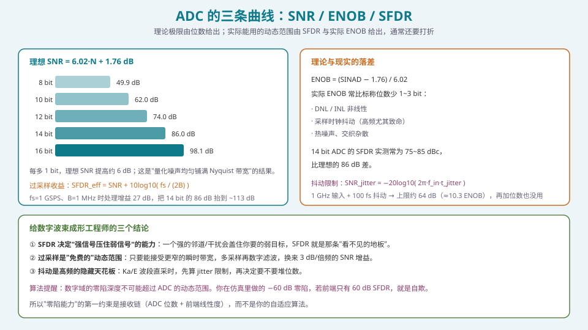
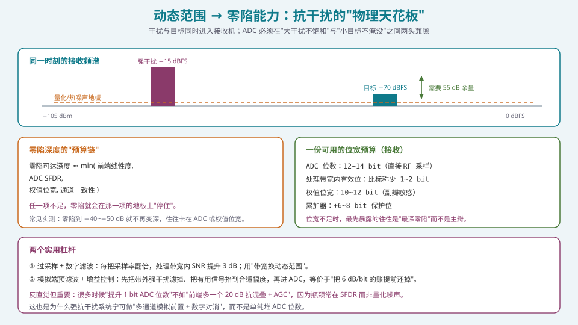
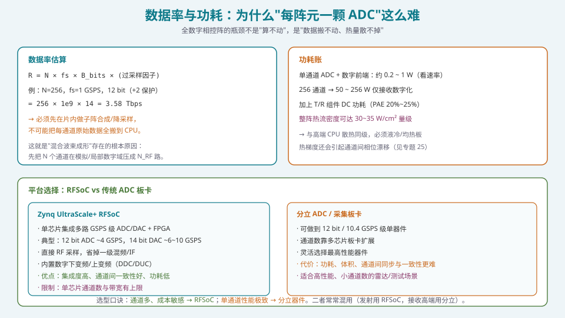

## 本篇要解决什么

前面几篇把"射频链"讲完了。现在到了射频与数字的**边界**：**ADC/DAC**。

数字波束成形（DBF）的所有好处——任意权值、多波束、自适应零陷——都建立在一个前提上：**信号被忠实地数字化了**。而这个前提的代价，就是这一篇的主题。

三个问题：

1. **位宽买到了多少动态范围？** 公式是什么、真实能用的又是多少？
2. **动态范围与"零陷能力"是什么关系？** 为什么说 ADC 是抗干扰的天花板？
3. **为什么要"每阵元一颗 ADC"这么难？** 数据率与功耗账怎么算？

---

## 一、从模拟到数字：ADC 在相控阵里的位置

在 [四种架构的选型](pa-architecture-selection.html) 里，ADC/DAC 的数量直接定义了架构：

| 架构 | ADC/DAC 数量 | 数字化位置 |
| --- | --- | --- |
| PESA | 1 套 | 整阵共用 |
| AESA | 1 套（模拟移相） | 整阵共用 |
| 混合 | N_RF 套 | 子阵级 |
| 全数字 | N 套 | **每阵元** |

**"每阵元一颗 ADC"** 是 DBF 的定义，也是所有困难的来源。这一篇要把这个"困难"量化。

---

## 二、位宽买到了什么：SNR、ENOB、SFDR



*图 1：理论极限由位数给出；实际能用的动态范围由 SFDR 与实际 ENOB 给出，通常还要打折。*

### 2.1 理想 SNR

对满量程正弦输入，理想 N bit ADC 在 Nyquist 带宽内的信噪比：

\[
\boxed{\;\mathrm{SNR}_{max}=6.02N+1.76\ \text{dB}\;}
\]

| N (bit) | 8 | 10 | 12 | 14 | 16 |
| --- | --- | --- | --- | --- | --- |
| 理想 SNR (dB) | 49.9 | 62.0 | 74.0 | 86.0 | 98.1 |

**这就是"每多 1 bit 约多 6 dB"的来源**，它假设量化噪声**均匀铺满 Nyquist 带宽**。

### 2.2 过采样：用带宽换动态范围

如果处理带宽 B 只是采样率 \(f_s\) 的一小部分，量化噪声被"挤"到更宽的频谱里，数字滤波后处理带宽内的噪声更低：

\[
\boxed{\;\mathrm{SFDR}_{eff}=\mathrm{SNR}_{max}+10\log_{10}\!\left(\frac{f_s}{2B}\right)\;}
\]

**例**：\(f_s=1\) GSPS、B=1 MHz ⇒ 处理增益 \(10\log_{10}(500)=27\) dB。14 bit 的 86 dB 可被抬到 **~113 dB**。

> **这就是"过采样是免费的动态范围"的定量含义**：每把采样率翻倍（相对带宽减半），SNR 提升 **3 dB**。代价是更窄的瞬时带宽与更多的算力。

### 2.3 ENOB 与 SFDR：理论与现实的落差

实际的 ADC 达不到理想 SNR：

- **DNL/INL 非线性**：产生谐波与杂散；
- **采样时钟抖动（jitter）**：高频下致命，\(\mathrm{SNR}_{jitter}=-20\log_{10}(2\pi f_{in}t_{jitter})\)；
- **热噪声、交织杂散**（interleaved ADC 的 offset/gain 失配）。

定义：

\[
\mathrm{ENOB}=\frac{\mathrm{SINAD}-1.76}{6.02}
\]

实际 ENOB 常比标称位数**少 1~3 bit**。而 **SFDR**（无杂散动态范围，最大杂散相对基波的比值）往往比 SNR 更关键：

> **14 bit ADC 的实测 SFDR 常在 75~85 dBc**，低于理想的 86 dB。因为 SFDR 由**非线性杂散**（而不是量化噪声）决定，而杂散比"均匀噪声"更难对付。

**抖动限制的算例**：\(f_{in}=1\) GHz、\(t_{jitter}=100\) fs ⇒ \(\mathrm{SNR}_{jitter}\approx64\) dB（约 10.3 ENOB）。**此时再加位数毫无意义**——天花板在时钟上。

---

## 三、动态范围 → 零陷能力：抗干扰的物理天花板



*图 2：干扰与目标同时进入接收机；ADC 必须在"大干扰不饱和"与"小目标不淹没"之间两头兼顾。*

### 3.1 零陷是"数字域的事"，但天花板在模拟域

自适应零陷（MVDR/LCMV，见 [自适应波束形成](pa-adaptive-mvdr-lcmv.html)）在数学上可以做到 −80 dB、−100 dB 的零陷深度。但**实测往往到 −40~−50 dB 就"停住"了**。原因：

\[
\boxed{\;\text{可达零陷深度}\approx\min(\text{前端线性度},\ \text{ADC SFDR},\ \text{权值位宽},\ \text{通道一致性})\;}
\]

**任一项不足，零陷就会在那一项的地板上"停住"。** 这是"仿真里能写 −60 dB 零陷，硬件上做不到"的根本原因。

### 3.2 一个接收场景的账

同一条链路里可能同时存在：

- **强干扰**：−15 dBFS（接近满量程，若再强就**饱和/削顶**）；
- **弱目标**：−70 dBFS（比干扰低 55 dB）。

**两头都要兼顾**：
- 若为不饱和而降增益 ⇒ 弱目标掉到噪声地板以下；
- 若为弱目标抬增益 ⇒ 强干扰把 ADC 推过满量程，产生**互调与杂散**，反而污染整个频段。

**所以 ADC 动态范围（尤其 SFDR）+ 前端 AGC + 抗混叠滤波** 是抗干扰系统的"三件套"。**算法能做的，是在这个物理边界内把零陷做到最好，而不是突破它。**

### 3.3 权值位宽也是天花板的一部分

即使 ADC 是 14 bit，若你的**权值只有 8 bit**，副瓣与零陷也会被权值量化限制（见 [定点化](pa-fixed-point-quantization.html)）。经验起点：

| 环节 | 经验位宽 |
| --- | --- |
| ADC 数据 | 12~14 bit |
| 处理带宽内有效位 | 比标称少 1~2 bit |
| 权值 | 10~12 bit |
| 累加保护位 | +6~8 bit |

**位宽不足时，最先暴露的往往是"最深零陷"，而不是主瓣**——因为零陷对相位/幅度误差的敏感度远高于主瓣。

---

## 四、为什么"每阵元一颗 ADC"这么难



*图 3：全数字相控阵的瓶颈不是"算不动"，是"数据搬不动、热量散不掉"。*

### 4.1 数据率

\[
R=N\times f_s\times B_{bits}\times(\text{过采样因子})
\]

**例**：N=256、\(f_s=1\) GSPS、12 bit（+2 保护位 = 14 bit）：

\[
R=256\times1\times10^9\times14=3.58\ \text{Tbps}
\]

**这个数据率不可能全搬到 CPU**。所以数字阵必须：

1. **片内先做子阵合成/降采样（DDC）**，把每通道的原始数据压成"波束级"或"子阵级"；
2. 把"逐采样复数乘加"放在 **FPGA 数据面**，而不是 CPU（见 [FPGA/HLS 实现](pa-fpga-hls-implementation.html)）。

> **这就是"混合波束成形"存在的根本原因**：先把 N 个通道在模拟/局部数字域压成 \(N_{RF}\) 路，数据率立刻降一个量级。

### 4.2 功耗与热

- 单通道 ADC + 数字前端：约 **0.2~1 W**（看速率）；
- 256 通道 ⇒ **50~256 W**，仅接收数字化；
- 加上 T/R 组件的 DC 功耗（PAE 20%~25%，见 [T/R 组件](pa-tr-module-rf-frontend.html)）；
- 整阵热流密度可达 **30~35 W/cm² 量级**——与高端 CPU 同级，必须液冷/均热板。

**更麻烦的是热 → 相位**：温度梯度会引起通道间相位漂移（PA 增益约 **0.02 dB/℃**，相位漂移更直接）。**热设计不是机械部门的活，它直接决定波束的稳定性**（见 [通道误差](pa-channel-error-impact.html)）。

### 4.3 平台选择：RFSoC vs 分立 ADC

| 维度 | Zynq UltraScale+ RFSoC | 分立 ADC / 采集板卡 |
| --- | --- | --- |
| 集成度 | 单芯片集成多路 GSPS ADC/DAC + FPGA | 多芯片板卡 |
| 典型规格 | 12 bit ADC ~4 GSPS；14 bit DAC ~6~10 GSPS | 12 bit / 10.4 GSPS 级单器件 |
| 采样方式 | 直接 RF 采样，省一级混频/IF | 可直采或中频采样 |
| 数字处理 | 内置 DDC/DUC | 需外接 FPGA/ASIC |
| 通道一致性 | 好（同片、同工艺） | 需仔细同步与校准 |
| 优势 | 集成度高、功耗低、体积小 | 单通道性能极限 |
| 限制 | 单芯片通道数与带宽有上限 | 功耗、体积、同步难度 |

**选型口诀**：**通道多、成本敏感 → RFSoC；单通道性能极致 → 分立器件**。实际系统常常混用（发射用 RFSoC，接收高端用分立）。

---

## 五、DAC 侧：发射的数字到模拟

DAC 与 ADC 镜像对称，但有几个发射特有的点：

1. **位宽与量化噪声**：DAC 的量化噪声会直接进入发射频谱，影响 **EVM 与 ACLR**；高阶调制（256-QAM）对 DAC 位宽与线性度要求更高；
2. **采样率与镜像**：需要足够的采样率 + 模拟滤波抑制镜像（image）；直接 RF 合成（RF-DAC）可以省掉上变频，但对 DAC 的动态范围与线性度要求极高；
3. **DPD 的算力**：数字预失真（DPD）要在**每个通道**做，是 FPGA 里最重的运算之一（见 [FPGA/HLS 实现](pa-fpga-hls-implementation.html)）；
4. **发射的多通道一致性**：每通道 DAC 的 gain/offset/skew 失配会产生**空间杂散**（在某个角度形成虚假波束），这在阵列里比单链更危险。

> **对算法工程师的落点**：发射侧的"数字自由度"受 DAC 动态范围与 DPD 算力限制；接收侧的"零陷能力"受 ADC 动态范围限制。**两端都要在预算表里写清"数字域能发挥到什么程度"。**

---

## 六、代码：位宽与动态范围预算

### 6.1 从需求反推位宽

```python
import numpy as np

def required_adc_bits(signal_bw_hz, fs_hz, req_sfdr_db,
                      jitter_fs=100e-15, f_in_hz=1e9, margin_db=3.0):
    """从"处理带宽内需要的 SFDR"反推标称位数（含过采样与抖动上限）。"""
    proc_gain = 10*np.log10(fs_hz / (2*signal_bw_hz))     # 过采样处理增益
    snr_needed = req_sfdr_db - proc_gain + margin_db       # 需要的 Nyquist 内 SNR
    n_bits = (snr_needed - 1.76) / 6.02
    # 抖动天花板
    snr_jitter = -20*np.log10(2*np.pi*f_in_hz*jitter_fs)
    return np.ceil(n_bits), snr_jitter

n, sj = required_adc_bits(1e6, 1e9, 100.0)
print(f"建议标称位数 ≈ {n:.0f} bit；抖动上限 SNR = {sj:.1f} dB")
```

### 6.2 数据率与功耗估算

```python
def dbf_data_rate_gbps(N, fs_hz, bits, oversample=1):
    return N * fs_hz * bits * oversample / 1e9

print(round(dbf_data_rate_gbps(256, 1e9, 14), 1), "Gbps")   # 3584.0 Gbps

def array_rx_power_W(N, w_per_ch, pae_pct=None, p_rf_per_ch_w=None, duty=1.0):
    p_adc = N * w_per_ch
    p_tx = 0.0
    if pae_pct and p_rf_per_ch_w:
        p_dc = N * p_rf_per_ch_w / (pae_pct/100.0)
        p_tx = (p_dc - N*p_rf_per_ch_w) * duty     # 发热
    return p_adc, p_tx
```

### 6.3 零陷天花板检查

```python
def null_floor_db(adc_sfdr_db, weight_bits, channel_consistency_db, fe_linearity_db):
    """零陷深度的实际天花板（取最弱环节）。"""
    weight_limit = 6.02*weight_bits - 1.76      # 权值量化的近似极限
    return -min(adc_sfdr_db, weight_limit,
                channel_consistency_db, fe_linearity_db)

print(null_floor_db(80, 12, 45, 70), "dB")   # ≈ -45 dB（受通道一致性限制）
```

**读法**：如果通道一致性只有 45 dB，那你把 ADC 换成 16 bit 也没用——**零陷依然停在 −45 dB**。**先补最弱的那一环。**

---

## 七、常见误区清单

**误区一：以为"位宽越高，性能越好"，线性外推。**
实际受 SFDR、抖动、非线性限制。**1 GHz 输入 + 100 fs 抖动 ⇒ 上限约 64 dB（10.3 ENOB）**，再多位数也无用。

**误区二：把 SNR 当动态范围。**
SNR 是"噪声"，SFDR 是"最坏杂散"。抗干扰看的是 **SFDR**——一个强干扰产生的杂散可能比噪声地板高得多。

**误区三：以为零陷深度由算法决定。**
零陷天花板是 **min(前端线性度, ADC SFDR, 权值位宽, 通道一致性)**。算法只能逼近这个边界。

**误区四：忽略过采样的价值。**
只要瞬时带宽不是硬约束，过采样 + 数字滤波是**最便宜**的动态范围来源（3 dB/倍频）。

**误区五：以为"全数字就是每路都全速采、全速传"。**
数据率 3.5 Tbps 级，必须**片内降维**。全数字的工程实现是"每通道 ADC + 片内 DDC + 子阵合成"，不是"把原始采样全搬走"。

**误区六：忽略热对相位的影响。**
PA 增益约 0.02 dB/℃、相位漂移更直接。**热梯度 = 通道相位误差 = 副瓣抬升 + 零陷变浅**。这是"算法不稳定"的隐藏原因。

**误区七：DAC 侧只关注"能合成信号"，不关注量化噪声与镜像。**
DAC 量化噪声直接进发射频谱，影响 EVM/ACLR；镜像抑制不够则污染邻道。高阶调制系统必须一并预算。

**误区八：认为"数字化之后就不受模拟影响"。**
数字域的一切都建立在"ADC 之前那个模拟信号"上。**前端线性度、AGC、抗混叠滤波的不足，数字域无法补救。**

**误区九：以为"位宽不足只会影响主瓣"。**
最先、最明显暴露的往往是**最深零陷与副瓣**，因为二者对误差的敏感度高一个量级。

---

## 八、快速自测

**Q1.** 一个 14 bit ADC，\(f_s=1\) GSPS，处理带宽 2 MHz。求：(a) 理想 SNR；(b) 过采样带来的处理增益；(c) 处理带宽内的有效 SFDR；(d) 若实测 SFDR 只有 78 dBc，结论如何？

<details><summary>参考要点</summary>

(a) \(\mathrm{SNR}=6.02\times14+1.76=86.0\ \text{dB}\)。

(b) 处理增益 \(=10\log_{10}(f_s/(2B))=10\log_{10}(1000/4)=10\log_{10}(250)=23.98\ \text{dB}\)。

(c) 理想有效 SFDR \(=86.0+23.98=109.98\ \text{dB}\)。

(d) **实测 SFDR 78 dBc 是"Nyquist 内"的指标**。若这个 78 dBc 是宽带 SFDR，则处理带宽内的有效动态范围约为 \(78+23.98=101.98\ \text{dB}\)——但**杂散不一定是白噪声**，窄带杂散不会因过采样而改善。**正确做法**：查 ADC 在**目标频点与带宽**下的实测 SFDR 曲线，而不是简单外推。

**结论**：处理增益对"白噪声型"量化噪声有效；对"确定性杂散"要单独看。**这就是 SFDR 比 SNR 更值得关心的原因。**

</details>

**Q2.** 为什么说"零陷深度不可能超过 ADC 动态范围"？请从信号流角度解释。

<details><summary>参考要点</summary>

**信号流**：干扰 + 目标 → 天线 → LNA → 混频/滤波 → **ADC** → 数字权值 → 输出。

**关键**：零陷是"在数字域对干扰方向的响应置零"。但数字域只能操作**已经被 ADC 采样并量化的信号**。若：

1. **ADC 饱和/削顶**：强干扰被削顶，产生大量谐波与互调——这些杂散**不是原信号的线性成分**，无法被线性权值抵消；削顶还把干扰"扩散"到其他方向（空间上是全方位的），零陷无能为力；
2. **量化/杂散**：干扰在 ADC 里产生杂散分量。权值可以在干扰方向置零，但**杂散已经"跑到别的角度"**了；
3. **权值精度**：若权值位数不够，零陷本身做不到很深（见 [定点化](pa-fixed-point-quantization.html)）；
4. **通道一致性**：各通道的幅相误差让"理想零点"在合成后变成"浅坑"。

**所以**：零陷的实际深度被这些环节中**最弱的那个**限制。**算法能做的，是让数字域尽量逼近这个边界，而不是突破它。**

**工程含义**：要更深的零陷，必须先问"瓶颈在哪一环"——可能是 ADC、可能是权值位宽、可能是通道一致性，**通常不是算法**。

</details>

**Q3.** 计算 512 元全数字阵（每阵元一颗 12 bit ADC、\(f_s=2\) GSPS）的原始数据率；如果只想把"128 个波束的输出"传给主控，数据率降到多少？

<details><summary>参考要点</summary>

**原始数据率**：
\(R=512\times2\times10^9\times12=1.229\times10^{13}\ \text{bps}=12.29\ \text{Tbps}\)。

**若片内先做 128 个波束合成**，每个波束输出带宽按 100 MHz、16 bit 复采样（I/Q）估：
\(R'=128\times100\times10^6\times16\times2\ (\text{I 与 Q})=4.1\times10^{11}=409.6\ \text{Gbps}\)。

**降幅约 30 倍**。

**结论**：
1. **"全数字"不等于"把原始数据全部送走"**。片内必须是"逐采样复数乘加 → 波束级输出"；
2. 这就是为什么数字阵的算力集中在 FPGA（数据面），而 CPU 只做控制面；
3. 越靠"波段级"输出，越需要高带宽接口（如 100G 以太网、Aurora、JESD204B/C）。

</details>

**Q4.** 一个系统的"零陷指标"是 −60 dB，但实测只到 −42 dB。请列出至少四个可能原因，并给出排查顺序。

<details><summary>参考要点</summary>

**可能原因**（对应本篇的"零陷天花板"四项 + 一项）：

1. **ADC 动态范围/SFDR 不足**：强干扰在 ADC 产生杂散，无法被线性权值抵消；
2. **权值位宽不足**：权值量化误差限制零陷（10~12 bit 常见，12 bit 的理论极限约 −70 dB，若只有 8 bit 约 −47 dB）；
3. **通道幅相一致性不足**：各通道误差让零点"填浅"；
4. **前端线性度不足**：LNA/混频器在强干扰下产生 IM3，干扰"再生"到别的方向；
5. **零陷展宽/稳健性不足**：干扰方向快变、或者用了对角加载过多导致零陷变浅（见 [零陷展宽与稳健波束形成](pa-null-broadening-robust.html)）；
6. **自适应算法本身的问题**：快拍数不足、协方差估计有偏、目标信号自零陷。

**排查顺序（从"物理边界"往"算法"排）**：
1. **先测 ADC 在你工作点下的实际 SFDR 与杂散**（用单音/双音）；
2. **再测通道一致性**（幅相误差 RMS）——这常常是真凶；
3. **再做定点仿真**，把权值量化到硬件位宽，看零陷退化多少；
4. **最后检查算法**：对角加载量、快拍数、是否有相干源、是否用频率平滑。

**经验**：多数"零陷不够深"的问题，前两步就能定位，**算法往往不是主因。**

</details>

**Q5.** 为什么"过采样能提供 3 dB/倍频"的增益？边界在哪里？

<details><summary>参考要点</summary>

**原理**：理想量化噪声的总功率固定（\(\Delta^2/12\)，\(\Delta\) = LSB），但它**均匀分布在 0 ~ \(f_s/2\)** 的整个 Nyquist 区间。处理带宽 B 内的噪声功率正比于 \(B/(f_s/2)\)。

采样率翻倍 ⇒ 噪声功率**密度**减半 ⇒ 处理带宽内噪声功率减半 ⇒ SNR 提升 **3 dB**。等价地：\(10\log_{10}(f_s/(2B))\) 的处理增益。

**边界（什么时候不成立）**：
1. **杂散不是白的**：确定性谐波/杂散（HD2、HD3、交织杂散）不会因过采样而降低，落在带内的照样在带内；
2. **热噪声与抖动噪声**：它们是模拟域引入的，不服从"量化噪声"的扩散规律（热噪声也有一定谱形，抖动噪声在高频更强）；
3. **ADC 本身的带宽限制**：高速采样时前端带宽有限，无法真正"过采样"到想要的倍数；
4. **功耗与算力代价**：翻倍采样率意味着翻倍的 ADC 功耗与后续数字算力；
5. **强信号会填满动态范围**：如果强干扰占据带内，过采样降的是"平均噪声"，而**干扰引起的杂散与饱和问题依然存在**。

**结论**：过采样是"对抗量化噪声"的利器，但**不是"对抗杂散与饱和"的利器**。抗干扰系统要同时用前端滤波 + AGC + 高 SFDR 器件。

</details>

**Q6.** 为什么"混合波束成形"可以显著降低数据率？它与 ADC 数量的关系是什么？

<details><summary>参考要点</summary>

**关系**：混合波束成形的定义就是"**ADC/DAC 数量 \(N_{RF}\) < 阵元数 N**"。子阵内的 N/N_RF 个阵元先用**模拟移相器**在射频域合成，再进 ADC。

**数据率**：
- 全数字：\(R\propto N\times f_s\times B_{bits}\)；
- 混合：\(R\propto N_{RF}\times f_s\times B_{bits}\)；
- 若压缩比 \(N/N_{RF}=8\)，数据率降 **8 倍**。

**收益**：
1. ADC 数量、功耗、体积、成本按压缩比下降；
2. 数据率按压缩比下降，后端算力压力缓解。

**代价**：
1. **波束数受限**（≈ \(N_{RF}\)）；
2. **零陷自由度受限**：自由度只有 \(N_{RF}\)，能同时置零的干扰数 ≤ \(N_{RF}-1\)，且是"子阵级"的粗零陷；
3. **子阵栅瓣**：子阵等效间距 = 子阵尺寸 × d，可能 > λ/2，引入栅瓣（见 [混合波束成形的子阵设计](pa-hybrid-beamforming.html)）；
4. **宽带斜视**：子阵内是模拟移相，宽带下仍会斜视（子阵越大越严重）。

**一句话**：混合架构是"用数字自由度换数据率与成本"的折中，**它是工程落地的常态，而全数字是方向。**

</details>

**Q7.** 发射侧的 DAC 位宽怎么定？与接收侧 ADC 位宽的选择逻辑有何不同？

<details><summary>参考要点</summary>

**相同点**：都受"量化噪声 + 非线性 + 时钟抖动"限制，都有"6 dB/bit"的理想定律，都可借助过采样。

**不同点**：

| | 接收 ADC | 发射 DAC |
| --- | --- | --- |
| 关键指标 | **SFDR**（抗强干扰杂散） | **EVM / ACLR**（调制质量） |
| 动态范围诉求 | 同时容纳强干扰与弱目标 | 合成高峰均比（PAPR）信号不失真 |
| 主要失真 | 谐波、互调、抖动 | 量化噪声、镜像、DAC 非线性 |
| 相关补偿 | AGC、抗混叠滤波 | **DPD（数字预失真）** |
| 结构相关 | 每个数字接收通道一颗 | 每个发射通道一颗；DPD 需额外算力 |

**发射侧选择逻辑**：
1. 从**调制阶数与 EVM 要求**反推（256-QAM 需 EVM < 3.5%）；
2. 考虑 **PAPR**：OFDM 类信号 PAPR 可达 8~10 dB，DAC 必须有足够余量；
3. 预算 **DPD 的算力**：每个发射通道的 DPD 是 FPGA 里最重的运算之一；
4. 考虑**阵列级一致性**：多通道 DAC 的 gain/offset/skew 失配会产生"空间杂散"，比单链更危险。

**共性结论**：**数字域的能力上限，由"量化环节（ADC/DAC）+ 一致性 + 算力"共同决定**，三者缺一不可。

</details>

**Q8.** 一个 256 元阵，每通道 ADC 功耗 0.5 W，每通道发射 RF 输出 0.3 W、PAE 22%。求接收数字化的总功耗、发射侧的平均发热（100% 占空比），并给出热流密度量级（假设阵面 10 cm × 10 cm）。

<details><summary>参考要点</summary>

**接收数字化**：\(P_{ADC}=256\times0.5=128\ \text{W}\)。

**发射侧**：单通道 \(P_{DC}=0.3/0.22=1.364\ \text{W}\)，发热 \(P_{heat}=1.364-0.3=1.064\ \text{W}\)。256 通道 ⇒ \(P_{heat,total}=272.4\ \text{W}\)。

**总热负荷（接收 + 发射发热）** ≈ \(128+272=400\ \text{W}\)。

**热流密度**：阵面 \(10\times10=100\ \text{cm}^2\) ⇒ \(400/100=4\ \text{W/cm}^2\)。

> 注意：若按**脉冲工作**（如 20% 占空比），发射发热摊薄到 54.5 W，但**瞬态峰值热流**仍需按脉冲内考虑；而接收数字化功耗是**连续的**。

**若阵面缩小到 85 mm × 85 mm = 72.25 cm²**（密排毫米波阵），同样的热负荷对应 **5.5 W/cm²**；若进一步集成（如 256 元在 6 cm × 6 cm），可达 **11 W/cm²**。

**工程含义**：
1. 必须用**液冷/均热板/铜钼热扩散**；
2. 热梯度会引起**通道相位漂移**，需要温度补偿表（三维补偿表的温度维，见 [校准工程化](pa-calibration-engineering.html)）；
3. 这就是"全数字的代价"——不只是芯片钱，还有整个热管理链条。

</details>

---

## 九、与本站其它专题的连接

| 想了解 | 看哪篇 |
| --- | --- |
| ADC 数量如何定义架构 | [四种架构的选型：PESA / AESA / 混合 / 全数字](pa-architecture-selection.html) |
| 混合架构的压缩比与子阵设计 | [混合波束成形（HBF）的子阵设计](pa-hybrid-beamforming.html) |
| 权值位宽不足如何抬高副瓣与填浅零陷 | [定点化：从浮点仿真到硬件指标不退化](pa-fixed-point-quantization.html) |
| 波束成形的算力如何落到 FPGA | [FPGA/HLS 实现：数据面与控制面的分工](pa-fpga-hls-implementation.html) |
| 自适应零陷的算法与天花板 | [自适应波束形成：MVDR 与 LCMV](pa-adaptive-mvdr-lcmv.html) |
| 零陷展宽与稳健性 | [零陷展宽、宽带与稳健波束形成](pa-null-broadening-robust.html) |
| T/R 组件功耗与热 | [T/R 组件与射频前端：一份手册怎么读](pa-tr-module-rf-frontend.html) |
| 通道误差如何限制零陷 | [通道误差的来源与影响](pa-channel-error-impact.html) |
| 温度补偿表怎么设计 | [校准工程化：流程、补偿表与验收](pa-calibration-engineering.html) |
| 相控阵的物理机制与架构 | [卫星相控阵天线：从阵元到波束](satellite-phased-array.html) |
| 学习体系全貌 | [相控阵天线学习体系：六阶段路线图](phased-array-roadmap.html) |

---

## 十、延伸阅读

**厂商文档（最重要）**
- Xilinx/AMD, **WP509《Understanding Key Parameters for RF-Sampling Data Converters》**。SNR、SFDR、SNDR、ENOB 的定义与 RFSoC 实测（本文 §2 的定义与数值来源）。
- Xilinx/AMD Zynq UltraScale+ **RFSoC** 数据手册：RF-ADC/RF-DAC 的位数、采样率、DDC/DUC 资源。
- TI / ADI（Analog Devices）高速 ADC 数据手册：ADC12DJ5200RF（12 bit / 10.4 GSPS）、AD9213（12 bit / 10.25 GSPS）等。
- 关于 RFSoC 数据转换器的独立表征：*Characterising the Performance of High-Speed Data Converters for RFSoC-based Radio Astronomy Receivers*（arXiv:2011.05691），给出了 ZU28DR 的 SFDR/SINAD/ENOB 实测与长时间稳定性。

**教材**
- Van Trees, *Optimum Array Processing*。动态范围、量化对自适应处理的影响。
- Analog Devices, *Data Conversion Handbook*。ADC/DAC 指标体系的权威教材。
- Walt Kester 的 ADC 应用笔记（*Understand SINAD, ENOB, SNR, THD, THD+N, and SFDR*）——入门最清晰的一篇。

**相关工程主题**
- 关于"数字阵的功耗与热"：相控阵封装/热管理综述与厂商白皮书。
- 关于 DPD：Morgan et al., "A Generalized Memory Polynomial Model for Digital Predistortion," *IEEE Trans. Signal Processing*, 2006。
- 关于数字阵的数据率与接口：JESD204B/C 接口规范与板级设计指南。
