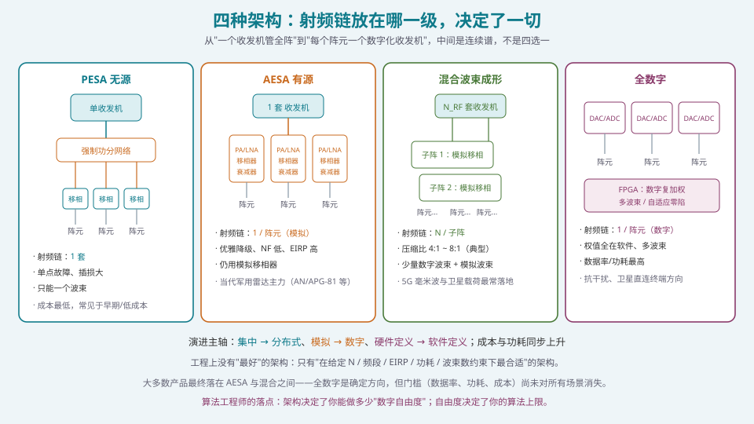
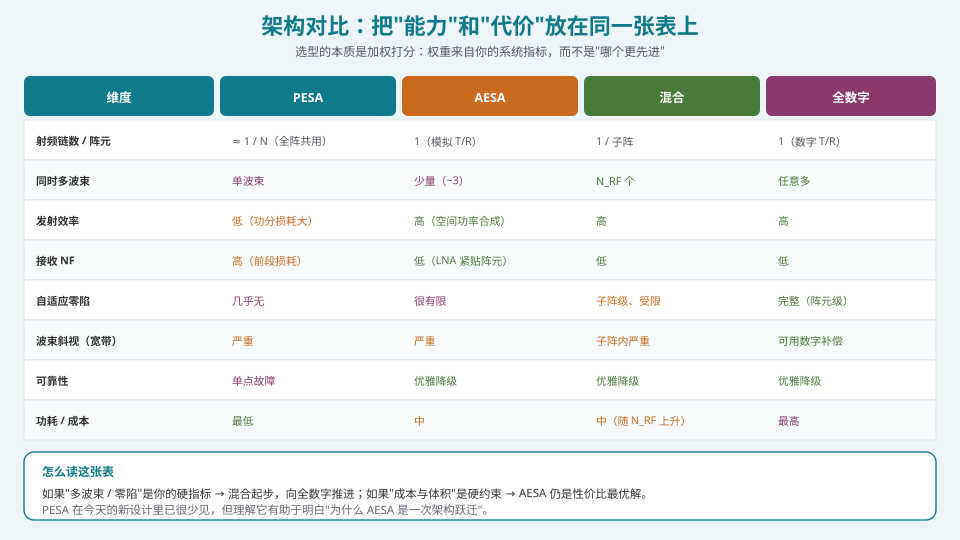
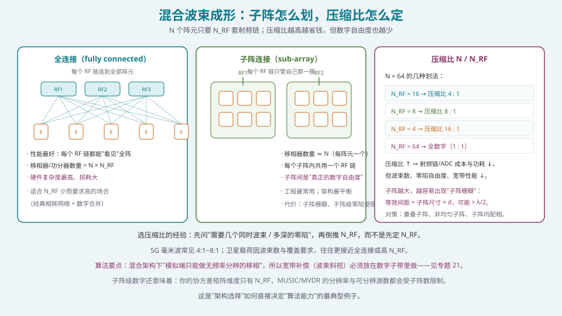

## 本篇要解决什么

这是 S3 的收尾篇。前四篇分别讲了 [T/R 组件](pa-tr-module-rf-frontend.html)、[移相器与 TTD](pa-phase-shifter-ttd.html)、[馈电网络与互耦](pa-feed-network-mutual-coupling.html)、[ADC/DAC](pa-adc-dac-dynamic-range.html)——都是"零件"。

这一篇把它们**组装**起来，回答系统设计里最贵的一个决策：

**射频链放在哪一级？**

这个决策一旦定下，就同时锁死了：

- **能力**（能做几个波束、零陷有多深、宽带能不能不斜视）；
- **代价**（射频链数量、功耗、热、成本、体积）；
- **你的算法能玩什么**（数字自由度 = 算法上限）。

---

## 一、四种架构



*图 1：从"一个收发机管全阵"到"每个阵元一个数字化收发机"，中间是连续谱，不是四选一。*

### 1.1 PESA：无源电子扫描阵

**一个高功率中央收发机** → 强制功分网络 → 每阵元的**移相器**（历史上多为铁氧体）→ 阵元。

- **射频链：1 套**；
- 优点：架构简单、成本低、单一高功放技术成熟；
- 缺点：**单点故障**（功放一挂，全阵瘫痪）；**功分网络插损大**，直接恶化发射效率与接收 NF；**只能一个波束**；多模式/多功能只能分时共享孔径。

> PESA 在 20 世纪 80 年代就成熟了（舰载/中型飞机雷达）。**理解它不是因为它还在用，而是因为"为什么 AESA 是一次架构跃迁"，必须在对比中才看得清。**

### 1.2 AESA：有源电子扫描阵

**每个阵元一个 T/R 组件**（PA + LNA + 移相器 + 衰减器 + 开关），但仍用**模拟移相器**。

- **射频链：1 / 阵元，但仅"模拟"**；
- 关键优势：
  1. **空间功率合成**：各单元 PA 的功率在空间叠加，总 EIRP 远超单个高功放的能力；
  2. **接收 NF 低**：LNA 紧贴阵元，比 PESA 通常低 **5 dB 以上**；
  3. **优雅降级**：单元级冗余，部分组件失效不影响整体；
  4. **快捷变**：可做频率捷变、多模式（受限于模拟波束成形，同时波束数约 3 个量级）。

**当代军用雷达的主力**（AN/APG-81、AN/APG-83、AN/SPY-6 等）；单 T/R 组件成本约 100~500 美元（看频段/功率/批量）。

### 1.3 混合波束成形（HBF）

**把整阵分成子阵**：子阵内用模拟移相器（像 AESA），**每个子阵接一套数字收发机**。

- **射频链：\(N_{RF}\) 套，\(N_{RF}<N\)**；
- 能力：**\(N_{RF}\) 个同时数字波束**，子阵级的粗零陷，比 AESA 强的灵活性；
- 代价：比全数字低得多的数据率、功耗与成本。

**这是 5G 毫米波大规模 MIMO 与卫星载荷最常落地的形态**（如 16T16R 到 64T64R 的 Massive MIMO 产品）。

### 1.4 全数字（DBF）

**每个阵元一个完整数字收发机**（ADC/DAC + 数字处理）。

- **射频链：1 / 阵元，数字域**；
- 能力：权值全在软件；**任意多同时波束**；**完整自适应零陷**；宽带可用数字补偿斜视（[波束斜视与宽带相控阵](pa-beam-squint-wideband.html)）；
- 代价：**数据率（256 通道可达 Tbps 级）、功耗、成本最高**（见 [ADC/DAC](pa-adc-dac-dynamic-range.html)）。

**数字波束成形是"软件定义传感器"的终极形态**，也是低轨手机直连卫星等场景的确定性方向。2024 年已有 DBF 相控阵原型演示**同时支持 8 路卫星连接**（对比传统抛物面天线只能连一颗）。

---

## 二、对比表：把能力和代价放在同一页



*图 2：选型的本质是加权打分：权重来自你的系统指标，而不是"哪个更先进"。*

| 维度 | PESA | AESA | 混合 | 全数字 |
| --- | --- | --- | --- | --- |
| 射频链 / 阵元 | ≈ 1/N（全阵共用） | 1（模拟 T/R） | 1/子阵 | 1（数字 T/R） |
| 同时多波束 | 单波束 | 少量（~3） | \(N_{RF}\) 个 | 任意多 |
| 发射效率 | 低（功分损耗大） | 高（空间功率合成） | 高 | 高 |
| 接收 NF | 高（前段损耗） | 低（LNA 紧贴阵元） | 低 | 低 |
| 自适应零陷 | 几乎无 | 很有限 | 子阵级、受限 | 完整（阵元级） |
| 波束斜视（宽带） | 严重 | 严重 | 子阵内严重 | 可用数字补偿 |
| 可靠性 | 单点故障 | 优雅降级 | 优雅降级 | 优雅降级 |
| 功耗 / 成本 | 最低 | 中 | 中（随 \(N_{RF}\) 上升） | 最高 |

### 2.1 怎么读这张表

1. **如果"多波束 / 零陷"是硬指标** ⇒ 混合起步，向全数字推进；
2. **如果"成本与体积"是硬约束** ⇒ AESA 仍是性价比最优解；
3. **PESA 在新设计里已很少见**，但它是理解"架构跃迁"的参照物。

### 2.2 别忘了"软件相关度"（对算法工程师最关键的列）

| 架构 | 你能拿到的数字自由度 | 算法上限 |
| --- | --- | --- |
| PESA | ≈ 0（只有配相表） | 只能做扫描与固定加权 |
| AESA | ≈ 0（模拟移相/衰减） | 配相 + 加窗 + 波束切换 |
| 混合 | \(N_{RF}\) | 少量同时波束、子阵级 MVDR/DOA |
| 全数字 | \(N\) | 完整 MVDR/MUSIC、任意多波束、阵元级零陷 |

**这就是 S4/S5 能讲多深的前提**：没有数字自由度，后面那些算法根本无处施展。

---

## 三、混合波束成形：子阵怎么划、压缩比怎么定



*图 3：N 个阵元只要 N_RF 套射频链；压缩比越高越省钱，但数字自由度也越少。*

### 3.1 三种连接拓扑

| 拓扑 | 结构 | 每条 RF 链连接 | 优点 | 缺点 |
| --- | --- | --- | --- | --- |
| **全连接** fully connected | 每条 RF 链经功分器连到**所有**阵元 | 全部 N 个 | 性能最好（每链都"看得见"全阵） | 移相器数量 = \(N\times N_{RF}\)，复杂、损耗大 |
| **子阵连接** sub-array | 每条 RF 链只管自己那一簇 | 该子阵的 N/N_RF 个 | 移相器数量 ≈ N，最简单 | 子阵栅瓣、零陷受限 |
| **部分连接** partially connected | 每条 RF 链接阵元的一个子集（可重叠） | 部分 N | 折中 | 设计复杂 |

**工程现实**：子阵连接最常用（移相器数量 = N，与阵元数同阶，最经济）。

### 3.2 压缩比 \(N/N_{RF}\)

\[
\text{压缩比}=\frac{N}{N_{RF}}
\]

| 压缩比 | 例子（N=64） | 射频链成本/功耗 | 数字自由度 |
| --- | --- | --- | --- |
| 4 : 1 | \(N_{RF}=16\) | 较高 | 较好 |
| 8 : 1 | \(N_{RF}=8\) | 中 | 一般 |
| 16 : 1 | \(N_{RF}=4\) | 低 | 差 |
| 1 : 1 | \(N_{RF}=64\) | 最高 | 全数字 |

**选法**：**先问"需要几个同时波束 / 多深的零陷"，再倒推 \(N_{RF}\)** —— 而不是先定 \(N_{RF}\) 再想能做什么。

- 5G 毫米波常见 **4:1 ~ 8:1**；
- 卫星载荷因波束数与覆盖要求，往往更接近**全连接或高 \(N_{RF}\)**。

### 3.3 子阵栅瓣：混合架构的"隐形代价"

子阵连接时，子阵的**相位中心间距** = 子阵尺寸 × 阵元间距。若这个等效间距 > λ/2，就会出现**子阵栅瓣**：

\[
d_{sub}= D_{sub}\times d> \frac{\lambda}{2}\;\Rightarrow\;\text{栅瓣}
\]

**对策**：

1. **重叠子阵（overlapped subarrays）**：相邻子阵共享部分阵元，打散周期性；
2. **非均匀子阵划分**：不同子阵大小不同，破坏栅瓣的相干叠加；
3. **子阵内配相**：在子阵内部做相位分布，等效地"填"进阵元级自由度；
4. **降低压缩比**：直接增加 \(N_{RF}\)。

> **权衡的本质**：你在"射频链数量"与"数字自由度"之间交易。**没有免费的压缩。**

---

## 四、场景映射：怎么选

### 4.1 一个简单的决策路径

```text
需要同时多波束 或 自适应零陷？
├─ 不需要 → 频率高/成本敏感？
│            ├─ 是 → AESA（模拟移相，最经济）
│            └─ 否 → AESA 或 PESA（PESA 仅历史/特殊场合）
└─ 需要 → 需要多少波束 / 多深零陷？
         ├─ 少量（≤ N_RF）、子阵级 → 混合波束成形（4:1~8:1）
         └─ 任意多、阵元级 → 全数字 DBF
```

### 4.2 典型场景

| 场景 | 推荐架构 | 理由 |
| --- | --- | --- |
| 机载/舰载雷达 | AESA（模拟） | 成熟、可靠、成本与热可控 |
| 5G 毫米波基站 | 混合（子阵连接） | 成本/功耗/数据率的最佳折中 |
| 卫星通信终端（多星） | 混合 → 全数字 | 需要多个同时波束跟踪多颗星 |
| 电子战 / 强抗干扰 | 全数字 | 需要阵元级自适应零陷 |
| 低轨手机直连卫星 | 全数字 | 多波束 + 波束内多用户 + 宽带 |
| 低成本相控阵 | AESA | 只需扫描与加窗 |

---

## 五、代码：射频链数、功耗与成本估算

### 5.1 从能力需求倒推架构

```python
import numpy as np

def required_n_rf(n_beams, n_null, null_margin=1.0):
    """从"同时波束数"和"需要置零的干扰数"倒推 N_RF。
    自由度：N_RF 个 RF 链最多同时处理约 N_RF 个波束/零陷（含主瓣约束）。"""
    n_from_beams = n_beams
    n_from_nulls = (n_null * null_margin) + 1     # +1 给主瓣约束
    return int(np.ceil(max(n_from_beams, n_from_nulls)))

print(required_n_rf(n_beams=4, n_null=3))   # → 4
```

### 5.2 三种架构的功耗与数据率

```python
def dbf_arch_metrics(N, N_RF, p_adc_w=0.5, p_mod_per_elem_w=1.06,
                     fs_hz=1e9, bits=14, beam_bw_hz=100e6):
    """粗略对比：射频链/ADC 功耗、数据率。"""
    # 全数字：N 颗 ADC；混合：N_RF 颗 ADC
    p_digital = N_RF * p_adc_w
    # T/R 发热：混合/全数字都是每阵元一个 T/R 组件（模拟或数字）
    p_tr_heat = N * p_mod_per_elem_w
    data_raw = N_RF * fs_hz * bits / 1e9          # Gbps（原始）
    data_out = N_RF * beam_bw_hz * 16 * 2 / 1e9   # Gbps（波束级 I/Q）
    return {"P_digital_W": p_digital, "P_TR_heat_W": p_tr_heat,
            "data_raw_Gbps": data_raw, "data_out_Gbps": data_out}

for name, nrf in [("PESA", 1), ("AESA", 1), ("Hybrid(8:1)", 32), ("Digital", 256)]:
    print(name, dbf_arch_metrics(256, nrf))
```

### 5.3 成本的第一近似

```python
def first_order_cost(N, N_RF, c_tr_elem=200.0, c_rf_chain=800.0,
                     c_digital_backend=0.0):
    """成本第一近似：T/R 组件（每阵元）+ 数字射频链（每 N_RF）+ 后端。"""
    return N*c_tr_elem + N_RF*c_rf_chain + c_digital_backend
```

**读法**：成本主要由**阵元数**（T/R 组件）与**射频链数**（ADC/DAC/数字）两项构成。**这就是为什么"降压缩比"能显著降本，也是为什么"位数、架构、N_RF"是连在一起的一盘棋。**

---

## 六、常见误区清单

**误区一：认为"全数字一定最好"。**
能力最好，但代价（数据率、功耗、热、成本）可能让你的系统根本装不下、散不了热、买不起。**工程上没有"最好"，只有"最合适"。**

**误区二：只看"同时波束数"，不看"数据率与热"。**
波束数是能力，数据率与热是"能不能落地"。**很多方案死在热上，不是死在算法上。**

**误区三：把压缩比当成"随便设的参数"。**
压缩比 ↑ ⇒ 射频链成本/功耗 ↓，但**波束数、零陷自由度、宽带性能同步下降**，还会引入子阵栅瓣。这是硬交易。

**误区四：忽略子阵栅瓣。**
子阵等效间距 = 子阵尺寸 × d，很容易就 > λ/2。必须做重叠子阵/非均匀子阵/子阵内配相处理。

**误区五：以为"AESA 和 PESA 只差一个功放的位置"。**
差别是结构性的：**单点故障 vs 优雅降级、功分损耗 vs 空间功率合成、NF 差 5 dB 以上、单波束 vs 多波束**。这是架构跃迁，不是改良。

**误区六：混合架构下还用"全数字的算法复杂度"做设计。**
子阵级数字意味着协方差矩阵维度只有 \(N_{RF}\)：MUSIC 可分辨源数、MVDR 可置零数都受 \(N_{RF}\) 限制（见 [DOA 估计](pa-doa-music-esprit.html)）。**算法必须按实际自由度设计。**

**误区七：忽略"架构决定算法上限"这件事。**
如果你在 AESA 上写 MVDR，那你只是给移相器算了个配相——**这不是自适应波束形成**。**先确认你的架构给了你多少自由度，再决定算法的期望值。**

**误区八：只比较"阵元数"，不比较"有效自由度"。**
两个都是 256 元的阵，全数字有 256 个自由度，8:1 混合只有 32 个。**"同样规模"的性能可以差一个量级。**

**误区九：认为"架构是硬件的事，与我无关"。**
架构直接决定你**能写什么算法、能承诺什么指标**。算法工程师**必须**参与架构评审的早期——这是最容易建立影响力的位置之一。

---

## 七、快速自测

**Q1.** 一个 1024 元阵，要求同时 4 个波束、能对 3 个干扰置零、边缘扫描 60°。请推荐架构并说明理由。若要求改为"同时 64 个波束、阵元级零陷"，架构怎么变？

<details><summary>参考要点</summary>

**场景一（4 波束 + 3 零陷）**：
- 需求波束 4，零陷约需 3 + 1（主瓣约束）= 4 ⇒ \(N_{RF}\ge4\)。取一点余量，\(N_{RF}=8\sim16\)。
- 压缩比 \(N/N_{RF}=1024/16=64:1\) 太大，会引入严重子阵栅瓣与自由度不足。**更好的做法：\(N_{RF}=32\sim64\)（压缩比 16:1~32:1）**，或按"每子阵 16~32 元"划分。
- **推荐：混合波束成形（子阵连接 + 重叠子阵）**，理由：成本/功耗可控，能满足 4 波束与子阵级零陷。

**注意**：60° 边缘扫描 + 子阵栅瓣风险，必须做**重叠子阵**或**子阵内配相**。

**场景二（64 波束 + 阵元级零陷）**：
- 64 个同时波束要求 ≥64 个数字通道；"阵元级零陷"要求自由度接近 N。
- **推荐：全数字（应为 1024 通道，实际可先用 256 通道子阵级 + 数字再合成）**。
- 直接后果：数据率 1024 × 1 GSPS × 14 bit ≈ **14 Tbps 级**，必须片内降维；功耗与热是最大挑战。

**共性结论**：**能力需求（波束数、零陷级）→ \(N_{RF}\) → 架构**，这是一条单向的倒推链。

</details>

**Q2.** 解释为什么"AESA 的接收 NF 比 PESA 低 5 dB 以上"，并说明这 5 dB 在链路预算里意味着什么。

<details><summary>参考要点</summary>

**原因**：PESA 的信号路径是"阵元 → 长馈网（强制功分）→ 中央接收机"。**LNA 前有长馈网插损**（X 波段 2~5 dB，Ka 6~8 dB）。按 Friis，无源插损的噪声因子等于其线性损耗，**这些损耗全部加到整机 NF 上**。

AESA 把低噪声放大器（LNA）**紧贴阵元**，LNA 之前只有开关/限幅（0.3~1 dB），因此整机 NF 显著低。

**5 dB 的含义**（链路预算）：
\[
C/N_0=\text{EIRP}-\text{FSPL}-L_{atm}+G/T+228.6
\]
\(G/T\) 里 \(T_{sys}\) 降低 5 dB（NF 降 5 dB 近似 T_e 降 5 dB）⇒ \(G/T\) 提升约 5 dB ⇒ **接收余量直接多 5 dB**。换算成速率或覆盖：在边缘条件下，5 dB 常常是"能不能连通"与"能跑多高速率"的分界。

**反过来**：若要在 PESA 上追平这 5 dB，只能**加大天线增益（更大孔径）或提高发射功率**——都是昂贵的方式。**这就是架构差异如何直接变成系统指标。**

</details>

**Q3.** 什么是"子阵栅瓣"？它和"阵元栅瓣"的成因有何异同？为什么混合架构必须处理它？

<details><summary>参考要点</summary>

**阵元栅瓣**：由**阵元间距 d > λ/2** 引起（空间采样不足），见 [λ/2 准则](pa-half-wavelength-criterion.html)。

**子阵栅瓣**：子阵连接时，每个子阵内部先模拟合成，**子阵的相位中心构成一个新的"等效阵列"，其等效间距 = 子阵尺寸 × d**。若这个等效间距 > λ/2，就会出现子阵级栅瓣。

**异同**：
- **相同**：机理都是"等效采样间距过大 ⇒ 空间混叠"；
- **不同**：阵元栅瓣在阵元级，子阵栅瓣在**子阵级**（来自子阵的周期性划分）。子阵栅瓣是"子阵划分"这一**人为结构**带来的，不是阵元间距问题。

**为什么必须处理**：
1. 子阵栅瓣会在非期望方向产生高副瓣/假波束，污染方向图；
2. 混合架构的压缩比往往很高（4:1~8:1），子阵尺寸大，**几乎一定会触发**；
3. 处理手段（重叠子阵、非均匀子阵、子阵内配相）都是设计早期必须做的，后期难补。

**一句话**：子阵栅瓣是"用数字自由度换成本"时**必须付出的利息**。

</details>

**Q4.** 一个"8:1 混合"的 256 元阵与一个"全数字"的 64 元阵，谁的算法能力强？请从自由度角度分析。

<details><summary>参考要点</summary>

**8:1 混合（256 元 / \(N_{RF}=32\)）**：
- 数字自由度 **32**；
- 能同时置零的干扰数 ≤ **31**（子阵级零陷，且零陷形状受子阵结构限制）；
- 可分辨波束数 ≈ 32；
- 子阵栅瓣风险高（32 元/子阵 ⇒ 子阵尺寸大）。

**全数字（64 元 / \(N_{RF}=64\)）**：
- 数字自由度 **64**；
- 可置零数 ≤ **63**，且是**阵元级**（零陷更深、更灵活）；
- 可分辨源数更多（MUSIC 可分辨约 \(N-1\) 个源）；
- 无子阵栅瓣问题（自由度全在数字域）。

**结论**：**全数字 64 元的算法能力强于 8:1 混合 256 元**。因为：

1. **自由度数量**（64 > 32）；
2. **自由度质量**：阵元级 > 子阵级（零陷深度与形状控制更精细）；
3. 全数字还能做宽带数字补偿（无斜视），混合的子阵内是模拟移相，宽带下仍会斜视。

**关键教训**：**比较阵列"能力"时，比较"有效数字自由度"，而不是"阵元数"。** 这是最容易被"规模数字"误导的地方。

</details>

**Q5.** 为什么"混合波束成形"在 5G 毫米波里是主流，而 6G 有向全数字演进的趋势？

<details><summary>参考要点</summary>

**5G 毫米波选混合的原因**：
1. **频段高、阵元数大**（数百到上千），全数字的 ADC 数量、数据率、功耗在**基站成本与热约束**下不可接受；
2. 5G 的波束管理需求（少量同时波束 + 扫描）**混合已能满足**；
3. 压缩比 4:1~8:1 让射频链成本与功耗降到可部署范围；
4. 产业链成熟（Massive MIMO 产品 16T16R~64T64R 大量使用）。

**6G 向全数字演进的原因**：
1. **场景需求升级**：通感一体化（ISAC）、超大规模 MIMO、低轨卫星直连，需要**大量同时波束 + 阵元级零陷**；
2. **器件进步**：RFSoC 等把多路 GSPS ADC/DAC + 数字处理集成到单芯片，降低了"每阵元数字化"的成本与功耗门槛；
3. **算力与接口**：片内降维、高速接口（100G+）让数据率问题变得可管理；
4. **软件定义**：全数字才能实现"同一硬件多任务"（雷达+通信+电子战共孔径）。

**但要注意**：演进不是线性的。**成本、功耗、热**在很长时间内仍会让混合留在主流位置，全数字先在"高价值、低通道数"场景（卫星、电子战、测试）落地。

**对算法工程师的意义**：**现在就业市场上"混合"的活最多，但"全数字"的算法人才更稀缺、溢价更高**。两条路都要准备——混合架构下要懂"自由度受限时怎么优化"，全数字架构下要懂"大规模数字处理"。

</details>

**Q6.** 为什么说"架构是硬件的事，与我无关"是算法工程师最危险的想法？请举两个具体例子。

<details><summary>参考要点</summary>

**核心逻辑**：架构**直接定义你的算法空间**。脱离架构讨论算法，等于在错误的坐标系里解题。

**例子一：自适应零陷**
你在 AESA（模拟移相器）上实现 MVDR。问题是：模拟移相器**只能调相位，不能调幅度**（或幅度只能粗调），且没有阵元级数字加权。你算出的 \(w=R^{-1}a\) 是复数权值，硬件只能兑现其相位部分——**实际方向图与你的计算完全不同**。
**正确做法**：先确认架构的自由度，再决定用"确定性零陷（相位-only）"还是"完整自适应"（需要数字自由度）。

**例子二：DOA 估计**
你用 256 元阵做 MUSIC，期望分辨 100 个源。但若架构是 8:1 混合，**数字通道只有 32 个**，协方差矩阵维度是 32×32 ⇒ **最多分辨约 31 个源**，且分辨率受子阵结构限制。
**正确做法**：按 \(N_{RF}\) 而非 N 来设计 DOA 算法的维度与期望值；或用子阵级的特殊 DOA 方法。

**影响**：
1. **指标承诺**：不确认架构就承诺"零陷 −60 dB、分辨 100 个源"，会在硬件上翻车；
2. **算法选型**：同样的需求，受限自由度下可能要换算法（如用波束域降维 MUSIC，见 [DOA 估计](pa-doa-music-esprit.html)）；
3. **成本谈判**：如果你想升级算法能力，需要知道"加 N_RF"的代价，才能向系统组提要求。

**一句话**：**算法工程师必须懂架构——不是为了设计硬件，而是为了知道自己的天花板在哪，以及抬高天花板要付什么代价。**

</details>

**Q7.** 全数字相控阵"数据率 3.5 Tbps"听起来惊人，但工程上如何让它变得可行？请列出至少四种手段。

<details><summary>参考要点</summary>

1. **片内降维（最关键）**：在每个通道内先做数字下变频（DDC）+ 抽取（decimation），把 GSPS 的采样降到"处理带宽"级（如 100 MHz），数据率立刻降 10 倍以上；
2. **子阵级预合成**：先在片内把 N 个通道合成成若干子阵/波束，只把"波束级"数据送出去（本站在 [ADC/DAC](pa-adc-dac-dynamic-range.html) 里算过：512 通道 12.29 Tbps → 128 波束 409 Gbps，降 30 倍）；
3. **通道复用与分时**：不是所有通道都需要同时全速工作——按场景动态配置；
4. **高速串行接口**：用 JESD204B/C、100G 以太网、Aurora 等，把数据"搬得动"；
5. **边缘处理**：把波束形成、检测、抽取尽量放在**离 ADC 最近的地方**（FPGA），而不是集中到 CPU（这是 [FPGA/HLS 实现](pa-fpga-hls-implementation.html) 的核心原则）；
6. **降低每通道位数/带宽**：在满足 SFDR 的前提下，用更少位数、更窄瞬时带宽换数据率。

**结论**：**"全数字"不是一个"通道全部原始数据"的概念，而是一个"每通道独立数字化 + 分层降维"的概念。** 理解这一点，才能理解为什么全数字是可实现的。

</details>

**Q8.** 你要为一个卫星载荷选架构：Ka 波段、2048 元、需要 8 个同时波束覆盖不同区域、需要抗地面干扰、宽带 500 MHz。请给出架构建议与关键权衡。

<details><summary>参考要点</summary>

**需求分解**：
- 8 个同时波束 + 抗干扰零陷 ⇒ 需数字自由度 ≥ 8，且希望零陷灵活 ⇒ **混合起步，N_RF ≥ 16~32**；
- 宽带 500 MHz @ Ka（如 30 GHz）⇒ 相对带宽 1.7%，斜视尚可，但 2048 元阵波束很窄 ⇒ **可能仍需 TTD 或数字子带补偿**；
- 2048 元 ⇒ 全数字的数据率与功耗对卫星载荷是重大约束（供电、散热、重量）。

**推荐架构**：
**混合波束成形（重叠子阵）**：
- 划分成 32~64 个子阵，每子阵 32~64 元；
- 子阵级数字（32~64 个数字通道）⇒ 支持 8 波束 + 子阵级零陷；
- 子阵级 TTD 或数字子带补偿消斜视；
- 子阵内用模拟移相器（低成本）。

**关键权衡**：
1. **零陷深度**：子阵级零陷不如阵元级深，若抗干扰要求极高，需增加 \(N_{RF}\)（成本/功耗/热上升）；
2. **子阵栅瓣**：32~64 元/子阵的等效间距很可能 > λ/2，**必须重叠子阵或非均匀划分**；
3. **功耗与热**：卫星载荷的散热能力有限，每多一个数字通道都要算进热预算；
4. **重量与体积**：2048 元的瓦式阵本身已经是重大结构挑战。

**若抗干扰要求是"阵元级、深度 ≥ 40 dB"** ⇒ 可能需要全数字，但必须同步解决供电、散热与数据回传，并接受成本跃升。

**结论**：**卫星载荷的架构选择是"能力 / 功耗 / 重量 / 成本"的四维约束问题**，任何单一维度的最优化都会在另一维度翻车。

</details>

---

## 八、与本站其它专题的连接

| 想了解 | 看哪篇 |
| --- | --- |
| T/R 组件（AESA 的基本单元） | [T/R 组件与射频前端：一份手册怎么读](pa-tr-module-rf-frontend.html) |
| 模拟移相器的位数与工艺 | [移相器与真时延器件（TTD）](pa-phase-shifter-ttd.html) |
| 馈电网络与空间馈电 | [功分合成网络与互耦效应](pa-feed-network-mutual-coupling.html) |
| 每阵元 ADC 的数据率与功耗 | [ADC/DAC：位宽、动态范围与零陷能力](pa-adc-dac-dynamic-range.html) |
| 混合架构的宽带补偿 | [波束斜视与宽带相控阵](pa-beam-squint-wideband.html) |
| 子阵级数字的算法设计 | [混合波束成形（HBF）的子阵设计](pa-hybrid-beamforming.html) |
| 数字自由度如何变成算法 | [常规波束形成：数据无关的权值计算](pa-conventional-beamforming.html) |
| 自适应零陷需要多少自由度 | [自适应波束形成：MVDR 与 LCMV](pa-adaptive-mvdr-lcmv.html) |
| 子阵维度如何限制 DOA | [DOA 估计：MUSIC / ESPRIT 与工程改良](pa-doa-music-esprit.html) |
| 大规模数字处理的落地 | [FPGA/HLS 实现：数据面与控制面的分工](pa-fpga-hls-implementation.html) |
| 相控阵的物理机制与架构 | [卫星相控阵天线：从阵元到波束](satellite-phased-array.html) |
| 学习体系全貌 | [相控阵天线学习体系：六阶段路线图](phased-array-roadmap.html) |

---

## 九、延伸阅读

**教材**
- Mailloux, *Phased Array Antenna Handbook*, 3rd ed.，第 1、3 章与第 7 章。架构、馈电与"子阵"的系统处理。
- Van Trees, *Optimum Array Processing*。子阵与降维处理（波束域）的理论基础。
- Heath et al., "An Overview of Signal Processing Techniques for Millimeter Wave MIMO Systems," *IEEE JSTSP*, 2016。**混合波束成形的权威综述**（拓扑、压缩比、混合预编码）。

**厂商与应用文档**
- **Keysight, *How to Design and Test a Phased Array Antenna***。PESA/AESA/DBF 架构演进与测试要求的对照（本文 §1 的架构叙述依据之一）。
- Analog Devices / Qorvo / NXP 的相控阵与波束成形芯片文档（架构实现细节）。
- 关于 Massive MIMO 产品形态：Ericsson 等厂商的 16T16R~64T64R 产品说明。

**工程文献**
- 关于数字阵列雷达（DAR）的综述与"全数字是确定方向"的产业判断。
- 关于重叠子阵（overlapped subarrays）与子阵栅瓣抑制的经典文献。
- 关于 DBF 多星同时连接的演示报道（2024 年 L3Harris 原型，8 路同时卫星连接）。

**本站衔接**
- S3 到此结束，接下来是**主战场 S4**：从 [常规波束形成](pa-conventional-beamforming.html) 开始，把"权值"从公式变成能跑的实时系统；
- 架构决定了 S4/S5 能讲多深——**先明确你的自由度，再学算法。**
