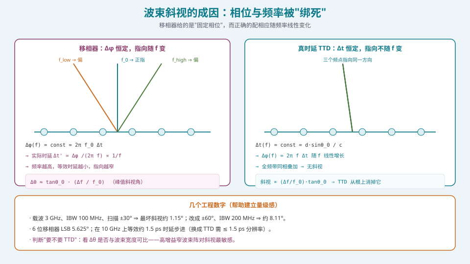
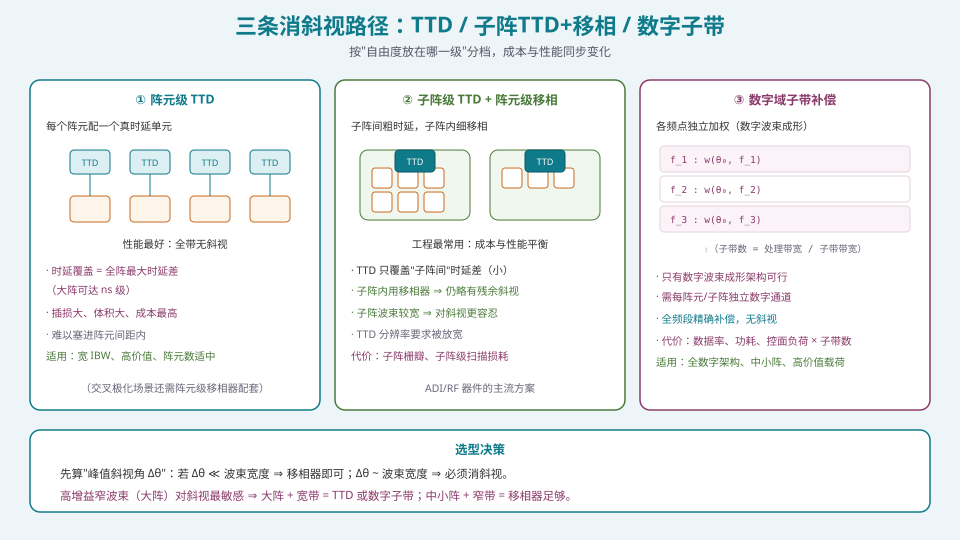
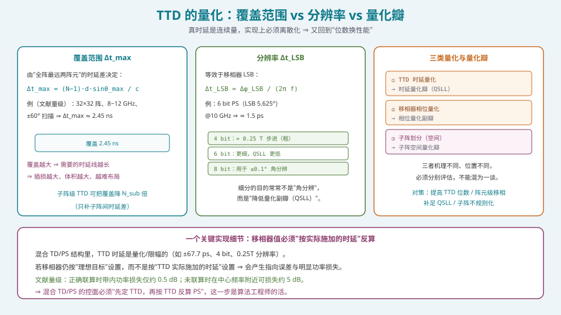

## 本篇要解决什么

前面四篇（[常规](pa-conventional-beamforming.html)、[MVDR/LCMV](pa-adaptive-mvdr-lcmv.html)、[DOA](pa-doa-music-esprit.html)、[稳健化](pa-null-broadening-robust.html)）默认一个前提：**窄带信号**——在信号带宽内，相位与时延可以互相换算、等价处理。

但当带宽变大，这个前提会崩塌：

核心问题：

**为什么宽带信号在移相阵列里会"偏指"？以及，怎么在"成本可控"的前提下消掉这个偏差？**

这是 S4 从"纯算法"走向"架构与系统"的转折点。理解了斜视，你才能理解为什么需要 TTD、为什么混合架构有"子阵内斜视"、为什么数字波束成形的价值不仅是多波束。

---

## 一、根源：相位与频率被"绑死"



*图 1：移相器给"固定相位"，等效时延随频率变化 ⇒ 指向随频率漂移；TTD 给"固定时延"⇒ 指向不随频率变。*

### 1.1 正确的配相本质是"配时延"

空间扫描要求的是**时延**：

\[
\Delta t=\frac{d\sin\theta_0}{c}.
\]

相位与时延的关系是

\[
\Delta\varphi=2\pi f\,\Delta t .
\]

**注意这里的 \(f\)**：正确的配相应随频率**线性变化**。

### 1.2 移相器给的是"固定相位"

移相器的定义是"在中心频率 \(f_0\) 上给一个固定相移"：

\[
\Delta\varphi(f)=\text{const}=2\pi f_0\Delta t .
\]

于是在任意其它频率 \(f\) 上，它对应的**等效时延**变成

\[
\Delta t'(f)=\frac{\Delta\varphi}{2\pi f}=\Delta t\cdot\frac{f_0}{f}\ \propto\ \frac{1}{f}.
\]

**频率越高，等效时延越小，扫描角越"靠内"**——这就是**波束斜视**（beam squint）。

### 1.3 峰值斜视角与工程数字

\[
\boxed{\ \Delta\theta\approx \tan\theta_0\cdot\frac{\Delta f}{f_0}\ }
\]

（\(\Delta f\) 为信号带宽，\(f_0\) 为中心频率。）

**工程数字（建立量级感）**：

| 场景 | 中心频率 | 带宽 | 扫描角 | 最坏斜视 |
| --- | --- | --- | --- | --- |
| 低频宽带 | 3 GHz | 100 MHz | ±30° | ≈ 1.15° |
| 大角宽带 | 3 GHz | 200 MHz | ±60° | ≈ 8.11° |

**判据**：把 \(\Delta\theta\) 与**波束宽度**比较。

- \(\Delta\theta \ll \text{HPBW}\) ⇒ 移相器足够（斜视可忽略）；
- \(\Delta\theta \sim \text{HPBW}\) ⇒ **必须消斜视**。

**高增益窄波束（大阵）对斜视最敏感**——同一场景下，波束越窄，几度的斜视就越致命。这就是"**大阵 + 宽带 = 必须 TTD**"的原因。

### 1.4 斜视的三个后果

1. **增益损失**：信号能量在带内"散"到不同方向，合成增益下降；
2. **指向误差**：等效波束"变形+偏指"，跟踪/对准精度下降；
3. **波形失真**：宽带调制信号（如 OFDM、宽带 chirp）的相位关系被破坏，EVM 恶化。

---

## 二、三条消斜视路径



*图 2：从"每阵元 TTD"到"数字子带"，是自由度放在哪一级的选择；成本与性能同步变化。*

### 2.1 路径①：阵元级 TTD

**每个阵元配一个真时延单元**，直接给时延而非相位：

\[
\Delta t(f)=\text{const}=\frac{d\sin\theta_0}{c}\ \Rightarrow\ \Delta\varphi(f)=2\pi f\Delta t\ \text{随 }f\text{ 线性增长}.
\]

- **性能最好**：全频带同相叠加，**完全无斜视**；
- **代价最大**：
  - 时延**覆盖范围**须等于全阵最远两阵元的时延差（大阵可达 ns 级，文献量级 32×32 阵在 8~12 GHz、±60° 下约 2.45 ns）；
  - 覆盖越大 ⇒ 时延线越长 ⇒ **插损、体积、成本**越大，且**难以塞进阵元间距内**；
  - 常见拓扑各有短板：**开关延迟线**（低损但面积大）、**人工传输线 ATL**（紧凑但损耗高）、**LC 网络**（可细调但敏感）。

**适用**：宽瞬时带宽（IBW）、高价值、阵元数适中的系统（雷达、卫星、测试）。

> 一个常被忽略的细节：**交叉极化**要求阵元两个极化端口间保持 90° 相位差。若用 TTD 直接替代移相器，交叉极化带宽会变差；工程上常在阵元级保留移相器（负责 90° 与细配相），在公共支路加 TTD（负责粗时延）。

### 2.2 路径②：子阵级 TTD + 阵元级移相（工程主流）

把阵列分成子阵：**子阵间用 TTD 补"粗时延"，子阵内用移相器做"细配相"**。

- **TTD 覆盖范围大幅缩小**（只需补子阵间的时延差，约降 \(N_{\text{sub}}\) 倍）⇒ 器件更容易做、插损更小；
- **TTD 分辨率要求被放宽**（子阵波束较宽，对斜视更容忍）；
- **残余斜视**：子阵内仍是"固定相位"，所以**子阵内仍有斜视**——但因**子阵波束宽**，影响被显著缓和；
- **代价**：引入**子阵栅瓣**与**子阵级扫描损耗**（见 [混合波束成形](pa-hybrid-beamforming.html)、[架构选型](pa-architecture-selection.html)）。

**这是 ADI 等厂商推荐的主流方案**：成本与性能平衡最好。

### 2.3 路径③：数字域子带补偿

**在数字波束成形架构下，对每个频点用各自的最优权值**：

\[
\mathbf{w}(f)=\frac{\mathbf{a}^{*}(\theta_0,f)}{N}\quad\text{逐子带施加}.
\]

- **全频段精确补偿，理论上无斜视**；
- **前提**：每阵元（或每子阵）有**独立数字通道** ⇒ 只有全数字/高 \(N_{RF}\) 混合架构可行；
- **代价**：数据率、功耗、控面负荷 **× 子带数**（子带越多越精确，也越贵）。

### 2.4 选型决策

```text
先算峰值斜视角 Δθ ≈ tanθ0 · (Δf/f0)
├─ Δθ ≪ HPBW            → 移相器足够（省钱）
├─ Δθ ~ HPBW（大阵+宽带）→ 必须消斜视：
│     ├─ 全数字架构        → 数字子带补偿
│     ├─ 高价值/中等阵元    → 阵元级 TTD
│     └─ 成本敏感/大阵      → 子阵级 TTD + 阵元移相
```

---

## 三、TTD 的量化：又回到"位数换性能"



*图 3：覆盖范围、分辨率步进、三类量化瓣——TTD 是连续量，实现上必须离散化。*

### 3.1 覆盖范围 \(\Delta t_{\max}\)

\[
\Delta t_{\max}=\frac{(N-1)\,d\,\sin\theta_{\max}}{c}.
\]

由"全阵最远两阵元 + 最大扫描角"决定。**覆盖越大 ⇒ 时延线越长 ⇒ 插损与体积越大、布局越难**。子阵级 TTD 的精髓就是把 \(\Delta t_{\max}\) 降下来。

### 3.2 分辨率 \(\Delta t_{\text{LSB}}\)

\[
\Delta t_{\text{LSB}}=\frac{\Delta\varphi_{\text{LSB}}}{2\pi f}.
\]

**量级对照**（关键工程换算）：

- 6 位移相器 LSB \(5.625^\circ\)，在 10 GHz 上等效约 **1.5 ps** 时延步进；
- 若用 TTD 替代，需 \(\le 1.5\) ps 分辨率才等价；
- 文献例子：**4 bit、0.25T 分辨率**的量化器（\(T=1/f_0\)）。

> **重要认知**：细分 TTD 分辨率的目的，**常常不是"提高角分辨"**（角分辨受波束宽度限制，早已够用），而是**降低量化副瓣（QSLL）**。这是最容易被误解的一点。

### 3.3 三类量化瓣（必须分清）

| 类型 | 来源 | 表现 |
| --- | --- | --- |
| ① TTD 时延量化瓣 | 时延被离散化 | 带内出现离散寄生峰 |
| ② 移相器相位量化副瓣 | 相位被 \(2^B\) 档离散 | 副瓣底噪抬升、离散量化瓣 |
| ③ 子阵空间量化瓣 | 子阵划分的周期性 | 子阵栅瓣（"子阵级假波束"） |

**三者机理不同、位置不同，必须分别评估**。常用对策：

- ① → 提高 TTD 位数，或阵元级移相补足细配相；
- ② → 提高移相器位数 / 量化相位抖动（dithering）；
- ③ → **子阵不规则化**（不同子阵大小不同）、重叠子阵、子阵内配相。

### 3.4 一个关键实现细节：PS 必须按"TTD 实际施加的时延"反算

混合 TD/PS 结构中，TTD 的时延是**量化/限幅**的（如覆盖 ±67.7 ps、4 bit、0.25T 分辨率）。若移相器仍按**理想目标**设置，而不是按 **TTD 实际施加的时延**设置，会产生：

- **指向误差**；
- **明显功率损失**（文献量级：未联算时在中心频率附近可损失约 **5 dB**；正确联算后带内损失仅约 **0.5 dB**）。

**所以控面必须"先定 TTD，再按 TTD 反算 PS"**——这是算法工程师在混合架构里的核心职责之一。

---

## 四、实现：TTD 权值联算与子带补偿

### 4.1 混合 TD/PS 的权值联算

```python
import numpy as np

def hybrid_td_ps_weights(N, d, f0, c, theta0_deg, ttd_bits, ttd_max_s,
                          ps_bits, n_sub=1):
    """混合 TD/PS 权值：子阵级 TTD 粗时延 + 阵元级 PS 细配相。
    返回 (ttd_codes, ps_codes)：分别是 TTD 量化码与 PS 量化码（每阵元）。
    """
    theta0 = np.deg2rad(theta0_deg)
    n = np.arange(N)
    # 理想时延（相对参考阵元）
    tau_ideal = n * d * np.sin(theta0) / c                 # 秒
    # ---- 第 1 步：TTD 只给子阵级粗时延，并量化 ----
    ttd_lsb = 2 * ttd_max_s / (2 ** ttd_bits)              # 覆盖 ±ttd_max
    sub_id = n // max(1, N // n_sub)
    tau_sub = tau_ideal[sub_id]                            # 每个子阵取代表时延
    tau_sub_clip = np.clip(tau_sub, -ttd_max_s, ttd_max_s)
    ttd_codes = np.round(tau_sub_clip / ttd_lsb).astype(int)
    tau_applied = ttd_codes * ttd_lsb                      # ★ TTD 实际施加的时延
    # ---- 第 2 步：PS 按"残余相位"反算（关键：用实际时延，不用理想时延）----
    phi_res = 2 * np.pi * f0 * (tau_ideal - tau_applied)   # 残差相位
    ps_lsb = 2 * np.pi / (2 ** ps_bits)
    ps_codes = np.round(phi_res / ps_lsb).astype(int) % (2 ** ps_bits)
    return ttd_codes, ps_codes
```

**验证**：对拍"理想全 TTD"与"混合 TD/PS"的方向图，检查带内（\(f_{\min}\sim f_{\max}\)）所有频点的指向误差与增益损失。正确联算下，带内损失应 ≈ 0.5 dB 量级，而非 5 dB。

### 4.2 数字子带补偿

```python
def wideband_digital_weights(N, d_over_lambda0, f0, freqs, theta0_deg):
    """数字子带补偿：每个频点一套权值（频率相关配相）。"""
    out = {}
    for f in freqs:
        lam = 3e8 / f
        a = np.exp(1j*2*np.pi*(d_over_lambda0*f0/f)*np.arange(N)*np.sin(np.deg2rad(theta0_deg)))
        out[f] = np.conj(a) / N
    return out
```

**注意**：这里的关键是把 \(d/\lambda\) 写成 \(d/\lambda_0\cdot f_0/f\)——**频率越高，等效间距越小**，配相斜坡越"缓"。逐子带应用即可消斜视。

### 4.3 峰值斜视与"要不要 TTD"的快速判据

```python
def squint_deg(theta0_deg, bw_hz, f0_hz):
    return np.rad2deg(np.arctan(np.deg2rad(1)))*0 + abs(np.tan(np.deg2rad(theta0_deg))) * (bw_hz/f0_hz) * 180/np.pi
# 例：squint_deg(60, 200e6, 3e9) ≈ 8.11°

def need_ttd(theta0_deg, bw_hz, f0_hz, N, d_over_lambda0=0.5):
    """若峰值斜视 > 1/4 波束宽度 ⇒ 建议消斜视。"""
    hpw = np.rad2deg(0.886/(N*d_over_lambda0*np.cos(np.deg2rad(theta0_deg))))
    dsq = abs(np.tan(np.deg2rad(theta0_deg))) * (bw_hz/f0_hz) * 180/np.pi
    return dsq, hpw, dsq > 0.25*hpw
```

---

## 五、常见误区清单

**误区一：以为"相位与时延可以互换"在宽带下依然成立。**
这是斜视的根因。**移相器给固定相位，TTD 给固定时延**；宽带下两者不再等价。

**误区二：只看中心频率的目标方向图就下结论。**
必须**在带内全频点**（\(f_{\min}\sim f_{\max}\)）评估指向与增益。中心频率"完美"的方案，带边可能已经偏了好几度。

**误区三：把"标称带宽"当成"无斜视带宽"。**
IBW（瞬时带宽）是**有代价**的。**带宽越大、扫描角越大、阵列越大，斜视越严重**——三者叠加时最危险。

**误区四：认为"细分 TTD 位数是为了提高角分辨"。**
角分辨受波束宽度限制，早够了。**细分主要是为了降 QSLL（量化副瓣）**。搞错目的会导致参数选错。

**误区五：混淆三类量化瓣。**
**TTD 时延量化瓣、移相器相位量化副瓣、子阵空间量化瓣**机理与位置完全不同，各有对策。把它们混成"量化副瓣"一个概念，无法定位问题。

**误区六：混合 TD/PS 中 PS 按"理想时延"设置。**
必须按 **TTD 实际（量化后）施加的时延**反算残差相位。否则指向误差 + 约 5 dB 的额外损失（对比正确联算的 ~0.5 dB）。

**误区七：忽略交叉极化与 TTD 的矛盾。**
交叉极化需要阵元两端口间**严格 90°**（宽带上保持）——这是**移相器**的强项、**TTD 的弱项**（只在一个频率上满足）。所以常见架构是"阵元级 PS 保极化，公共支路 TTD 消斜视"。

**误区八：大阵无脑上"阵元级 TTD"。**
大阵的 \(\Delta t_{\max}\) 可达 ns 级，**时延线插损与体积会失控**，且塞不进阵元间距。**大阵应走子阵级 TTD 或数字子带**。

**误区九：把斜视问题全部推给硬件。**
**数字子带补偿是算法工程师能独立贡献的方案**——在全数字/高 \(N_{RF}\) 架构下，"按频点算权值"就是消斜视。这是算法视角在宽带系统里的主战场之一。

---

## 六、快速自测

**Q1.** 推导峰值斜视角公式 \(\Delta\theta\approx\tan\theta_0\cdot\Delta f/f_0\)，并解释为什么"高增益窄波束阵"对斜视最敏感。

<details><summary>参考要点</summary>

移相器给固定相位 \(\Delta\varphi=2\pi f_0\Delta t\)，等效时延 \(\Delta t'(f)=\Delta t f_0/f\)。斜视等价于"用错误时延扫描"，指向由 \(\sin\theta\) 反演：

由 \(\sin\theta' = (f_0/f)\sin\theta_0\)，在小偏差下 \(\Delta\theta\approx\tan\theta_0\cdot\Delta\theta_{\text{freq}}\)，代入 \(\Delta f/f_0\) 得

\[
\Delta\theta\approx\tan\theta_0\cdot\frac{\Delta f}{f_0}.
\]

**为什么窄波束最敏感**：判据是"\(\Delta\theta\) 与 HPBW 的相对大小"。HPBW \(\approx0.886\lambda/(L\cos\theta_0)\propto1/L\)。大阵 ⇒ HPBW 很小 ⇒ 同样的 \(\Delta\theta\) 占波束宽度的比例很大 ⇒ 带边几乎"指到别的方向"。**低增益宽波束阵则对同样的 \(\Delta\theta\) 不敏感。**

</details>

**Q2.** 3 GHz 载波、200 MHz 带宽、±60° 扫描，峰值斜视多少度？若阵列 HPBW 是 3°，要不要上 TTD？

<details><summary>参考要点</summary>

\[
\Delta\theta\approx\tan60^\circ\times\frac{200\ \text{MHz}}{3\ \text{GHz}}
=1.732\times0.0667\approx0.1155\ \text{rad}\approx6.6^\circ
\]

（按另一组文献参数 ±60°/200 MHz/3 GHz 给的是 ≈8.11°；差异来自 \(\tan\theta\) 与更精确表达式的差别，**量级都是数度**。）

**判断**：HPBW=3°，而 \(\Delta\theta\approx6.6^\circ\sim8.1^\circ\) **大于波束宽度** ⇒ **必须消斜视**（移相器远不够）。

**方案**：子阵级 TTD + 阵元移相，或（若全数字架构）数字子带补偿。

</details>

**Q3.** 对比三种消斜视路径的成本与性能，并给出各自的适用场景。

<details><summary>参考要点</summary>

| 路径 | 性能 | 主要代价 | 适用 |
| --- | --- | --- | --- |
| ① 阵元级 TTD | 全带无斜视（最好） | 时延覆盖大、插损/体积/成本最高，难塞进阵元间距 | 宽 IBW、高价值、阵元数适中（雷达/卫星/测试） |
| ② 子阵级 TTD + 阵元 PS | 子阵内残余斜视（可接受） | 子阵栅瓣、子阵级扫描损耗 | 工程主流：成本性能平衡，器件易实现 |
| ③ 数字子带补偿 | 理论上无斜视（精确） | 数据率/功耗/控面负荷 × 子带数 | 全数字/高 \(N_{RF}\) 架构，中小阵，高价值载荷 |

**共性**：都是"把自由度放在某一级"的取舍。**没有免费的无斜视。**

</details>

**Q4.** TTD 的"覆盖范围"和"分辨率"分别由什么决定？分别对应什么代价？

<details><summary>参考要点</summary>

**覆盖范围** \(\Delta t_{\max}=\dfrac{(N-1)d\sin\theta_{\max}}{c}\)：由**全阵最远两阵元 + 最大扫描角**决定。
- 代价：时延线越长 ⇒ **插损、体积、成本**越大，布局越难。
- 子阵级 TTD 通过"只补子阵间时延差"把覆盖降约 \(N_{\text{sub}}\) 倍。

**分辨率** \(\Delta t_{\text{LSB}}=\Delta\varphi_{\text{LSB}}/(2\pi f)\)：由**量化位数**决定。
- 量级换算：6 bit 移相器 LSB \(5.625^\circ\) 在 10 GHz 上 ≈ **1.5 ps**。
- 代价：位数越高，器件越复杂；且**细分的主要目的是降 QSLL，而非提角分辨**。

</details>

**Q5.** 为什么混合 TD/PS 结构中，移相器必须按"TTD 实际施加的时延"反算？不这么做会怎样？

<details><summary>参考要点</summary>

TTD 的时延是**量化（离散档）且可能限幅**的。若 PS 按"理想目标时延"设置，则实际的"PS 残差相位"与"TTD 施加后剩下的残差"**不匹配**，相当于给每个阵元加了一个未知的相位误差 ⇒

1. **指向误差**：等效波前被扭曲，指向偏离；
2. **功率损失**：文献量级——未联算时中心频率附近可损失约 **5 dB**；正确联算后带内损失仅约 **0.5 dB**。

**正确做法**：先算 TTD 量化码 → 得到**实际施加时延** \(\tau_{\text{applied}}\) → 再按残差 \(\tau_{\text{ideal}}-\tau_{\text{applied}}\) 计算 PS 相位并量化。

**结论**：这是"混合结构的控面必须联算"的原因，也是算法工程师在混合架构中的核心职责。

</details>

**Q6.** 三类量化瓣分别是什么？各自的对策是什么？

<details><summary>参考要点</summary>

1. **TTD 时延量化瓣**：时延被离散化产生离散寄生峰 → 提高 TTD 位数，或用阵元级 PS 补足细配相；
2. **移相器相位量化副瓣**：相位取 \(2^B\) 档 → 提高位数、量化相位抖动（dithering）；
3. **子阵空间量化瓣（子阵栅瓣）**：子阵划分的周期性使等效相位中心间距 > λ/2 → **子阵不规则化、重叠子阵、子阵内配相、降低压缩比**。

**关键**：三者**机理与空间位置不同**，必须**分别测量与评估**，不能笼统归为"量化副瓣"。

</details>

**Q7.** 为什么说"数字子带补偿"是算法工程师在宽带相控阵里最直接的贡献点？

<details><summary>参考要点</summary>

**原因**：
1. 它**完全在数字域**完成——按频点给不同权值 \(\mathbf{w}(f)\)，**不需要新增模拟器件**；
2. 只要架构是**全数字或高 \(N_{RF}\) 混合**，就有实现条件；
3. 它把"消斜视"从"硬件难题"变成"**控面的计算与存储问题**"——正是软件/算法工程师的主场；
4. 可与自适应、DOA、稳健化统一在同一框架（子带化后各算法分别作用）。

**代价与边界**：
- 数据率/功耗/控面负荷 **× 子带数**；
- 受**架构自由度**限制（没有独立数字通道就没有子带自由度）；
- 子带数、子带带宽、权值更新率需要与系统指标统筹。

**一句话**：**在宽带系统里，"消斜视"不再只是买 TTD 器件，而是一道可以在数字域解出来的题——这是算法工程师的价值所在。**

</details>

**Q8.** 一个卫星载荷：Ka 波段 30 GHz、瞬时带宽 500 MHz、2048 元、±50° 扫描。请估算斜视并给出消斜视建议。

<details><summary>参考要点</summary>

**斜视估算**：
\[
\Delta\theta\approx\tan50^\circ\times\frac{500\ \text{MHz}}{30\ \text{GHz}}
=1.19\times0.0167\approx0.0199\ \text{rad}\approx1.14^\circ .
\]

**相对带宽**仅 \(500/30000\approx1.7\%\)，**斜视不算大**（约 1.1°）。

**但要注意**：2048 元 @ Ka 的波束极窄（HPBW 可能是零点几度甚至更窄）。若 HPBW < 1.14°，则 **1.14° 的斜视已超过波束宽度 ⇒ 仍需消斜视**。

**建议**：
1. **先算 HPBW**：\(\text{HPBW}\approx0.886\lambda/(L\cos\theta_0)\)。2048 元、\(d=\lambda/2\) ⇒ 孔径 \(L\approx1024\lambda\) ⇒ 法线 HPBW ≈ 0.05°！即便扫描到 50° 也才 ~0.08°。**结论：1.14° 的斜视是该波束宽度的十余倍 ⇒ 必须消斜视。**
2. **方案**：卫星载荷对功耗/重量敏感 ⇒ **子阵级 TTD + 子阵内 PS**（或子阵级数字子带），并配合**子阵不规则化**抑制子阵栅瓣；
3. 若抗干扰需要阵元级数字通道 ⇒ 高 \(N_{RF}\) 混合 + **数字子带补偿**，但要精算功耗、散热与重量预算。

**结论**：**"相对带宽小"不等于"斜视可忽略"——决定因素是"斜视 vs 波束宽度"，而不是单纯看百分比。**

</details>

---

## 七、与本站其它专题的连接

| 想了解 | 看哪篇 |
| --- | --- |
| 移相器与 TTD 器件本身 | [移相器与真时延器件（TTD）](pa-phase-shifter-ttd.html) |
| 混合架构的子阵设计与栅瓣 | [混合波束成形（HBF）的子阵设计](pa-hybrid-beamforming.html) |
| 四种架构的选型对比 | [四种架构的选型：PESA / AESA / 混合 / 全数字](pa-architecture-selection.html) |
| 扫描损耗（角度相关增益滚降） | [扫描损耗：波束越偏增益越低](pa-scan-loss.html) |
| 宽带下的自适应与频率平滑 | [零陷展宽、宽带与稳健波束形成](pa-null-broadening-robust.html) |
| 权值位宽与量化误差 | [定点化：从浮点仿真到硬件指标不退化](pa-fixed-point-quantization.html) |
| 子带权值落到芯片 | [FPGA/HLS 实现：数据面与控制面的分工](pa-fpga-hls-implementation.html) |
| 常规权值与 LUT 索引（含频点维度） | [常规波束形成：数据无关的权值计算](pa-conventional-beamforming.html) |
| 相控阵的物理机制 | [卫星相控阵天线：从阵元到波束](satellite-phased-array.html) |
| 学习体系全貌 | [相控阵天线学习体系：六阶段路线图](phased-array-roadmap.html) |

---

## 八、延伸阅读

**厂商与应用文档（本主题最高效的入口）**
- Analog Devices, "Combining the Best of Both Worlds: True Time Delays and Phase Shifters"（2022）。**混合 TD/PS 架构与量级数据的权威解读**（本文 §1.3、§3 多处依据）。
- EDN, "TTD for wideband phased array beamforming: Eliminating beam squint in AESA"。TTD 器件拓扑（开关线/ATL/LC）与需求计算。
- 专利 US11670850 "Hybrid time delay/phase shifter structure for beam squint mitigation"：**PS 与 TTD 联算的工程细节**（±67.7 ps、4 bit/0.25T、5 dB vs 0.5 dB）。
- Qorvo / ADI 关于宽 IBW AESA 的白皮书。

**教材与理论**
- Mailloux, *Phased Array Antenna Handbook*, 3rd ed.，第 7 章。宽带阵列与真时延的系统处理。
- Haupt, *Timed Arrays: Wideband and Time Varying Antenna Arrays*。时延阵列专著。
- Van Trees, *Optimum Array Processing*：宽带阵列的频率相关处理（子带/聚焦）。

**本站衔接**
- S4 上半场（算法路线 17~20）到此收官；本篇开启"**宽带与架构**"（21~22），随后进入"**实现**"（23~24）；
- 记住：**斜视是"相位与频率绑定"的直接后果；消斜视的三种路径，本质是"把时延自由度放在哪一级"的选择。**
