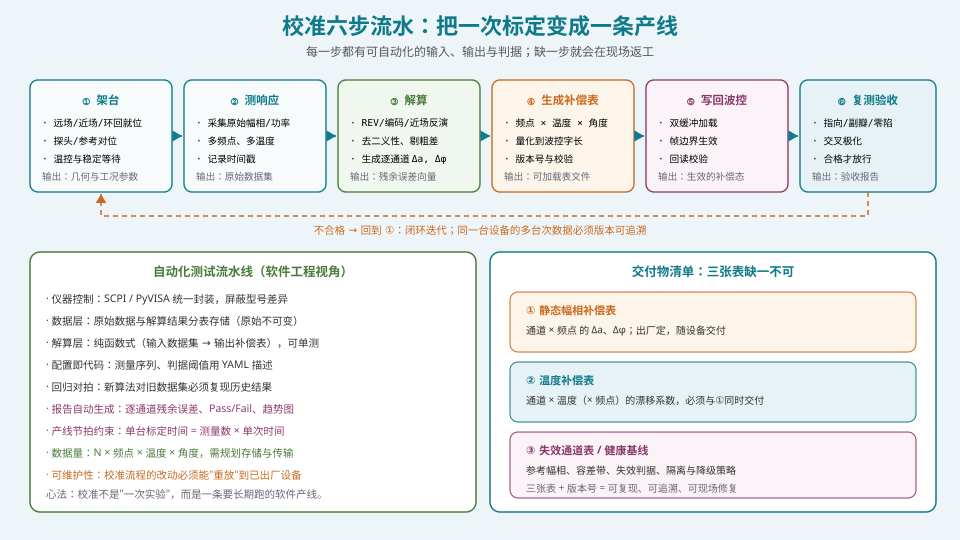
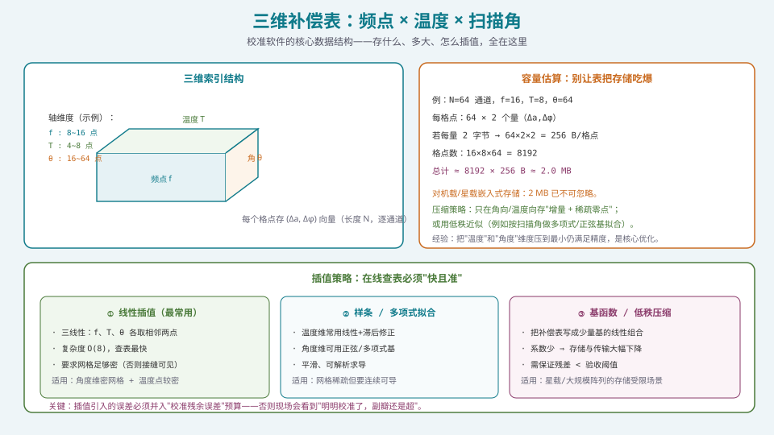
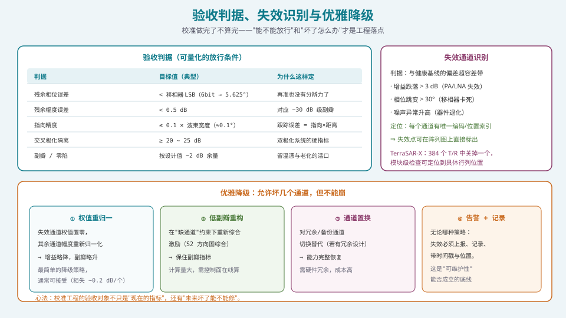

## 本篇要解决什么

[前三篇](pa-channel-error-impact.html)把 S5 的"物理—数学—手段"讲完了：

- 误差有多大、怎么分类（[误差来源与影响](pa-channel-error-impact.html)）；
- 只测幅度怎么解（[REV](pa-rev-calibration.html)）；
- 大阵/在轨/在线用什么手段（[近场/编码/环回](pa-nearfield-encoding-loopback.html)）。

但真正的工程问题还没回答：

**核心问题：怎么把"一次校准实验"变成"一条能长期跑、能被维护、能验收的流水线"？**

这一篇是 S5 的收尾篇，也是**最贴近软件工程师本职**的一篇。三分之二的内容是**数据结构、插值、流程编排、自动化测试与验收判据**——全是软件问题。

**为什么这条链路的软件化如此重要**：绝大部分人会写波束形成算法，但**会设计校准流程的人少得多**。校准的解算、补偿表设计、自动化验证流水线，是软件工程师在这条链路上**最容易建立不可替代性**的位置。

---

## 一、六步流水



*图 1：每一步都有可自动化的输入、输出与判据；缺一步就会在现场返工。*

| 步骤 | 做什么 | 输出 | 关键约束 |
| --- | --- | --- | --- |
| **① 架台** | 远场/近场/环回就位，探头/参考对位，温控与稳定等待 | 几何与工况参数 | **定位精度直接进误差预算** |
| **② 测响应** | 采集原始幅相/功率，多频点、多温度 | 原始数据集 | 必须记录**时间戳与温度** |
| **③ 解算** | REV/编码/近场反演；去二义性、剔粗差 | 逐通道 \(\Delta a,\Delta\varphi\) | 解算必须**可复现、可单测** |
| **④ 生成补偿表** | 频点 × 温度 × 角度；量化到波控字长；版本号与校验 | 可加载的表文件 | **量化误差要计入预算** |
| **⑤ 写回波控** | 双缓冲加载、帧边界生效、回读校验 | 生效的补偿态 | 换表**必须双缓冲**（见 [S4](pa-fpga-hls-implementation.html)） |
| **⑥ 复测验收** | 指向/副瓣/零陷/交叉极化 | 验收报告 | **不合格 → 回到 ① 闭环** |

### 1.1 为什么必须"闭环"

单次通过不代表合格。真实流程是**迭代闭环**：

```text
① 架台 → ② 测响应 → ③ 解算 → ④ 生成补偿表 → ⑤ 写回 → ⑥ 复测
   ▲                                                        │
   └────────────────── 不合格，调整后重来 ◀──────────────────┘
```

**软件落点**：把这条闭环实现成**状态机**，每一步有明确的前置条件与产出，任一步失败可**断点重跑**（而不是从头开始）。

### 1.2 数据可追溯性（易被忽略的硬要求）

同一台设备会有**多次、多台次**的校准数据。必须保证：

- **原始数据不可变**（写一次，只读）；
- 每次解算记录**输入数据集哈希 + 算法版本 + 参数**；
- 补偿表带**版本号与校验和**；
- 记录可**长期保存**并支持审计（军用系统常要求保存 10 年以上，并防篡改）。

**这一条不是"补充说明"，而是产品能否交付、能否返修的前提。**

---

## 二、三维补偿表：频点 × 温度 × 扫描角



*图 2：三维索引结构、容量估算与三种插值策略。*

### 2.1 为什么是三维

补偿量本身是**逐通道**的（长度 \(N\) 的向量），但它随三个"工况维度"变化：

\[
\Delta a_n,\ \Delta\varphi_n \;\longrightarrow\; \Delta a_n(f,T,\theta),\ \Delta\varphi_n(f,T,\theta)
\]

| 维度 | 为什么需要 | 典型点数 |
| --- | --- | --- |
| **频点 \(f\)** | 馈网与器件的频响、相移-频率关系 | 8~16 |
| **温度 \(T\)** | 相位温漂、增益温漂 | 4~8 |
| **扫描角 \(\theta\)** | 互耦与有源驻波随角变化、有源方向图 | 16~64 |

**注意**：\(\theta\) 维最密——因为**互耦效应随扫描角强烈变化**，是三维里最难压缩的一维。

### 2.2 容量估算：别让表把存储吃爆

以 \(N=64\)、\(f=16\)、\(T=8\)、\(\theta=64\) 为例：

\[
\underbrace{64\times2}_{\text{每格点两量}}\times\underbrace{2\ \text{B}}_{\text{每量}}
=256\ \text{B/格点}
\]

\[
\underbrace{16\times8\times64}_{\text{格点数}}=8192
\quad\Longrightarrow\quad
8192\times256\ \text{B}\approx \mathbf{2.0\ MB}
\]

**这对机载/星载嵌入式存储已不可忽略**——尤其还要留余量给多波束、多极化。

### 2.3 压缩策略

1. **增量 + 稀疏**：只存与参考态（如 \(f_0,T_0,\theta_0\)）的**差值**，大量格点接近零 → 稀疏存储；
2. **低秩 / 基函数拟合**：把表格写成少量基函数（如按 \(\theta\) 的多项式/正弦基）的线性组合，系数少 → 存储骤降；
3. **维度裁剪**：把 \(T\)、\(\theta\) 压到"最小但仍满足精度"的点数——**这是最有效的优化**；
4. **量化**：波控字长本身就是量化器，配合 **dithering** 可以把量化瓣"抹"成随机底噪（见 [移相器与 TTD](pa-phase-shifter-ttd.html)）。

### 2.4 在线查询必须"快且准"

补偿表在运行时要按当前 \((f,T,\theta)\) **实时查询**。三种插值策略：

| 策略 | 做法 | 复杂度 | 适用 |
| --- | --- | --- | --- |
| **三线性插值** | \(f,T,\theta\) 各取相邻两点 | \(O(8)\)，最快 | 网格足够密 |
| **样条 / 多项式拟合** | 温度维线性+滞后修正；角度维正弦/多项式基 | 中 | 网格稀疏但要平滑可导 |
| **基函数 / 低秩** | 少量基系数展开 | 中 | 存储受限（星载/超大规模阵） |

**必须记住的工程事实**：

> **插值引入的误差是实打实往"校准残余误差"预算里加的。**

这就是"明明校准了，副瓣还是超"的常见原因之一——**表格格点不够密，插值把精度吃掉了**。

---

## 三、温补表必须与校准表同时交付

这是本节最想强调的一条工程纪律。

### 3.1 两类表的角色

| 表 | 内容 | 谁生成 |
| --- | --- | --- |
| **静态幅相补偿表** | 通道 × 频点 的 \(\Delta a,\Delta\varphi\) | 出厂标定（近场扫描/并行编码） |
| **温度补偿表** | 通道 × 温度（× 频点）的漂移系数 | **温箱标定**（可与出厂标定同批） |

### 3.2 为什么"必须同时交付"

**反例极其常见**：

1. 出厂校准在**稳定温度**下做，验收全部合格；
2. 装到平台、大功率运行 30 分钟后温度上升；
3. 若**温补表没有一起交付**，或**在线没有启用按实测温度插值** ⇒ 补偿完全失效；
4. 现场副瓣超标、指向漂移 ⇒ **返工，甚至误判为"设计有问题"**。

**所以**：**静态表 + 温补表 + 版本号 = 一组不可分割的交付物。** 只交静态表，等于交付了一个"只在实验室合格"的产品。

### 3.3 温漂量级参考

- 相位温漂约 **0.03 °/℃** 量级（有源 GaN 器件更大）；
- 对 6 bit 移相器（LSB = 5.625°），**180℃ 的温升就吃掉一整个 LSB** —— 看起来温漂很小，但累计起来不可忽略；
- 因此在线层必须**按分钟级周期**刷新（见[上一篇](pa-nearfield-encoding-loopback.html)的三层节奏）。

---

## 四、失效通道识别与优雅降级



*图 3：可量化的验收判据；失效识别；以及四种降级策略。*

### 4.1 失效识别：建立"健康基线"

**做法**：把首次合格校准的结果存为**健康基线**（每个通道的参考 \(\Delta a,\Delta\varphi\) + 容差带），此后每次自检与基线对比：

| 判据 | 阈值（典型） | 指向的故障 |
| --- | --- | --- |
| 增益跌落 | > 3 dB | PA / LNA 失效 |
| 相位跳变 | > 30° | 移相器卡死/损坏 |
| 噪声异常升高 | 超出容差带 | 器件退化 |
| **相对偏差** | 超容差带 | 器件漂移 |

**定位能力**：如果每个通道有**唯一编码/位置索引**（如并行编码、行/面板级分组），失效点可在**阵列图上直接标出**。TerraSAR-X 的模块级检查就能在 384 个 T/R 中**直接定位到具体行列位置**。

### 4.2 优雅降级：允许坏几个通道，但不能崩

| 策略 | 做法 | 效果 | 代价 |
| --- | --- | --- | --- |
| **① 权值重归一** | 失效通道权值置零，其余通道幅度重新归一 | 增益略降、副瓣略升 | **最低**（最简单，通常可接受） |
| **② 低副瓣重构** | 在"缺通道"约束下重新综合激励 | 保住副瓣指标 | 计算量大，需控面在线算 |
| **③ 通道置换** | 切换到冗余/备份通道 | 能力完整恢复 | 需硬件冗余，成本高 |
| **④ 告警 + 记录** | 失效必须上报、记录、带时间戳与位置 | 保证可维护性 | 无（这是底线） |

**量级直觉**：① 策略下，单个失效通道带来的增益损失大约 **0.2 dB** 量级（\(10\log_{10}(N/(N-1))\) 的近似）；但**副瓣与零陷的劣化往往更明显**，尤其对低副瓣设计。

**核心心法**：

> **校准工程的验收对象不只是"现在的指标"，还有"未来坏了能不能修"。**

这也是为什么 ④（告警+记录）被列为"底线"——**它是"可维护性"能否成立的唯一保证。**

---

## 五、验收判据：可量化的放行条件

| 判据 | 目标值（典型） | 为什么这样定 |
| --- | --- | --- |
| **残余相位误差** | **< 移相器 LSB**（6 bit → 5.625°） | 再准也没有分辨力了 |
| **残余幅度误差** | < 0.5 dB | 对应 −30 dB 级副瓣 |
| **指向精度** | ≤ 0.1 × 波束宽度（≈0.1°） | 跟踪误差 = 指向 × 距离 |
| **交叉极化隔离** | ≥ 20 ~ 25 dB | 双极化系统的硬指标 |
| **副瓣 / 零陷** | 设计值 − 2 dB 余量 | 留温漂与老化的活口 |

### 5.1 "残余误差 < 移相器步进"背后的逻辑

补偿值的施加本身就受移相器分辨力限制。**若残余误差已小于 1 个 LSB，再精确的测量也无法转化为更精确的施加**——精度被"执行器分辨力"截断。

- 6 bit ⇒ LSB = \(360°/64=5.625°\)，最大量化误差为半 LSB = 2.8125°；
- 所以**残余相位误差目标常定在 < 5° 量级**；
- **推论**：提高校准精度的边际收益在跨越移相器分辨力后急剧衰减 ⇒ 该把预算转去做**温补**或**在线漂移追踪**。

### 5.2 为什么副瓣要留 −2 dB 余量

因为交付时的"合格"只是**某一时刻、某一工况**的合格。任务周期内还有温漂与老化，必须**预留活口**。不留余量 ⇒ 出厂合格、服役超标。

### 5.3 指向精度为什么是 0.1 波束宽度

跟踪/通信场景里，指向误差直接转化为**等效增益损失与目标位置误差**：

- 0.5° 的指向误差在 10 km 距离上对应 **87 m** 的位置误差；
- 对窄波束（0.5° 级）系统，**0.1° 的指向精度**几乎是常规要求；
- 由**移相器量化**带来的指向误差（6 bit 约 0.1~0.3° at broadside）与**校准残余**误差（良好校准约 0.1~0.5°）要**分别记账**。

---

## 六、自动化测试流水线（软件工程视角）

把校准做成产线，本质上是一个**测试系统软件**问题。

### 6.1 分层架构

| 层 | 职责 | 工程要点 |
| --- | --- | --- |
| **仪器控制层** | 封装 VNA / 功率计 / 转台 / 温度箱 | 统一 SCPI / PyVISA 接口，屏蔽型号差异 |
| **数据层** | 原始数据与解算结果分表存储 | **原始不可变**；结果可重算 |
| **解算层** | 纯函数式：输入数据集 → 输出补偿表 | **可单测、可复现**；算法版本化 |
| **配置层** | 测量序列、判据阈值 | **配置即代码**（YAML/JSON） |
| **报告层** | 逐通道残余误差、Pass/Fail、趋势图 | 自动生成，可归档审计 |

### 6.2 五条工程纪律

1. **解算纯函数化**：`solve(dataset) -> table`，无副作用 ⇒ 可对历史数据集**回放对拍**；
2. **回归对拍**：新算法在旧数据集上**必须复现**历史结果（或明确解释差异）；
3. **配置即代码**：测量点、阈值、序列全部版本化 ⇒ 流程可"重放"到已出厂设备；
4. **产线节拍约束**：单台标定时间 = 测量数 × 单次时间，必须在**设计阶段**就核算（见[上一篇 Q7](pa-nearfield-encoding-loopback.html)的算例）；
5. **数据量规划**：\(N\times f\times T\times\theta\) 的数据量要做**存储与传输**规划。

### 6.3 一个可运行的验收对拍脚本

```python
import numpy as np

def verify(delta_phi_deg, delta_a_db, lsb_deg=5.625, amp_tol_db=0.5):
    """验收：残余相位误差 < LSB；残余幅度误差 < 容差"""
    rms_phi = np.sqrt(np.mean(delta_phi_deg**2))
    rms_a   = np.sqrt(np.mean(delta_a_db**2))
    ok_phi  = rms_phi < lsb_deg
    ok_a    = rms_a < amp_tol_db
    return dict(rms_phi=rms_phi, rms_a=rms_a,
                pass_phi=bool(ok_phi), pass_amp=bool(ok_a),
                verdict=bool(ok_phi and ok_a))

# 模拟一批解算结果（逐通道残余误差）
rng = np.random.default_rng(1)
N = 64
resid_phi = rng.normal(0, 2.0, N)          # rms 2°，优于 LSB
resid_a   = rng.normal(0, 0.25, N)         # rms 0.25 dB
print(verify(resid_phi, resid_a))
# {'rms_phi': ~2.0, 'rms_a': ~0.25, 'pass_phi': True, 'pass_amp': True, 'verdict': True}
```

**扩展建议**：
1. 把 `verify` 的输出接入报告生成器，做**逐通道热力图**；
2. 对同一台设备的多次测量结果做**趋势分析**（漂移预警）；
3. 把"验收判据"做成**可配置规则**，不同型号用不同阈值。

---

## 七、常见误区清单

**误区一：把校准当成"一次实验"，而不是"一条产线"。**
一次实验只解决一台设备的一个状态；**产线要解决"批次一致性 + 可追溯 + 可返修"**。

**误区二：只交付静态补偿表。**
**温补表必须一起交付**，否则出厂合格、装机超标。这是最典型、最贵的遗漏。

**误区三：把插值误差当"不算误差"。**
补偿表是离散格点，在线要插值。**插值误差要并入残余误差预算**——否则会看到"校准了但副瓣还是超"。

**误区四：把"残余误差压到最小"当成唯一目标。**
精度受**移相器 LSB 截断**。**越过 LSB 之后的投入应转去做温补与在线追踪**，而不是继续提高测角精度。

**误区五：验收只看副瓣，不看指向与交叉极化。**
**副瓣、指向、交叉极化、球面覆盖、波束扫描一致性**恰恰是最常翻车的项（S6 会展开）。验收判据必须是**多指标的**。

**误区六：没有健康基线，失效无法自动识别。**
没有基线就无法判断"某个通道是不是坏了"。**首次合格结果必须存为基线 + 容差带**。

**误区七：忽略"失效后的行为设计"。**
只做正常路径，不做降级路径 ⇒ 系统在第一个器件失效时就整体不可用。**优雅降级是"能否活到设计寿命"的关键。**

**误区八：把校准数据当"临时文件"。**
校准数据必须**长期归档、可追溯、防篡改**（尤其军用/在轨）。**这是产品交付与返修的法律/工程基础。**

**误区九：忽略"换表的原子性"。**
在运行中换补偿表若不做**双缓冲**，会出现"半新半旧"的补偿态 ⇒ 瞬态畸变。**换表必须帧边界生效**（与 [S4 的架构原则](pa-fpga-hls-implementation.html)一致）。

**误区十：让硬件团队单独负责校准。**
校准的解算、补偿表、自动化流水线**全是软件问题**。**把它当硬件活，是软件工程师主动放弃差异化能力。**

---

## 八、快速自测

**Q1.** 画出（或描述）校准六步流水，并说明为什么必须"闭环"。

<details><summary>参考要点</summary>

**六步**：① 架台 → ② 测响应 → ③ 解算 → ④ 生成补偿表 → ⑤ 写回波控 → ⑥ 复测验收。

**必须闭环的原因**：单次通过不代表合格。实际系统里，①~⑤ 的每一步都会引入误差（定位、噪声、解算、量化、插值），**只有第 ⑥ 步复测才能验证"整链"是否满足指标**。若不合格，必须回到相应步骤调整后重跑。

**软件落点**：实现为**状态机**，每步有前置条件与产出，支持**断点重跑**（而不是每次从头执行）。**闭环 = 可迭代 = 可收敛到指标。**

</details>

**Q2.** 三维补偿表是哪三维？为什么"扫描角"这一维通常最密？

<details><summary>参考要点</summary>

**三维**：**频点 \(f\) × 温度 \(T\) × 扫描角 \(\theta\)**。

- \(f\)：馈网与器件频响、相移-频率关系；
- \(T\)：相位/增益温漂；
- \(\theta\)：**互耦与有源驻波随扫描角强烈变化**、有源方向图变化。

**\(\theta\) 最密的原因**：互耦效应随扫描角的变化是**强非线性**的，且直接影响单元的实际激励（等效于额外的幅相误差）。相比之下，温度维在工程温度区间内近似线性、频响也较平滑 ⇒ **\(\theta\) 是三维里最难压缩、必须给最多点的维度**。

</details>

**Q3.** 估算一张 \(N=128\)、\(f=16\)、\(T=8\)、\(\theta=64\) 的补偿表容量（每量 2 字节）。这个量级对星载存储意味着什么？

<details><summary>参考要点</summary>

**每格点**：\(128\times2\times2\ \text{B}=512\ \text{B}\)。
**格点数**：\(16\times8\times64=8192\)。
**总计**：\(8192\times512=4.19\times10^6\ \text{B}\approx\mathbf{4.2\ MB}\)。

**对星载存储的意义**：
- 4.2 MB 对地面计算机微不足道，但对**星载嵌入式**是显著占用（还要留多波束、多极化、备份表）；
- 传输/上注带宽有限 ⇒ 表更新本身成为一个需要规划的操作。

**应对**：维度裁剪（尤其 \(T\) 与 \(\theta\)）、增量+稀疏存储、基函数低秩压缩、量化 + dithering。

</details>

**Q4.** 为什么"温补表必须与静态校准表同时交付"？不交付会发生什么？

<details><summary>参考要点</summary>

**为什么**：静态表只在**校准时的温度**下有效；真实运行的温度会显著偏离（大功率功放自热、环境温度变化）。**温度一变，静态表就失效。**

**不交付的后果**（典型故障链）：
1. 出厂在稳定温度下验收合格；
2. 装机后大功率运行，阵面升温 ⇒ 通道相位漂移；
3. 无温补 ⇒ 副瓣超标、指向漂移、零陷变浅；
4. 现场误判为"设计缺陷" ⇒ **返工、延误，甚至不必要地更换硬件**。

**正确做法**：**静态表 + 温补表 + 版本号 = 一组不可分割的交付物**；且在线必须按**实测温度**插值。

**量级参考**：相位温漂约 0.03 °/℃ 量级 ⇒ 对 6 bit 移相器（LSB 5.625°），约 180℃ 就吃掉一个 LSB——看似小，累计起来不可忽略。

</details>

**Q5.** 为什么"残余相位误差目标"常定在"移相器 LSB 以内"？6 bit 移相器的对应数值与最大量化误差是多少？

<details><summary>参考要点</summary>

**原因**：补偿值的**施加**受移相器分辨力限制。若残余误差已 < 1 LSB，**再精确的测量也无法转化为更精确的施加** ⇒ 精度被"执行器分辨力"截断。

**6 bit**：
- LSB = \(360°/2^6=5.625°\)；
- **最大量化误差 = 半个 LSB** = \(360°/2^{B+1}=360/128=2.8125°\)。

**实践**：残余相位误差目标常定在 **< 5°** 量级（约 1 个 LSB）。

**推论**：**跨越移相器分辨力之后，继续提高测量精度的边际收益极低** ⇒ 预算应转向**温补**与**在线漂移追踪**。这也解释了为什么"堆精度"不是校准工程的最优策略。

</details>

**Q6.** 一个通道失效后，有哪四种处理方式？各自的效果与代价？

<details><summary>参考要点</summary>

| 策略 | 效果 | 代价 |
| --- | --- | --- |
| **① 权值重归一** | 失效通道权值置零，其余幅度重归一；增益略降（单通道约 0.2 dB 量级）、副瓣略升 | 最低（最简单，通常可接受） |
| **② 低副瓣重构** | 在缺通道约束下重新综合激励，**保住副瓣指标** | 计算量大，需控面在线算 |
| **③ 通道置换** | 切换到冗余/备份通道，能力完整恢复 | 需硬件冗余，成本高 |
| **④ 告警 + 记录** | 上报、记录、带时间戳与位置 | 无（这是**可维护性底线**） |

**补充要点**：
- ① 的增益损失小，但**副瓣与零陷的劣化往往更明显**（尤其低副瓣设计）；
- ④ 不是"可选"，而是**底线**——没有记录就无法维护；
- 实际系统通常是**分层策略**：先告警（④），再自动重归一（①），高价值系统才上 ③。

</details>

**Q7.** 你被要求"把校准从手工脚本变成产线系统"。请给出你的分层设计与三条最关键工程设计。

<details><summary>参考要点</summary>

**分层**：
1. **仪器控制层**：统一封装 VNA/功率计/转台/温箱（SCPI/PyVISA），屏蔽型号差异；
2. **数据层**：原始数据不可变；结果可重算；
3. **解算层**：纯函数式 `solve(dataset)->table`，可单测、可复现、算法版本化；
4. **配置层**：测量序列与阈值**配置即代码**；
5. **报告层**：自动生成逐通道残余误差、Pass/Fail、趋势图。

**三条最关键工程设计**：
1. **解算纯函数化 + 回归对拍**：新算法必须在旧数据集上复现历史结果 ⇒ 保证"改进不引入回归"，也让流程可重放到已出厂设备；
2. **产线节拍核算**（在设计阶段就做）：单台时间 = 测量数 × 单次时间。大阵必须选并行编码/分组（见[上一篇 Q7](pa-nearfield-encoding-loopback.html)），否则节拍不达标；
3. **版本化 + 可追溯**：补偿表带版本号与校验和；每次解算记录输入哈希 + 算法版本 + 参数 ⇒ 支持审计与返修。

**补充**：把**验收判据**做成可配置规则，不同型号用不同阈值；把**插值误差**纳入验收预算。

</details>

**Q8.** "误差预算"在这个收尾篇里怎么落地？请串起 S5 四篇的闭环。

<details><summary>参考要点</summary>

**S5 四篇的闭环**：

1. **误差来源与影响**：给出**总误差预算**（\(\sigma_{\text{total}}^2=\sigma_{\text{mfg}}^2+\sigma_{\text{dev}}^2+\sigma_{\text{cpl}}^2+\sigma_{\text{drift}}^2+\sigma_{\text{aging}}^2\)）与"能不能一次解决"的分类；
2. **REV**：提供**只测幅度**的解算手段 ⇒ 把"可测"变成"可解"；
3. **近场/编码/环回**：提供**手段库**；分层（出厂/在线）各取所需；
4. **工程化（本篇）**：把上面三者的产出落到**补偿表 + 验收判据 + 流水线**上，并**把插值误差、量化误差、温补残余重新计入残余误差预算**。

**落地的关键动作**：
- 定**残余误差目标**（如 < 移相器 LSB）⇒ 这是"预算"的终点；
- 用 ①~③ 的手段去**逼近**这个目标；
- 用 ④（本篇）的流程去**验证并维护**这个目标。

**闭环意义**：**预算 → 手段 → 表 → 验收 → 反馈修正预算**。S5 的终点不是"测准了"，而是"**指标在整个寿命期内可维持、可验证、可修复**"。

</details>

---

## 九、与本站其它专题的连接

| 想了解 | 看哪篇 |
| --- | --- |
| 误差四分类与"能不能一次解决"的判据 | [通道误差的来源与影响](pa-channel-error-impact.html) |
| REV：只测幅度的解算原理 | [REV 旋转矢量法：原理、推导与解算](pa-rev-calibration.html) |
| 近场扫描 / 并行编码 / 环回自校准 | [近场扫描、并行编码与环回自校准](pa-nearfield-encoding-loopback.html) |
| 双缓冲换表与"控面解算/数据面执行" | [FPGA/HLS 实现：数据面与控制面的分工](pa-fpga-hls-implementation.html) |
| 位宽不足 → 副瓣抬高与零陷暴露（量化账） | [定点化：从浮点仿真到硬件指标不退化](pa-fixed-point-quantization.html) |
| 移相器位数与量化副瓣、dithering | [移相器与真时延器件（TTD）](pa-phase-shifter-ttd.html) |
| 零陷深度对校准残余的敏感度 | [零陷展宽、宽带与稳健波束形成](pa-null-broadening-robust.html) |
| 互耦随扫描角变化（\(\theta\) 维为何最密） | [功分合成网络与互耦效应](pa-feed-network-mutual-coupling.html) |
| 方向图综合（缺通道时的激励重构） | [方向图综合与赋形：从"扫描"到"想要什么形状"](pa-pattern-synthesis-shaping.html) |
| 架构决定能否做内建环回 | [四种架构的选型：PESA / AESA / 混合 / 全数字](pa-architecture-selection.html) |
| 相控阵的物理机制 | [卫星相控阵天线：从阵元到波束](satellite-phased-array.html) |
| 学习体系全貌 | [相控阵天线学习体系：六阶段路线图](phased-array-roadmap.html) |

---

## 十、延伸阅读

**校准工程与流程**
- Keysight, *How to Design and Test a Phased Array Antenna*——**相控阵测试与校准的工程手册**（免费电子书），六步流水与验收判据的实践来源。
- 相控阵校准的系统性综述——把"串行/并行 × 相干/非相干"组织成完整分类，含各方法的测量数与硬件要求对比。
- 关于校准周期与层级（工厂 / 内部 / 外部）的工程问答——**"秒~分钟级内部校准 + 天~月级外部验证"这一节奏的来源**。

**失效检测与降级**
- TerraSAR-X 的 TRM 失效检测与在轨性能监控——**"关掉一个 T/R 可在 384 个单元中直接定位到具体行列"**的工程实证。
- 相控阵健康监控与故障隔离的工程方法——失效判据、容差带、降级策略。

**测试系统软件**
- 自动化测试系统（ATS）的分层架构与仪器抽象层实践（SCPI / PyVISA / 配置即代码）。
- 关于"校准数据可追溯与审计"的工程规范（版本化、校验和、长期归档）。

**本站衔接**
- 本篇是 **S5 的收尾篇**。四篇连起来是：**误差有多严重（诊断） → 只测幅度怎么解（REV） → 大阵/在轨/在线用什么手段（近场/编码/环回） → 怎么工程化为产线（本篇）**；
- 记住 S5 的最终心法：**把误差按"能不能一次解决"分类；把校准做成带版本、可追溯、可降级的流水线；把残余误差压到执行器分辨力以内，然后把预算转去追漂移**；
- **下一篇进入 S6 测试与一致性**（专题 29~32）——从"能不能校准"走向"**能不能过认证**"：OTA 的必要性、DFF/CATR/NFTF 三方法、EIRP/TRP/EIS 与球面扫描、以及从 TS 38.101 到 CTIA 到 ITU-R 的规范认证地图。
