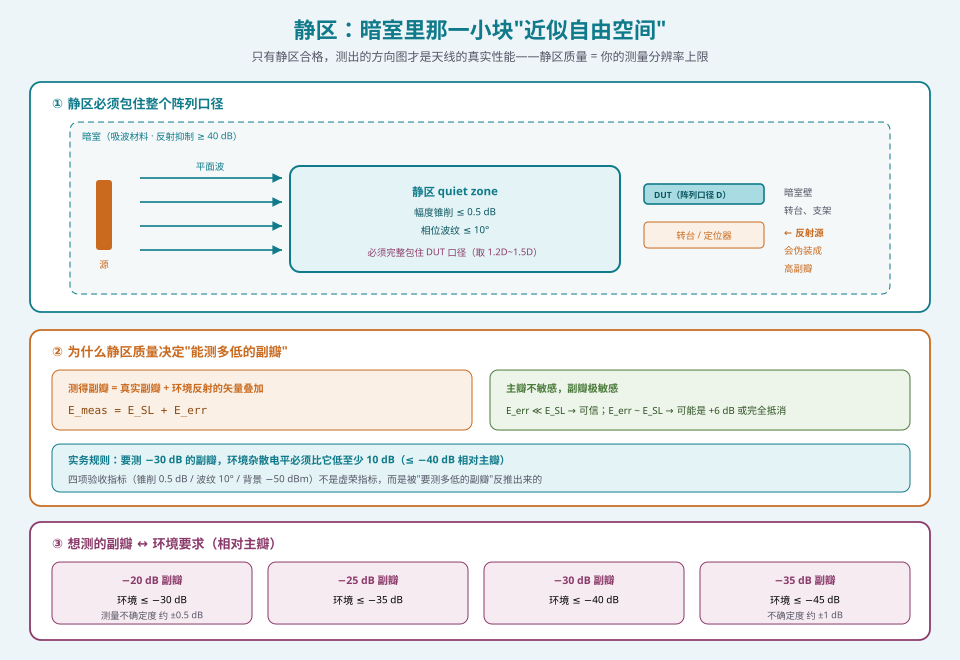
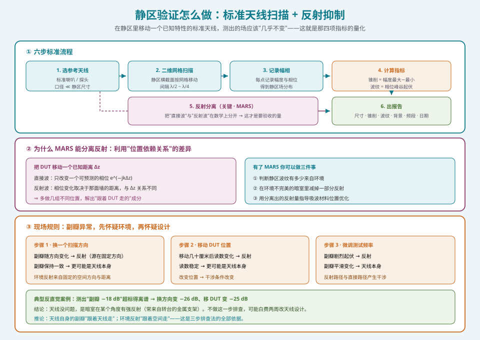

## 本篇要解决什么

[VNA 多通道相参测量](pa-vna-multichannel-measurement.html) 那篇讲了**"仪器这一侧"**怎么把数据测准。但数据准不准，还有一半取决于**"环境这一侧"**。

这一篇处理的就是环境这一侧的口径问题：

> 你在暗室里测出天线第一副瓣是 −22 dB。这个数字，是**天线的真实副瓣**，还是**暗室墙壁、转台、支架的反射伪装出来的**？

这个问题的答案不由你的天线决定，而由**静区（quiet zone）是否经过验证**决定。

四个问题：

1. **静区到底是什么？** 为什么自由空间只有一小块？
2. **四项验收指标怎么读？** 幅度锥削 0.5 dB、相位波纹 10° 意味着什么？
3. **怎么验证？** 标准天线 + 反射抑制算法具体怎么做？
4. **怎么判断副瓣超标的锅在天线还是环境？** 一条能立刻用的现场规则。

---

## 一、静区是什么：自由空间的"样本区"

### 1.1 从"要测什么"倒推"要什么场"

天线方向图的定义，前提是**平面波**：

> 远场方向图 \(F(\theta,\phi)\) 描述的是"**来自 \(\theta,\phi\) 方向的平面波**被天线接收的能力"。

所以测量时必须创造这样一个环境：把待测天线（DUT）放在一个**入射波近似为均匀平面波**的区域里。

- **真远场**：靠足够大的距离 \(R \ge 2D^2/\lambda\) 让球面波"看起来像"平面波
- **紧缩场（CATR）**：用抛物面反射器把馈源的球面波**准直**成平面波
- **近场**：在近场采样，再用数学变换**算出**远场

三条路都在做同一件事：**在有限空间里伪造一块平面波**。

而这块"伪造出来的平面波"所占的体积，就是**静区**。

### 1.2 静区的两个维度

静区不是抽象概念，它有两个可测的物理属性：

| 属性 | 物理含义 | 为什么重要 |
| --- | --- | --- |
| **静区尺寸**（quiet zone size） | 满足平面波条件的测试体积，通常是"直径 × 长度"的柱状或球状区域 | 必须**完整包住 DUT**，否则阵列边缘的单元就处于非平面波区 |
| **静区质量**（quiet zone quality） | 该区域内场的"平"的程度 = 幅度锥削 + 相位波纹 | 直接决定你能测出多低的副瓣 |

**尺寸的第一条硬约束**：静区必须包住整个阵列口径。

一个 \(D = 1\,\mathrm{m}\) 的阵列，静区直径至少也要 1 m 以上（留余量，通常取 \(1.2D\sim 1.5D\)）。这就把场地尺寸逼得很紧——**阵列越大，静区越大，场地越大，成本越高**。这就是远场暗室成本的根本来源。

### 1.3 为什么静区质量决定"能测多低的副瓣"

这是本节最核心的一条推理链。

**主瓣电平**对环境的敏感度不高——它主要由天线自身增益决定，一点反射不会改变主瓣量级。

**副瓣电平**则极度敏感。设真实第一副瓣为 \(P_{\text{SL}}\)，环境反射引入一个寄生信号 \(P_{\text{err}}\)，测得的副瓣是两者**电压矢量和**：

\[
E_{\text{meas}} = E_{\text{SL}} + E_{\text{err}}
\]

- 若 \(E_{\text{err}} \ll E_{\text{SL}}\)：测得值 ≈ 真实值，**可信**
- 若 \(E_{\text{err}} \sim E_{\text{SL}}\)：测得值可能是真实值的 2 倍（+6 dB）到完全抵消（−∞）

于是得到这条实务规律：

> **要测 −30 dB 的副瓣，环境的杂散电平必须比它低至少 10 dB**（即 ≤ −40 dB 相对主瓣）。

这就是静区验收指标（幅度锥削 ≤ 0.5 dB、相位波纹 ≤ 10°）的来历——它们不是"越高越好"的虚荣指标，而是**被"要测多低的副瓣"反推出来的**。

| 想测的副瓣 | 环境要求（相对主瓣） |
| --- | --- |
| −20 dB | ≤ −30 dB |
| −25 dB | ≤ −35 dB |
| −30 dB | ≤ −40 dB |
| −35 dB | ≤ −45 dB |

**读表的一个结论**：测量不确定度随副瓣降低而增大。−10 dB 副瓣的测量不确定度约 ±0.5 dB，而 −20 dB 副瓣约 **±1 dB**。所以：

> **改善量小于测量不确定度，就统计上不可区分。**

你花两周把副瓣从 −22 dB 优化到 −21 dB，如果测量不确定度是 ±1 dB，这个"改善"没有任何意义——它是噪声。

---

## 二、四项验收指标怎么读

一份静区验证报告，你至少要能读懂这四项。

| 指标 | 含义 | 典型限值 | 读法 |
| --- | --- | --- | --- |
| **静区尺寸** | 满足平面波条件的体积 | 直径 ≥ 1 m（视阵列） | 必须完整包住 DUT 口径 |
| **幅度锥削** | 静区内场强的不均匀程度 | ≤ 0.5 dB | 越大 → 越像"被照得不均匀"，等效于给阵列加了幅度加权误差 |
| **相位波纹** | 静区内相位的平坦度 | ≤ 10° | 越大 → 等效于给阵列加了相位误差，直接抬高副瓣 |
| **背景电平** | 暗室本底噪声 | ≤ −50 dBm @ 18 GHz | 决定能测多微弱的小信号 |



*图 1：静区的几何约束（必须包住整个阵列口径）、为什么副瓣对环境极度敏感，以及"想测多低的副瓣"所对应的环境要求*

### 2.1 幅度锥削与相位波纹的等效影响

它们为什么是这两个数字？可以用"等效误差"来理解：

- **幅度锥削 0.5 dB** → 近似给所有单元叠加一个 0.5 dB 量级的幅度误差
- **相位波纹 10°** → 近似给所有单元叠加一个 10° 量级的相位误差

回顾 [通道幅相校准](pa-rev-calibration.html) 里那条判据：**残余幅相误差应小于移相器步进**（6 bit → 5.6°）。

那么问题来了：如果你的静区引入 10° 的相位波纹，而你的移相器步进只有 5.6°——**你测出的"相位误差"里，环境贡献比移相器本身还大**。

> 这就是为什么"静区验证是 commissioning 的前置条件"：**它定义了你的测量分辨率上限。**

### 2.2 背景电平为什么这样定

−50 dBm @ 18 GHz 是"背景电平"的常见工程限值。它的意义在于：

- 它必须显著低于你最弱的有用信号（例如深零陷处的电平、交叉极化隔离后的交叉极化分量）
- 高灵敏度接收测试（如 G/T、EIS）尤其依赖低的背景

**注意频率依赖**：背景电平通常随频率升高而恶化（吸波材料高频性能、泄漏路径），所以报告里必须注明**测试频段**。

---

## 三、静区验证怎么做

### 3.1 核心思路

静区验证要回答一个可操作的问题：

> **在静区里移动一个已知特性的标准天线，测出的场应该"几乎不变"。**

"几乎不变"就是那四项指标的量化。

### 3.2 标准流程

```text
① 选参考天线
   用一个已知特性的标准天线（标准增益喇叭 / 已知方向图的探头），
   口径要显著小于静区尺寸

② 二维扫描
   在静区横截面（通常是垂直于传播方向的平面）上按网格移动该天线
   网格密度要能分辨出场的起伏（典型 λ/2 ~ λ/4 间隔）

③ 记录幅度与相位
   每个网格点记录幅相 → 得到静区内的场分布

④ 计算指标
   幅度锥削 = 静区内幅度最大最小值之差
   相位波纹 = 静区内相位的峰谷起伏

⑤ 反射分离（关键）
   用数学方法把"直接波"与"反射波"分开，
   得到不含反射的静区场 → 才是真正要验收的量

⑥ 出报告
   报告内容：静区尺寸、幅度锥削、相位波纹、背景电平、频段、验证日期
```

### 3.3 反射抑制算法：MARS

第 ⑤ 步为什么关键？

因为你在静区里测到的场，**永远是"直接波 + 反射波"的叠加**。直接测出的幅度锥削与相位波纹里，包含了暗室壁、转台、支架的反射贡献。

**MARS**（Mathematical Absorber Reflection Suppression，数学吸波器反射抑制）就是干这件事的：通过**改变天线位置/频率**获取多组数据，利用反射信号与直接信号在"位置依赖关系"上的差异，**在数学上把反射贡献分离出去**。

**为什么它有效**：把 DUT 移动一个已知距离 \(\Delta z\)，直接波只改变一个可预测的相位 \(e^{-jk\Delta z}\)，而来自暗室壁的反射波的相位变化取决于那面墙的距离，与 \(\Delta z\) 的关系不同。多做几组不同位置的测量，就能解出哪些成分是"跟着 DUT 走的"（直接波）、哪些是"不跟着走的"（环境反射）。

> **实务意义**：有了 MARS，你可以：
> ① 判断静区里的波纹有多少是环境造成的；
> ② 在环境不完美的暗室里"减掉"一部分反射，得到更接近真实的测量；
> ③ 用分离出的反射量来**指导吸波材料的位置优化**（反射从哪来的？）。

### 3.4 一个特别实用的现场规则

这是本篇最值得记住的一条：

> **看到副瓣异常，先怀疑环境，再怀疑设计。**

**具体操作**（三步排查法）：

| 步骤 | 动作 | 若指标跟着变 → | 若不变 → |
| --- | --- | --- | --- |
| 1 | **换一个扫描方向**重测 | 副瓣随方向变化 → **反射**（反射源在某个固定空间方向） | 副瓣一致 → 可能是天线本身 |
| 2 | **移动 DUT 位置**（几十厘米）重测 | 副瓣读数变化 → **反射** | 副瓣稳定 → 更可能是天线本身 |
| 3 | **改变测试频率**（微调） | 副瓣剧烈起伏 → **反射**（反射路径与直接路径干涉） | 副瓣平滑变化 → 天线本身 |

**为什么这三步有效**：环境的反射有一个固定特征——**它来自固定的空间方向和固定的距离**。所以改变 DUT 的位置或指向，干涉条件就变了，反射贡献随之变化。而天线自身的副瓣，无论你把天线挪到哪，**都跟着天线走**。

> **一个反直觉的例子**：你测出一条"副瓣 −18 dB"的曲线，超标得离谱。但用上面三步排查，换方向后变成 −26 dB、移动 DUT 后变成 −25 dB。结论是**天线没问题，是暗室在某个角度上有强反射**（很可能来自转台的金属支架）。如果不做这一步，你可能会去改天线设计，白费两周。



*图 2：静区验证的六步流程、MARS 反射分离所利用的"位置依赖差异"，以及"先怀疑环境"的三步现场排查法*

---

## 四、场地四选：各自的静区从哪来

静区不是暗室的专利。不同场地用不同方法"伪造平面波"，代价与边界完全不同。

| 类型 | 原理 | 静区来源 | 成本特征 | 适用 |
| --- | --- | --- | --- | --- |
| **远场（DFF）** | 真距离 \(R \ge 2D^2/\lambda\) | 球面波自然近似 | **场地成本随 \(D^2\) 增长** | 低频、小阵、外场验收 |
| **紧缩场（CATR）** | 抛物面反射器准直 | 反射面后的柱形静区 | **反射面昂贵，可达 DFF 的 10 倍** | 毫米波、AESA、产线 |
| **近场（NF）** | 近场采样 + 数学变换 | 不需要静区（数学上等效） | 扫描架成本 | 大型面阵、精度优先 |
| **混响室** | 搅拌反射形成统计均匀场 | 不需要静区（统计场） | 中等 | TRP 类"总能量"指标 |

### 4.1 远场：距离是硬成本

远场条件的硬约束：

\[
R > \frac{2D^2}{\lambda}
\]

**算一下就知道有多痛**：一个 \(D = 1\,\mathrm{m}\) 的阵列，在 10 GHz（\(\lambda = 3\,\mathrm{cm}\)）时——

\[
R > \frac{2 \times 1^2}{0.03} \approx 67\ \mathrm{m}
\]

67 米的暗室。这就是远场暗室在毫米波、大阵面前"经济上不可行"的原因，也是紧缩场存在的全部理由。

### 4.2 紧缩场：用反射面"买"静区

CATR 用一个大抛物面把馈源放在焦点，反射出的波在反射面口径内近似平面波。

- **优点**：几米的暗室就能得到远场几十米的效果
- **代价**：反射面的加工精度要求极高（表面误差需远小于 \(\lambda\)，毫米波下是微米级），**成本可达远场方案的 10 倍**
- **静区特征**：静区是反射面前方的一个柱状区域，口径受反射面尺寸限制

**这就是为什么毫米波产线测试几乎都是 CATR**：省下来的场地成本远超反射面的造价。

### 4.3 近场：不需要静区，但需要另一样东西

近场测量的思路完全不同：**在近场（\(1\lambda \sim 10\lambda\)）逐点采样，再用数学变换算出远场。**

- **优点**：不需要大场地，精度高，还能**全息诊断**（反演出阵面上的幅相分布，直接看出哪个单元坏了）
- **代价**：需要高精度扫描架（探头定位精度到 **50 μm** 量级），且探头本身要校准
- **采样面**：平面（PNF）/ 球面（SNF）/ 柱面（CNF），选哪个取决于天线的波束形状
- **"静区"的对应物**：近场的"合法性"不靠静区，而靠**探头校正精度 + 扫描定位精度 + 截断处理**

> **对软件工程师的意义**：近场的 NF→FF 变换就是一次坐标系变换 + 傅里叶变换，是**最适合软件背景的人深入的一块**。

### 4.4 混响室：快，但只给"总量"

混响室故意不吸波，反而用**搅拌器**打乱反射，形成一个**统计均匀**的场。

- **测什么**：TRP（总辐射功率）这类"把天线所有方向加起来"的总量指标
- **优势**：**极快** —— TRP 测量时间可从暗室方案的约 6 分钟/信道压到约 1 分钟，**约 1/6**
- **劣势**：**无法给出方向图**。它测的是能量平均值，看不到副瓣、看不到零陷

**选择逻辑**：要方向图 → 暗室 / CATR / 近场；只要总量 → 混响室。

---

## 五、静区验证报告：该看哪几行

找一份公开的静区验证报告，按这个顺序读：

```text
① 测试频段与频点        ← 背景电平、各项指标都随频率变，必须对上你的工作频段
② 静区尺寸与位置        ← 确认它能包住你的阵列口径
③ 幅度锥削（dB）        ← ≤ 0.5 dB 是常见限值
④ 相位波纹（度）        ← ≤ 10° 是常见限值
⑤ 背景电平（dBm）       ← 是否低于你最弱的有用信号
⑥ 是否含反射抑制处理    ← 原始数据 vs 经 MARS 处理后，两者差多少
⑦ 验证日期与有效期      ← 暗室改造、更换吸波材料后必须重新验证
```

**两条容易忽略的**：

- **第 ⑥ 行**：如果报告只给"处理后"数据，问一下"处理前的原始数据"——两者的差距说明暗室有多依赖算法补救。
- **第 ⑦ 行**：静区验证**不是一次性工作**。暗室改动、吸波材料老化、更换转台，都可能让静区退化。规范做法是**定期复验**。

> **不做这一步的系统没有资格出认证数据。** 这不是夸张——认证机构查的就是这份报告。

---

## 本篇要点回顾

| # | 要点 | 一句话 |
| --- | --- | --- |
| 1 | 静区是什么 | 暗室里近似均匀平面波的那一小块体积，必须包住整个阵列口径 |
| 2 | 为什么要验 | 副瓣测量对反射极度敏感，静区质量 = 你的测量分辨率上限 |
| 3 | 四项指标 | 尺寸 · 幅度锥削 ≤ 0.5 dB · 相位波纹 ≤ 10° · 背景电平 |
| 4 | 10° 相位波纹的后果 | 它比 6 bit 移相器步进（5.6°）还大，会污染你的相位误差测量 |
| 5 | 验证方法 | 标准天线二维扫描 + **MARS 反射分离** |
| 6 | 现场规则 | **副瓣异常，先怀疑环境**：换方向 / 移 DUT / 改频率，看指标是否跟着变 |
| 7 | 场地四选 | DFF（场地贵）· CATR（反射面贵）· NF（扫描架贵但能诊断）· 混响室（快但只有总量） |
| 8 | 不确定性 | −20 dB 副瓣的不确定度约 ±1 dB；**改善小于不确定度则不可区分** |

---

## 延伸阅读与衔接

**上游与同级**

- [VNA 多通道相参测量：把"一副天线"测成 N 个可比的通道](pa-vna-multichannel-measurement.html) —— 仪器侧的测量正确性
- [通道幅相校准：把 N 个"不一样"的通道拉成一副天线](pa-rev-calibration.html) —— 静区的相位波纹会直接污染校准结果
- [阵列因子：从两个阵元到 N 个阵元](pa-array-factor.html) —— 副瓣的来源，理解"为什么副瓣对环境敏感"的前提

**下游**

- [为什么必须 OTA：从连接器消失说起](pa-ota-necessity.html)
- [OTA 三方法与暗室工程：DFF / CATR / NFTF](pa-ota-methods-chamber.html)
- [测试量：EIRP / TRP / EIS 与球面扫描](pa-ota-metrics-spherical-scan.html)

**标准与资料**

| 文件 | 内容 |
| --- | --- |
| SJ 20884-2003 | 相控阵天线测试方法 |
| GB/T 30142-2013 | 天线测量场地相关要求 |
| ASTM E2312 | 雷达截面 / 天线测量场地评估方法 |
| IEEE Std 149 | 天线测试标准（远场 / 近场方法） |
| NSI2000 用户手册 | MARS 反射抑制、全息诊断成像的操作细节 |

**自测**

1. 用 \(R > 2D^2/\lambda\) 算一下：一个 \(D=0.5\,\mathrm{m}\) 的阵列在 28 GHz 时的最小远场距离是多少？这个数字说明了什么？
2. 为什么"副瓣 −18 dB"可能是暗室的假象？给出三步排查方法。
3. 静区的相位波纹限值是 10°，而 6 bit 移相器的步进是 5.6°。这两者的关系说明了什么问题？
4. MARS 为什么能分离出反射贡献？它利用了什么物理差异？
