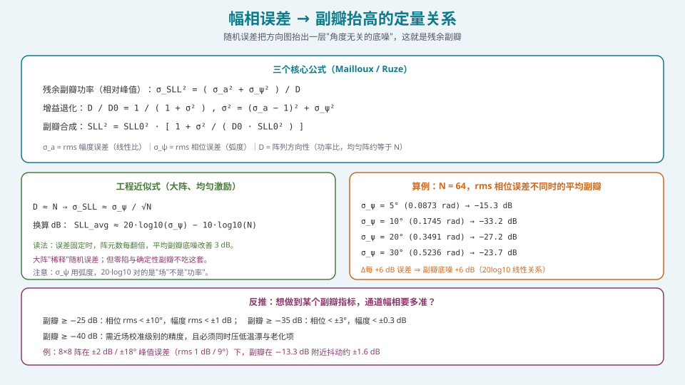
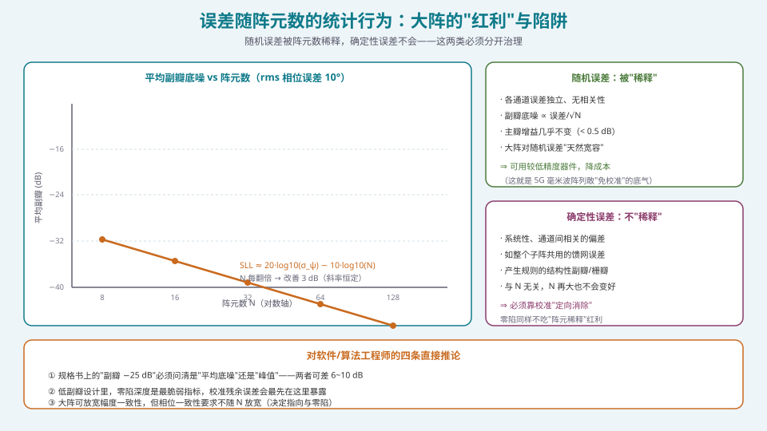

## 本篇要解决什么

S4 用八篇把"算法"讲透了：常规权值、MVDR/LCMV、DOA、稳健化、宽带消斜视、混合架构、定点化、FPGA/HLS 实现。但所有这些算法都建立在一个默认前提上：

> **N 个通道真的能像一副天线一样工作。**

现实里不是。每个通道都有各自的幅度与相位误差，各自的温度漂移，各自的老化。S5 的第一篇回答一个问题：

**核心问题：如果不校准，指标到底会损失多少？**

这个问题必须用数字回答，否则"要不要花成本做校准"就只能靠猜。本篇给三样东西：

1. **误差四分类**——按"能不能一次性解决"分类，而不是按"误差长什么样"分类；
2. **定量关系**——幅相误差如何把副瓣抬起来、把零陷填掉、把波束推偏；
3. **误差预算**——从副瓣/指向指标反推"每个通道要多准"。

---

## 一、误差四分类：决定校准架构的第一张表


*图 1：四类误差的物理来源不同，但真正决定校准架构的是"能不能一次性解决"。*

### 1.1 分类标准：不是"长什么样"，而是"能不能一次解决"

教科书常按"幅度误差 / 相位误差"分类，但这对**设计校准架构没有帮助**。工程上更有用的分类维度是：

\[
\boxed{\ \text{这个误差在校准之后还会不会变？}\ }
\]

- **不会变（或变化极慢）** ⇒ **一次性离线校准**就能解决，写进静态补偿表；
- **会变（随温度、时间、扫描角）** ⇒ **必须在线解决**，靠内建自检周期性追。

### 1.2 四类误差

| 类别 | 典型来源 | 量级 | 校准属性 |
| --- | --- | --- | --- |
| ① **静态制造公差** | 移相器每 bit 误差、衰减器误差、馈网/线缆长度公差、阵元位置与贴装误差 | 移相器 ±5~±10°、衰减器 ±0.3~±0.5 dB | **一次性**（出厂标定） |
| ② **器件非理想** | PM-AM/AM-PM 转换、插损随状态变化、幅相耦合、增益压缩 | 随工作点变化 | **查表补偿**（与①同表，但需覆盖工作点） |
| ③ **互耦与罩体** | 单元间互耦、边缘效应、有源驻波随扫描角变化、天线罩插损与折射 | 随扫描角变化 | **部分一次性 + 部分在线** |
| ④ **温漂与老化** | 相位温漂（约 0.03 °/℃ 量级，有源 GaN 器件更大）、增益漂移、器件老化、在轨辐照累积 | 连续变化 | **必须在线**（内建自校准） |

**关键判据**：问一句"这个量在校准之后还会不会变？"

- 变化时间尺度 **≫ 任务周期** ⇒ 离线；
- 变化时间尺度 **≤ 任务周期** ⇒ 在线。

### 1.3 为什么这个分类如此重要

因为它直接对应**两套完全不同的工程投入**：

- 离线校准：需要**近场扫描架 / 暗室 / 精密转台**——一次性巨额资本投入，但只做一次；
- 在线校准：需要**内建环回网络 / 耦合线 / 参考通道**——增加硬件复杂度与成本，但换来长期可维护性。

**把"必须在线"的东西当成"一次性"来做，是校准设计里最贵的错误。**

---

## 二、幅相误差 → 副瓣抬高的定量关系



*图 2：三条核心公式与数值算例；随机误差把能量摊成一层"角度无关的底噪"。*

### 2.1 物理图像：随机误差把能量"洒"到全空间

理想阵列的副瓣由激励分布**确定性**决定（比如均匀激励下第一副瓣 −13.2 dB）。一旦引入**随机**的幅相误差，能量会被"洒"到所有方向上，形成一层**角度无关的副瓣底噪（residual sidelobe）**。

### 2.2 三个核心公式（Mailloux / Ruze）

设每个通道的幅度误差（线性比）与相位误差（弧度）为**零均值高斯**随机量，rms 分别为 \(\sigma_a\)、\(\sigma_\psi\)，阵列方向性（功率比）为 \(D\)：

**（1）残余副瓣功率（相对峰值）**

\[
\sigma_{SLL}^{2}=\frac{\sigma_a^{2}+\sigma_\psi^{2}}{D}
\tag{2.1}
\]

**（2）增益退化**

\[
\frac{D}{D_0}=\frac{1}{1+\sigma^{2}},\qquad
\sigma^{2}=(\sigma_a-1)^{2}+\sigma_\psi^{2}
\tag{2.2}
\]

**（3）副瓣合成（设计副瓣 + 误差底噪）**

\[
SLL^{2}=SLL_{0}^{2}\left(1+\frac{\sigma^{2}}{D_0\,SLL_{0}^{2}}\right)
\tag{2.3}
\]

**读法**：式 (2.1) 说"误差底噪正比于误差平方、反比于方向性"；式 (2.3) 说"实际副瓣是**设计副瓣与误差底噪的功率和**"——两者谁大听谁的。

### 2.3 工程近似式：大阵、均匀激励

对 \(N\) 元均匀阵、\(\lambda/2\) 间距，有 \(D\approx N\)，于是：

\[
\sigma_{SLL}\approx\frac{\sigma_\psi}{\sqrt{N}}
\quad\Longrightarrow\quad
\boxed{\ SLL_{\text{avg}}\approx 20\log_{10}(\sigma_\psi)-10\log_{10}(N)\ }
\tag{2.4}
\]

> **注意单位**：\(\sigma_\psi\) 用**弧度**，系数是 \(20\log_{10}\)（对"场"取对数），不是 \(10\log_{10}\)。

**数值算例**（\(N=64\)）：

| rms 相位误差 | 弧度 \(\sigma_\psi\) | \(20\log_{10}\sigma_\psi\) | 平均副瓣（式 2.4） |
| --- | --- | --- | --- |
| 5° | 0.0873 | −21.2 dB | −21.2 − 18.1 = **−39.3 dB** |
| 10° | 0.1745 | −15.2 dB | −15.2 − 18.1 = **−33.3 dB** |
| 20° | 0.3491 | −9.1 dB | −9.1 − 18.1 = **−27.2 dB** |
| 30° | 0.5236 | −5.6 dB | −5.6 − 18.1 = **−23.7 dB** |

（其中 \(-10\log_{10}64=-18.1\) dB。）

**规律**：误差每 +6 dB（翻倍），副瓣底噪就 +6 dB——这是严格的线性关系。

### 2.4 从指标反推通道容差

反过来用式 (2.1) 就能做**误差预算**：

| 目标副瓣 | 相位 rms | 幅度 rms |
| --- | --- | --- |
| ≥ −25 dB | < ±10° | < ±1 dB |
| ≥ −35 dB | < ±3° | < ±0.3 dB |
| ≥ −40 dB | 需近场校准级精度 | 且必须同时压低温漂与老化 |

**一个真实参照**：一个 8×8 阵列在 ±2 dB / ±18° 的**峰值**误差（rms 约 1 dB / 9°）下，副瓣在理想值 −13.3 dB 附近抖动约 **±1.6 dB**，而主瓣增益仅降约 0.17 dB——**这就是"平均效应"：主瓣几乎不动，副瓣抖得厉害**。

### 2.5 被低估的受害者：零陷

副瓣抬高是"线性"问题，**零陷被填平是"非线性"问题，而且严重得多**：

- 一个设计到 −40 dB 的零陷，在几度相位误差下就可能退化到 −25 dB 量级；
- 抗干扰能力直接与零陷深度挂钩 ⇒ **"校准不到位"最直接、最致命的后果是抗干扰塌陷**；
- 而且**零陷不享受"阵元数稀释"的红利**（见下节）。

### 2.6 可运行原型：误差对方向图的影响

```python
import numpy as np

N, d, lam = 64, 0.5, 1.0            # 阵元数、间距(λ)、波长
theta = np.linspace(-90, 90, 3601)
u = np.sin(np.deg2rad(theta))
n = np.arange(N)

def pattern(w):
    return np.abs(np.exp(1j*2*np.pi*d/lam*np.outer(u, n)) @ w)

def monte_carlo(sig_a_db, sig_phi_deg, trials=200):
    """返回 (平均副瓣底噪 dB, 峰值副瓣 dB 的均值±散度, 增益退化 dB)"""
    wn = np.ones(N) / N                      # 理想均匀权值
    slls, peaks, gains = [], [], []
    for _ in range(trials):
        a = 10**(np.random.randn(N)*sig_a_db/20)          # 幅度误差(线性)
        p = np.deg2rad(np.random.randn(N)*sig_phi_deg)     # 相位误差(rad)
        w = wn * a * np.exp(1j*p)
        pat = pattern(w); pat /= pat.max()
        db = 20*np.log10(np.maximum(pat, 1e-9))
        main = np.abs(theta) < 5
        side = np.abs(theta) > 8
        gains.append(db[0] - db[main].max())    # 主瓣相对自身的退化
        slls.append(np.mean(db[side]))          # 平均副瓣底噪
        peaks.append(db[side].max())            # 峰值副瓣
    return np.mean(slls), np.mean(peaks), np.std(peaks)

# 复现式(2.4)：N=64, σ_ψ=10°, σ_a≈0
print(monte_carlo(0.0, 10.0))
# 预期：平均副瓣 ≈ -33 dB 量级，与 20log10(0.1745)-10log10(64) 一致
```

**建议**：把上面这段跑一遍，把 \(\sigma_\psi\) 从 2° 扫到 30°，画一条"rms 相位误差 → 平均副瓣"的曲线。**这条曲线就是你以后做误差预算的模板。**

---

## 三、误差随阵元数的统计行为：大阵的红利与陷阱



*图 3：随机误差被 N 稀释（每翻倍改善 3 dB），确定性误差不会。*

### 3.1 随机误差：被"稀释"

由式 (2.4)，平均副瓣随 \(N\) **单调下降**：

\[
SLL_{\text{avg}}\approx 20\log_{10}(\sigma_\psi)-10\log_{10}(N)
\]

- \(N\) **每翻倍**，底噪改善 **3 dB**；
- 主瓣增益几乎不受影响（非相干合成只损失极小的功率）；
- **结论**：**大阵对随机误差天然宽容**。

这正是 5G 毫米波大规模阵列敢用"精度一般"的芯片、甚至在部分场景下"免校准"的底气：只要误差是随机且独立的，大阵自己会把它平均掉。

### 3.2 确定性误差：不"稀释"

但如果误差是**系统性、通道间相关**的（例如整个子阵共用一段馈网、整块板子的温度梯度），它会产生**规则的结构性副瓣**，而且：

- 与 \(N\) **无关**——阵元再多也不会变好；
- 在方向图上表现为**有规律的峰值**（甚至栅瓣），而不是均匀底噪；
- **必须靠校准"定向消除"**。

### 3.3 零陷：两类误差都不享受红利

零陷深度由**通道间相对相位的一致性**决定。随机误差把零陷"填高"，确定性误差把零陷"推偏"——**两种都不吃阵元稀释红利**。

### 3.4 四条直接推论（给算法/软件工程师）

1. **规格书上的"副瓣 −25 dB"必须问清是"平均底噪"还是"峰值"**——两者可差 6~10 dB；
2. **低副瓣设计里，零陷深度是最脆弱指标**，校准残余误差会最先在这里暴露；
3. **大阵可适当放宽幅度一致性，但相位一致性要求不随 \(N\) 放宽**（相位决定指向与零陷）；
4. **误差预算要分"随机项"和"系统项"记账**——只有前者能靠 \(N\) 打折。

---

## 四、从指标到容差：误差预算怎么算

把它做成一个可复用的流程：

**第 1 步**：确定**关键指标**（一般是副瓣与零陷，其次是指向与交叉极化）。

**第 2 步**：用式 (2.1)/(2.3) 把**每个指标**分解为"设计值 + 误差底噪"两部分。

**第 3 步**：把总误差预算拆成各分量（制造、器件、互耦、温漂、老化），通常按**功率相加**（各项独立）：

\[
\sigma_{\text{total}}^2=\sigma_{\text{mfg}}^2+\sigma_{\text{dev}}^2+\sigma_{\text{cpl}}^2+\sigma_{\text{drift}}^2+\sigma_{\text{aging}}^2
\]

**第 4 步**：对每个分量，判断它是**离线可消**还是**在线必须追**（回到图 1 的分类）。

**第 5 步**：给出**残余误差目标**——校准之后剩下多少。经验判据：

\[
\boxed{\ \sigma_{\text{residual}} < \text{移相器步进（LSB）}\ }
\]

因为再准也没有分辨力了。6 bit 移相器 LSB = 5.625°，所以残余相位误差目标常定在 **< 5°** 量级。

**第 6 步**：把"插值误差""量化误差""温补残余"一并计入残余误差预算（否则现场会看到"明明校准了，副瓣还是超"）。

---

## 五、常见误区清单

**误区一：以为"校准"就是"把误差测出来"。**
测量只是第一步。**真正的工程量在"分类 → 决定离线/在线 → 建表 → 插值 → 验收"**这条链上。

**误区二：把误差按"幅度/相位"分类，而不是按"能不能一次解决"分类。**
前者对物理理解有用，后者对**架构决策**有用。**架构决策错了，后面全错。**

**误区三：以为大阵不必校准。**
大阵只对**随机**误差宽容。**系统性误差（馈网、边缘效应、温差梯度）不会因为 N 大而消失**，低副瓣/抗干扰应用仍然必须校准。

**误区四：为了压副瓣把相位精度一路往上顶。**
过剩精度是**浪费成本**：残余误差压到移相器 LSB 以下就没有分辨力了。**目标是"刚好够"，不是"越高越好"。**

**误区五：只关注副瓣，忽略零陷。**
零陷对误差的敏感度**远高于**副瓣，而且**不享受阵元稀释红利**。抗干扰系统里，零陷深度往往比主瓣增益更能体现工程水准。

**误区六：把温漂/老化当"一次校准能解决"。**
温漂变化尺度是 **秒~分钟级**，老化是 **月级**。**它们必须走在线自校准**——这是"系统能否活到设计寿命"的关键。

**误区七：忽略"角度/温度插值"引入的额外误差。**
补偿表是离散格点，在线查询要插值。**插值误差是实打实往残余误差预算里加的**，不能漏。

**误区八：把"平均副瓣"当成"峰值副瓣"报告。**
误导出结论：平均值可能看着达标，峰值却超了很多。**报告里必须写清是均值、1σ、2σ 还是最坏值。**

---

## 六、快速自测

**Q1.** 请说明"误差四分类"，并给出分类的依据。为什么这个依据对校准架构更重要？

<details><summary>参考要点</summary>

**四类**：① 静态制造公差；② 器件非理想；③ 互耦与罩体；④ 温漂与老化。

**依据**：**"校准之后这个误差还会不会变？"**（等价于"变化时间尺度 vs 任务周期"）。

**为什么更重要**：因为它直接决定**离线校准（一次性）** 还是**在线校准（持续）**。离线需要近场/暗室一次性投入；在线需要内建环回网络。**把"必须在线"的当"一次性"做，是校准设计里最贵的错误**——而按"幅度/相位"分类无法给出这个决策。

</details>

**Q2.** 写出残余副瓣功率的公式，并解释每一项的物理含义。为什么它"角度无关"？

<details><summary>参考要点</summary>

\[
\sigma_{SLL}^{2}=\frac{\sigma_a^{2}+\sigma_\psi^{2}}{D}
\]

- \(\sigma_a\)：rms 幅度误差（线性比）；\(\sigma_\psi\)：rms 相位误差（弧度）；
- \(D\)：阵列方向性（功率比），均匀阵约 \(N\)。

**角度无关的原因**：随机误差与阵列几何/角度无关，其贡献在方向图上表现为**白噪声式的均匀能量分布**，所以叠加出一个不随 \(\theta\) 变化的常数底噪项（在式 (2.3) 里表现为把设计副瓣整体"抬"起来并在副瓣间隙里"填平"）。

</details>

**Q3.** \(N=64\) 的均匀阵，rms 相位误差 10°，rms 幅度误差 0.5 dB。估算平均副瓣底噪与增益退化。

<details><summary>参考要点</summary>

**平均副瓣**（用式 (2.4)，忽略幅度项）：
\(20\log_{10}(0.1745)-10\log_{10}(64)=-15.2-18.1=-33.3\) dB。

**含幅度项**（用式 (2.1)）：\(\sigma_a=0.5\) dB ⇒ 线性比 rms \(\approx 0.059\)；\(\sigma_a^2+\sigma_\psi^2=0.0035+0.0305=0.034\)；
\(\sigma_{SLL}^2=0.034/64=5.3\times10^{-4}\) ⇒ \(\sigma_{SLL}=-32.8\) dB。**与上面基本一致**（相位主导）。

**增益退化**（式 (2.2)）：\(\sigma^2=(1.059-1)^2+0.0305=0.0345\) ⇒ \(D/D_0=1/1.0345=-0.147\) dB，**仅约 0.15 dB**。

**要点**：**副瓣掉了 20 dB 量级，增益只掉了 0.15 dB**——误差的破坏是"副瓣式的"，不是"增益式的"。

</details>

**Q4.** 为什么"大阵对误差宽容"这个说法只对了一半？

<details><summary>参考要点</summary>

**对的一半**：对**随机、独立**误差，平均副瓣 \(\propto 1/\sqrt{N}\)（式 (2.4)），\(N\) 每翻倍改善 3 dB。大阵确实"稀释"随机误差。

**错的一半**：对**系统性/相关**误差（馈网共用段、边缘效应、温度梯度），误差产生的副瓣与 \(N\) 无关，不会被稀释；而且**零陷对两类误差都不享受稀释红利**。所以：

> **"大阵不必校准"只在"误差随机 + 指标宽松（只看平均副瓣）"时成立。**

</details>

**Q5.** 一个系统要求副瓣 −35 dB 且要抗干扰（零陷 −40 dB）。你会给出什么通道容差要求？为什么这两个指标的要求不同？

<details><summary>参考要点</summary>

**副瓣 −35 dB**：查 §2.4 表 ⇒ 相位 rms **< ±3°**，幅度 rms **< ±0.3 dB**。

**零陷 −40 dB**：这个要求**比副瓣更严**——因为零陷是"相消"结构，对相对相位误差极其敏感，通常需要残余相位误差压到 **1~2° 量级**，且必须同时压低温漂与老化（否则零陷会在任务周期内飘走）。

**为什么要求不同**：
- 副瓣是**能量叠加**问题（误差能量摊到全空间，再与设计副瓣相加）——**对 Σ 敏感**；
- 零陷是**相消干涉**问题——分子分母都在变，**微小相位误差直接把"完全抵消"变成"不完全抵消"**，灵敏度高一个量级。

**结论**：以抗干扰为核心的应用，**校准指标应以"零陷"为约束来定，而不是以副瓣**。

</details>

**Q6.** 用式 (2.4) 说明：为什么"把相位精度从 5° 提升到 2.5°"对副瓣的收益，和"把阵元数从 64 加倍到 128"是等效的？

<details><summary>参考要点</summary>

式 (2.4)：\(SLL_{\text{avg}}=20\log_{10}(\sigma_\psi)-10\log_{10}(N)\)。

- 相位误差**减半**（5°→2.5°）：\(20\log_{10}\) 项变化 \(20\log_{10}(0.5)=-6.02\) dB；
- 阵元数**翻倍**（64→128）：\(-10\log_{10}(2)=-3.01\) dB。

所以**严格说并不等效**——相位减半带来的改善（−6 dB）是阵元翻倍（−3 dB）的**两倍**。

**但要点在于**：两者都进入同一张"预算表"，可以互相兑换。**如果芯片相位精度提升的成本低于把阵面做大一倍的成本，就应该在精度上投入**——这正是"误差预算"作为成本决策工具的价值。

</details>

**Q7.** 为什么"残余误差目标"常定在"移相器步进以内"？6 bit 移相器的对应数值是多少？

<details><summary>参考要点</summary>

**原因**：补偿值的施加本身就受移相器分辨力限制。若残余误差已小于 1 个 LSB，**再精确的测量也无法转化为更精确的施加**——精度被"执行器分辨力"截断。

**6 bit**：\(360^\circ/2^{6}=360/64=5.625^\circ\) per LSB。

**相位量化最大误差**为半个 LSB：\(360^\circ/2^{B+1}=360/128=2.8125^\circ\)（6 bit）。

**所以残余相位误差目标常定在 < 5°（约 1 个 LSB）量级**。**结论**：提高校准精度的边际收益，在跨越移相器分辨力之后就急剧衰减——**该把预算转去做温补或在线的漂移追踪**。

</details>

**Q8.** 你的系统在出厂校准后测试全部合格，但装到平台上运行 30 分钟后副瓣超标。请给出最可能的原因与排查路径。

<details><summary>参考要点</summary>

**最可能原因**：**温漂**（第 ④ 类误差），且温补表缺失或未生效。

**证据链**：
- 出厂校准在**稳定温度**下做，验收合格；
- 上平台后**大功率功放发热**，阵面出现温度梯度 ⇒ 通道相位漂移；
- 若温度补偿表**未随校准表一起交付**，或**未启用**，补偿就完全失效。

**排查路径**：
1. 读取阵列各点温度传感器，看是否有梯度；
2. 检查补偿表是否**同时包含温度维**，以及在线是否按实测温度插值；
3. 用内建环回在"冷态/热态"各测一次，对比同一通道的相位差 ⇒ **可直接量化温漂系数**；
4. 若确认是温漂：补做**温箱标定**，把温漂系数写入补偿表；若是在线场景，启用**周期性内建自校准**。

**次要可能**：天线罩/平台的介电环境改变（第 ③ 类），需要通过"装机状态下的校准"（近场扫描或外场标定）解决。

</details>

---

## 七、与本站其它专题的连接

| 想了解 | 看哪篇 |
| --- | --- |
| 幅相误差的定量来源（移相器位数、量化副瓣） | [移相器与真时延器件（TTD）](pa-phase-shifter-ttd.html) |
| 互耦与有源驻波如何随扫描角变化 | [功分合成网络与互耦效应](pa-feed-network-mutual-coupling.html) |
| 位宽不足 → 副瓣抬高与零陷暴露 | [定点化：从浮点仿真到硬件指标不退化](pa-fixed-point-quantization.html) |
| 自适应算法对误差的敏感度（MVDR 对角加载） | [自适应波束形成：MVDR 与 LCMV](pa-adaptive-mvdr-lcmv.html) |
| 阵列误差下的性能退化与稳健化 | [零陷展宽、宽带与稳健波束形成](pa-null-broadening-robust.html) |
| 零陷能力与动态范围的下限 | [ADC/DAC：位宽、动态范围与零陷能力](pa-adc-dac-dynamic-range.html) |
| 校准解算怎么落到芯片上 | [FPGA/HLS 实现：数据面与控制面的分工](pa-fpga-hls-implementation.html) |
| 后续：REV 只测幅度也能校准 | [REV 旋转矢量法：原理、推导与解算](pa-rev-calibration.html) |
| 后续：大阵/在轨/在线校准手段 | [近场扫描、并行编码与环回自校准](pa-nearfield-encoding-loopback.html) |
| 后续：校准如何工程化为产线 | [校准工程化：流程、补偿表与验收](pa-calibration-engineering.html) |
| 相控阵的物理机制 | [卫星相控阵天线：从阵元到波束](satellite-phased-array.html) |
| 学习体系全貌 | [相控阵天线学习体系：六阶段路线图](phased-array-roadmap.html) |

---

## 八、延伸阅读

**教材与经典文献**
- Mailloux, *Phased Array Antenna Handbook*（第 3 版）——**残余副瓣与随机误差分析的标准出处**。
- Ruze, "The effect of aperture errors on the antenna radiation pattern"（1952）——**误差 → 副瓣关系的原始论文**。
- Hansen, *Phased Array Antennas*——误差与容差的工程化处理。

**工程应用笔记**
- 相控阵校准需求与容差的工程问答（误差源清单、−25/−35/−40 dB 副瓣对应的相位/幅度容差）。
- 28 GHz 相控阵收发机设计文献——**"±2 dB / ±18° 峰值误差下副瓣抖动 ±1.6 dB"这一算例的来源**，也是"5G 阵列能否免校准"的讨论蓝本。
- 自适应阵列对幅相误差敏感度的研究——论证"零陷对误差比副瓣更敏感"。

**本站衔接**
- 本篇是 **S5 的开篇**。S4 决定你能不能**解决问题**，S5 决定你的系统能不能在**真实硬件上真正工作**；
- 记住这篇的核心产出：**一张"能不能一次解决"的分类表 + 一条 \(SLL\approx20\log_{10}\sigma_\psi-10\log_{10}N\) 的定量关系 + 一套从指标反推容差的预算方法**；
- 下一篇回答"**只测幅度**怎么把相位也校准出来"——[REV 旋转矢量法](pa-rev-calibration.html)。
