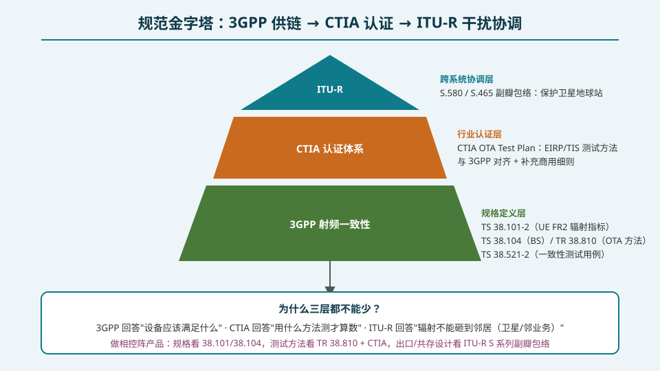
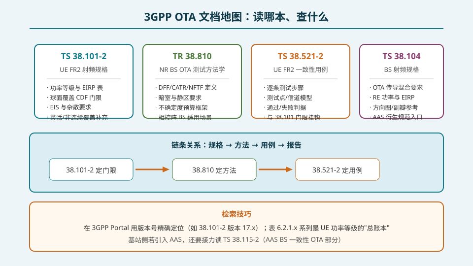
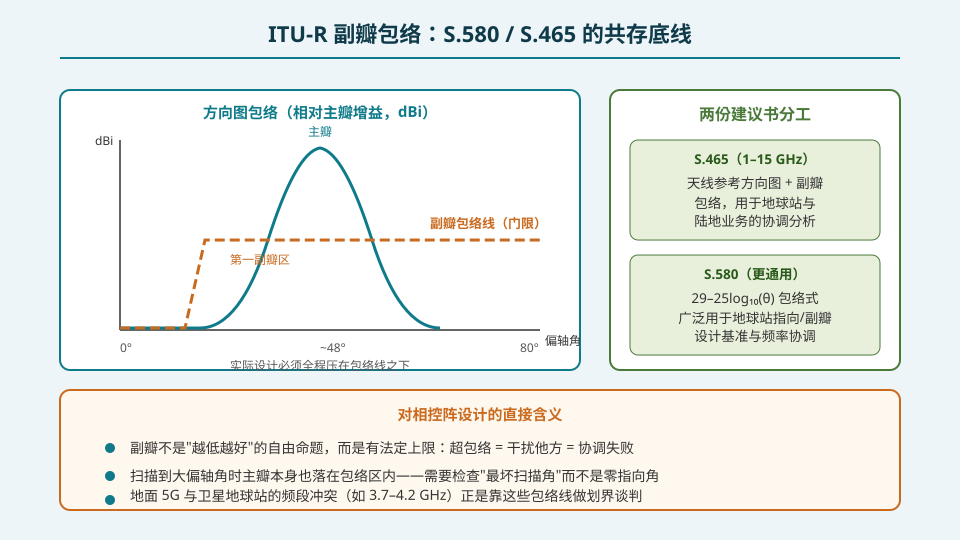

## 本篇要解决什么

前 31 篇讲了"怎么设计、怎么校准、怎么测"，但工程的最后一环是**合规**：你的相控阵凭什么被允许入网？这篇给出三张地图，回答"谁定规矩、规矩之间什么关系、我要读哪些文档"。

**核心问题：从设计到出货，一台相控阵设备要过哪些规范关卡？**

1. **3GPP**——回答"设备应该满足什么"；
2. **CTIA**——回答"用什么方法测才算数"；
3. **ITU-R**——回答"辐射不能砸到邻居"。

---

## 一、规范金字塔：三层各司其职

**底层：3GPP 射频规格（规格定义层）。** 这是所有门限的源头：

- **TS 38.101-2**：UE FR2 辐射要求——功率等级、EIRP/球面覆盖/EIS 门限（第 31 篇的表格出处）；
- **TS 38.104**：BS 射频规格——基站侧 OTA/传导混合要求、RE 功率与 EIRP、AAS 衍生规范的入口；
- **TR 38.810**：BS OTA 方法学研究报告——DFF/CATR/NFTF/RC 的适用性与不确定度框架（第 30 篇的方法出处）；
- **TS 38.521-2**：UE FR2 一致性测试用例——把 38.101-2 的门限变成逐步可执行的测试步骤；
- 引入 AAS 的基站还要接力读 **TS 38.115-2**（AAS BS 一致性，OTA 部分）。

**中层：CTIA 认证体系（行业认证层）。** CTIA 的《OTA Test Plan》把 3GPP 门限配上可审计的测量细则：暗室配置、探头校准、测量不确定度预算、报告模板。运营商（尤其北美市场）的入库认证直接引用 CTIA 计划——**3GPP 说"多少 dB 合格"，CTIA 说"怎么测出来的 dB 才算数"**。

**顶层：ITU-R（跨系统协调层）。** 3GPP 和 CTIA 都只管"这台设备自己"，但相控阵发射的旁瓣会打到别人的系统（卫星地球站、邻频段业务）。ITU-R 的建议书给出**跨系统的副瓣包络与协调方法**——见下一节。

---

## 二、3GPP OTA 文档地图

四份核心文档的链条关系是**规格 → 方法 → 用例 → 报告**：

\[
\text{38.101-2 / 38.104（定门限）} \rightarrow \text{TR 38.810（定方法）} \rightarrow \text{38.521-2 / 38.115-2（定用例）} \rightarrow \text{认证报告}
\]

**检索技巧**：

- 在 3GPP Portal 用**版本号**精确定位（如 38.101-2 v17.x），不同 Release 的门限表差异不小；
- 38.101-2 的表 6.2.1.x 系列是 UE 功率等级的"总账本"，球面覆盖要求在相邻表格；
- TR 38.810 是"研究报告"（TR 而非 TS），它规定方法学而非门限——读它时关注的是不确定度预算结构与各方法的适用条件；
- 38.521-2 每条用例都会回指 38.101-2 的具体条款，报错时沿引用链回溯即可定位门限争议。

---

## 三、ITU-R 副瓣包络：共存的法定底线

两份关键建议书：

- **ITU-R S.580**：给出经典的 **29 − 25log₁₀(θ)** 副瓣包络式（dBi，θ 为偏轴角），广泛用作地球站天线指向/副瓣设计基准与频率协调的判据；
- **ITU-R S.465**：面向 1–15 GHz 的天线参考方向图与副瓣包络，用于地球站与陆地业务之间的协调分析。

**对相控阵设计的三条直接含义：**

1. **副瓣有"法定上限"**：不是越低越好，而是全程不得超包络——超包络 = 干扰他方 = 协调失败 = 产品在某些市场无法入网；
2. **要查最坏扫描角**：相控阵扫描到大偏轴角时，主瓣本身也会落进包络约束区。设计检查必须遍历**最坏扫描角**下的方向图，而不是只在零指向角（boresight）验证；
3. **划界谈判的工具**：地面 5G 与卫星地球站的频段冲突（如 C 波段 3.7–4.2 GHz）正是靠这些包络线做"离多远、隔离多少 dB"的量化谈判。相控阵的副瓣控制水平直接决定部署密度上限。

---

## 四、产品视角：一份要打交道的文档清单

| 阶段 | 要读/要写的文档 | 出处 |
|---|---|---|
| 需求定义 | 功率等级、球面覆盖、共存约束 | TS 38.101-2 / 38.104、ITU-R S.580 |
| 天线设计 | 副瓣包络约束、扫描最坏角检查 | ITU-R S.580/S.465、38.104 方向图参考 |
| 测试系统建设 | 方法选择与不确定度预算 | TR 38.810、CTIA OTA Test Plan |
| 研发验证 | EIRP/TRP/EIS/球面覆盖测量 | 38.101-2 门限 + 38.810 方法 |
| 一致性认证 | 逐条测试用例执行 | TS 38.521-2（UE）/ 38.115-2（AAS BS） |
| 运营商入库 | CTIA 认证报告 | CTIA OTA Test Plan |
| 频率协调 | 与卫星/邻业务的隔离度分析 | ITU-R S.465 及 S 系列协调建议书 |

**收官一句话**：32 篇专题走完"设计 → 算法 → 校准 → 测试 → 合规"的全链路。规范不是设计的枷锁，而是把工程判断变成可入网产品的最后一步映射——每一条门限背后，都是前面 31 篇里的某项能力。

---

## 误区清单

1. **"3GPP 是唯一要读的规范"** —— 3GPP 只管设备自身性能；认证方法（CTIA）与跨系统共存（ITU-R）是另外两层，缺一层产品就出不了门。
2. **"TR 和 TS 是一类东西"** —— TS（Technical Specification）是规范性文件，TR（Technical Report）是研究性文件；38.810 规定方法学，不规定门限。
3. **"副瓣只要够低就一定好"** —— 副瓣包络是上限约束，过低的副瓣往往意味着过宽的主瓣或代价过高的口径；设计目标是"包络之内最优"。
4. **"ITU-R 包络在 boresight 检查一次就行"** —— 相控阵扫描会让主瓣落进包络约束区，必须遍历最坏扫描角验证。
5. **"认证只是走流程"** —— 球面覆盖、EIS 等门限直接反向约束天线口径、功率预算与校准精度；合规需求应当从需求定义阶段就进入设计输入。

---

## 自测（8 题）

**1. 三层规范体系各自回答什么问题？**

答案

3GPP 回答"设备应该满足什么"（规格定义）；CTIA 回答"用什么方法测才算数"（认证方法）；ITU-R 回答"辐射不能干扰邻系统"（跨系统共存与协调）。

**2. 写出 3GPP OTA 文档的链条关系。**

答案

规格 → 方法 → 用例 → 报告：TS 38.101-2/38.104 定门限，TR 38.810 定方法，TS 38.521-2/38.115-2 定一致性用例，最后形成认证报告（CTIA 框架下可审计）。

**3. ITU-R S.580 的副瓣包络公式是什么？适用范围？**

答案

29 − 25log₁₀(θ) dBi（θ 为偏轴角），广泛用作地球站天线副瓣设计基准与频率协调判据；S.465 则覆盖 1–15 GHz 的参考方向图与协调分析。

**4. 为什么相控阵的 ITU-R 合规检查必须遍历扫描角？**

答案

扫描到大偏轴角时主瓣本身会进入包络约束区，副瓣包络检查若只在 boresight 做，会漏掉最坏扫描角的超限情形。

**5. TR 38.810 是门限文件吗？它规定什么？**

答案

不是。TR 是技术报告（研究性），TS 才是规范性文件。38.810 规定 BS OTA 方法学：DFF/CATR/NFTF/RC 的适用条件与测量不确定度框架。

**6. CTIA OTA Test Plan 与 3GPP 规范的关系是什么？**

答案

3GPP 定义"多少 dB 合格"的门限；CTIA 把门限配上可审计的测量细则（暗室配置、校准、不确定度预算、报告模板），运营商入库认证直接引用它。

**7. 地面 5G 与卫星地球站的 C 波段冲突靠什么工具划界？**

答案

ITU-R S 系列副瓣包络（S.580/S.465）与协调建议书：用包络线量化"离多远、需要多少隔离度"，作为频谱划界谈判的依据。

**8. 在产品流程中，ITU-R 约束最早应出现在哪个阶段？**

答案

需求定义阶段：共存/副瓣包络约束应作为设计输入进入天线口径与功率预算，而不是等到一致性测试或频率协调时才发现要改设计。

---

## 站内连接

| 相关主题 | 关系 |
|---|---|
| [测试量：EIRP/TRP/EIS 与球面扫描](/topics/pa-ota-metrics-spherical-scan/) | 上一篇：38.101-2 门限的具体测量方法 |
| [OTA 三方法与暗室工程](/topics/pa-ota-methods-chamber/) | TR 38.810 方法学的完整展开 |
| [通道误差的来源与影响](/topics/pa-channel-error-impact/) | S5 起点：误差 → 副瓣 → ITU-R 包络合规的因果链 |
| [相控阵学习路线图](/pa-learning-roadmap/) | 32 篇专题总览 |

## 延伸阅读

- 3GPP TS 38.101-2 / TS 38.104 / TS 38.521-2 / TS 38.115-2 / TR 38.810 ——本文档地图的原始出处
- CTIA《OTA Test Plan for LTE & NR Devices》——认证测量细则
- ITU-R S.580 / S.465 / S.466 ——地球站副瓣包络与协调建议书
- ITU-R《Handbook on Satellite Communications》——频率协调流程全景
