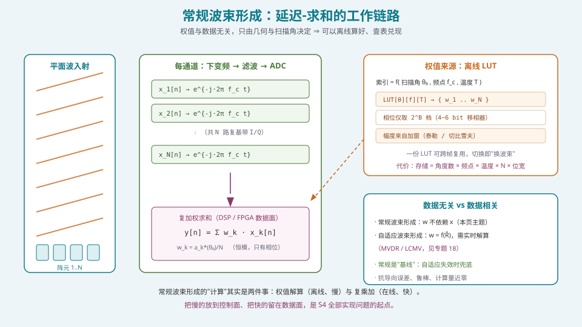
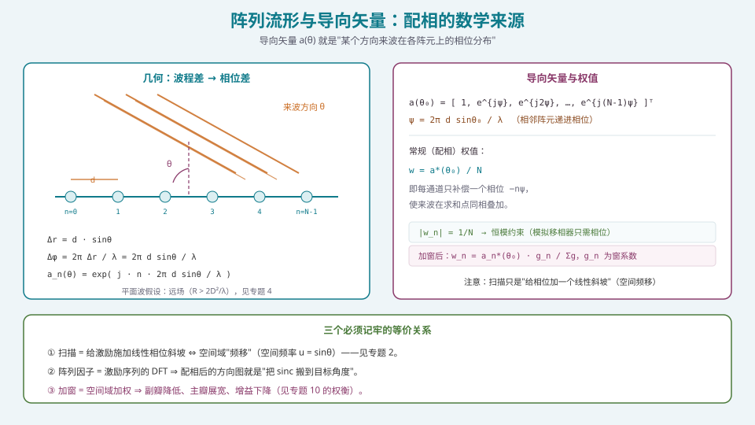
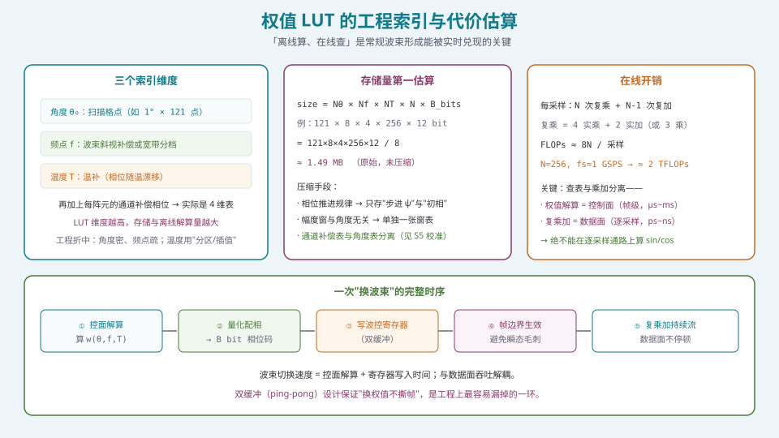

## 本篇要解决什么

这是 S4 主战场的第一篇。S3 把硬件讲完了——你手上有 N 个通道、B 位数字移相器、若干条射频链。现在要回答一个看起来最"平凡"、实则最根本的问题：

**波束形成的权值到底是怎么来的？**

答案是：常规波束形成（conventional beamforming，又叫延迟-求和 / 配相）的权值与**输入数据无关**，它只由**几何 + 扫描角 + 频率**决定。

这句话的分量在于：既然与数据无关，那么它就可以**在软件里离线算好、在运行时查表兑现**。这一性质决定了：

- 常规波束形成的**在线计算量几乎为零**（只有查表 + 复乘加）；
- 它是所有自适应算法的**基线**，也是自适应失效时的**兜底**；
- 它的"计算"其实是两件事：**权值解算**（慢、帧级、控制面）与**复乘加**（快、采样级、数据面）。**把这两件事分开，是 S4 全部实现问题的起点。**

本篇先建立这套"离线-在线"心法，再逐层展开。

---

## 一、延迟-求和：最基础也最不该轻视的波束形成



*图 1：平面波入射 → 每通道下变频/滤波/ADC → 复加权求和；权值来自一张离线 LUT。*

### 1.1 从波程差到配相

均匀线阵（ULA）间距 \(d\)，来波方向 \(\theta\) 相对阵列法线。相邻阵元的**波程差**为 \(d\sin\theta\)，对应的**相位差**为

\[
\psi = \frac{2\pi d}{\lambda}\sin\theta .
\]

要让这个方向的来波在求和点**同相叠加**，就必须在每个阵元上预先补偿一个反向相位 \(-\,n\psi\)。这就是"配相"这个中文词的全部含义。

### 1.2 阵列流形与导向矢量

把各阵元上的相位分布写成一个向量，就是**阵列流形**（array manifold）在方向 \(\theta\) 处的取值，即**导向矢量**（steering vector）：

\[
\mathbf{a}(\theta)=\Big[1,\;e^{j\psi},\;e^{j2\psi},\;\dots,\;e^{j(N-1)\psi}\Big]^{\mathsf T},\qquad \psi=\frac{2\pi d}{\lambda}\sin\theta .
\]

对平面阵，导向矢量是二维相位面的列向量化；对共形阵/带互耦的真实阵，\(\mathbf{a}(\theta)\) 由**实测标定**给出（这正是 S5 校准要产出的东西之一）。

### 1.3 常规权值：配相 + 归一化

常规（延迟-求和）波束形成的权值就是**导向矢量的共轭**，再除以 \(N\) 归一化：

\[
\mathbf{w}_{\text{conv}}=\frac{1}{N}\,\mathbf{a}^{*}(\theta_0).
\]

于是每个通道的权值满足

\[
|w_n|=\frac{1}{N}\quad\Rightarrow\quad \text{恒模约束（constant modulus）}.
\]

**恒模约束的工程意义**：如果权值只有相位、幅度恒定，那么**模拟移相器**就能独立兑现它——不需要可变的幅度控制。这就是 AESA 只靠移相器就能扫描的原因（见 [移相器与真时延器件（TTD）](pa-phase-shifter-ttd.html)）。

> 反过来，一旦你想要**低副瓣**或**自适应零陷**，就必须打破恒模（动幅度），这就是"只用移相器做不到"的边界。

输出信号即

\[
y[n]=\mathbf{w}^{\mathsf H}\mathbf{x}[n]=\sum_{k=1}^{N}w_k^{*}\,x_k[n].
\]

---

## 二、三种等价表述：别被公式吓到



*图 2：几何（波程差）→ 相位差 → 导向矢量 → 权值，是一条链，不是四件事。*

把上面几式放在一起，会看到三个必须记牢的等价关系（推导见 [空间频率与空间傅里叶变换](pa-spatial-frequency-fft.html)）：

| 表述 | 内容 | 工程含义 |
| --- | --- | --- |
| 几何表述 | 补偿波程差 \(d\sin\theta_0\) | 阵列要"看向"目标 |
| 相位表述 | 施加线性相位斜坡 \(-n\psi_0\) | 移相器只需一条线性相位码 |
| 信号表述 | 在空间频率 \(u=\sin\theta\) 上做**频移** | 扫描 = 空间频谱平移 |

**这意味着三件事在数学上是同一件事**。理解这一点，后面所有算法都能"少背一半公式"：

1. **扫描**只是给激励乘一个线性相位斜坡（空间频移）；
2. **阵列因子**就是激励序列的 DFT（空间谱）；
3. **加窗**就是在空间域做加权滤波（副瓣降低、主瓣展宽）。

### 2.1 扫描不是"重新算一套权值"，而是"改一个斜坡"

在工程实现里，最省的做法是**只存相位步进 \(\psi_0\) 和初相**，扫描时按 \(n\) 线性累加即可。这样一张 LUT 可以覆盖整个扫描范围，而不必逐角度存整张表。这是"角度维度可以压缩"的来源。

---

## 三、权值 LUT：工程上真正的实现方式



*图 3：LUT 索引 = 角度 × 频点 × 温度 × 通道；存储与解算是"控面"的活。*

### 3.1 索引维度

工程上真正被查表的对象是一个"**按需索引的权值库**"，典型维度：

- **角度 \(\theta_0\)**：扫描格点，例如 \(1^\circ\) 步进、\(-60^\circ\sim60^\circ\) 共 121 点；
- **频点 \(f\)**：用于波束斜视补偿（见 [波束斜视与宽带相控阵](pa-beam-squint-wideband.html)）或宽带分档；
- **温度 \(T\)**：温补（相位随温漂移，见 S5 校准）；
- **通道 \(k\)**：每通道的补偿相位（校准残差的落点）。

前三维决定"物理场景"，第四维决定"这台具体的硬件"。

### 3.2 存储量的第一估算

\[
\text{size}=N_\theta\times N_f\times N_T\times N\times B_{\text{bits}} .
\]

取 \(N_\theta=121,\;N_f=8,\;N_T=4,\;N=256,\;B=12\) bit：

\[
\frac{121\times 8\times 4\times 256\times 12}{8}\approx 1.49\ \text{MB}.
\]

单看不吓人，但它要进波控 FPGA 的片上存储，并且**随温度档数线性增长**。工程上的压缩手段：

1. **相位推进规律化**：只存步进 \(\psi_0\) 与初相，不存整张相位表；
2. **幅度与角度解耦**：幅度窗系数与 \(\theta_0\) 无关，单独一张窗表（长度 \(N\)）；
3. **通道补偿与角度解耦**：校准残差单独一张表，与扫描表做在线相加（见 S5）。

### 3.3 量化：把浮点权值变成硬件能吃的码字

权值最终要交给 \(B\) 位数字移相器，因此相位只能取 \(2^B\) 档。量化误差表现为"**空间相位噪声**"，会把随机副瓣抬高（量化副瓣），并可能产生离散的**量化瓣**。经验起点：

- \(B=4\)：约 \(-20\sim-25\) dB 量化副瓣量级；
- \(B=5\)：约 \(-28\sim-30\) dB；
- \(B=6\)：约 \(-33\) dB 以下（\(5.625^\circ\) LSB）。

> **大阵对小位数容忍度更高**：量化副瓣近似 \(\propto 1/(N\cdot 2^B)\)，所以 \(N\) 大时可用更少位数——这是直接决定成本的一条结论（见 [移相器与真时延器件（TTD）](pa-phase-shifter-ttd.html)）。

### 3.4 计算量：FLOP 估算

每采样一次波束形成的实数运算量约为

\[
\text{FLOPs}\approx 8N\quad(\text{复乘 }4\text{ 实乘}+2\text{ 实加，复加 }2\text{ 实加，含共轭近似}).
\]

\(N=256\)、采样率 \(1\) GSPS 时约 **2 TFLOPs**。这个量级**不可能用 CPU 逐采样做**，必须落到 FPGA/ASIC 的并行数据面——正是 [FPGA/HLS 实现：数据面与控制面的分工](pa-fpga-hls-implementation.html) 讨论的分工。

### 3.5 一次"换波束"的时序

1. **控面解算**：算 \(\mathbf{w}(\theta_0,f,T)\)（µs~ms 级）；
2. **量化配相**：转成 \(B\) 位相位码；
3. **写波控寄存器**：**双缓冲（ping-pong）**，避免换权值瞬间撕帧；
4. **帧边界生效**；
5. **数据面复乘加持续流**，不停顿。

**双缓冲是最容易漏掉的一环**：没有它，换波束的瞬间会输出一段"半新半旧"权值形成的畸变波束。

---

## 四、代码：离线 LUT 生成与在线复乘加

### 4.1 生成权值（离线）

```python
import numpy as np

def steering_vector(N, d_over_lambda, theta_deg):
    """ULA 导向矢量 a(θ)，θ 以法线为 0°。"""
    theta = np.deg2rad(theta_deg)
    n = np.arange(N)
    return np.exp(1j * 2*np.pi * d_over_lambda * n * np.sin(theta))

def conventional_weights(N, d_over_lambda, theta0_deg, window=None):
    """常规波束形成权值：配相 + 归一化（可叠加加窗）。"""
    a = steering_vector(N, d_over_lambda, theta0_deg)
    w = np.conj(a) / N
    if window is not None:                      # 窗系数 g_n
        g = np.asarray(window, dtype=float)
        w = w * g / g.sum() * 1.0               # 保持直流增益归一
    return w

def quantize_phase(w, bits):
    """把复数权值量化为 B 位移相码（恒模近似）。"""
    levels = 2 ** bits
    step = 2 * np.pi / levels
    phi = np.angle(w)
    code = np.round(phi / step).astype(int) % levels
    return code, np.exp(1j * code * step)
```

### 4.2 在线复乘加（数据面原型）

```python
def beamform_frame(X, w):
    """X: (N, T) 复基带；w: (N,) 权值向量；返回 (T,) 波束输出。"""
    return w.conj() @ X          # 一句矩阵乘 = N 次复乘加，逐列并行
```

**关键认知**：上面这两段代码，在工程上**运行在不同的处理器、不同的时标上**。第一段跑在 CPU/ARM 上、按帧触发；第二段映射到 FPGA 的 DSP48/DSP58 阵列、按采样节拍流水。**把它们的边界划清，就是用软件思维做相控阵的第一课。**

### 4.3 验证：把方向图算出来对拍

```python
def pattern_db(w, N, d_over_lambda, ang=np.arange(-90, 90.5, 0.1)):
    P = []
    for th in ang:
        a = steering_vector(N, d_over_lambda, th)
        P.append(abs(w.conj() @ a) ** 2)
    P = np.array(P); P /= P.max()
    return ang, 10*np.log10(P + 1e-12)
```

对均匀激励的 ULA，应看到第一副瓣约 **−13.2 dB**、HPBW \(\approx 0.886\lambda/(Nd\cos\theta_0)\)——若对不上，先查 \(d/\lambda\) 与角度定义（法线 / 端射）。

---

## 五、常见误区清单

**误区一：把常规波束形成当成"低端方案"。**
它是**基线、兜底与参考**。没有它，你无法判断自适应算法"到底改善了没有"；自适应在低快拍/导向误差下会退化，此时常规反而是最稳的。

**误区二：以为扫描要"每个角度重算一套权值"。**
扫描只是施加线性相位斜坡（空间频移）。**只存步进与初相即可**，这是 LUT 能压缩的根本原因。

**误区三：忘记恒模约束是"硬约束"。**
常规权值 \(|w_n|=1/N\) **天然恒模**，所以只用移相器就能实现。一旦你做加窗或自适应，破了恒模，就必须有幅度控制——**这是"能不能只用移相器"的分水岭**。

**误区四：在逐采样通路上算 sin/cos。**
相位码必须**离线算好或查表**。在数据面调 `sinf/cosf`（更别说 `exp`）会直接让流水线跑不到采样率。

**误区五：忽略权值量化的副瓣代价。**
4 位移相器的量化副瓣可能把副瓣抬到 \(-20\sim-25\) dB，**直接击穿你的低副瓣指标**。选位数要与其后端的加窗目标一起权衡。

**误区六：加窗时不重新归一化。**
乘窗后若不把直流增益归一，主瓣峰值会变化，导致"增益对不上账"。加窗的代价应是**主瓣展宽 + 增益略降**，不是"总增益凭空变化"。

**误区七：不做双缓冲，直接在帧中途换权值。**
会产出"半新半旧"权值的畸变波束与瞬态毛刺。**换波束必须落在帧边界。**

**误区八：把"标称扫描范围"当成"性能保证范围"。**
\(\pm60^\circ\) 是几何可达范围，但增益随扫描滚降（见 [扫描损耗](pa-scan-loss.html)）。**常规波束形成的能力上限由孔径与扫描角共同决定，不由软件决定。**

**误区九：认为"常规算法简单，所以谁都会写"。**
把公式写成代码确实简单；但把权值解算、量化、LUT 索引、双缓冲、温补、通道补偿**串成一条可维护的流水线**，是 S4/S5 真正的工作量所在。

---

## 六、快速自测

**Q1.** 写出均匀线阵在方向 \(\theta\) 处的导向矢量，并说明"配相"为什么等价于给激励加一个线性相位斜坡。

<details><summary>参考要点</summary>

\[
\mathbf{a}(\theta)=\big[1,e^{j\psi},\dots,e^{j(N-1)\psi}\big]^{\mathsf T},\quad \psi=\tfrac{2\pi d}{\lambda}\sin\theta .
\]

阵列各阵元上，来波因波程差 \(d\sin\theta\) 产生**递进相位** \(n\psi\)。要同相叠加，需在每阵元补偿 \(-n\psi\)，即激励相位随阵元序号 \(n\) **线性递减**——这就是"线性相位斜坡"。

在空间频率域看：令 \(u=\sin\theta\)，则 \(\psi = 2\pi (d/\lambda) u\)，配相 \(e^{-jn\psi}\) 恰是**在 \(u\) 轴上的频移**。所以扫描 = 空间频移 = 线性相位斜坡，三者为同一件事。

</details>

**Q2.** 一个 \(N=64\)、\(d=\lambda/2\) 的 ULA，请写出它在 \(\theta_0=30^\circ\) 的常规权值，并说明其是否满足恒模约束。

<details><summary>参考要点</summary>

\(\psi_0=\pi\sin30^\circ=\pi/2\)，故 \(\mathbf{a}(30^\circ)=[1,e^{j\pi/2},e^{j\pi},\dots]^{\mathsf T}\)，权值

\[
w_n=\frac{1}{64}\,e^{-j n\pi/2}.
\]

幅度 \(|w_n|=1/64\) 恒定 ⇒ **满足恒模约束**，可由纯移相器实现（相位只需取 \(0,\pi/2,\pi,3\pi/2\) 四档，故 2 bit 位足够——但工程上不会只用 2 bit，因为量化副瓣太高）。

**注意**：角度定义要一致（法线 or 端射）；若定义在端射，\(\psi_0=\pi\) 结果不同。

</details>

**Q3.** 为什么说"常规波束形成的在线计算量几乎为零"？请区分"权值解算"与"复乘加"。

<details><summary>参考要点</summary>

- **权值解算**：算 \(\mathbf{w}(\theta_0,f,T)\)（含 sin/cos、归一化、量化），复杂度约 \(O(N)\)，但**只在换波束/换帧/换温时发生**，频率是 µs~ms 级；而且对固定场景可**完全离线预计算**并查表。
- **复乘加**：每采样 \(O(N)\)，频率是 ns 级，**必须实时**。这才是真正的"在线"计算量。

"几乎为零"指的是**权值解算的实时负担**：因为权值与数据无关，可以预计算。而**复乘加是不可省的**，它的量级 \(8N\) FLOPs/采样正是数据面设计的核心约束。

**结论**：常规波束形成的"简单"体现在**权值解算可离线**，不体现在"复乘加可以省"。

</details>

**Q4.** 一张 LUT 用 \(N_\theta=91\)、\(N_f=4\)、\(N_T=3\)、\(N=128\)、\(B=10\) bit 索引。估算其存储量，并给出至少两种压缩方法。

<details><summary>参考要点</summary>

\[
\frac{91\times4\times3\times128\times10}{8}\approx 174.7\ \text{KB}.
\]

压缩方法：
1. **只存相位步进 \(\psi_0\) 与初相**（利用线性斜坡规律），角度维度从"存整表"降为"存两个数"；
2. **幅度窗与角度解耦**：窗系数与 \(\theta_0\) 无关，单独一张长度 \(N\) 的表；
3. **通道补偿与角度解耦**：校准残差一维表，与扫描表在线相加；
4. **温度维度用分区 + 插值**（而非逐度全存）。

</details>

**Q5.** 你用了 4 位的数字移相器，但指标要求副瓣 ≤ −30 dB。可能出什么问题？怎么改？

<details><summary>参考要点</summary>

**问题**：4 位相位量化（LSB \(22.5^\circ\)）引入的**量化副瓣**量级约 \(-20\sim-25\) dB，且即使加窗把"理想副瓣"压到 \(-35\) dB，量化副作用也会把实际副瓣**抬回** \(-25\) dB 左右 ⇒ **指标必然不达标**。

**改法（按代价从低到高）**：
1. **升位数**：\(B=6\)（LSB \(5.625^\circ\)）可把量化副瓣压到 \(-33\) dB 以下；
2. **量化相位抖动（dithering）**：用随机化/确定性抖动打散相位误差的空间周期性，把离散量化瓣"抹成"随机副瓣底噪；
3. **幅度加权 + 相位加权联合优化**（部分抵消量化带来的幅相误差）；
4. **改架构**：用数字波束成形的幅度自由度（若架构允许）。

**核心**：**量化副瓣是"后加的底噪"，不能靠前端加窗再压下去**——位数在架构阶段就应锁定。

</details>

**Q6.** 为什么"换波束"必须做双缓冲，直接写寄存器会怎样？

<details><summary>参考要点</summary>

复乘加数据面**流水不停地**接收采样。若在帧中途逐通道改写权值，会出现一段"部分通道是新权、部分是旧权"的过渡区间，结果是**畸变波束 + 瞬态毛刺**（幅度/相位跳变，甚至产生频谱杂散）。

**双缓冲**：准备两组寄存器，控面把新权值写进"后台"组，在**帧边界**一次性切换指针，让数据面看到的是**原子更新**的完整权值组。

代价：多一组寄存器；收益：换波束"无损、无毛刺"。这是波束扫描/波束切换类系统的**必备设计**。

</details>

**Q7.** 常规波束形成与加窗（如泰勒窗）如何联合使用？请写出权值表达式并说明代价。

<details><summary>参考要点</summary>

\[
w_n=\frac{g_n}{N\,\bar{g}}\;a_n^{*}(\theta_0),\qquad \bar{g}=\frac{1}{N}\sum_n g_n
\]

即"先配相、再乘窗系数、最后归一化保直流增益"。

**代价**（见 [加权加窗：低副瓣设计的完整方法](pa-amplitude-tapering.html)）：
1. **主瓣展宽**：窗越"重"，主瓣越宽（分辨力下降）；
2. **增益略降**：由于 \(\bar{g}\) 归一，峰值增益近似不变，但**有效孔径利用率**下降使方向性系数略降；
3. **破恒模**：幅度非均匀 ⇒ 需要可变衰减器或数字幅度加权 ⇒ 硬件成本上升。

**收益**：副瓣从 \(-13.2\) dB 压到 \(-25\sim-40\) dB，抗干扰与频谱合规能力显著提升。

</details>

**Q8.** 一个数字波束形成系统 \(N=1024\)、采样率 \(2\) GSPS、16 波束。请估算复乘加的运算量，并说明为什么必须用 FPGA 而非 CPU。

<details><summary>参考要点</summary>

单波束：\(\text{FLOPs}\approx 8N f_s = 8\times1024\times2\times10^9\approx 1.64\times10^{13}\) FLOPs ≈ **16.4 TFLOPs**。

16 波束：若共用同一组 N 路输入、每波束各自复乘加，则为 \(16\times16.4\approx\) **262 TFLOPs**（实际可先共用一个"子阵预合成"降低，见架构篇）。

**为什么必须 FPGA**：
1. CPU 逐指令执行的吞吐远低于此（单核百 GFLOPs 量级，且功耗/时延失控）；
2. 数据面要求**确定性时延与线速率**，CPU 的缓存/调度不确定性不可接受；
3. FPGA 用 DSP 阵列 + 流水线可做到**每时钟多路复乘加**，且功耗/能效高一个量级以上。

**结论**：这就是"数据面必须硬件化、控面留在 CPU"的量化理由。

</details>

---

## 七、与本站其它专题的连接

| 想了解 | 看哪篇 |
| --- | --- |
| 空间频率、DFT 与阵列因子的对偶 | [空间频率与空间傅里叶变换](pa-spatial-frequency-fft.html) |
| 阵列因子、方向图乘积定理 | [阵列因子：从两个阵元到 N 个阵元](pa-array-factor.html) |
| 波束宽度、增益与孔径 | [波束宽度、增益与孔径](pa-beamwidth-gain-aperture.html) |
| 加窗（泰勒/切比雪夫）与副瓣 | [加权加窗：低副瓣设计的完整方法](pa-amplitude-tapering.html) |
| 移相器位数与恒模的代价 | [移相器与真时延器件（TTD）](pa-phase-shifter-ttd.html) |
| 自适应权值（数据相关） | [自适应波束形成：MVDR 与 LCMV](pa-adaptive-mvdr-lcmv.html) |
| 宽带下的斜视与补偿 | [波束斜视与宽带相控阵](pa-beam-squint-wideband.html) |
| 权值落到芯片上 | [FPGA/HLS 实现：数据面与控制面的分工](pa-fpga-hls-implementation.html) |
| 相控阵的物理机制 | [卫星相控阵天线：从阵元到波束](satellite-phased-array.html) |
| 学习体系全貌 | [相控阵天线学习体系：六阶段路线图](phased-array-roadmap.html) |

---

## 八、延伸阅读

**教材**
- Mailloux, *Phased Array Antenna Handbook*, 3rd ed.，第 1、2 章。配相、阵列流形与馈电的系统处理。
- Van Trees, *Optimum Array Processing*，第 2 章。阵列流形与常规波束形成的严格定义。
- Balanis, *Antenna Theory*, 第 6 章。阵列因子与方向图乘积定理。

**工程 / 数据手册**
- 厂商相控阵芯片应用笔记（ADI / Qorvo / NXP）：**权值 LUT 与波控接口的实际定义**通常就藏在这里。
- Keysight, *How to Design and Test a Phased Array Antenna*：波控、量化与测试的衔接。
- Xilinx/AMD Vitis DSP 库文档：复数乘加到 DSP48/DSP58 的映射。

**本站衔接**
- 本篇建立"**离线解算 + 在线复乘加**"的分工，是后续 [MVDR](pa-adaptive-mvdr-lcmv.html)、[DOA](pa-doa-music-esprit.html)、[定点化](pa-fixed-point-quantization.html)、[HLS 实现](pa-fpga-hls-implementation.html) 的共同底盘。
- 记住一句话：**常规波束形成是基线；任何"更好"的算法，都必须先在它之上证明自己更好。**
