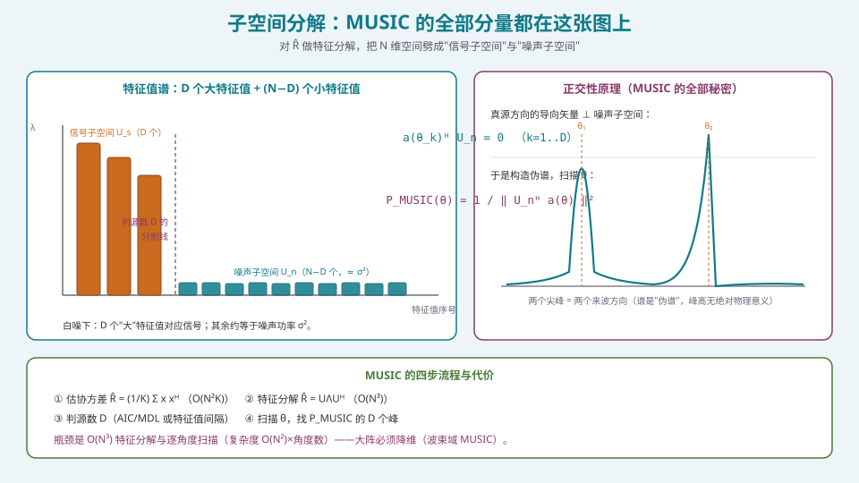
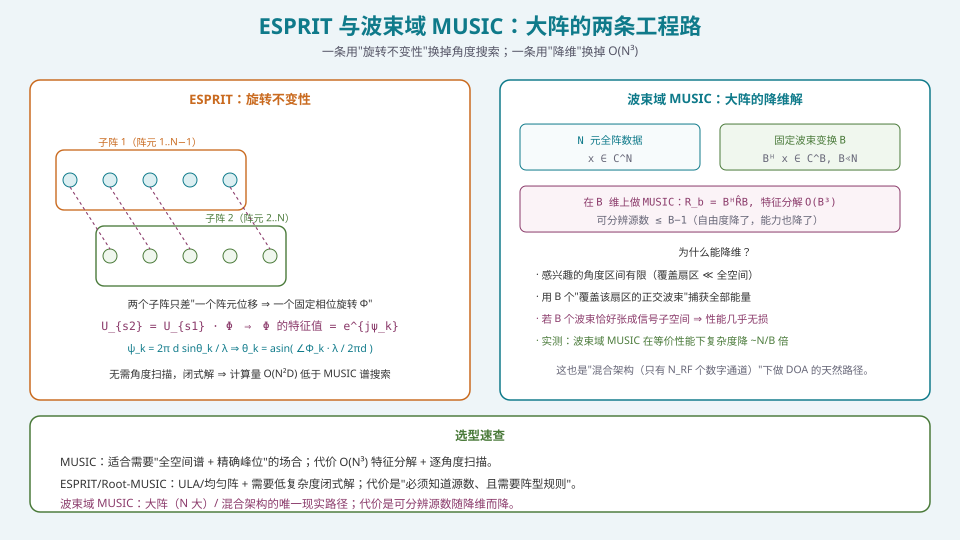

## 本篇要解决什么

[自适应波束形成](pa-adaptive-mvdr-lcmv.html)（MVDR）能"压"干扰，但它**不知道干扰在哪**——零陷是 \(\hat{\mathbf{R}}^{-1}\) 自动挖出来的，不可解释、不能提前规划。要**定位**干扰（为了提前规划零陷、为了频谱态势感知、为了校准），就需要**DOA 估计**（Direction of Arrival）。

核心问题：

**在一堆阵元接收到的信号里，如何高精度地反演出"来波方向"？**

常规波束形成的答案受**孔径（Rayleigh 限）**约束。子空间类方法（MUSIC / ESPRIT）能突破这个约束，代价是**更多计算 + 更强假设**。这一篇要把这套"超分辨"的机理、工程改良与代价讲透。

---

## 一、子空间：MUSIC 的全部秘密



*图 1：特征值分成"大（信号）"与"小（噪声）"两组；真源方向的导向矢量与噪声子空间正交。*

### 1.1 信号模型与协方差

\(N\) 元阵、\(D\) 个非相干源、白噪声：

\[
\mathbf{x}(t)=\sum_{k=1}^{D}\mathbf{a}(\theta_k)s_k(t)+\mathbf{n}(t)
=\mathbf{A}\,\mathbf{s}(t)+\mathbf{n}(t),
\]

其协方差矩阵

\[
\mathbf{R}=\mathbb{E}[\mathbf{x}\mathbf{x}^{\mathsf H}]
=\mathbf{A}\,\mathbf{R}_s\,\mathbf{A}^{\mathsf H}+\sigma^2\mathbf{I}.
\]

对 \(\mathbf{R}\) 做特征分解 \(\mathbf{R}=\mathbf{U}\boldsymbol\Lambda\mathbf{U}^{\mathsf H}\)：

- **信号子空间** \(\mathbf{U}_s\)：\(D\) 个最大特征值对应的特征向量，与 \(\mathbf{A}\) 张成同一空间；
- **噪声子空间** \(\mathbf{U}_n\)：其余 \(N-D\) 个特征值（\(\approx\sigma^2\)）对应的特征向量。

### 1.2 正交性原理

由于 \(\mathrm{span}(\mathbf{U}_s)=\mathrm{span}(\mathbf{A})\)，而 \(\mathbf{U}_s\perp\mathbf{U}_n\)，故每个真源方向满足

\[
\mathbf{a}^{\mathsf H}(\theta_k)\,\mathbf{U}_n=\mathbf{0},\qquad k=1,\dots,D .
\]

这就是 MUSIC 的全部秘密：**真源方向的导向矢量与噪声子空间正交**。于是定义伪谱

\[
\boxed{\ P_{\text{MUSIC}}(\theta)=\frac{1}{\big\|\mathbf{U}_n^{\mathsf H}\mathbf{a}(\theta)\big\|^2}\ }
\]

当 \(\theta\) 恰为真源方向时分母趋零、谱出现尖峰。**扫描 \(\theta\) 找峰**即得 DOA（注意：这是"伪谱"，峰高无绝对物理含义，只有**位置**有意义）。

### 1.3 为什么能"超分辨"

常规波束形成的谱本质是"做空间滤波再测能量"，分辨率受孔径限制；MUSIC 用的是**子空间的几何正交性**，与孔径无关——只要 SNR 足够、阵列流形精确、源数正确，就能分辨**间隔小于常规波束宽度**的两个源。

**代价（三条硬前提）**：

1. **足够 SNR 与快拍**：低 SNR 时特征值"大小"分不开，子空间模糊；
2. **精确阵列流形**：\(\mathbf{a}(\theta)\) 必须与真实阵一致（否则正交性被破坏，峰位漂移）——这是 S5 校准的直接动因；
3. **源数已知且正确**：\(D\) 错，子空间切错，谱就错。

---

## 二、判源数：AIC 与 MDL

MUSIC 需要知道 \(D\)。信息论准则从特征值出发估计：

**AIC**（Akaike Information Criterion）与 **MDL**（Minimum Description Length）都在"拟合优度 + 复杂度惩罚"上做文章。以负对数似然项

\[
L(d)=K(N-d)\ln\!\left[\frac{\frac{1}{N-d}\sum_{i=d+1}^{N}\hat\lambda_i}{\Big(\prod_{i=d+1}^{N}\hat\lambda_i\Big)^{1/(N-d)}}\right]
\]

为基础，加不同惩罚项：

- **AIC**：\(\hat d_{\text{AIC}}=\arg\min_d\big[L(d)+d(2N-d)\big]\)；
- **MDL**：\(\hat d_{\text{MDL}}=\arg\min_d\big[L(d)+\tfrac12\big(d(2N-d)+1\big)\ln K\big]\).

**工程结论**：**MDL 是一致估计**（大样本下收敛到真值），**AIC 会过估计**（倾向多报源）。所以**工程上首选 MDL**；但在低 SNR/少快拍下两者都可能不准，实践中常辅以**特征值最大间隔法**或**固定保守值**（如取 \(N/3\)）。

> **判源数偏大 vs 偏小的后果不对称**：派偏大只会让噪声子空间少几个向量，"多出几个小假峰"，真峰位置基本不变；派偏小则**真源直接消失**。**因此"宁大勿小"是更安全的默认。**

---

## 三、ESPRIT：用旋转不变性换掉角度搜索



*图 2：ESPRIT 用两个"错开一个阵元"的子阵的旋转关系闭式解出角度；波束域 MUSIC 用降维解决大阵复杂度。*

MUSIC 要在角度上**逐点扫描**，计算量与角度分辨率成正比。对**均匀阵**，ESPRIT 用"**旋转不变性**"绕开搜索：

把阵列分成两个**只差一个阵元位移**的子阵（阵元 \(1..N-1\) 与 \(2..N\)）。它们的导向矩阵满足

\[
\mathbf{A}_2=\mathbf{A}_1\boldsymbol\Phi,\qquad
\boldsymbol\Phi=\mathrm{diag}\big(e^{j\psi_1},\dots,e^{j\psi_D}\big),\quad
\psi_k=\frac{2\pi d}{\lambda}\sin\theta_k .
\]

于是信号子空间也满足 \(\mathbf{U}_{s2}=\mathbf{U}_{s1}\boldsymbol\Phi\)。解出 \(\boldsymbol\Phi\)（最小二乘 / TLS），其**特征值的相位**直接给出 \(\psi_k\)：

\[
\theta_k=\arcsin\!\left(\frac{\angle\Phi_k\cdot\lambda}{2\pi d}\right).
\]

**特点**：**闭式解、无需角度扫描**，复杂度约 \(O(N^2D)\)，低于 MUSIC 的谱搜索；代价是**要求阵型规则**（均匀阵）且**必须知道源数**。

**Root-MUSIC** 是另一条省搜索的路：对 ULA，把 MUSIC 谱的分母写成多项式 \(z=\mathrm e^{j\psi}\)，**求根**代替扫描，得到的根的角度即 DOA，精度常优于谱搜索。

---

## 四、相干源与空间平滑

MUSIC 的致命弱点：**相干源（coherent sources）**。

多径（同一发射源的直达径 + 反射径）会让源之间**完全相干**，此时 \(\mathbf{R}_s\) **秩亏**，信号子空间维数小于 \(D\)——"信号的一部分漏进噪声子空间"，MUSIC 谱峰**退化甚至消失**。

**空间平滑（spatial smoothing）**：把 \(N\) 元阵划成 \(K\) 个**重叠子阵**（每个长 \(L=N-K+1\)），对各子阵的协方差矩阵**取平均**，即可**恢复满秩**：

\[
\hat{\mathbf{R}}_{\text{ss}}=\frac{1}{K}\sum_{k=1}^{K}\mathbf{R}_k .
\]

- 每增加一个平滑子阵，可处理的相干源数 **+1**；
- 代价：**有效阵元数减少**（孔径变小），分辨力略降；
- **前后向平均（forward-backward averaging）** 是另一种做法（利用中心对称阵的共轭对称），常与空间平滑联合使用。

> 工程判断：**如果不确定信号是否相干，先跑一遍 MUSIC；若谱峰"矮胖或消失"，就对协方差做空间平滑/前后向平均再跑。**

---

## 五、CRB：性能的理论下界

任何 DOA 估计器都有方差下界——**Cramér–Rao Bound（CRB）**。ULA 的近似式（高 SNR、非相干源）：

\[
\mathrm{CRB}(\theta)\ \approx\ \frac{6}{K\cdot N(N^2-1)\cdot \mathrm{SNR}\cdot(\pi\cos\theta)^2}\ \ \text{(rad}^2\text{)} .
\]

三个重要含义：

1. **∝ 1/(SNR·K)**：提高 SNR 或增加快拍都能降方差；
2. **∝ 1/N³**：阵元数是"立方收益"——**大阵的 DOA 精度优势极强**；
3. **∝ 1/cos²θ**：**扫描角越大，精度越差**（与扫描损耗同源，见 [扫描损耗](pa-scan-loss.html)）。

**工程用法**：CRB 给出"最好能到什么精度"的基准。若实测远差于 CRB，说明有**失配（校准不足）或模型误差**，而不是算法不够好。

---

## 六、工程实现：波束域降维与参考代码

### 6.1 大阵的唯一现实路径：波束域 MUSIC

\(N\) 大时，\(O(N^3)\) 特征分解与 \(O(N^2)\times\)角度数 的谱搜索都难以实时。**波束域 MUSIC**：

1. 用 \(B\) 个固定/自适应波束（覆盖感兴趣扇区）做变换 \(\mathbf{B}\in\mathbb C^{N\times B}\)，得 \(\mathbf{x}_b=\mathbf{B}^{\mathsf H}\mathbf{x}\)；
2. 在 \(B\) 维上估协方差 \(\mathbf{R}_b=\mathbf{B}^{\mathsf H}\hat{\mathbf{R}}\mathbf{B}\)；
3. 在 \(B\) 维上做 MUSIC（特征分解 \(O(B^3)\)）。

**为什么几乎无损**：若这 \(B\) 个波束张成的空间**包含整个信号子空间**，则降维不损失信息。实测中在等价性能下复杂度降低约 \(N/B\) 倍。

**代价**：可分辨源数上限从 \(N-1\) 降到 \(B-1\)——**降维的本质仍是"用自由度换复杂度"**。在混合架构里，\(B\) 直接受 \(N_{RF}\) 限制（见 [混合波束成形](pa-hybrid-beamforming.html)）。

### 6.2 参考代码

```python
import numpy as np

def ula_steering(N, d_over_lambda, theta_deg):
    n = np.arange(N)
    return np.exp(1j*2*np.pi*d_over_lambda*n*np.sin(np.deg2rad(theta_deg)))

def music_spectrum(X, N, d_over_lambda, D, angles):
    """X: (N, K) 复快拍；返回 (len(angles),) 伪谱。"""
    R = X @ X.conj().T / X.shape[1]
    lam, U = np.linalg.eigh(R)              # 升序特征值
    Un = U[:, :N-D]                         # 噪声子空间（最小 N−D 个）
    out = []
    for th in angles:
        a = ula_steering(N, d_over_lambda, th)
        out.append(1.0 / (np.linalg.norm(Un.conj().T @ a) ** 2 + 1e-15))
    return np.array(out)

def esprit(X, N, d_over_lambda, D):
    """ULA ESPRIT：返回 D 个角度（度）。"""
    R = X @ X.conj().T / X.shape[1]
    lam, U = np.linalg.eigh(R)
    Us = U[:, -D:]                          # 信号子空间（最大 D 个）
    U1, U2 = Us[:-1, :], Us[1:, :]          # 两个错位子阵
    Phi = np.linalg.lstsq(U1, U2, rcond=None)[0]   # U2 ≈ U1 Φ
    psi = np.angle(np.linalg.eigvals(Phi))
    return np.rad2deg(np.arcsin(np.clip(psi/(2*np.pi*d_over_lambda), -1, 1)))

def mdltest(R, K):
    """MDL 判源数（基于特征值）。"""
    lam = np.sort(np.linalg.eigvalsh(R))[::-1]
    N = len(lam); best, d_best = np.inf, 0
    for d in range(N):
        tail = lam[d:]
        if len(tail) == 0 or np.any(tail <= 0):
            continue
        am = tail.mean()
        gm = np.exp(np.log(tail).mean())
        L = K*(N-d)*np.log(am/gm)
        pen = 0.5*(d*(2*N-d)+1)*np.log(K)
        if L+pen < best:
            best, d_best = L+pen, d
    return d_best
```

### 6.3 空间平滑的工程实现要点

```python
def spatial_smooth(X, sub_len):
    """前向空间平滑：X:(N,K) → 平滑后 (sub_len, sub_len) 协方差。"""
    N = X.shape[0]
    K_sub = N - sub_len + 1
    Rss = np.zeros((sub_len, sub_len), dtype=complex)
    for k in range(K_sub):
        Xk = X[k:k+sub_len, :]
        Rss += Xk @ Xk.conj().T
    return Rss / (K_sub * X.shape[1])
```

**验证建议**：用 `pyroomacoustics` 的 DOA 模块或 MATLAB `phased.MUSICEstimator` / `mdltest` / `espritdoa` 对拍——**不同实现的谱峰位置应一致**（峰高可以不同）。

---

## 七、常见误区清单

**误区一：以为 MUSIC 的谱峰高度代表信号强度。**
MUSIC 是**伪谱**，峰高没有绝对物理意义，**只有峰的位置**才对应 DOA。拿峰高当"信号功率"是典型误解。

**误区二：不判源数（或判错）。**
\(D\) 是 MUSIC/ESPRIT 的**必需输入**。派小了真源消失；派大了出现假峰。**工程上首选 MDL（一致估计）**，AIC 会过估；宁可略偏大也别偏小。

**误区三：忘了"低 SNR / 少快拍会退化"。**
MUSIC 的超分辨是**条件性**的。SNR 太低时特征值"大/小"两组交融，子空间切不开，谱峰漂移抖动，甚至不如常规/Capon 稳。

**误区四：忽略阵列流形误差。**
阵元位置误差、幅相不一致、互耦、罩体——都会让实际的 \(\mathbf{a}(\theta)\) 偏离理想模型，破坏正交性 ⇒ **峰位偏、峰变矮**。**DOA 精度最怕的不是算法，是校准。**（转 S5）

**误区五：对相干源直接用 MUSIC。**
多径相干会让协方差秩亏，谱峰退化。**必须先空间平滑 / 前后向平均**，否则结果不可信。

**误区六：在大阵上硬算 \(O(N^3)\)。**
\(N=256\) 的特征分解 + 逐 0.1° 扫描，单次可能几十毫秒到秒级，**无法实时**。**大阵必须波束域降维**（或在混合架构下用 \(N_{RF}\) 维做）。

**误区七：把 ESPRIT 用到非均匀阵上。**
ESPRIT 的旋转不变性依赖**阵型的平移对称（均匀阵）**。非均匀阵/稀疏阵上 ESPRIT 不成立（除非做特殊设计），此时用 MUSIC 或稀疏 DOA 方法。

**误区八：忘记 DOA 与自适应的"鸡生蛋"关系。**
稳健的自适应（如协方差重构）需要**先知道干扰方向**；而 DOA 又需要在"干扰存在"的数据上估计。工程上常是**迭代/交替**的：粗 DOA → 重构协方差 → 自适应 → 复核。**别指望一步到位。**

**误区九：忽略 CRB，把"算法不够好"当成根因。**
先算 CRB。如果实测精度已接近 CRB，那**问题在物理（SNR/孔径/角度），不在算法**。改算法无益，要改硬件或场景。

---

## 八、快速自测

**Q1.** 写出 MUSIC 伪谱表达式，并说明分母的含义；为什么谱峰位置对应来波方向？

<details><summary>参考要点</summary>

\[
P_{\text{MUSIC}}(\theta)=\frac{1}{\big\|\mathbf{U}_n^{\mathsf H}\mathbf{a}(\theta)\big\|^2}.
\]

**分母**是"候选导向矢量在噪声子空间上的投影能量"。若 \(\theta\) 恰为真源方向，则 \(\mathbf{a}(\theta)\) 落在信号子空间内，与噪声子空间正交 ⇒ 投影能量→0 ⇒ 谱→∞（尖峰）。反之，非源方向能量不为零，谱被压低。

**所以峰位置 = 来波方向**。峰高无绝对含义（是伪谱）。

</details>

**Q2.** \(N=16\) 的 ULA，MUSIC 最多能分辨多少个源？若用波束域 MUSIC 降到 \(B=6\) 维，最多又能分辨多少？

<details><summary>参考要点</summary>

- 全维 \(N=16\)：信号子空间最多 16 维，但噪声子空间需至少 1 维（否则无法正交判别），故**可分辨源数 ≤ N−1 = 15**。工程上还要留余量（判源误差），实际可靠性远低于 15。
- 波束域 \(B=6\)：**可分辨源数 ≤ B−1 = 5**。

**结论**：降维的代价就是**可分辨源数下降**——这是"复杂度 ↔ 能力"的直接交易。

</details>

**Q3.** 为什么"源数判大"比"判小"更安全？

<details><summary>参考要点</summary>

设真源数 \(D=2\)。
- **判大（\(D'=3\)）**：噪声子空间取 \(N-3\) 维，少了一个向量。真源方向的导向矢量**仍然**（近似）落在剩余噪声子空间的正交补之外 ⇒ 两个真峰**依然存在**，只是多出一个较矮的随机假峰。
- **判小（\(D'=1\)）**：信号子空间只取 1 维，**第二个真源被"划进"噪声子空间**，正交性条件被破坏 ⇒ **第二个源直接消失或严重畸变**。

**所以"宁大勿小"**：假峰可后处理剔除（按显著性阈值），丢掉的真源却无法挽回。

</details>

**Q4.** ESPRIT 相对 MUSIC 的优势与代价分别是什么？

<details><summary>参考要点</summary>

**优势**：
1. **无需角度扫描**——闭式解，直接得到角度，计算量从"O(N³)+O(N²)×角度数"降到约 \(O(N^2D)\)；
2. 对 ULA 尤其高效；
3. 可避免谱搜索的"网格分辨率"限制。

**代价**：
1. **要求阵型规则（均匀/平移对称）**——旋转不变性依赖此；
2. **必须知道源数 \(D\)**（与 MUSIC 相同）；
3. 低 SNR 下子空间估计误差会传到位移矩阵，精度可能不如 Root-MUSIC/MUSIC；
4. 对**相干源**同样需要平滑。

</details>

**Q5.** 什么是"相干源"？为什么它会让 MUSIC 失效？写出空间平滑的基本思路。

<details><summary>参考要点</summary>

**相干源**：两个（或多个）源信号**完全相关**（如直达径 + 反射径，复幅度成固定比例）。

**为何失效**：源协方差矩阵 \(\mathbf{R}_s\) 因相干而**秩亏**（\(D\) 个源只贡献 < D 个自由度），导致 \(\mathrm{rank}(\mathbf{ARS A}^{\mathsf H})<D\) ⇒ **信号子空间维数不足**，一部分信号能量"漏"进噪声子空间 ⇒ 正交性被破坏 ⇒ 谱峰退化或消失。

**空间平滑**：把 \(N\) 元阵划分为 \(K\) 个（重叠的）长度 \(L=N-K+1\) 的子阵，取各子阵协方差矩阵的平均：

\[
\hat{\mathbf{R}}_{\text{ss}}=\frac{1}{K}\sum_{k=1}^{K}\mathbf{R}_k .
\]

平均使相干源之间的**相位关系被"打散"**，从而**恢复满秩**。每增加一个子阵，可处理相干源 +1；代价是**有效孔径减小、分辨力略降**。

</details>

**Q6.** 一个 256 元阵要在 10 ms 内完成一次 DOA。直接做全维 MUSIC 可行吗？给出你的工程方案。

<details><summary>参考要点</summary>

**直接全维不可行（大概率）**：
- 特征分解 \(O(N^3)=256^3\approx1.7\times10^7\) 复运算/次；
- 谱搜索：若 0.1° 步进、覆盖 ±60° 需 1200 个角度，每角度算 \(\|\mathbf{U}_n^{\mathsf H}\mathbf{a}\|^2\) 约 \(O(N\cdot(N-D))\)，总量可达 \(10^8\sim10^{10}\) 量级，10 ms 窗口内很难在通用处理器上完成。

**工程方案**：
1. **波束域降维**：用 \(B=16\sim32\) 个波束覆盖扇区，在 \(B\) 维做 MUSIC（\(O(B^3)\) 特征分解 + \(B\) 维谱搜索），复杂度降 \(1\sim2\) 个量级；
2. **判源数**用 MDL（先在全维特征值上算，或在降维后算）；
3. **Root-MUSIC / ESPRIT**（若阵型规则）替代谱搜索，省掉网格扫描；
4. **协方差递推 + 只在需要时重估**，避免每帧全量重算；
5. 控制面（CPU/DSP）做特征分解与谱计算，**不与数据面复乘加抢资源**。

**一句话**：**大阵 DOA 的答案同样是"降维 + 少搜索"。**

</details>

**Q7.** CRB 的三个 scaling 关系是什么？它们对系统设计有什么指导？

<details><summary>参考要点</summary>

\[
\mathrm{CRB}(\theta)\ \propto\ \frac{1}{K\cdot N^3\cdot \mathrm{SNR}\cdot\cos^2\theta}.
\]

1. \(\propto 1/(\mathrm{SNR}\cdot K)\)：提高 SNR 或增加快拍都降方差——但快拍受平稳性限制；
2. \(\propto 1/N^3\)：**阵元数是立方收益** ⇒ 大阵 DOA 精度优势极强（这是大阵的价值之一）；
3. \(\propto 1/\cos^2\theta\)：**扫描角越大精度越差**（有效孔径投影变小）。

**指导**：
- 要提升 DOA 精度，**优先加阵元数**（N³ 收益）而非单纯加功率（线性收益）；
- 大角度扫描场景要**预期精度下降**，指标不能按法线方向定；
- **用 CRB 当"标尺"**：实测远差于 CRB ⇒ 问题在失配（校准），不在算法。

</details>

**Q8.** DOA 估计与自适应零陷为什么要"交替迭代"？

<details><summary>参考要点</summary>

**互为前提的困境**：
- **稳健自适应（协方差重构类）** 需要**先知道干扰方向**（才能在干扰方向重构 \(\hat{\mathbf{R}}_{i+n}\)，避免自零陷）；
- 而 **DOA 又需要在"含干扰的数据"上估计**，且强干扰会污染估计。

**交替迭代流程**：

1. **粗 DOA**（在原始数据上，容错即可）；
2. **协方差重构**：按粗 DOA 构造干扰方向，重构 \(\hat{\mathbf{R}}_{i+n}\)（剔除期望信号分量）；
3. **自适应权值**：用重构的协方差解 MVDR/LCMV；
4. **复核**：用新权值后的残余谱重新估计 DOA，必要时回到 2。

**本质**：这是"**先粗定位、再精抑制、再复核**"的工程闭环——没有单步最优解，只有可收敛的迭代。参见 [零陷展宽、宽带与稳健波束形成](pa-null-broadening-robust.html) 的稳健化讨论。

</details>

---

## 九、与本站其它专题的连接

| 想了解 | 看哪篇 |
| --- | --- |
| 自适应权值（MVDR/LCMV） | [自适应波束形成：MVDR 与 LCMV](pa-adaptive-mvdr-lcmv.html) |
| 常规（数据无关）波束形成 | [常规波束形成：数据无关的权值计算](pa-conventional-beamforming.html) |
| 干扰在动、模型失配怎么办 | [零陷展宽、宽带与稳健波束形成](pa-null-broadening-robust.html) |
| 降维与模拟-数字联合 | [混合波束成形（HBF）的子阵设计](pa-hybrid-beamforming.html) |
| 特征分解落到位宽与芯片 | [定点化：从浮点仿真到硬件指标不退化](pa-fixed-point-quantization.html) · [FPGA/HLS 实现](pa-fpga-hls-implementation.html) |
| 自由度由架构决定 | [四种架构的选型：PESA / AESA / 混合 / 全数字](pa-architecture-selection.html) |
| 扫描角对精度的代价 | [扫描损耗：波束越偏增益越低](pa-scan-loss.html) |
| 阵列流形误差与校准 | S5 · 通道误差的来源与影响 · REV 旋转矢量法 |
| 相控阵的物理机制 | [卫星相控阵天线：从阵元到波束](satellite-phased-array.html) |
| 学习体系全貌 | [相控阵天线学习体系：六阶段路线图](phased-array-roadmap.html) |

---

## 十、延伸阅读

**经典文献**
- Schmidt, "Multiple Emitter Location and Signal Parameter Estimation," *IEEE Trans. AP*, 1986。**MUSIC 原始论文**。
- Roy & Kailath, "ESPRIT—A Subspace Rotation Approach to Estimation of Parameters of Cisoids in Noise," *IEEE Trans. ASSP*, 1989。**ESPRIT 原始论文**。
- Wax & Kailath, "Detection of Signals by Information Theoretic Criteria," *IEEE Trans. ASSP*, 1985。**AIC/MDL 判源原始论文**。
- Stoica & Nehorai, "MUSIC, Maximum Likelihood, and Cramér-Rao Bound," *IEEE Trans. ASSP*, 1989。**性能界的经典分析**。
- Shan, Wax & Kailath, "On Spatial Smoothing for Direction-of-Arrival Estimation of Coherent Signals," 1985。**空间平滑原始论文**。

**工程工具**
- MATLAB Phased Array System Toolbox：`phased.MUSICEstimator`、`mdltest`、`espritdoa`、`rootmusicdoa`、`spsmooth`。
- `pyroomacoustics` 的 DOA 子模块（用于算法对拍）。
- Van Trees, *Optimum Array Processing*，第 6、8 章。子空间方法与性能界的系统处理。

**本站衔接**
- 上游：[自适应波束形成](pa-adaptive-mvdr-lcmv.html)（怎么压干扰）；
- 下游：[零陷展宽、宽带与稳健波束形成](pa-null-broadening-robust.html)（为什么压不住、怎么压稳）；
- 三者构成 S4 抗干扰闭环：**DOA 定位 → MVDR/LCMV 抑制 → 稳健化保命**。
