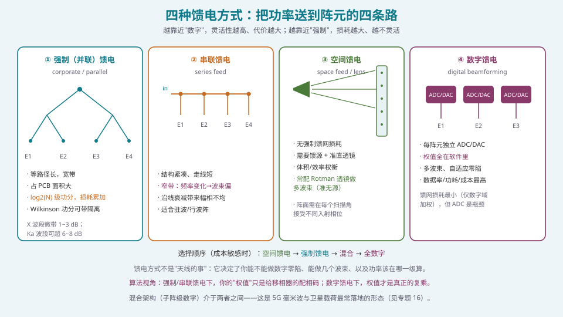
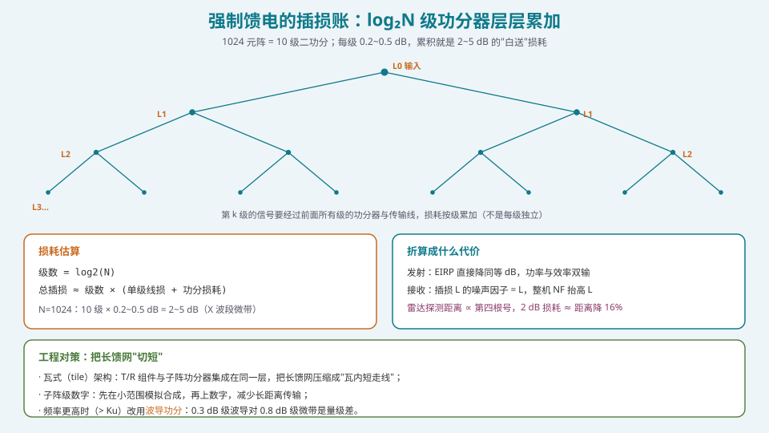
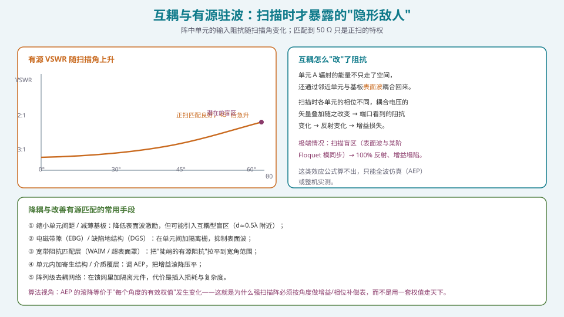

## 本篇要解决什么

[T/R 组件](pa-tr-module-rf-frontend.html) 解决的是"一个阵元背后有什么"。[移相器与 TTD](pa-phase-shifter-ttd.html) 解决的是"相位怎么给"。

但还有一层**在阵元之间**的东西没讲：**功率怎么送到每个阵元、以及阵元之间怎么互相干扰**。

这一篇回答三个问题：

1. **馈电网络（feed network）有几种做法？** 各自在什么场景下划算？
2. **强制馈电到底吃掉多少效率？** 这笔账怎么算、怎么减小？
3. **互耦（mutual coupling）为什么只在"扫描时"露头？** 它对算法意味着什么？

---

## 一、四种馈电方式



*图 1：越靠近"数字"，灵活性越高、代价越大；越靠近"强制"，损耗越大、越不灵活。*

| 方式 | 结构 | 优点 | 缺点 | 典型场景 |
| --- | --- | --- | --- | --- |
| ① 强制（并联）馈电 corporate | 二叉功分树（Wilkinson/T 型），等路径长 | 宽带、幅相一致性好 | 占面积大、损耗随 N 累积 | 大多数 AESA 的模拟馈网 |
| ② 串联馈电 series | 沿一条线依次耦合到各阵元 | 紧凑、走线短 | 窄带（频率变化→波束偏）、沿线衰减不均 | 驻波/行波阵、波导缝隙阵 |
| ③ 空间馈电 space / lens | 馈源照射阵面，靠自由空间分配 | 无强制馈网损耗 | 需馈源 + 准直结构，体积/效率权衡 | Rotman 透镜多波束、反射阵 |
| ④ 数字馈电 digital | 每阵元（或子阵）独立 ADC/DAC | 权值全在软件、多波束、自适应零陷 | 数据率/功耗/成本最高 | 数字阵雷达、卫星直连终端 |

### 1.1 强制馈电：log₂N 级功分

N=1024 的强制馈电需要 **10 级**二功分（\(2^{10}=1024\)）。每一级都带来：

- **功分器插损**：Wilkinson 约 0.1~0.3 dB（含隔离电阻损耗），T 型接近理想但无隔离；
- **传输线损耗**：微带在 X 波段约 0.2~0.5 dB/级；到 Ka 波段可超 0.6 dB/级。

### 1.2 Wilkinson vs T 型：隔离度的取舍

- **Wilkinson 功分器**：各端口匹配、**输出端口之间有隔离**。接收阵尤其重要——隔离能防止"阵元经馈网互相耦合"，避免耦合路径产生的不稳定与方向图畸变；
- **T 型功分器**：简单紧凑、损耗小，但**无隔离**。发射阵常可接受，因为末级 PA 本身提供了反向隔离。

**对算法工程师的意义**：如果馈网隔离不足，那么"阵元 A 的激励受阵元 B 的阻抗变化影响"这条路径会变得显著，阵列因子就不再只是"激励的 DFT"——这是"仿真漂亮、实测翻车"的经典来源。

### 1.3 空间馈电与透镜

空间馈电用自由空间代替了强制馈网，**省掉了几 dB 的插损**，代价是需要一个馈源和准直结构，且阵面要能在每个扫描角接受不同的入射相位。

最常见的形态是 **Rotman 透镜**：它是一种"真时延"的准无源波束形成网络，天然支持多个同时波束（每个输入端口对应一个波束），且**天然无斜视**（因为是真时延）。缺点：体积、设计与制造难度、旁瓣控制受限。

**对算法工程师的意义**：Rotman 透镜的多波束是"硬件预置"的，算法能做的只是"选哪个端口"，而不是"任意合成权值"。**架构决定自由度**——这一点与 [四种架构的选型](pa-architecture-selection.html) 完全一致。

---

## 二、强制馈电的插损账



*图 2：1024 元阵 = 10 级二功分；每级 0.2~0.5 dB，累积就是 2~5 dB 的"白送"损耗。*

### 2.1 怎么算

\[
L_{feed}\approx \log_2(N)\times(L_{divider}+L_{line})
\]

| N | 级数 | X 波段典型总插损 | Ka 波段典型总插损 |
| --- | --- | --- | --- |
| 16 | 4 | 0.8~2 dB | 2~3 dB |
| 64 | 6 | 1.2~3 dB | 3~5 dB |
| 256 | 8 | 1.6~4 dB | 4~6 dB |
| 1024 | 10 | 2~5 dB | 6~8 dB |

### 2.2 折算成系统代价

- **发射**：EIRP 直接降同等 dB，且功率与效率双输（多出来的损耗变热）；
- **接收**：无源插损的**噪声因子等于其线性损耗**，整机 NF 抬高 \(L_{feed}\)（见 [T/R 组件](pa-tr-module-rf-frontend.html)）。Ka 波段 6 dB 的馈损会把一个本来 2.5 dB 的 LNA 系统拉到 8.5 dB 的 NF——**这是灾难性的**；
- **雷达探测距离 ∝ 第四根号**：2 dB 损耗 ≈ 探测距离降约 16%。

### 2.3 对策：把长馈网"切短"

1. **瓦式（tile）架构**：T/R 组件与子阵功分器集成在同一层，"瓦内短走线"替代长馈网；
2. **子阵级数字**：先在小范围模拟合成，再上数字，减少长距离传输；
3. **波导功分**：> Ku 波段时，0.3 dB 级波导对 0.8 dB 级微带是量级差；
4. **低损耗基板 + 加厚介质**：降低导体损耗（但要注意表面波）。

> **一句话**：Ka 波段每 0.1 dB 都很贵。**这就是为什么毫米波相控阵几乎都是瓦式 + AiP（antenna-in-package）。**

---

## 三、互耦与有源驻波：扫描时才暴露的隐形敌人



*图 3：阵中单元的输入阻抗随扫描角变化；匹配到 50 Ω 只是正扫的特权。*

### 3.1 互耦的机制

阵中一个单元的**输入阻抗**，不等于它孤立时的阻抗。原因：它辐射的能量不只走了空间，还通过邻近单元与基板**表面波**耦合回来，形成"**有源输入阻抗**" \(Z_{active}(\theta_0,\phi_0)\)。

扫描时，各单元相位不同，**耦合电压的矢量叠加随之改变** ⇒ 端口看到的阻抗变化 ⇒ 反射变化 ⇒ 增益损失。典型现象：

- 正扫匹配良好（VSWR ≈ 1.2），扫描到 45° 后 VSWR 可升到 **3:1** 以上；
- 极端情况出现**扫描盲区（scan blindness）**：某一角度上 **100% 功率反射**，增益断崖式塌陷。

### 3.2 扫描盲区的两种成因

| 类型 | 机理 | 更常见于 |
| --- | --- | --- |
| 栅瓣型（onset of grating lobe） | 第一高阶 Floquet（Bloch）模从**衰减转为传播**，阵元间强相互作用 | **间距较大**的阵（d > λ/2） |
| 表面波型（surface wave） | 高阶 Floquet 模与**介质基板支撑的表面波**相位速度"同步"（Oliner / Wood anomaly；Pozar & Schaubert 的印刷偶极子分析） | **密集阵**（厚基板、高介电常数） |

**关键认知**：这类效应**公式算不出来**，必须靠**全波仿真**（得到有源单元方向图 AEP，或全阵扫描阻抗）或**整机实测**。

### 3.3 降耦与改善有源匹配的手段

1. **缩小单元间距 / 减薄基板**：降低表面波激励；但 d≈0.5λ 附近可能引入互耦型盲区，需权衡；
2. **EBG（电磁带隙）/ DGS（缺陷地结构）**：在阵元间加隔离栅或修改地平面，抑制表面波在基板内的传播；
3. **WAIM / 超表面罩（wide-angle impedance matching）**：把"陡峭的有源阻抗"拉平到宽角范围；
4. **单元内加寄生结构 / 介质覆层**：直接整形 AEP，把扫描增益滚降压平；
5. **阵列级去耦网络**：在馈网里加隔离元件，代价是插损与复杂度；
6. **打破周期性**：非周期/稀疏子阵布局（array-of-array 等），切断 Floquet 模与表面波的"一对一"关系。

> **量级参考**：有实测报道用"wire medium 床钉式罩"（bed of nails metaradome）消除盲区、并显著降低栅瓣，代价是低频端正扫增益下降 3~5 dB。**所有降耦手段都有代价，没有"只赚不赔"的方案。**

---

## 四、天线罩（radome）：最后一层非理想

天线罩是相控阵"必须穿"的一层介质，它对**宽角扫描**的伤害比对固定波束更大：

- **插入损耗**：典型 0.3~1 dB（随入射角增大而增大，大角处可达 2 dB 以上）；
- **波束偏移（beam deflection）**：折射使波束指向偏离，且**随扫描角变化**——这等价于一个"角度相关的指向误差"；
- **副瓣抬升**：罩体厚度/材料不均匀会引起相位起伏；
- **交叉极化恶化**：斜入射时极化纯度下降。

**工程做法**：
1. 天线罩的电磁设计必须**与阵列一起优化**（不能先做罩再配阵）；
2. 用**多层/渐变介电常数**结构做宽角匹配；
3. 把"罩 + 阵"的**联合方向图**作为校准的参考面——**校准必须在装机状态下做，而不是裸阵**。

**对算法工程师的意义**：如果你的补偿表是"裸阵标定的"，装机后带了罩，边缘角度的指向与增益都会偏——**这类误差是"系统性"的，但因为随角度变化，不能被单一常数吸收。**

---

## 五、代码：把馈损与互耦折进链路预算

### 5.1 馈损与 AEP 滚降的建模

```python
import numpy as np

def feed_loss_db(N, loss_per_level_db):
    """强制馈电总插损（含功分与线损）。"""
    return np.log2(N) * loss_per_level_db

def aep_gain_rolloff(theta_rad, k=1.0, g0_dbi=0.0):
    """有源单元方向图的简化滚降模型（工程近似，需实测/仿真取 k）。"""
    c = max(np.cos(theta_rad), 1e-3)
    return g0_dbi + 10*k*np.log10(c)

def array_gain_with_feed(N, g_e_dbi, eta, theta_rad,
                         feed_loss_per_level_db=0.35, k=1.0):
    """把馈损与 AEP 滚降折进阵列增益。
    注意：馈损对发射是 EIRP 损失，对接收是 NF 抬升——此处只演示增益口径。
    """
    g_dir = g_e_dbi + 10*np.log10(N) + 10*np.log10(eta)   # 理想方向性
    g_scan = aep_gain_rolloff(theta_rad, k)
    l_feed = feed_loss_db(N, feed_loss_per_level_db)
    return g_dir + g_scan - l_feed, l_feed

g, lf = array_gain_with_feed(1024, 5.0, 0.72, np.deg2rad(45))
print(f"有效增益 {g:.2f} dBi, 馈损 {lf:.2f} dB")
```

### 5.2 AEP 数据的正确用法

**核心原则**：**不要用"孤立单元方向图" × 阵列因子**，而应用 **AEP（有源单元方向图）** 或者直接的**全阵仿真结果**。

```python
def pattern_with_aep(theta_grid, N, d_lambda, w, aep_gain_db):
    """给定 AEP 表，合成全阵方向图（单位 dBi）。"""
    u = np.sin(theta_grid)
    n = np.arange(N)
    # 阵列因子（阵内互耦已含在 AEP 里，此处只用理想 AF 做示意）
    af = np.abs(np.sum(w[None, :] * np.exp(1j*2*np.pi*d_lambda*n[None, :]*u[:, None]), axis=1))
    af_db = 20*np.log10(af / af.max())
    return aep_gain_db(theta_grid) + af_db   # 注意：这是近似乘积，严格应做"逐角合成"
```

> **诚实地说**：AEP × AF 的乘积只在"阵元全同 + 互耦可忽略 + 阵元尺寸远小于 λ"三条假设下成立（见 [方向图乘积定理](pa-array-factor.html)）。大阵、密集阵、宽扫描下这三条都会破——此时应直接用**仿真/实测的扫描方向图**，而不是硬套乘积公式。

---

## 六、常见误区清单

**误区一：把馈网插损当成"小项"。**
1024 元阵 10 级功分，X 波段 2~5 dB、Ka 波段 6~8 dB。对接收链这是 NF 的直接抬升，对发射链是 EIRP 的直接损失。**它常常是整机效率的第一杀手。**

**误区二：认为"阵元在阵中的方向图 = 孤立单元方向图"。**
阵中单元带互耦，方向图会变，且**随扫描角变**。这就是为什么要用 AEP，而不是孤立单元表。

**误区三：以为"匹配到 50 Ω"就万事大吉。**
匹配只保证正扫良好。**有源阻抗随扫描角变化**，宽角匹配是单独的设计问题，不是"匹配一次"就完事。

**误区四：忽略扫描盲区，直到外场测试才被发现。**
盲区是**共振**现象，仿真能预测但需要全波扫描阻抗分析。设计早期不做，后期只能靠加降耦结构（成本高、耗时长）。

**误区五：把天线罩当"结构件"，让机械部门最后配。**
罩的介质会改变指向与副瓣，**必须与阵联合优化**，且**校准要带上罩**。

**误区六：用 Wilkinson 还是 T 型"看哪个便宜"。**
要按**端口隔离需求**选：接收阵通常需要隔离（防馈网耦合），发射阵常可用 T 型。**隔离度影响的是"阵列因子是否还可信"。**

**误区七：以为"空间馈电没有损耗"。**
空间馈电省掉了强制馈网损耗，但引入了馈源照射效率、边缘漏射、准直结构损耗。**它把问题从"传导损耗"换成了"照射与体积问题"。**

**误区八：忽略馈网的相位一致性。**
强制馈电"等路径长"是理想；实际加工公差、温度梯度会让每路路径长不同 ⇒ **馈网本身就是一组相位误差源**。这直接进 [通道误差](pa-channel-error-impact.html) 与 [校准](pa-calibration-engineering.html) 的范畴。

---

## 七、快速自测

**Q1.** 一个 X 波段 256 元阵用强制馈电，每级（功分 + 线损）0.35 dB。求馈网总插损。若发射单通道 RF 输出 5 W、阵列增益 30 dBi，馈损带来的 EIRP 损失是多少 dB、相当于损失多少功率比例？

<details><summary>参考要点</summary>

级数 \(=\log_2 256=8\)。
\(L_{feed}=8\times0.35=2.8\ \text{dB}\)。

EIRP 无馈损时：\(P_{tx}=10\log_{10}(256\times5\ \text{W})=10\log_{10}(1280\ \text{W})=31.07\ \text{dBm... }\) 换成 W：\(1280\ \text{W}=61.07\ \text{dBm}\)；加增益 30 dBi ⇒ EIRP \(=91.07\ \text{dBm}\)（若该增益已含阵增益）。

馈损 2.8 dB ⇒ EIRP 变为 \(88.27\ \text{dBm}\)。

**功率比例**：\(10^{2.8/10}=1.905\) ⇒ **损失约 47.5% 的发射功率**。

**结论**：2.8 dB 看起来"不大"，但功率上是接近一半。雷达探测距离 ∝ 第四根号：\(10^{-2.8/40}=0.851\) ⇒ 探测距离降约 **15%**。

</details>

**Q2.** 为什么"扫描盲区"通常在仿真里分析，而不像栅瓣那样能用简单公式预测？

<details><summary>参考要点</summary>

**栅瓣可以公式预测**：它是几何/采样现象，条件 \(d\le\lambda/(1+|\sin\theta_0|)\) 是解析的。

**盲区不能**：它是**共振**现象，需要两个条件同时满足：
1. 存在一个**表面波模式**（由基板厚度、介电常数决定，需要解色散方程）；
2. 该表面波的传播常数与某个 **Floquet 模**（由阵元间距与扫描相位决定）**相等**。

这涉及**周期结构的模式分析**，没有闭式解。且：
- 有源阻抗随角度的变化是**非常陡峭的**（盲区附近），微小参数差就会让仿真与实测显著不同；
- 实际阵列有**边缘效应**（有限阵），不是无限周期结构，进一步偏离理想模型。

**所以必须**：全波仿真（HFSS/CST）算**有源单元方向图或扫描阻抗**，最好再做**原型实测**。这就是"公式算不出来的那部分"——与 [扫描损耗](pa-scan-loss.html) 里"第三本账"同一性质。

</details>

**Q3.** 有同事主张"把阵元间距从 0.5λ 减到 0.35λ 来减小互耦"。这个说法哪里对、哪里可能错？

<details><summary>参考要点</summary>

**对的部分**：间距减小 → 单元间耦合的"近场强耦合区"占比下降、表面波激励减弱 ⇒ 通常**降低互耦对方向图的扰动**，并给宽角匹配更多余量。

**可能错的部分**：
1. **盲区可能更严重**：密集阵更容易触发"表面波型盲区"（密排厚基板阵的经典问题）。减小间距不总是降低盲区，反而可能把它"推"到别的角度；
2. **单元尺寸与耦合**：电小间距下单元变小/变弱，**效率与带宽下降**，天线的"辐射电阻"变小，匹配更难；
3. **给 T/R 组件的空间更少**：物理上塞不下，尤其毫米波；
4. **不解决根源**：互耦的本质是"单元间电磁耦合路径"，减小间距只是改变路径强弱，没有消除。真正的做法常是**EBG/DGS/WAIM/单元设计**。

**正确表述**："减小间距通常改善宽角匹配与耦合一致性，但会带来单元效率、带宽与盲区位置的变化，需用全波仿真在整个扫描体积上验证，不能简单类推。"

</details>

**Q4.** 为什么"接收阵更需要 Wilkinson 功分器，而发射阵常用 T 型"？

<details><summary>参考要点</summary>

**Wilkinson 的隔离作用**：输出端口之间被隔离电阻（或等效网络）隔离，阻止功率从一个输出口流向另一个输出口。对**接收**：
- 多个 LNA 的输出去合成，若功分器端口间无隔离，一个通道的噪声/反射会经馈网串到另一个通道；
- 馈网耦合会给阵列因子引入额外路径 ⇒ 与理想模型偏离；
- 隔离还能改善端口匹配稳定性。

**发射阵**：末级 PA 提供**强反向隔离**（PA 输出通常对反向信号呈现高隔离），所以馈网端口间的互漏被 PA"挡住"，T 型足够。且 T 型更小、损耗更低。

**代价**：Wilkinson 的隔离是"耗散型"的，插入损耗略高（约 0.1~0.3 dB）。这属于"用 0.2 dB 换隔离与模型可信度"的交易——**在很多系统里这笔交易非常划算。**

</details>

**Q5.** 解释"有源单元方向图（AEP）"是什么，以及为什么它比"孤立单元方向图"更适合做系统设计。

<details><summary>参考要点</summary>

**定义**：AEP 是**阵中某一个单元**在**所有其他单元存在并端接匹配负载**（或按扫描条件端接）时的方向图。它包含了互耦的影响。

**为什么优先用 AEP**：
1. **它已含互耦**：全阵方向图可以用 AEP × AF 的乘积近似（比孤立单元 × AF 准得多）；严格来说，全阵方向图对每个扫描角都要用扫描相关的 AEP；
2. **它给出扫描增益滚降**：AEP 随角度的滚降就是"真实扫描损耗"，比 \(\cos\theta_0\) 更全（含失配与互耦）；
3. **它能预测盲区**：AEP 在盲区角度会出现"凹口/零点"；
4. **它是可测量/可仿真的量**：单元在阵中测（或在阵中仿真），得到的就是 AEP。

**对算法工程师的意义**：算法需要的**波束增益-角度表**、**补偿表**，都应该基于 AEP，而不是基于理想 \(\cos\theta_0\) 或孤立单元表。**这是"仿真漂亮、装机翻车"最常见的落差来源。**

</details>

**Q6.** 一个 Ka 波段终端曾用"阵面法线朝正上方 + 扫描到 60°"跟踪低轨卫星，实测边缘性能远差于预期。请列出至少三个可能与之相关的"馈电/互耦/罩体"因素。

<details><summary>参考要点</summary>

1. **扫描盲区**：60° 附近可能有表面波共振（尤其厚基板/高介电常数瓦式阵），导致增益断崖式下跌；正扫看不出问题，大角才暴露；
2. **有源驻波恶化**：大角处有源阻抗偏离 50 Ω，反射损耗增加，实际增益低于仿真（若仿真用了理想端口）；
3. **天线罩的大角损耗与波束偏移**：斜入射时罩损可达 2 dB+，且波束被折射偏移——如果校准是裸阵做的，装机后边缘指向/增益都偏；
4. **强制馈电插损 + 热梯度**：Ka 馈损可达 6~8 dB；大角持续工作导致阵面温度梯度，通道相位漂移；
5. **校准参考面不一致**：若校准在"每通道端口"做，而实际链路含馈网 + 罩，则"系统级相位"未被补偿。

**排查建议**：在转台/暗室做**全扫描体积的 2D 方向图**，把"阵名 vs 装机"两组曲线对比，定位是"阵本身"还是"罩/安装"贡献。**这类问题几乎不会是单一原因。**

</details>

**Q7.** 为什么说"馈电网络本身是一组相位误差源"？它如何进入校准流程？

<details><summary>参考要点</summary>

**原因**：强制馈电设计上"等路径长"，但：
- **加工公差**：每段线的长度、介质厚度、接头都有偏差；
- **温度梯度**：不同位置温度不同 ⇒ 介电常数与物理长度变化 ⇒ 相位漂移；
- **宽频**：同一路径对不同频率的相位不同（色散）；
- **焊接/装配**：连接器相位一致性有限。

因此每个端口的"电气长度"都略有不同，等价于给每通道加了**未知的固定相位 + 随频率与温度的漂移**。

**如何进入校准**：
1. 把"馈网 + 通道"作为**一个整体通道**标定（即校准参考面在阵元端口，而不是在馈网输入端）；
2. 生成的**补偿表**天然吸收了馈网的相位偏差；
3. 三维补偿表（**频点 × 温度 × 扫描角**）里，频率那一维主要就是在吸收"馈网色散 + 移相器频响"（见 [校准工程化](pa-calibration-engineering.html)）；
4. 验收时"残余相位误差 < 移相器步进"这个判据，实际就是在说"馈网与通道的总不确定性已被压到可忽略"。

</details>

**Q8.** 请说明"空间馈电（Rotman 透镜）"在什么场景下是更优选择，以及它给算法带来的限制。

<details><summary>参考要点</summary>

**更优的场景**：
- 需要**多波束同时工作**且波束位置**固定/预置**（如多星同时通信、多目标搜索）；
- 对**宽带无斜视**有要求（透镜是真时延）；
- **不希望**在阵元级放大量 T/R 组件与馈网（省损耗、省成本、省热）；
- 中等阵元数、对旁瓣要求不极端的场合。

**代价**：
- 体积与重量（透镜是三维结构）；
- 旁瓣控制能力弱（波束形状由硬件决定）；
- 增益受照射效率、边缘漏射限制；
- 制造公差敏感。

**给算法的限制（关键）**：
1. **自由度只在"选端口"**：你只能选 Rotman 透镜的哪个输入端口 ⇒ 波束是"量化且预置"的，无法连续扫描；
2. **没有自适应零陷能力**（除非后端再加数字处理）；
3. **不能任意加窗**（幅度分布由透镜设计固定）。

**结论**：Rotman 透镜是"用算法自由度换硬件简洁与宽带性能"的典型架构——**这正是 [四种架构的选型](pa-architecture-selection.html) 里"自由度 ↔ 代价"权衡的一个具体实例。**

</details>

---

## 八、与本站其它专题的连接

| 想了解 | 看哪篇 |
| --- | --- |
| T/R 组件与整机噪声预算 | [T/R 组件与射频前端：一份手册怎么读](pa-tr-module-rf-frontend.html) |
| 移相器/衰减器与量化副瓣 | [移相器与真时延器件（TTD）](pa-phase-shifter-ttd.html) |
| 互耦如何改变"扫描损耗" | [扫描损耗：波束越偏增益越低](pa-scan-loss.html) |
| 单元方向图、表面波与互耦的物理 | [电磁地基（结论级）：阵元、极化、互耦、表面波](pa-electromagnetics-basics.html) |
| 方向图乘积定理的适用边界 | [阵列因子：从两个阵元到 N 个阵元](pa-array-factor.html) |
| 栅瓣与间距的关系 | [λ/2 准则：栅瓣的成因、抑制与例外](pa-half-wavelength-criterion.html) |
| 架构选择（含空间馈电/混合/数字） | [四种架构的选型：PESA / AESA / 混合 / 全数字](pa-architecture-selection.html) |
| 馈网误差如何进入校准表 | [校准工程化：流程、补偿表与验收](pa-calibration-engineering.html) |
| 通道误差的完整分类 | [通道误差的来源与影响](pa-channel-error-impact.html) |
| 相控阵的物理机制与架构 | [卫星相控阵天线：从阵元到波束](satellite-phased-array.html) |
| 学习体系全貌 | [相控阵天线学习体系：六阶段路线图](phased-array-roadmap.html) |

---

## 九、延伸阅读

**教材**
- Mailloux, *Phased Array Antenna Handbook*, 3rd ed.，第 3、4 章。馈电网络与互耦的系统处理。
- Hansen, *Phased Array Antennas*, 2nd ed.。互耦对扫描阻抗与增益的影响。
- Amitay, Galindo & Wu, *Theory and Analysis of Phased Array Antennas*, 1972。**盲区理论的经典**（"Element pattern nulls in phased arrays and their relation to guided waves"）。
- Pozar, *Microwave Engineering*。Wilkinson/T 型功分器、定向耦合器的设计基础。

**经典文献**
- R. J. Mailloux, "Phased Array Theory and Technology," *Proc. IEEE*, vol. 70, no. 3, 1982。馈网与互耦的系统性综述。
- K. M. Lee & R.-S. Chu, "Analysis of mutual coupling between a finite phased array of dipoles and its feed network," *IEEE Trans. AP*, vol. 36, no. 12, 1988。馈网与互耦的联合分析（本文 §1.3 关于隔离度影响的依据）。
- N. Amitay, V. Galindo, C. P. Wu, 及 Oliner 等人的盲区工作；Pozar & Schaubert 关于印刷偶极子阵表面波盲区的研究。
- 关于降耦与盲区抑制：*Experimental demonstration of metamaterials application for mitigating scan blindness in phased array antennas*（EPJ Applied Metamaterials, 2016）——wire medium "床钉式"罩的实测数据。

**应用笔记**
- RF Essentials 系列：*How do I design the feed network for a large phased array antenna?*（本文 §2.1 的级数-损耗数据来源）与 phased-array beamforming 综述（T/R 组件成本、热管理量级）。
- Keysight, *How to Design and Test a Phased Array Antenna*。馈网 S 参数测试与多端口 VNA 测量。
- 关于有源 S 参数（AEP）测量方法：多通道 VNA + 探头方案，详见 [多通道 VNA 测量](pa-vna-multichannel-measurement.html)。
