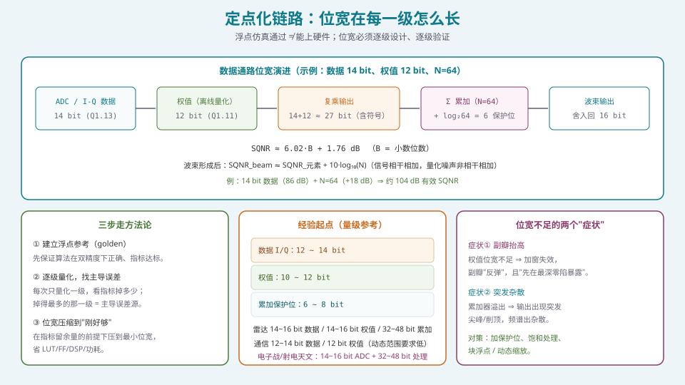
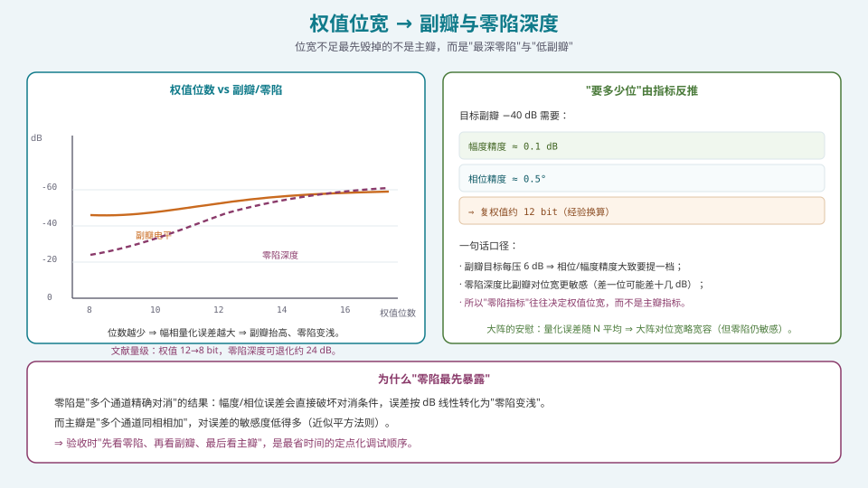
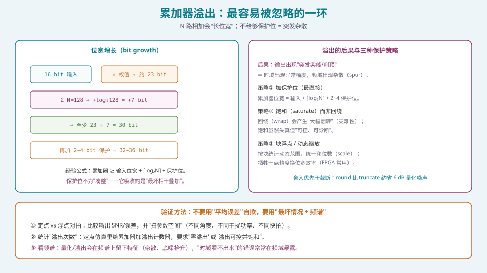

## 本篇要解决什么

前面六篇（[常规](pa-conventional-beamforming.html)、[自适应](pa-adaptive-mvdr-lcmv.html)、[DOA](pa-doa-music-esprit.html)、[稳健化](pa-null-broadening-robust.html)、[斜视](pa-beam-squint-wideband.html)、[HBF](pa-hybrid-beamforming.html)）都在"浮点世界"里工作：权值是双精度复数，协方差矩阵是精确的，求逆是精确的。

但硬件里**没有双精度浮点**——只有定点（或有限的浮点）。于是：

核心问题：

**为什么浮点仿真通过，上了硬件指标就退化？以及，怎么把算法"翻译"成硬件能接受的定点形式，同时保住指标？**

这一篇是 S4"实现篇"的第一篇。它的价值在于：**定点化能力是"算法工程师"与"只会跑仿真的人"最明显的分水岭之一。** 浮点仿真是"理想世界"，定点化是"现实世界"。

---

## 一、定点化的三步走方法论



*图 1：位宽在每一级"生长"；定点化的核心是"逐级找主导误差"，而不是"一次拍一个位宽"。*

### 1.1 第一步：建立浮点参考（golden）

用双精度实现算法，**先确保**：

- 算法逻辑正确（方向图对得上理论）；
- 指标达标（副瓣、零陷、DOA 精度等）；
- 参数空间已扫过（角度、频率、干扰功率、快拍数）。

**这一步产出的"浮点参考"是后续所有对比的基准（golden）。** 没有它，你无法判断"定点化到底损失了多少"。

### 1.2 第二步：逐级量化，找主导误差

**关键方法论**：**每次只量化一级**（比如只量化数据、或只量化权值、或只量化累加），观察指标掉多少。

- 掉得最多的那一级 = **主导误差源** ⇒ 优先给它加位宽；
- 掉得很少的级 ⇒ 可以大胆压位宽，省资源。

**这是"定点化"最省时间的工作方式**：不靠猜，靠一次只动一个变量的受控实验。

### 1.3 第三步：位宽压缩到"刚好够"

在指标**留有余量**的前提下，把每一级的位宽压到最小。目标是同时优化：

- **LUT / FF / DSP** 资源（位宽 ↑ ⇒ 资源 ↑，近似平方增长）；
- **功耗**（位宽 ↑ ⇒ 动态功耗 ↑）；
- **时序**（位宽 ↑ ⇒ 关键路径变长，Fmax 下降）。

**"刚好够"是艺术**：压得太狠，指标不达标；压得太松，资源/功耗浪费。**判据是"指标余量"，不是"看起来够用"。**

---

## 二、量化噪声：SQNR 的第一原理

### 2.1 SQNR 公式

对 \(B\) 位量化的理想信号（满量程正弦），信噪比

\[
\boxed{\ \mathrm{SQNR}\approx6.02B+1.76\ \text{dB}\ }
\]

- \(B=12\) bit ⇒ 约 74 dB；
- \(B=14\) bit ⇒ 约 86 dB；
- \(B=16\) bit ⇒ 约 98 dB。

**直觉**：每增加一位，量化台阶减半，噪声功率降 6 dB（+1.76 是满量程正弦的常数项）。

### 2.2 波束形成的"意外之喜"

**关键结论**：波束形成后的 SQNR 会比单元素**更高**：

\[
\mathrm{SQNR}_{\text{beam}}\approx\mathrm{SQNR}_{\text{element}}+10\log_{10}(N).
\]

**原因**：信号在求和时**相干叠加**（功率 \(\propto N^2\)，电压 \(\propto N\)），而各通道的量化噪声**非相干叠加**（功率 \(\propto N\)）。于是信噪比改善 \(10\log_{10}N\)。

**例子**：14 bit 数据（约 86 dB）+ \(N=64\)（+18 dB）⇒ **约 104 dB 有效 SQNR**。

**工程含义**：**大阵对"数据位宽"相对宽容**——因为量化噪声被空间平均掉了。但**这不适用于"零陷"**（见 §3）。

### 2.3 位宽增长的算术

- **复乘**：\(B_1\) 位 × \(B_2\) 位 ⇒ 乘积约 \(B_1+B_2\) 位（含符号）。例：16 bit 数据 × 12 bit 权值 ⇒ 约 29 bit；
- **累加**：\(N\) 项相加 ⇒ 增加 \(\lceil\log_2 N\rceil\) 位。例：\(N=64\) ⇒ +6 bit；
- **回写到输出位宽**：若直接截断回 16 bit，截断噪声相当于"16 bit 量化噪声"，相对无限精度可能损失约 \(10\log_{10}N\) dB。

**应对**：**用舍入（round）而非截断（truncate）**——可减少约 6 dB 量化噪声；必要时用**收敛舍入（convergent rounding）**消除舍入带来的直流偏置。

---

## 三、权值位宽 → 副瓣与零陷（最要命的症状）



*图 2：位数不足时副瓣抬高、零陷变浅；而"零陷深度"比"副瓣"对位宽更敏感。*

### 3.1 定量关系

权值的幅相量化误差，本质上是"加在每个通道上的随机幅相扰动"。它有两重后果：

1. **副瓣抬高**：随机扰动破坏加窗设计的"精密对消"，副瓣从设计值"反弹"；
2. **零陷变浅**：零陷是"多通道精确对消"的结果，对误差按 dB 线性敏感。

**量级参考**：

| 指标要求 | 需要的权值精度（经验） |
| --- | --- |
| 副瓣 −30 dB | 幅度 ≈ 0.2 dB、相位 ≈ 1° |
| 副瓣 −40 dB | 幅度 ≈ 0.1 dB、相位 ≈ 0.5° ⇒ **约 12 bit 复权值** |

**文献量级**：权值从 12 bit 降到 8 bit，**零陷深度可退化约 24 dB**。这说明**零陷对位宽极其敏感**。

### 3.2 为什么"零陷最先暴露"

**机制差异**：

- **主瓣**：多通道**同相相加**，误差近似平方法则，不敏感；
- **零陷**：多通道**精确对消**，误差直接破坏对消条件 ⇒ 按 dB 线性恶化。

**所以验收顺序应该是：先看零陷 → 再看副瓣 → 最后看主瓣。** 这是定点化调试最省时间的原则。

### 3.3 权值位宽不足的"补救"

1. **提高权值位宽**（直接，但资源/功耗上升）；
2. **幅度/相位分别设计位宽**（幅度可能只需更少位，相位需更多）；
3. **利用"大阵平均效应"**：量化误差随 \(N\) 平均 ⇒ 大阵对**副瓣**略宽容（但零陷仍敏感）；
4. **避免用截断**（用舍入）；
5. **在算法层面预补偿**：把量化误差纳入设计（如"量化感知"的权值优化）——代价是复杂度。

### 3.4 位宽与资源的权衡

FPGA 里，资源消耗近似与**位宽的平方**相关（尤其是乘法器与矩阵运算）。因此：

\[
\text{位宽} \times 2 \Rightarrow \text{资源} \approx \times 4 .
\]

**这就是"位宽压缩"为什么值钱**：每压一位，省下的可能是成倍的 LUT/DSP。

---

## 四、累加器溢出：最容易被忽略的一环



*图 3：N 路相加会"长位宽"；不给够保护位，就会出现突发尖峰/削顶 ⇒ 频谱杂散。*

### 4.1 位宽增长的经验公式

\[
\boxed{\ \text{累加器位宽}\ \ge\ \text{输入位宽}+\lceil\log_2 N\rceil+\text{保护位}(2\sim4)\ }
\]

**例子**：16 bit 输入 × 12 bit 权值 ⇒ 乘积约 27~29 bit；\(N=128\) ⇒ +7 bit ⇒ 约 34~36 bit；再加 2~4 bit 保护 ⇒ **36~40 bit**。

**常见工程做法**：

| 数据类型 | 格式（示例） | 说明 |
| --- | --- | --- |
| 输入 I/Q | Q2.14（16 bit） | 动态范围 ±2，精度 ≈ 6.1e-5 |
| 权值 | Q1.15（16 bit）或 12 bit | 复数权值实虚各一份 |
| 乘法输出 | Q3.29（32 bit） | 16×16 自动扩展 |
| 累加器 | Q7.29（36 bit） | 扩展整数位防溢出 |
| 波束输出 | Q3.13（16 bit） | 舍入/截断回输出位宽 |

**保护位不是"凑整"**——它吸收的是**最坏相干叠加**（所有通道同相时电压叠加最大）。

### 4.2 溢出的后果

- 时域：**突发尖峰 / 削顶**（幅度异常）；
- 频域：**杂散（spur）** 出现——这常常是"时域看不出来"的错误。

### 4.3 三种保护策略

| 策略 | 做法 | 代价 |
| --- | --- | --- |
| **加保护位** | 累加器位宽 = 输入 + ⌈log₂N⌉ + 2~4 | 资源上升 |
| **饱和（saturate）** | 溢出时钳位到极值，**不回绕** | 失真但可控、可诊断 |
| **块浮点 / 动态缩放** | 按块统计动态范围，统一移位 | 牺牲精度换位宽效率（FPGA 常用） |

**关键对比**：**回绕（wrap）** 会产生"从最大值跳到最小值"的大幅翻转——**灾难性**；**饱和**虽失真，但**可控且可诊断**。**工程上绝不允许回绕。**

### 4.4 舍入策略

- **舍入（round）** 优于**截断（truncate）**：约省 6 dB 量化噪声；
- **收敛舍入（convergent rounding）**：消除舍入统计偏置；
- **保留关键级全精度，只在输出截断**：中间级尽量不动位宽。

---

## 五、验证：怎么证明"定点化没退化"

### 5.1 三条铁律

1. **定点 vs 浮点对拍**：比较输出（或方向图/SINR）误差，并**扫参数空间**（不同角度、干扰功率、快拍、频率）；
2. **统计溢出次数**：定点仿真里给累加器加**溢出计数器**，要求"零溢出"或"溢出可控且饱和"；
3. **看频谱，不只看时域**：量化/溢出会在频谱留下特征（杂散、底噪抬升）。**"时域看不出来"的错误，常在最深的零陷或频谱上暴露。**

### 5.2 一个 Python 定点化验证脚本

```python
import numpy as np

def quantize(x, bits, signed=True):
    """均匀量化到 bits 位（含 1 符号位），输入假设 |x|<=1。"""
    levels = 2 ** (bits - 1) if signed else 2 ** bits
    step = 1.0 / levels
    q = np.round(np.clip(x, -1, 1 - step) / step) * step
    return q

def fixed_beamform(X, w_bits=12, data_bits=14, acc_guard=3):
    """定点波束形成：数据/权值/累加分别量化，并统计溢出。"""
    N, T = X.shape
    # 归一化到 [-1,1)
    scale = np.max(np.abs(X)) + 1e-12
    Xn = X / scale
    wscale = np.max(np.abs(X)) + 1e-12
    # 量化数据与权值
    Xq = (quantize(Xn.real, data_bits) + 1j*quantize(Xn.imag, data_bits))
    # 累加位宽与饱和
    acc_bits = data_bits + int(np.ceil(np.log2(N))) + acc_guard
    acc_lim = 2 ** (acc_bits - 1) - 1
    y = np.zeros(T, dtype=complex)
    overflow = 0
    for t in range(T):
        s = np.sum(Xq[:, t])                      # 简化：等权叠加（示意）
        if abs(s) > acc_lim:
            overflow += 1
            s = np.clip(s, -acc_lim, acc_lim)     # 饱和，不回绕
        y[t] = s
    return y, overflow

def sqnr(ref, test):
    ref = ref / np.linalg.norm(ref)
    test = test / (np.linalg.norm(test) + 1e-15)
    err = ref - test
    return 10*np.log10(np.sum(np.abs(ref)**2) / (np.sum(np.abs(err)**2) + 1e-15))
```

### 5.3 与硬件工具链对接

- **MATLAB Fixed-Point Designer**：`fi` 对象做定点仿真，自动插入溢出/饱和检测；
- **Vitis HLS**：`ap_fixed<W,I>` / `ap_int<W>` 做位精确建模，C 仿真与 RTL 协同仿真（C/RTL Co-sim）验证位精确一致；
- **对比基准**：与浮点"golden"逐样本/逐指标对比，**量化误差要在预算之内**。

---

## 六、常见误区清单

**误区一：以为"浮点仿真通过 ⇒ 上硬件就能过"。**
浮点通过只证明**算法对**；定点化会引入量化噪声与溢出，**指标可能退化**。**定点化是独立的一步工作，不是"自动转换"。**

**误区二：一次拍一个全局位宽，而不是逐级定位。**
正确做法是**逐级量化、找主导误差**。一次性"全量化"只会让你不知道问题出在哪一级。

**误区三：忽略"零陷对位宽极其敏感"。**
零陷是"精确对消"的结果，**位宽不足先毁零陷**（文献量级：12→8 bit 可退化 24 dB）。**用主瓣达标来判断位宽够不够，是典型错误。**

**误区四：累加器不给够保护位。**
累加器位宽必须 ≥ 输入位宽 + ⌈log₂N⌉ + 保护位。**少给 = 溢出 = 突发杂散。**

**误区五：溢出用回绕（wrap）而不是饱和。**
回绕会产生"最大值→最小值"的大幅翻转，**灾难性**；饱和失真可控、可诊断。**工程上绝不允许回绕。**

**误区六：用截断（truncate）代替舍入（round）。**
截断引入直流偏置与更高量化噪声（约多 6 dB）。**中间级尽量保留精度，只在输出截断。**

**误区七：只在"个别场景"下验证。**
必须在**参数空间上扫**（角度、功率、快拍、频率）。**定点化的错误往往是"条件性"的**——某些角度/功率下才暴露。

**误区八：只看时域波形，不看频谱。**
溢出/量化在频谱留下的杂散与底噪抬升，**时域常常看不出来**。**频谱与零陷是最灵敏的探测器。**

**误区九：认为"位宽越大越好"。**
位宽 ↑ ⇒ 资源（近似平方）、功耗 ↑，时序（Fmax）↓。**位宽是"刚好够"的艺术**，目标是最小化资源同时留足指标余量。

---

## 七、快速自测

**Q1.** 写出 SQNR 公式，并计算 12 bit、14 bit 数据对应的 SQNR。

<details><summary>参考要点</summary>

\[
\mathrm{SQNR}\approx6.02B+1.76\ \text{dB}.
\]

- \(B=12\)：\(6.02\times12+1.76=72.24+1.76\approx\) **74 dB**；
- \(B=14\)：\(6.02\times14+1.76=84.28+1.76\approx\) **86 dB**。

**含义**：每增 1 位约 +6 dB。动态范围要求（如雷达 60~90 dB）直接换算到所需位数。

</details>

**Q2.** 为什么"波束形成后 SQNR 会提升 10log₁₀(N)"？这个结论对"零陷"也成立吗？

<details><summary>参考要点</summary>

**提升原因**：\(N\) 路求和时，
- **信号相干叠加**：幅度 \(\propto N\) ⇒ 功率 \(\propto N^2\)；
- **量化噪声非相干叠加**：功率 \(\propto N\)。

故信噪比改善 \(\dfrac{N^2}{N}=N\) ⇒ \(10\log_{10}N\) dB。例：\(N=64\) ⇒ +18 dB。

**对零陷不成立**：零陷依赖"多通道**精确对消**"，量化误差直接破坏对消条件，**按 dB 线性恶化**而非被平均掉。所以**大阵对数据位宽宽容，但对"与零陷相关的权值位宽"依然敏感**。

</details>

**Q3.** 若要实现 −40 dB 副瓣，权值需要多少位？请给出定量推理。

<details><summary>参考要点</summary>

**经验映射**：−40 dB 副瓣需要
- 幅度精度 ≈ **0.1 dB**；
- 相位精度 ≈ **0.5°**；
- 对应约 **12 bit 复权值**（实虚各 12 bit）。

**推理**：副瓣电平近似正比于"权值幅相误差的均方根"。要从 −13 dB（均匀激励副瓣）压到 −40 dB，需要加权精度比 −40 dB 高若干 dB 的余量；0.1 dB / 0.5° 的精度对应约 12 bit 能提供足够的量化台阶。

**注意**：这还只是"量化"要求；实际还要叠加通道幅相误差（校准）、移相器量化等。**权值位数只是总误差预算的一部分。**

</details>

**Q4.** 16 bit 输入、权值 12 bit、N=128 的复乘加，累加器至少需要多少位？为什么？

<details><summary>参考要点</summary>

- **复乘输出**：\(16+12=28\) bit（含符号，实际约 27~29 bit）；
- **累加增长**：\(\lceil\log_2 128\rceil=7\) bit ⇒ 约 \(28+7=35\) bit；
- **保护位**：2~4 bit ⇒ 最终 **37~39 bit**。

**为什么**：累加器必须容纳"**最坏相干叠加**"（所有通道同相时幅度最大），否则溢出。经验公式：

\[
\text{累加器位宽}\ \ge\ \text{输入位宽}+\lceil\log_2 N\rceil+\text{保护位}.
\]

**实现**：一般取 40 bit 或 36 bit（视余量），并配**饱和**逻辑（绝不用回绕）。

</details>

**Q5.** 累加器溢出为什么会导致"频谱杂散"？为什么必须用饱和而不是回绕？

<details><summary>参考要点</summary>

**溢出 → 杂散**：溢出使输出出现非线性的幅度畸变（削顶或跳变），这是**非线性操作**，会产生新的频率分量（谐波/互调/杂散）。

**回绕（wrap）为什么灾难性**：定点回绕会让"超过最大值"的结果**翻转成最小值**（如 0111…→1000…），形成**幅度反转的巨大跳变** ⇒ 输出出现强尖峰与宽频谱污染。且这种错误**难以诊断**（看起来像"信号"，不像"错误"）。

**饱和（saturate）**：钳位到极值，失真**有界、可预测、可诊断**。**工程上必须饱和，禁止回绕。**

</details>

**Q6.** 请描述"三步走"定点化方法论，并说明每一步的判别标准。

<details><summary>参考要点</summary>

1. **浮点参考（golden）**：
   - 判别：算法正确、指标达标、参数空间已扫过。
2. **逐级量化找主导误差**：
   - 做法：**每次只量化一级**，观察指标下降；
   - 判别：**下降最多的那一级 = 主导误差源**，优先加位宽；下降少的级可压位宽。
3. **位宽压缩到刚好够**：
   - 做法：在**指标留余量**前提下压到最小；
   - 判别：**指标余量**（不是"看起来够"）；同时看资源（LUT/FF/DSP）、功耗、时序（Fmax）。

**核心**：**用受控实验代替猜测**——"一次只动一个变量"是定点化最高效的工作方式。

</details>

**Q7.** 一个通信波束形成器要求动态范围 60 dB，一个雷达要求 80 dB。数据位宽各取多少？为什么通信的更少？

<details><summary>参考要点</summary>

由 SQNR ≈ 6.02B+1.76：
- **60 dB**：\(B\ge(60-1.76)/6.02\approx9.7\) ⇒ **约 10~12 bit**（留余量取 12）；
- **80 dB**：\(B\ge(80-1.76)/6.02\approx13\) ⇒ **约 14~16 bit**（留余量取 14~16）。

**为什么通信更少**：
- 通信场景的信号/干扰功率差异相对可控，且波束形成后有 \(10\log_{10}N\) 的 SQNR 增益；
- 雷达需要处理"从远距弱目标到近距强杂波"的巨大回波动态范围（60~90 dB），对 ADC 位宽要求高；
- 电子战/射电天文更极端（80~120 dB）⇒ 14~16 bit ADC + 32~48 bit 处理。

**工程口径**：**位宽由"动态范围需求"反推**，而非统一值。

</details>

**Q8.** 你的定点实现"主瓣达标、副瓣达标，但零陷只有 −35 dB（要求 −45 dB）"。请给出诊断与改进步骤。

<details><summary>参考要点</summary>

**诊断顺序**（零陷最敏感，先查零陷相关环节）：

1. **权值位宽**：零陷对权值位宽最敏感。试着把权值位宽从 10 bit 提到 12~14 bit，看零陷是否改善 ⇒ 若显著改善，**主导误差在权值量化**；
2. **累加器位宽/溢出**：检查是否有溢出（加溢出计数器）。零陷处是对消，**溢出的影响在零陷处最明显**；
3. **舍入 vs 截断**：改用**收敛舍入**，看是否改善（截断的直流偏置会破坏对消）；
4. **数据位宽**：把数据位宽抬一位，看零陷变化；
5. **逐级定位**：每次只动一级，找出"提升哪一级，零陷改善最多"。

**改进优先级**（性价比）：
1. 先改**舍入策略**（零成本，约省 6 dB 噪声）；
2. 再**提高权值位宽**（代价：资源/功耗）；
3. 再检查/增加**累加器保护位**；
4. 最后才考虑提高数据位宽（大阵下数据位宽常已够，因有 SQNR 平均效应）。

**一句话**：**零陷掉，先查"权值 + 舍入 + 溢出"这三样，而不是先怀疑算法。**

</details>

---

## 八、与本站其它专题的连接

| 想了解 | 看哪篇 |
| --- | --- |
| ADC/DAC 位宽与动态范围 | [ADC/DAC：位宽、动态范围与零陷能力](pa-adc-dac-dynamic-range.html) |
| 移相器位数与量化副瓣 | [移相器与真时延器件（TTD）](pa-phase-shifter-ttd.html) |
| 自适应权值为何对误差敏感 | [自适应波束形成：MVDR 与 LCMV](pa-adaptive-mvdr-lcmv.html) |
| 零陷展宽与稳健化 | [零陷展宽、宽带与稳健波束形成](pa-null-broadening-robust.html) |
| 定点模块落到芯片 | [FPGA/HLS 实现：数据面与控制面的分工](pa-fpga-hls-implementation.html) |
| 加窗与副瓣设计 | [加权加窗：低副瓣设计的完整方法](pa-amplitude-tapering.html) |
| 权值 LUT 与位宽的关系 | [常规波束形成：数据无关的权值计算](pa-conventional-beamforming.html) |
| 自由度与架构约束 | [四种架构的选型：PESA / AESA / 混合 / 全数字](pa-architecture-selection.html) |
| 相控阵的物理机制 | [卫星相控阵天线：从阵元到波束](satellite-phased-array.html) |
| 学习体系全貌 | [相控阵天线学习体系：六阶段路线图](phased-array-roadmap.html) |

---

## 九、延伸阅读

**教材与工具文档**
- Xilinx/AMD *Vitis HLS* 文档与 **ap_fixed / ap_int** 位精确类型指南（**最直接的工程材料**）。
- MATLAB **Fixed-Point Designer** 与 `fi` 对象文档：自动溢出/饱和检测。
- Oppenheim & Schafer, *Discrete-Time Signal Processing*：量化噪声与 SQNR 的严格推导。
- Smith, *Digital Signal Processing*（含定点的位增长与舍入分析）。

**工程文献**
- 关于"数字波束形成器字长与动态范围"的工程分析（SQNR、位增长、舍入 vs 截断、资源权衡）。
- DTIC 报告 *Design Definition for a Digital Beamforming Processor*：**信号/权值量化对零陷深度影响的定量数据**（8~12 bit 与零陷深度的对照）。
- 关于"自适应权值计算的字长要求"的 FPGA/ASIC 实现研究（QR 分解、CORDIC 位宽）。

**本站衔接**
- 下一篇 [FPGA/HLS 实现](pa-fpga-hls-implementation.html) 把这些定点数值真正映射到 DSP/BRAM 与流水线；
- 记住：**浮点通过只是"算法对"；定点化通过才是"能上硬件"。而"零陷"永远是最灵敏的探针。**
