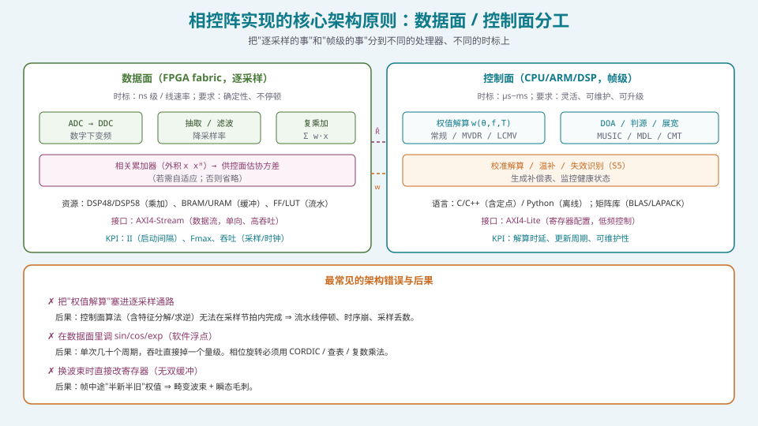
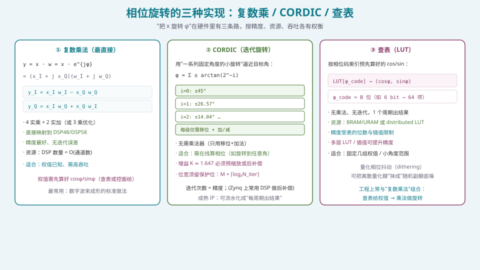
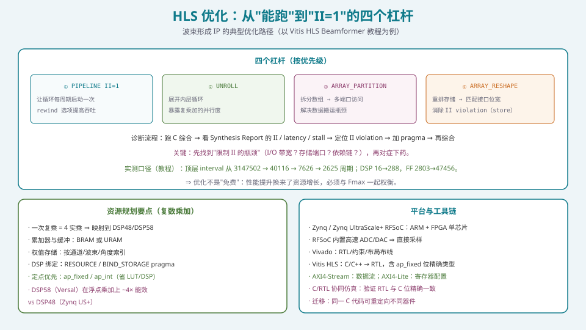

## 本篇要解决什么

S4 前面的七篇把"算法"讲完了：常规权值、MVDR/LCMV、DOA、稳健化、宽带消斜视、混合架构设计、定点化。最后一篇回答：

核心问题：

**这些算法怎么"落到芯片上"，才能跑出真实的实时性能？**

答案的核心不是某个算法，而是**一条架构原则**：

\[
\boxed{\ \text{FPGA 数据面（逐采样、确定性、高吞吐）}\ \ +\ \ \text{CPU/DSP 控制面（帧级、灵活、可维护）}\ }
\]

**把"慢的、要灵活的事"放在控制面，把"快的、要确定的事"放在数据面。** 这一条原则划错了，后面所有的优化都是白费。

---

## 一、核心架构原则：数据面 vs 控制面



*图 1：两条完全不同的时标与设计要求；两者通过"协方差"与"权值"交换中间结果。*

### 1.1 数据面（FPGA fabric）

**做什么**：

- 数字下变频（DDC）、抽取/滤波；
- **复乘加** \(\sum_k w_k x_k[n]\)——这是相控阵的核心算子；
- 相关累加器（外积 \(xx^{\mathsf H}\)，供控制面估协方差）；
- 波束合成、多波束并行。

**要求**：

- **确定性时延与线速率**（不能"有空再算"）；
- **不停顿**、无缓存抖动；
- 资源：**DSP48/DSP58**（乘加）、**BRAM/URAM**（缓冲）、FF/LUT（流水）；
- 接口：**AXI4-Stream**（单向、高吞吐数据流）。

**KPI**：**II（启动间隔，Initiation Interval）**、**Fmax**、**吞吐（采样/时钟）**。

- **II=1** 意味着"每个时钟周期启动一次迭代"——这是数据面追求的目标；
- **Fmax** 决定时钟频率上限，与关键路径（位宽、运算深度）相关。

### 1.2 控制面（CPU / ARM / DSP）

**做什么**：

- **权值解算** \(\mathbf{w}(\theta_0, f, T)\)（常规 / MVDR / LCMV）；
- **DOA 估计**、判源（MUSIC / ESPRIT / MDL）、零陷展宽（CMT）；
- **校准解算、温补、失效通道识别**（S5）；
- **生成补偿表**、健康监控。

**要求**：

- **灵活、可维护、可升级**（改算法不改硬件）；
- 时标是 **µs~ms 级**（帧级，不是采样级）；
- 语言：C/C++（含定点）、Python（离线）；矩阵库（BLAS/LAPACK）；
- 接口：**AXI4-Lite**（低频寄存器配置）。

**KPI**：**解算时延**、**更新周期**、**可维护性**。

### 1.3 两者如何交换数据

```text
数据面 ──(协方差 R̂ / 快拍)──▶ 控制面
数据面 ◀──(权值 w / 相位码，双缓冲)── 控制面
```

- **数据面 → 控制面**：把"估计所需的统计量"（协方差/R̂、或降维后的数据）送上去；
- **控制面 → 数据面**：把"算好的权值"送下来，**必须双缓冲**。

**划界判据**：**问一句"这件事的单位是'每个采样'还是'每一帧'？"** 每个采样 ⇒ 数据面；每一帧 ⇒ 控制面。

### 1.4 三种最常见的架构错误

| 错误 | 后果 | 正确做法 |
| --- | --- | --- |
| 把**权值解算**塞进逐采样通路 | 含特征分解/求逆的算法无法在采样节拍内完成 ⇒ 流水线停顿、时序崩、丢数 | 权值解算放控制面，帧级更新 |
| 在数据面调 **sin/cos/exp** | 单次几十周期 ⇒ 吞吐掉一个量级 | **CORDIC / 查表 / 复数乘法** |
| 换波束**直接改寄存器**（无双缓冲） | 帧中途"半新半旧"权值 ⇒ 畸变波束 + 瞬态毛刺 | **双缓冲，帧边界生效** |

**这三条错误的共同特征**：都是"**把控制面的活塞进数据面**"或"**把该原子化的操作拆碎了**"。

---

## 二、复乘加：数据面的核心算子

### 2.1 复数乘法

波束形成的本质是复加权求和：

\[
y[n]=\sum_{k=1}^{N}w_k^{*}x_k[n].
\]

一次复乘

\[
(x_I+jx_Q)(w_I+jw_Q)=(x_Iw_I-x_Qw_Q)+j(x_Iw_Q+x_Qw_I)
\]

需要 **4 个实乘 + 2 个实加**（可用 3 乘 + 5 加的 Karatsuba 变体优化）。

### 2.2 映射到 DSP

- 每个实乘映射到一个 **DSP48/DSP58** 原语；
- 复乘 ⇒ 每通道 4（或 3）个 DSP；
- **\(N=64\) 通道的复乘加 ≈ 256 个 DSP 原语**（并行实现）——必须做资源规划；
- **Versal 的 DSP58** 支持原生浮点乘加，实测**能效约是 DSP48 的 4 倍**（同一设计的 DSP 用量约减半、FF/LUT 用量大幅下降）。

**工程取舍**：

- **减少 DSP 用量** ⇒ 用**时分复用（TDM）**（多通道共享一个复乘器），代价是吞吐下降；
- **提高吞吐** ⇒ 用**并行/展开**，代价是 DSP 用量上升。
- **这是"面积 ↔ 吞吐"的经典权衡**，由系统带宽需求决定。

---

## 三、相位旋转的三种实现



*图 2：复数乘（最直接，映射 DSP）/ CORDIC（无乘法，迭代）/ 查表（1 周期，受精度限制）。*

| 方法 | 原理 | 优点 | 代价 | 适用 |
| --- | --- | --- | --- | --- |
| **复数乘法** | \(y=x e^{j\varphi}\) 直接算 | 精度最好、无迭代误差、直接映射 DSP | 需先得到 \(\cos\varphi,\sin\varphi\) | 权值已知、需高吞吐 |
| **CORDIC** | 一系列固定角 \(\arctan(2^{-i})\) 的移位加法旋转 | **不需乘法器**（移位+加） | 有迭代误差、增益需补偿 | 需在线算相位（旋转到任意角） |
| **查表 LUT** | 按相位码索引预存 \(\cos/\sin\) | **1 周期出结果**、无乘法 | 精度受表长与插值限制；占 BRAM | 固定几组权值 / 小角度范围 |

### 3.1 CORDIC 的关键细节

- **增益因子** \(K\approx1.647\) 无法通过移位消除 ⇒ 必须**预缩放**（输入端除以 \(K\)，损失初始精度）或**后补偿**（乘 \(1/K\)，通常映射到 DSP，可能引入舍入误差）；
- **位宽增长**：每级迭代加法都会使位宽增加 ⇒ 若目标精度 \(M\) 位，中间位宽应至少 \(M+\lceil\log_2 N_{\text{iter}}\rceil\)（**保护位**）；
- **流水线化**：把每一级迭代放入一个流水级 ⇒ 可做到"每周期出结果"（吞吐优先），代价是延迟与资源。

### 3.2 查表 + 复数乘的组合（最常用）

工程上最常见的组合是：

1. **控制面算好权值** ⇒ 量化为相位码；
2. **查表得到 \(\cos\varphi,\sin\varphi\)**（或直接由控制面给量化后的实虚部）；
3. **数据面用复数乘法完成旋转**。

这样既避免了在数据面算三角函数，又保持了高精度与高吞吐。

### 3.3 量化相位抖动

若移相器/权值只能取 \(2^B\) 档，量化误差会造成**离散量化瓣**。**相位抖动（dithering）** 用确定的随机化相位扰动"打散"误差的空间周期性，把离散量化瓣"抹成"随机副瓣底噪——这是**纯数字域的免费改善**（见 [移相器与 TTD](pa-phase-shifter-ttd.html)）。

---

## 四、HLS 优化：从"能跑"到"II=1"



*图 3：四个优化杠杆；以 Vitis HLS 的 Beamformer 教程为例，顶层 interval 从 3147502 → 2625 周期。*

### 4.1 四个杠杆

| 杠杆 | 作用 | 典型 pragma |
| --- | --- | --- |
| **PIPELINE** | 让循环每周期启动一次（II=1） | `#pragma HLS PIPELINE II=1`（`rewind` 提升吞吐） |
| **UNROLL** | 展开内层循环，暴露并行度 | `#pragma HLS UNROLL` |
| **ARRAY_PARTITION** | 拆分数组 ⇒ 多端口访问 | `#pragma HLS ARRAY_PARTITION variable=A dim=1` |
| **ARRAY_RESHAPE** | 重排存储以匹配接口位宽，消除 store 造成的 II violation | `#pragma HLS ARRAY_RESHAPE variable=b dim=2 type=complete` |

### 4.2 诊断流程

1. **跑 C 综合**（C Synthesis）；
2. **看 Synthesis Report**：II、latency、stall 原因、资源占用；
3. **定位 II violation**（是 I/O 带宽受限？存储端口不足？依赖链过长？）；
4. **加对应 pragma**；
5. **再综合、对比**。

**关键**：**先找"限制 II 的瓶颈"，再对症下药**——盲目加 pragma 只会浪费资源。

### 4.3 一个真实的优化轨迹（Vitis HLS Beamformer 教程）

| 阶段 | 顶层 interval（周期） | DSP | FF | LUT |
| --- | --- | --- | --- | --- |
| 未优化 | 3 147 502 | 16 | 2 803 | 3 888 |
| +PIPELINE | 40 116 | 18 | 16 274 | 8 550 |
| +RX reshape | 7 626 | 96 | 27 465 | 12 551 |
| +Beam reshape | **2 625** | 288 | 47 456 | 11 454 |

**读法**：性能从 315 万周期降到 2625 周期（**三个量级**），但 DSP 从 16 增到 288、FF 从 2803 增到 47456。

**结论**：**优化不是免费的**——吞吐提升用**资源**换来，必须与 Fmax、功耗、成本一起权衡。

### 4.4 定点优先（与上一篇呼应）

- 用 **`ap_fixed<W,I>` / `ap_int<W>`**（位精确类型）代替 `float/double` ⇒ **大幅省 LUT/FF/DSP**；
- **右调宽度**（right-size widths）是省资源最有效的手段之一；
- 与 [定点化](pa-fixed-point-quantization.html) 的位宽设计直接对接：**先定好位宽，再写 HLS 代码**。

### 4.5 平台与工具链

| 平台 / 工具 | 作用 |
| --- | --- |
| **Zynq / Zynq UltraScale+** | ARM + FPGA 单芯片 ⇒ 天然的数据面/控制面载体 |
| **Zynq RFSoC** | 内置高速 ADC/DAC ⇒ **直接采样，省去分立 ADC 板卡** |
| **Vivado** | RTL、约束、布局布线、时序收敛 |
| **Vitis HLS** | C/C++ → RTL；`ap_fixed` 位精确建模；C/RTL 协同仿真 |
| **AXI4-Stream / AXI4-Lite** | 数据流 / 寄存器配置的两类接口 |

**一次 HLS 设计可重定向到不同器件**：实测同一 C 代码从 Versal 迁到 Zynq US+ RFSoC，**性能略降（interval 2625 → 2782）、资源显著上升（DSP 288 → 576、FF 47456 → 177434、LUT 11454 → 111181）**——因为 DSP48 不如 DSP58 高效。**这说明"器件选型"与"算法实现"是耦合的。**

### 4.6 参考代码：一个 HLS 波束形成器骨架

```cpp
#include "ap_fixed.h"
#include "hls_stream.h"

using data_t = ap_fixed<16, 2>;      // 数据：2 整数位 + 14 小数位
using w_t    = ap_fixed<12, 1>;      // 权值：1 整数位 + 11 小数位
using acc_t  = ap_fixed<40, 8>;      // 累加器：留足整数保护位

struct axis_t { data_t i, q; bool last; };

void beamformer(hls::stream<axis_t> &in, hls::stream<axis_t> &out,
                w_t wi[64], w_t wq[64], int n_samples) {
#pragma HLS INTERFACE axis port=in
#pragma HLS INTERFACE axis port=out
#pragma HLS INTERFACE s_axilite port=n_samples
#pragma HLS ARRAY_PARTITION variable=wi dim=1 complete
#pragma HLS ARRAY_PARTITION variable=wq dim=1 complete
  for (int n = 0; n < n_samples; n++) {
#pragma HLS PIPELINE II=1
    acc_t ai = 0, aq = 0;
    for (int k = 0; k < 64; k++) {
#pragma HLS UNROLL
      axis_t x = in.read();               // 简化示意：实际需按通道缓冲
      ai += (acc_t)(x.i * wi[k] - x.q * wq[k]);
      aq += (acc_t)(x.i * wq[k] + x.q * wi[k]);
    }
    out.write({(data_t)ai, (data_t)aq, n == n_samples - 1});
  }
}
```

**说明**：真实实现需**按通道把 N 路数据对齐缓冲**（`hls::stream` 一次只给一路），或用"分通道流 + 并行 read"（受 AXI 端口数限制）——这正是"数据搬运"成为常见 II 瓶颈的原因，也是 `ARRAY_PARTITION` / `ARRAY_RESHAPE` 要解决的问题。

### 4.7 时序收敛与流水线

- **关键路径**：长加法树（累加 \(N\) 项）会拉长路径、降低 Fmax ⇒ 用**流水线寄存器**打断（HLS 通常自动插入，可约束 `#pragma HLS LATENCY`）；
- **时钟约束**在工具里设（`create_clock -period`），不在代码里；
- **目标**：**Fmax 有余量、II=1、资源在预算内**——三者是联合约束，不能单独追求。

---

## 五、常见误区清单

**误区一：把"权值解算"放进逐采样通路。**
这是最严重的架构错误。特征分解/求逆是 \(O(N^3)\)，**不可能在采样节拍内完成**。**权值解算必须帧级、在控制面。**

**误区二：在 FPGA 数据面调浮点 sin/cos/exp。**
单次几十周期 ⇒ 吞吐掉一个量级。**相位旋转用 CORDIC / 查表 / 复数乘法。**

**误区三：换波束不做双缓冲。**
帧中途改权值 ⇒ 畸变波束 + 瞬态毛刺。**双缓冲、帧边界生效。**

**误区四：以为"优化就是加 pragma"。**
盲目加 pragma 浪费资源。**必须先定位 II violation 的根因**（I/O 带宽？存储端口？依赖链？），再对症下药。

**误区五：忽略"性能是资源换来的"。**
Beamformer 教程里 interval 降 3 个量级，DSP 从 16 涨到 288。**优化要交代价**——必须与 Fmax/功耗/成本一起权衡。

**误区六：用浮点实现，最后再"转"定点。**
**定点与浮点在 HLS 里是"从第一行代码就不同"的**。用 `ap_fixed` 位精确建模，才能从一开始就做对资源与精度设计。

**误区七：忽略"数据搬运"是常见瓶颈。**
复乘本身可能很快，但"把 N 路数据喂进乘法器"常常才是限制 II 的真正原因。**用 `ARRAY_PARTITION` / `ARRAY_RESHAPE` / 合理接口解决。**

**误区八：忽略器件差异对资源的影响。**
同一设计从 Versal 迁到 Zynq US+ RFSoC，资源可能涨 4~10 倍。**器件选型与算法实现是耦合的**——要在目标器件上评估。

**误区九：认为 HLS 一定不如手写 RTL。**
HLS 开发效率极高，**多数场景足够**；但在**极端时序约束**下，HLS 生成的寄存器插入策略可能不如人工控制，此时才需要手写 RTL 优化关键路径。**先 HLS 快速迭代，必要时对关键模块下沉到 RTL。**

**误区十：忽略"可维护性"。**
把校准、温补、失效识别这些"非功能需求"写死在硬件里，会让系统无法演进。**控制面负责灵活，数据面负责确定**——这条原则也适用于"系统能否活到设计寿命"。

---

## 六、快速自测

**Q1.** 请给出"数据面 / 控制面"分工的判据，并各举三个属于该面的任务。

<details><summary>参考要点</summary>

**判据**：问"这件事的单位是'每个采样'还是'每一帧'？"——**每采样 ⇒ 数据面；每帧 ⇒ 控制面**。

- **数据面**（FPGA，逐采样、确定性）：① 数字下变频/抽取；② 复数乘加（波束合成）；③ 相关累加器（估计协方差）。
- **控制面**（CPU/DSP，帧级、灵活）：① 权值解算（MVDR/常规）；② DOA 估计与判源；③ 校准解算/温补/失效识别。

**补充判据**：是否需要"改算法不改硬件"？需要 ⇒ 控制面。是否要求"确定性时延与线速率"？要求 ⇒ 数据面。

</details>

**Q2.** 为什么"把权值解算放进逐采样通路"是灾难性的？

<details><summary>参考要点</summary>

**量级不匹配**：
- 权值解算含**协方差估计 \(O(N^2K)\) + 特征分解/求逆 \(O(N^3)\)**。以 \(N=64\) 为例，一次求逆就是 \(6.4\times10^4\) 量级的复运算；
- 采样通路的节拍是 **ns 级**（如 1 GSPS ⇒ 1 ns/采样）。

**后果**：
1. **无法在采样节拍内完成** ⇒ 流水线**停顿（stall）**，吞吐崩溃；
2. 强行塞入会拉长关键路径 ⇒ **Fmax 下降、时序不收敛**；
3. 采样丢数 ⇒ 波束畸变、系统失效。

**正确**：权值**帧级更新**（µs~ms），数据面**持续复乘加不停顿**，两者通过**双缓冲权值**解耦。

</details>

**Q3.** 相位旋转的三种实现各有什么代价？请给出你的选型原则。

<details><summary>参考要点</summary>

| 方法 | 代价 |
| --- | --- |
| 复数乘法 | 需先得 \(\cos/\sin\)（查表或控面给）；占 DSP |
| CORDIC | 迭代误差；增益 \(K\approx1.647\) 需预缩放/后补偿；位宽需保护位 |
| 查表 | 精度受表长/插值限制；占 BRAM；大范围高精度时表太大 |

**选型原则**：
1. **权值已知、需高吞吐** ⇒ **复数乘法**（+ 控面给量化权值），最常用；
2. **需在线算任意角**（如实时旋转） ⇒ **CORDIC**（无乘法器）；
3. **固定几组权值 / 小角度范围** ⇒ **查表**（1 周期出结果）；
4. **组合**：查表得 \(\cos/\sin\) + 复数乘法旋转，是工程上最常见的组合。

</details>

**Q4.** HLS 的四个优化杠杆分别解决什么问题？请给出诊断流程。

<details><summary>参考要点</summary>

| 杠杆 | 解决的问题 |
| --- | --- |
| PIPELINE | 让循环每周期启动（**II=1**），提升吞吐 |
| UNROLL | 展开内层循环，**暴露并行度** |
| ARRAY_PARTITION | 拆分数组 ⇒ **多端口访问**，解决数据搬运瓶颈 |
| ARRAY_RESHAPE | 重排存储 ⇒ **匹配接口位宽**，消除 store 造成的 II violation |

**诊断流程**：跑 C 综合 → 看报告（II/latency/stall/资源）→ **定位 II violation 根因**（I/O 带宽？存储端口？依赖链？）→ 加对应 pragma → 再综合对比。

**核心**：**先定位根因，再下药**；盲目加 pragma 只会浪费资源。

</details>

**Q5.** CORDIC 的"增益因子"为什么必须补偿？位宽上要注意什么？

<details><summary>参考要点</summary>

**增益来源**：CORDIC 每一级旋转把向量长度乘以 \(\sqrt{1+2^{-2i}}\)，多级连乘收敛到

\[
K=\prod_{i=0}^{N-1}\sqrt{1+2^{-2i}}\approx1.647 .
\]

**为何必须补偿**：\(K\) 是"非理想增益"，若不补偿，输出幅度会比输入大 1.647 倍，破坏权值的绝对幅度含义（以及后续的功率/动态范围规划）。

**两种补偿**：
1. **预缩放**：输入端先乘 \(1/K\) ⇒ 损失初始精度；
2. **后补偿**：输出端乘 \(1/K\) ⇒ 通常映射到 DSP，**位宽不足时会引入严重舍入误差**。

**位宽注意**：每级迭代加法使位宽增长 ⇒ 目标精度 \(M\) 位时，中间位宽应至少 \(M+\lceil\log_2 N_{\text{iter}}\rceil\)（**保护位**），否则低位有效信号被进位噪声淹没。

</details>

**Q6.** 一个 \(N=64\)、1 GSPS、16 波束的系统，数据面要做多少复乘？如何规划 DSP 资源？

<details><summary>参考要点</summary>

**运算量**：每采样每波束 \(N=64\) 次复乘 ⇒ 16 波束 ⇒ 每采样 \(64\times16=1024\) 次复乘。

**吞吐需求**：1 GSPS ⇒ \(1024\times10^9=1.024\times10^{12}\) 复乘/秒。

**DSP 规划**：
- 一次复乘 = 4 实乘 ⇒ 若每周期每 DSP 做 1 实乘，1 GHz 时钟下每 DSP 提供 \(10^9\) 实乘/秒；
- 需要实乘数 = \(4\times1.024\times10^{12}=4.1\times10^{12}\) 实乘/秒；
- ⇒ 约需 \(4.1\times10^{3}\) 个 DSP（**远超单芯片资源**）！

**所以必须降维/复用**：
1. **先做子阵预合成**（如 \(64\to8\)）再形成 16 波束 ⇒ 运算量降 8 倍；
2. **TDM 复用**：多通道共享复乘器（降资源、降吞吐）；
3. **利用"波束合并共用中间结果"**（如 FFT 型多波束）；
4. **降低有效带宽**（抽取后处理，见 [ADC/DAC](pa-adc-dac-dynamic-range.html)）；
5. **DSP58（浮点原生）** 提升单位能效。

**结论**：**"16 波束 × 1 GSPS × 64 通道"必须靠分层降维 + 复用，不能天真地全并行。** 这正是 [架构选型](pa-architecture-selection.html) 里"片内降维"的量化理由。

</details>

**Q7.** 为什么 HLS 优化"性能与资源"必须一起看？请用教程数据说明。

<details><summary>参考要点</summary>

**教程数据**（Vitis HLS Beamformer）：

| 阶段 | interval | DSP | FF | LUT |
| --- | --- | --- | --- | --- |
| 未优化 | 3 147 502 | 16 | 2 803 | 3 888 |
| 最终 | 2 625 | 288 | 47 456 | 11 454 |

**读法**：吞吐提升 **1200 倍**（interval 降 3 个量级），但 **DSP 涨 18 倍、FF 涨 17 倍**。

**为什么必须一起看**：
1. **资源有限**：FPGA 的 DSP/BRAM/FF 有上限，过度并行会"装不下"；
2. **Fmax 受影响**：资源拥塞、布线变长 ⇒ 时序难以收敛；
3. **功耗上升**：更多并行 ⇒ 动态功耗增大；
4. **成本上升**：更大器件或更多芯片。

**结论**：**优化的目标是"在资源/Fmax/功耗约束下满足吞吐需求"，而不是"把 II 压到最低"。**

</details>

**Q8.** 你要把一个在 Versal 上验证的波束形成 IP 迁到 Zynq UltraScale+ RFSoC。会发生什么？为什么？

<details><summary>参考要点</summary>

**现象**（教程实测，同一 C 代码、同一 pragma）：
- **性能略降**：interval 2625 → 2782；
- **资源显著上升**：DSP 288 → 576、FF 47 456 → 177 434、LUT 11 454 → 111 181。

**原因**：
- **DSP58（Versal）支持原生浮点乘加**，一个原语完成一次浮点乘加；而 **DSP48（Zynq US+）只有定点模式**，实现同样运算要用更多原语；
- 平均而言 **DSP58 的计算能效约是 DSP48 的 4 倍**；
- 复乘的迭代延迟增大 ⇒ 顶层 interval 略微上升。

**启示**：
1. **器件选型与算法实现是耦合的**——评估必须在**目标器件**上做；
2. 迁移时可能需要**重新做位宽/并行度/复用策略**的权衡；
3. **用位精确定点（ap_fixed）而非浮点**，可显著缓解器件差异带来的资源膨胀。

</details>

---

## 七、与本站其它专题的连接

| 想了解 | 看哪篇 |
| --- | --- |
| 定点化与位宽设计 | [定点化：从浮点仿真到硬件指标不退化](pa-fixed-point-quantization.html) |
| 权值 LUT 与"控面解算/数据面复乘加"的起点 | [常规波束形成：数据无关的权值计算](pa-conventional-beamforming.html) |
| 自适应权值解算的复杂度 | [自适应波束形成：MVDR 与 LCMV](pa-adaptive-mvdr-lcmv.html) |
| 特征分解与降维的代价 | [DOA 估计：MUSIC / ESPRIT 与工程改良](pa-doa-music-esprit.html) |
| 移相器位数与量化副瓣 | [移相器与真时延器件（TTD）](pa-phase-shifter-ttd.html) |
| 每阵元数字化的数据率与功耗 | [ADC/DAC：位宽、动态范围与零陷能力](pa-adc-dac-dynamic-range.html) |
| 架构决定数据面规模 | [四种架构的选型：PESA / AESA / 混合 / 全数字](pa-architecture-selection.html) |
| 混合架构的模拟-数字权值分解 | [混合波束成形（HBF）的子阵设计](pa-hybrid-beamforming.html) |
| 宽带子带权值的实现 | [波束斜视与宽带相控阵](pa-beam-squint-wideband.html) |
| 相控阵的物理机制 | [卫星相控阵天线：从阵元到波束](satellite-phased-array.html) |
| 学习体系全貌 | [相控阵天线学习体系：六阶段路线图](phased-array-roadmap.html) |

---

## 八、延伸阅读

**官方文档与教程（最直接的工程材料）**
- AMD/Xilinx **Vitis HLS 文档**：`ap_fixed` / `ap_int` 位精确类型、PIPELINE/UNROLL/ARRAY_PARTITION/ARRAY_RESHAPE 指令。
- **Vitis HLS Beamformer 教程**（`Vitis_Tutorials/Vitis_HLS/Feature_Tutorials/02-Beamformer_Analysis`）：**本文 §4.3 优化轨迹与 §4.5 器件迁移数据的来源**，强烈建议亲手跑一遍。
- AMD/Xilinx **Zynq / Zynq UltraScale+ RFSoC** 产品文档与 DSP48/DSP58 原语手册。
- AMD/Xilinx **DSP 库（Vitis DSP Library）**：复数乘加、CORDIC、FFT 的参考实现。

**教材与综述**
- 关于 FPGA 上自适应权值计算（QR 分解、CORDIC、Systolic array）的架构研究。
- 关于数字波束形成器 FPGA 资源规划与字长优化的工程文献。
- Volder, "The CORDIC Trigonometric Computing Technique"（CORDIC 原始论文）。

**本站衔接**
- 本篇是 **S4 的收尾篇**：从 [常规波束形成](pa-conventional-beamforming.html) 到本篇，你已经走完"**权值 → 自适应 → 定位 → 稳健 → 宽带/架构 → 定点 → 硬件实现**"的完整链；
- 下一篇进入 **S5 校准与实时实现**（专题 25~28）——**S4 决定你能不能解决问题，S5 决定你的系统能不能在真实硬件上真正工作**；
- 记住 S4 的最终心法：**把慢的放到控制面、把快的留在数据面、把权值原子化（双缓冲）、把位宽压到刚好够。**
