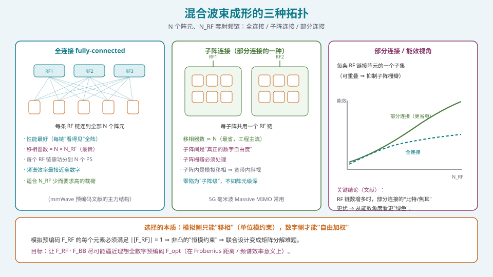
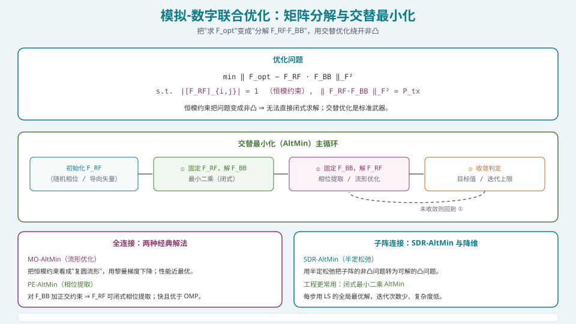

## 本篇要解决什么

[四种架构的选型](pa-architecture-selection.html) 已经告诉你：全数字（每阵元一个射频链）能力最强，但代价最高。工程上最常见的折中是**混合波束成形**（Hybrid Beamforming, HBF）：

**用 \(N_{RF}\) 套射频链驱动 \(N\) 个阵元（\(N_{RF}<N\)），把波束成形拆成"模拟 + 数字"两级。**

核心问题：

**射频链不够时，模拟侧与数字侧怎么配合，才能让性能尽量接近全数字？以及，子阵怎么划，才不会"省了钱却毁了方向图"？**

这一篇给出 HBF 的三种拓扑、把设计问题写成**矩阵分解**、讲透**交替最小化**这柄标准武器，并重点讲清**子阵栅瓣**这个"隐形代价"。

---

## 一、三种拓扑



*图 1：全连接（性能最好、最贵）/ 子阵连接（最省、工程主流）/ 部分连接（可重叠、利于栅瓣抑制）。*

### 1.1 全连接（fully connected）

**每条射频链经功分器连到全部 \(N\) 个阵元。**

- **性能最好**：每个射频链"看得见"全阵 ⇒ 模拟波束可做得很精细，频谱效率最接近全数字；
- **代价**：移相器数量 = \(N\times N_{RF}\)（最贵），功分网络复杂、插损大；
- **适用**：\(N_{RF}\) 少而要求高的载荷（毫米波预编码文献的主力结构）。

### 1.2 子阵连接（sub-array connected）

**每条射频链只管自己那一簇阵元。**

- **移相器数量 ≈ \(N\)**（与阵元数同阶，最省）；
- **子阵之间才是"真正的数字自由度"**；
- **代价**：子阵栅瓣、子阵级零陷受限、子阵内模拟移相导致宽带斜视；
- **工程地位**：**5G 毫米波 Massive MIMO 最常用的形态**（成本/功耗/数据率的最佳折中）。

### 1.3 部分连接（partially connected）

**每条射频链接阵元的一个子集**（子集可重叠、可不等长）。

- **折中形态**，且**重叠/不规则划分有利于抑制子阵栅瓣**；
- **代价**：馈电网络设计更复杂。

### 1.4 从"能效"看拓扑选择

一个反直觉但重要的结论（Yu 等 AltMin 论文的实测）：**当射频链数增多时，部分连接的"能量效率（比特/焦耳）"反超全连接**——因为全连接的功分网络与移相器数量随 \(N_{RF}\) 线性增长，硬件功耗增长更快。

**所以"全连接性能最好"只在频谱效率维度成立；在能效维度上，部分连接/子阵连接可能更优。** 这正是 5G 选子阵连接的原因之一。

---

## 二、把设计问题写成矩阵分解

### 2.1 数学模型

设理想（全数字）预编码为 \(\mathbf{F}_{\text{opt}}\in\mathbb C^{N\times N_s}\)，混合预编码为

\[
\mathbf{F}=\mathbf{F}_{RF}\mathbf{F}_{BB},\qquad
\mathbf{F}_{RF}\in\mathbb C^{N\times N_{RF}},\ \ \mathbf{F}_{BB}\in\mathbb C^{N_{RF}\times N_s}.
\]

其中 \(\mathbf{F}_{RF}\) 由**模拟移相器**实现，故每个元素必须满足**恒模约束**：

\[
\big|[\mathbf{F}_{RF}]_{i,j}\big|=1 .
\]

设计目标（在 Frobenius 距离意义下逼近最优全数字预编码）：

\[
\boxed{\
\min_{\mathbf{F}_{RF},\mathbf{F}_{BB}}\ \big\|\mathbf{F}_{\text{opt}}-\mathbf{F}_{RF}\mathbf{F}_{BB}\big\|_F^2
\quad
\text{s.t.}\ \big|[\mathbf{F}_{RF}]_{i,j}\big|=1,\ \ \|\mathbf{F}_{RF}\mathbf{F}_{BB}\|_F^2=P_{tx}
\ }
\]

### 2.2 为什么"难"

- **恒模约束非凸**：可行集是 \(N\times N_{RF}\) 个**复圆**的乘积（一个黎曼流形），不是凸集；
- **两个变量耦合**：\(\mathbf{F}_{RF}\) 与 \(\mathbf{F}_{BB}\) 相乘，不能分别独立优化；
- 目标函数在联合变量上非凸 ⇒ **没有闭式全局最优解**。

**这就是"混合波束成形设计 = 带恒模约束的矩阵分解"这句话的全部含义。**

> 工程意义：**约束的"硬度"决定了性能上限**。若移相器只能取 \(2^B\) 档，还可进一步加"量化相位"约束（更硬）——工程上常先按连续相位设计，再做量化+微调。

---

## 三、交替最小化：标准武器



*图 2：固定一个、优化另一个，往复迭代；每一步都尽量用"闭式/凸"的解。*

### 3.1 基本骨架

**交替最小化（Alternating Minimization, AltMin）**：固定 \(\mathbf{F}_{RF}\) 解 \(\mathbf{F}_{BB}\)，再固定 \(\mathbf{F}_{BB}\) 解 \(\mathbf{F}_{RF}\)，往复直至收敛。

**① 固定 \(\mathbf{F}_{RF}\)，解 \(\mathbf{F}_{BB}\)**：此时问题是**凸的最小二乘**，闭式解

\[
\mathbf{F}_{BB}=\big(\mathbf{F}_{RF}^{\mathsf H}\mathbf{F}_{RF}\big)^{-1}\mathbf{F}_{RF}^{\mathsf H}\mathbf{F}_{\text{opt}}
\quad(\text{或带功率约束的归一化版本}).
\]

按定义，\(\mathbf{F}_{RF}^{\mathsf H}\mathbf{F}_{RF}=N\cdot\mathbf{I}\)（每列恒模），故

\[
\boxed{\ \mathbf{F}_{BB}=\frac{1}{N}\mathbf{F}_{RF}^{\mathsf H}\mathbf{F}_{\text{opt}}\ }
\]

极其简洁——**这是 AltMin 能用起来的核心原因之一**。

**② 固定 \(\mathbf{F}_{BB}\)，解 \(\mathbf{F}_{RF}\)**：此时是"在恒模约束下最小化 \(\|\mathbf{F}_{\text{opt}}-\mathbf{F}_{RF}\mathbf{F}_{BB}\|_F^2\)"，仍有非凸性。不同解法就是不同的 AltMin 变体。

### 3.2 全连接的两种经典解法

| 方法 | 思路 | 特点 |
| --- | --- | --- |
| **MO-AltMin**（流形优化） | 把恒模约束视为**复圆流形**，用黎曼梯度下降 | 性能近最优（作为基准）；计算复杂度较高 |
| **PE-AltMin**（相位提取） | 对 \(\mathbf{F}_{BB}\) 加**正交约束** ⇒ \(\mathbf{F}_{RF}\) 可**闭式相位提取** | 快得多，且**优于 OMP**（正交匹配追踪，之前的业界标准） |

**PE-AltMin 的洞察**：强制数字预编码正交几乎不损失频谱效率，却让模拟部分变得**闭式可解**——这是"用一点点约束换巨大简化"的典型案例。

### 3.3 子阵连接的解法

- **SDR-AltMin**：用**半定松弛（SDR）**把子阵的非凸问题松弛为可解的凸问题；
- **工程更常用**：**闭式最小二乘 AltMin**——每一步都用最小二乘的全局最优解，所需迭代次数少、复杂度低，在不同混合架构下都能保持低开销。

### 3.4 参考代码（全连接 AltMin / PE-AltMin 骨架）

```python
import numpy as np

def altmin_fully_connected(Fopt, N_RF, n_iter=30, seed=0):
    """全连接混合预编码：AltMin（相位提取版）。
    Fopt: (N, Ns) 理想全数字预编码。返回 (F_RF, F_BB)。"""
    rng = np.random.default_rng(seed)
    N, Ns = Fopt.shape
    F_RF = np.exp(1j*2*np.pi*rng.random((N, N_RF)))       # 每列恒模
    for _ in range(n_iter):
        # ① 固定 F_RF：F_BB = (F_RFᴴF_RF)^-1 F_RFᴴ F_opt = (1/N) F_RFᴴ F_opt
        F_BB = (F_RF.conj().T @ Fopt) / N
        # ② 固定 F_BB：相位提取（PE）——先做 LS 解，再取相位
        F_ls = Fopt @ np.linalg.pinv(F_BB)                 # 无约束 LS 解
        F_RF = np.exp(1j*np.angle(F_ls))                   # 投影回恒模
    # 归一化数字预编码以满足总功率约束
    F_BB = F_BB / np.linalg.norm(F_RF @ F_BB) * np.sqrt(Fopt.shape[1])
    return F_RF, F_BB

def se_loss(Fopt, F_RF, F_BB):
    return np.linalg.norm(Fopt - F_RF @ F_BB, 'fro')**2
```

**验证**：令 \(N_{RF}=N_s\)（射频链数 = 数据流数），MO-AltMin 的频谱效率应**几乎等于全数字**；PE-AltMin 应**显著优于 OMP**。

---

## 四、子阵栅瓣：混合架构的隐形代价


*图 3：压缩比越高越省钱，但子阵越大、等效间距越容易超 λ/2 ⇒ 子阵栅瓣。*

### 4.1 成因

子阵连接时，每个子阵内部先做模拟合成，于是**子阵的相位中心构成一个新的等效阵列**，其等效间距为

\[
d_{sub}=D_{sub}\times d .
\]

若 \(d_{sub}>\lambda/2\)，就会出现**子阵栅瓣**——与 [λ/2 准则](pa-half-wavelength-criterion.html) 里"阵元栅瓣"的机理**完全同源**（空间采样不足 ⇒ 空间混叠），只是发生在**子阵级**。

### 4.2 后果

- 在非期望方向产生**高副瓣/假波束**；
- **污染方向图**，使波束形状畸变；
- 极端情况下**"指错方向"**（假波束被误认为主波束）；
- 破坏低副瓣与零陷指标。

**危险在于**：HBF 的压缩比往往很高（4:1~8:1），子阵尺寸大 ⇒ **几乎必然触发**，而且**后期难补**。

### 4.3 四类对策

| 对策 | 原理 | 代价 |
| --- | --- | --- |
| **重叠子阵**（overlapped subarrays） | 相邻子阵共享部分阵元 ⇒ 破坏周期性 | 功分网络更复杂、损耗略增 |
| **非均匀子阵划分** | 子阵大小不同 ⇒ 破坏相干叠加 | 设计复杂度上升 |
| **子阵内配相** | 在子阵内部施加相位分布 ⇒ 等效补回自由度 | 消耗子阵内配相资源 |
| **降低压缩比** | 直接增加 \(N_{RF}\) | 成本/功耗/数据率上升 |

**权衡的本质**：**你在"射频链数量"与"数字自由度"之间交易；没有免费的压缩。**

### 4.4 压缩比 \(N/N_{RF}\) 怎么选

**正确顺序（反直觉但关键）**：

\[
\boxed{\ \text{先问"需要几个同时波束 / 多深的零陷"，再倒推 } N_{RF}, \text{而不是先定 } N_{RF} .\ }
\]

| 压缩比 | 例子（\(N=64\)） | 数字自由度 | 适用 |
| --- | --- | --- | --- |
| 4:1 | \(N_{RF}=16\) | 较好 | 要求较高的场景 |
| 8:1 | \(N_{RF}=8\) | 一般 | **5G 毫米波常见** |
| 16:1 | \(N_{RF}=4\) | 紧张 | 成本极敏感 |
| 1:1 | \(N_{RF}=64\) | 全数字 | 高价值载荷 |

**约束传递**：\(N_{RF}\) 上的"自由度上限"直接决定：

- 可同时置零的干扰数 \(\lesssim N_{RF}-1\)（见 [MVDR](pa-adaptive-mvdr-lcmv.html)）；
- 可分辨的源数 \(\lesssim N_{RF}-1\)（见 [DOA](pa-doa-music-esprit.html)）；
- 子阵级零陷的深度与形状（不如阵元级）。

---

## 五、实践差异：5G Massive MIMO vs 卫星载荷

| 维度 | 5G 大规模 MIMO | 卫星载荷 |
| --- | --- | --- |
| 首要约束 | 成本 / 功耗 / 数据率 | 能力 / 功耗 / 重量 / 覆盖 |
| 典型拓扑 | 子阵连接 | 全连接或高 \(N_{RF}\) |
| 典型压缩比 | 4:1 ~ 8:1 | 更接近 1:1 ~ 2:1 |
| 带宽压力 | 相对窄，斜视压力小 | 宽（需 TTD / 数字子带） |
| 波束需求 | 少量同时波束 + 扫描 | 多个同时波束 + 抗干扰 |
| 算法后果 | 自由度受限下优化 | 自由度较充裕，但功耗/热更紧张 |

**共同点**：**数字自由度只有 \(N_{RF}\) 个**——这是 HBF 对算法的硬约束，也是 S4 后续所有算法（自适应、DOA、稳健化）必须面对的边界。

---

## 六、常见误区清单

**误区一：以为"混合 = 全数字打个折，随便配配就行"。**
HBF 的设计是**带恒模约束的非凸矩阵分解**，是**最难的一类优化问题之一**。它比全数字更省硬件，但**算法上更难**。

**误区二：只在频谱效率维度比较拓扑。**
**全连接频谱效率最好，但能效不一定**（功分网络与移相器随 \(N_{RF}\) 线性增长）。**5G 选子阵连接，正是能效驱动的。**

**误区三：忽略子阵栅瓣。**
\(d_{sub}=D_{sub}\times d\) 很容易 > λ/2。**高压缩比下几乎必然发生**，且后期难补。**必须在架构/子阵划分阶段就处理。**

**误区四：先定 \(N_{RF}\) 再想能做什么。**
正确顺序是**从能力需求倒推 \(N_{RF}\)**。先定 \(N_{RF}\) 会锁死你的波束数、零陷数与带宽。

**误区五：对"恒模约束"掉以轻心。**
模拟移相器只能调相位、不能调幅度 ⇒ \(\mathbf{F}_{RF}\) 每元素恒模。**这是非凸性的根源**，也是"为什么不能直接把全数字方案量化一下就用"的原因。

**误区六：忽略移相器量化。**
工程上移相器只有 \(2^B\) 档，连续相位解要**量化 + 微调**。量化会引入量化副瓣（见 [移相器与 TTD](pa-phase-shifter-ttd.html)），须与低副瓣指标一起权衡。

**误区七：把 HBF 的子阵内斜视当成"不存在"。**
子阵内是模拟移相 ⇒ **宽带下子阵内仍有斜视**。要么子阵做小（但栅瓣风险升），要么叠 TTD/数字子带（见 [波束斜视与宽带相控阵](pa-beam-squint-wideband.html)）。

**误区八：用"全数字的算法复杂度"设计混合系统。**
子阵级数字意味着协方差矩阵只有 \(N_{RF}\) 维：**MUSIC 可分辨源数、MVDR 可置零数都受 \(N_{RF}\) 限**。算法必须按实际自由度设计（见 [架构选型](pa-architecture-selection.html)）。

**误区九：忘了"宽带 OFDM"下模拟预编码要跨子载波共用。**
OFDM 宽带下，**一个模拟预编码器要在所有子载波上工作**，而数字预编码可逐子载波。这使问题更难（模拟侧无频率分辨力），也解释了为什么宽带 HBF 常需 TTD 或子带处理。

---

## 七、快速自测

**Q1.** 写出 HBF 的优化问题，并解释"恒模约束"为什么使问题非凸。

<details><summary>参考要点</summary>

\[
\min_{\mathbf{F}_{RF},\mathbf{F}_{BB}}\|\mathbf{F}_{\text{opt}}-\mathbf{F}_{RF}\mathbf{F}_{BB}\|_F^2
\quad\text{s.t.}\ |[\mathbf{F}_{RF}]_{i,j}|=1,\ \|\mathbf{F}_{RF}\mathbf{F}_{BB}\|_F^2=P_{tx}.
\]

**非凸的原因**：
1. **恒模约束的可行集是 \(N\times N_{RF}\) 个复圆的乘积**（黎曼流形），不是凸集；
2. 两个变量**相乘耦合**（双线性），不能分别独立求解；
3. 目标在联合变量上非凸。

**后果**：无闭式全局最优，必须用交替优化 / 流形优化 / 松弛方法。

</details>

**Q2.** 在全连接 AltMin 中，"固定 \(\mathbf{F}_{RF}\) 解 \(\mathbf{F}_{BB}\)"为什么有简洁闭式解 \(\mathbf{F}_{BB}=\frac1N\mathbf{F}_{RF}^{\mathsf H}\mathbf{F}_{\text{opt}}\)？

<details><summary>参考要点</summary>

固定 \(\mathbf{F}_{RF}\) 时，问题退化为**凸的最小二乘**：

\[
\min_{\mathbf{F}_{BB}}\|\mathbf{F}_{\text{opt}}-\mathbf{F}_{RF}\mathbf{F}_{BB}\|_F^2
\Rightarrow
\mathbf{F}_{BB}=(\mathbf{F}_{RF}^{\mathsf H}\mathbf{F}_{RF})^{-1}\mathbf{F}_{RF}^{\mathsf H}\mathbf{F}_{\text{opt}} .
\]

**关键**：全连接结构下 \(\mathbf{F}_{RF}\) 每列恒模，且各列相互正交（或可正交化），故

\[
\mathbf{F}_{RF}^{\mathsf H}\mathbf{F}_{RF}=N\,\mathbf{I}
\Rightarrow
\mathbf{F}_{BB}=\frac{1}{N}\mathbf{F}_{RF}^{\mathsf H}\mathbf{F}_{\text{opt}} .
\]

**这就是 AltMin 高效的根源**：一半的迭代步骤有极简闭式解。

</details>

**Q3.** 对比全连接、子阵连接、部分连接三种拓扑的结构、移相器数量、性能与适用场景。

<details><summary>参考要点</summary>

| 拓扑 | RF 链连接 | 移相器数 | 性能 | 适用 |
| --- | --- | --- | --- | --- |
| 全连接 | 每条链连全部 \(N\) 阵元 | \(N\times N_{RF}\) | 频谱效率最好 | \(N_{RF}\) 少、要求高（mmWave 文献主力） |
| 子阵连接 | 每条链只管自己的簇 | \(\approx N\) | 折中（有子阵栅瓣） | **5G Massive MIMO 主流** |
| 部分连接 | 每条链连阵元子集（可重叠） | \(N\)~\(N\times N_{RF}\) 之间 | 折中，可抑制栅瓣 | 能效优先、需抑制栅瓣 |

**补充**：从**能效**看，随 \(N_{RF}\) 增多，部分连接的"比特/焦耳"可能反超全连接。

</details>

**Q4.** 什么是子阵栅瓣？为什么 HBF 几乎必然遇到？给出至少三种对策。

<details><summary>参考要点</summary>

**定义**：子阵连接时，每个子阵内部先模拟合成，**子阵相位中心构成等效阵列**，其等效间距

\[
d_{sub}=D_{sub}\times d .
\]

若 \(d_{sub}>\lambda/2\) ⇒ **空间混叠** ⇒ 子阵栅瓣（与阵元栅瓣同源，但发生在子阵级）。

**为何几乎必然**：HBF 压缩比常为 4:1~8:1 ⇒ 子阵尺寸大 ⇒ \(d_{sub}\) 极易 > λ/2。

**对策**：
1. **重叠子阵**：相邻子阵共享阵元，破坏周期性；
2. **非均匀子阵划分**：子阵大小不同，破坏相干叠加；
3. **子阵内配相**：在子阵内施加相位分布，等效补充自由度；
4. **降低压缩比**（增加 \(N_{RF}\)）。

</details>

**Q5.** MO-AltMin 与 PE-AltMin 有什么区别？各自适用什么场合？

<details><summary>参考要点</summary>

- **MO-AltMin（流形优化）**：把恒模约束视为**复圆流形**，用黎曼梯度下降求解。**性能近最优**，常作为**基准**；但**计算复杂度较高**。
- **PE-AltMin（相位提取）**：对数字预编码 \(\mathbf{F}_{BB}\) 施加**正交约束** ⇒ 模拟部分 \(\mathbf{F}_{RF}\) 可用**闭式相位提取**得到。**计算快得多**，且**优于 OMP**（业界此前的标准）。

**适用**：
- 追求**性能基准 / 离线验证** ⇒ MO-AltMin；
- 追求**实时/低复杂度**（如工程实现） ⇒ PE-AltMin；
- **子阵结构** ⇒ SDR-AltMin 或"闭式最小二乘 AltMin"（工程更常用）。

</details>

**Q6.** 一个 256 元阵要支持 8 个同时波束、对 6 个干扰置零、宽带 400 MHz@28 GHz。请给出 HBF 设计建议。

<details><summary>参考要点</summary>

**自由度需求**：
- 8 个波束 + 6 个零陷 + 主瓣/保形约束 ⇒ 需要数字自由度 \(\ge\) 约 15~20；
- 取 **\(N_{RF}=32\)**（压缩比 8:1），留余量。

**拓扑建议**：**子阵连接 + 重叠子阵**（每子阵 8 元，重叠 2 元），理由：
- 移相器数 ≈ \(N=256\)（经济）；
- 重叠抑制子阵栅瓣（\(D_{sub}=8\) ⇒ \(d_{sub}=8\times\lambda/2=4\lambda\gg\lambda/2\)，**若不重叠必然出栅瓣**）。

**宽带（400 MHz @ 28 GHz，相对带宽 1.4%）**：
- 相对带宽不大，但 256 元的波束极窄 ⇒ **子阵内斜视仍需关注**；
- 建议**子阵级 TTD 或数字子带补偿**（见专题 21）。

**算法边界提醒**：协方差矩阵只有 32×32 ⇒ **最多置零约 31 个干扰（子阵级）**，且零陷不如阵元级深。若"6 个干扰、40 dB 抑制"中有强对抗要求，需评估是否需要部分阵元级数字通道。

**结论**：**先由能力需求定 \(N_{RF}\) → 再定拓扑 → 再处理子阵栅瓣与斜视**，是 HBF 设计的正确顺序。

</details>

**Q7.** 为什么"能效"会改变拓扑选择的结论？这对 5G 与卫星载荷分别意味着什么？

<details><summary>参考要点</summary>

**原因**：全连接的**硬件规模随 \(N_{RF}\) 线性增长**（移相器 \(N\times N_{RF}\)、功分网络），故功耗上升快；子阵/部分连接的硬件规模近似与 \(N\) 同阶，**随 \(N_{RF}\) 增长的功耗更慢**。

**文献结论**：射频链数增多时，**部分连接的"比特/焦耳"反超全连接**（更"绿色"）。

**含义**：
- **5G Massive MIMO**：首要约束是成本/功耗 ⇒ 选**子阵连接**（4:1~8:1），在满足波束管理需求下最省；
- **卫星载荷**：首要约束是能力/覆盖/抗干扰，且需多同时波束 ⇒ 更接近**全连接或高 \(N_{RF}\)**，但要精算功耗、散热与重量（"能力再好，散不了热也白搭"）。

**共同点**：拓扑选择是**多目标优化**（频谱效率 × 能效 × 成本 × 重量），不是"哪个更先进"。

</details>

**Q8.** 为什么"OFDM 宽带 HBF"比窄带 HBF 更难？

<details><summary>参考要点</summary>

**核心矛盾**：OFDM 各子载波频率不同，而 **模拟预编码 \(\mathbf{F}_{RF}\) 由移相器实现、无频率分辨力**——一个 \(\mathbf{F}_{RF}\) 要在**所有子载波上同时工作**；而数字预编码 \(\mathbf{F}_{BB}\) 可逐子载波设计。

**后果**：
1. 模拟侧对全带"折中"，**无法逐频补偿** ⇒ 存在**子阵内斜视**（见专题 21）；
2. 联合设计要**同时兼顾所有子载波**，问题维度与难度上升；
3. 若追求无斜视，需引入 **TTD**（模拟域消色散）或**子带化数字处理**。

**工程应对**：
- 窄相对带宽 ⇒ 可容忍，按中心频率设计；
- 宽相对带宽 ⇒ **子阵级 TTD** 或 **数字子带补偿**，并把 \(\mathbf{F}_{RF}\) 设计成"带内近似频率无关"。

**一句话**：**宽带把 HBF 从"矩阵分解"升级为"带频率维度的矩阵分解"。**

</details>

---

## 八、与本站其它专题的连接

| 想了解 | 看哪篇 |
| --- | --- |
| 四种架构的整体选型 | [四种架构的选型：PESA / AESA / 混合 / 全数字](pa-architecture-selection.html) |
| λ/2 准则与栅瓣机理 | [λ/2 准则：栅瓣的成因、抑制与例外](pa-half-wavelength-criterion.html) |
| 混合架构下的斜视与消斜视 | [波束斜视与宽带相控阵](pa-beam-squint-wideband.html) |
| 移相器位数与量化副瓣 | [移相器与真时延器件（TTD）](pa-phase-shifter-ttd.html) |
| 馈电网络与互耦 | [功分合成网络与互耦效应](pa-feed-network-mutual-coupling.html) |
| 子阵级自适应的自由度上限 | [自适应波束形成：MVDR 与 LCMV](pa-adaptive-mvdr-lcmv.html) |
| 子阵维度如何限制 DOA | [DOA 估计：MUSIC / ESPRIT 与工程改良](pa-doa-music-esprit.html) |
| 模拟-数字权值落到芯片 | [FPGA/HLS 实现：数据面与控制面的分工](pa-fpga-hls-implementation.html) |
| 大规模 MIMO 与波束赋形概念 | [大规模 MIMO 与波束赋形](massive-mimo-beamforming.html) |
| 相控阵的物理机制 | [卫星相控阵天线：从阵元到波束](satellite-phased-array.html) |
| 学习体系全貌 | [相控阵天线学习体系：六阶段路线图](phased-array-roadmap.html) |

---

## 九、延伸阅读

**权威综述与经典论文**
- Yu, Shen, Zhang & Letaief, "Alternating Minimization Algorithms for Hybrid Precoding in Millimeter Wave MIMO Systems," *IEEE JSTSP*, 2016。**AltMin / MO-AltMin / PE-AltMin / SDR-AltMin 的原始论文**（本文 §3 主要依据）。
- Heath et al., "An Overview of Signal Processing Techniques for Millimeter Wave MIMO Systems," *IEEE JSTSP*, 2016。**毫米波 MIMO 信号处理权威综述**（拓扑、压缩比、混合预编码）。
- El Ayach et al., "Spatially Sparse Precoding in Millimeter Wave MIMO Systems," *IEEE TWC*, 2014。**OMP 稀疏预编码**（PE-AltMin 的对比基准）。
- 关于低复杂度闭式最小二乘 AltMin 的后续工作（IMT Atlantique 等）。

**教材**
- Mailloux, *Phased Array Antenna Handbook*, 3rd ed.：子阵与重叠子阵的系统处理。
- Van Trees, *Optimum Array Processing*：波束域/子阵降维的理论基础。

**本站衔接**
- 上一篇 [波束斜视与宽带相控阵](pa-beam-squint-wideband.html) 处理"频率维度"；
- 本篇处理"**空间/架构维度**"——**这两篇共同构成 S4 的"架构篇"**；
- 接下来进入"**实现篇**"：[定点化](pa-fixed-point-quantization.html) 与 [FPGA/HLS](pa-fpga-hls-implementation.html)，把前面所有算法真正落到硬件指标上。
