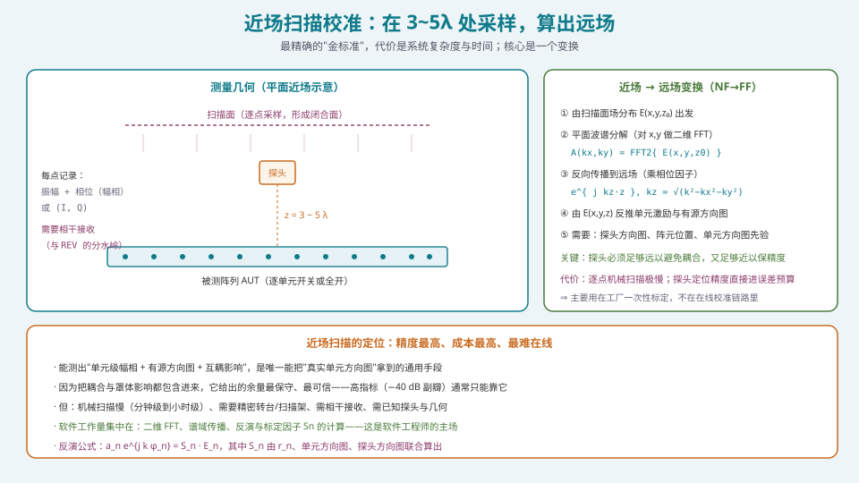
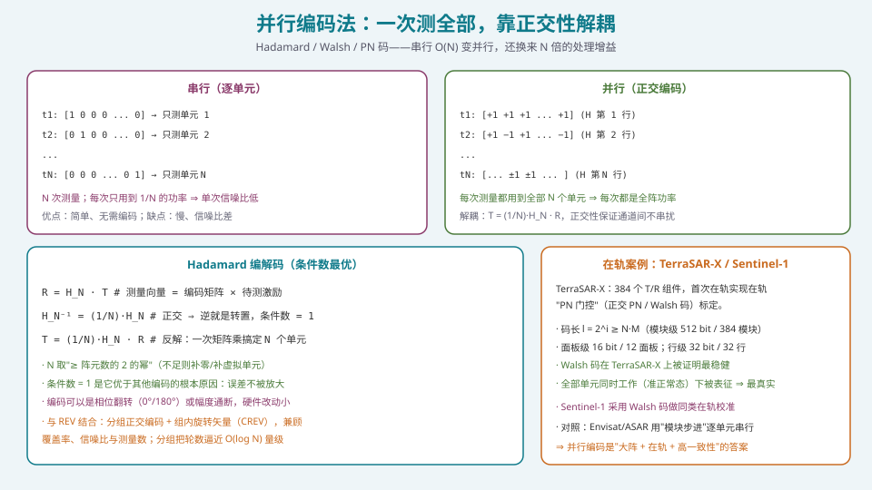
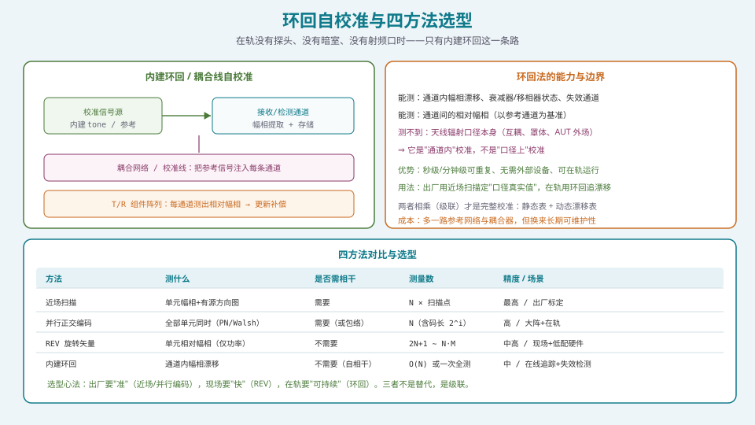

## 本篇要解决什么

[REV](pa-rev-calibration.html) 解决了一个漂亮的数学问题：只测功率也能解出幅相。但它在两个场景下会卡住：

1. **大阵太慢**：\(N=1000\)、每次 \(2N+1\) 次测量，还要逐单元转，产线节拍根本受不了；
2. **在轨/在线无远场探头**：卫星在轨没有远场测试距离，也没有可移动探头。

所以本篇回答：

**核心问题：大阵、在轨、在线，分别该怎么校准？**

四条路线，各有明确的适用边界：

| 路线 | 一句话 | 核心机制 |
| --- | --- | --- |
| **近场扫描** | 最精确的"金标准" | 探头 3~5λ 采样 + 近远场变换 |
| **并行正交编码** | 一次测全部 | Hadamard/Walsh/PN 码解耦 |
| **FFT 频谱分析** | 并行 + 频域分离 | 各单元不同频率 ⇒ 频谱可分辨 |
| **内建环回** | 在轨唯一解 | 耦合线/参考网络自检 |

---

## 一、三个真实约束

先说清约束，否则方案选择没有依据。

### 1.1 约束一：远场距离的代价

对口径尺寸 \(D\) 的阵列，远场条件是

\[
R>\frac{2D^2}{\lambda}
\tag{1.1}
\]

**例**：一个 \(D=1\ \text{m}\)、\(\lambda=3\ \text{cm}\)（10 GHz）的阵列，需要 \(R>2\times1/0.03\approx67\ \text{m}\) 的远场距离。**暗室的造价随距离平方增长**——这就是"近场扫描"存在的直接理由：

> **不满足远场条件，不等于拿不到远场信息。可以在近场采样，再用数学变换算出远场。**

### 1.2 约束二：大阵的测量数

\(N\) 个单元若逐次测，时间 \(\propto N\)。当 \(N\) 到几百上千，**逐次测量的时间与"每一次测量都要稳定"的难度**同时爆炸。

### 1.3 约束三：在轨/在线没有探头

卫星在轨、车载/机载运行时：

- 没有暗室，没有远场距离；
- 没有可移动探头；
- 天线往往**没有射频连接器**（集成度高）；
- **但指标必须在整个寿命期内保持**（温漂 + 老化）。

**⇒ 必须有"自给自足"的校准手段。**

---

## 二、近场扫描：探头 3~5λ + 近远场变换

*图 1：探针在阵列前方 3~5λ 的扫描面上逐点采样，再经平面波谱变换得到远场与单元激励。*

### 2.1 测量几何

- 探头位于阵列前方 **3~5 个波长**处（近场区，但足够远以避免强耦合）；
- 在**扫描面**上逐点采样（平面近场）/ 或沿闭合面采样（球面/柱面近场）；
- 每个点记录**振幅 + 相位**（或 I/Q）。

**两种采集模式**：

1. **逐单元开关（on-off）**：只开被测单元，其余关断 ⇒ 直接得到该单元的响应；简单但慢，且**测量条件与正常工作态不符**（互耦状态不同）；
2. **全开（all-on）**：所有单元都工作，通过设置不同激励组合反解 —— 更真实，但需要解方程（见第三节）。

### 2.2 近场 → 远场变换（NF→FF）

核心是**平面波谱分解**（对 \(x,y\) 做二维 FFT）：

\[
A(k_x,k_y)=\iint E(x,y,z_0)\,e^{-j(k_x x+k_y y)}\,\mathrm dx\,\mathrm dy
\tag{2.1}
\]

再由谱域**反向传播**到任意 \(z\)：

\[
E(x,y,z)=\iint A(k_x,k_y)\,e^{\,j k_z z}\,e^{\,j(k_x x+k_y y)}\,\mathrm dk_x\,\mathrm dk_y,
\qquad k_z=\sqrt{k^2-k_x^2-k_y^2}
\tag{2.2}
\]

**用 \(k_z=k\sin\theta\) 就能把"谱域"翻译成"角度域"** —— 这正是[空间频率与空间傅里叶变换](pa-spatial-frequency-fft.html)里那套对偶关系的工程落地。

### 2.3 反演单元激励

由测得的场分布反推单元激励与有源方向图：

\[
a_n\,e^{\,j k\varphi_n}=S_n\cdot E_n
\tag{2.3}
\]

其中 \(S_n\) 是**标定因子**，由"阵元到探头距离 \(r_n\)、单元方向图、探头方向图、几何位置"联合算出：

\[
S_n \;=\; \frac{1}{r_n}\cdot g_n(\alpha_n^{\,e})\cdot f(\alpha_n^{\,p})
\]

**关键**：反演精度**直接取决于** \(r_n\) 的测量精度、探头与单元方向图的先验准确度——**软件工作量主要在这里**。

### 2.4 定位：精度最高，也最贵、最难在线

| 维度 | 评价 |
| --- | --- |
| 精度 | **最高**。能测"单元幅相 + 有源方向图 + 互耦影响" |
| 结论可信度 | **最保守**（耦合与罩体都含在内）⇒ 高指标（−40 dB 副瓣）通常只能靠它 |
| 速度 | 极慢（机械扫描，分钟~小时级） |
| 硬件 | 精密转台/扫描架 + 相干接收 + 已知探头 |
| 部署 | **只在工厂做一次性标定**，不进在线链路 |

---

## 三、并行正交编码：一次测全部

*图 2：串行每次只开一个单元；并行每次让全部单元按正交码工作，靠正交性解耦。*

### 3.1 串行 vs 并行

- **串行**：第 \(t_k\) 次只开单元 \(k\)，其余关断。\(N\) 次测量，每次只用到 \(1/N\) 的功率 ⇒ **单次信噪比差**；
- **并行**：每次测量都让**全部 \(N\) 个单元**按正交码工作 ⇒ **每次都是全阵功率**，且靠正交性把各单元解出来。

### 3.2 Hadamard 编解码

设待测激励向量为 \(\mathbf T\)（长度 \(N\)），测量向量为 \(\mathbf R\)（长度 \(N\)），编码矩阵取 Hadamard 矩阵 \(H_N\)：

\[
\mathbf R=H_N\,\mathbf T
\tag{3.1}
\]

Hadamard 矩阵的核心性质是**正交**：

\[
H_N^{-1}=\frac{1}{N}H_N
\quad\Longrightarrow\quad
\boxed{\ \mathbf T=\frac{1}{N}H_N\,\mathbf R\ }
\tag{3.2}
\]

**为什么它是最优选择**：正交性使**条件数 = 1**——这是所有编码方式里最好的。条件数越大，测量误差被放大得越厉害；**条件数 = 1 意味着误差不被放大**。

**实现要点**：
- \(N\) 取"**≥ 阵元数的 2 的幂**"（不足则补零或补虚拟单元）；
- 编码实现可以是**相位翻转（0°/180°）**或**幅度通断**——硬件改动小；
- 反解就是**一次矩阵乘**——计算量极低。

### 3.3 在轨案例：TerraSAR-X 的 PN 门控

**这是"并行编码"最有说服力的工程实证。**

| 项目 | TerraSAR-X |
| --- | --- |
| 阵列规模 | **384 个 T/R 组件**（12 面板 × 32 行） |
| 编码 | **正交 PN / Walsh 码** |
| 码长 | \(l=2^i\ge N\cdot M\) |
| 模块级 | 512 bit / 384 模块 —— **全部 384 个 T/R 同时被表征** |
| 面板级 | 16 bit / 12 面板 |
| 行级 | 32 bit / 32 行 |
| 关键结论 | **Walsh 码被证明最稳健**；全部单元在"准正常工作态"下被表征 |

**为什么这很重要**：

- 与 Envisat/ASAR 的**逐单元串行步进**相比，TerraSAR-X 让 **384 个单元同时工作**——**测量条件最真实**（互耦、温度、工作点都符合实际）；
- "**准正常态**"这一点是关键：串行的 on-off 模式会改变互耦环境，而并行编码不会；
- 结果可以**直接定位失效通道**（每个单元有唯一编码 ⇒ 失效位置可直接读出）；
- **Sentinel-1 采用 Walsh 码**做同类在轨校准；
- 动态范围问题（bore-sight 时全码同号会让合成信号过高）可通过"**几何编码**"（给底层波束加一个恒定相位分布）来抑制。

> **方法论价值**：TerraSAR-X 的做法确立了"**内建校准网络 + 正交编码 + 在轨周期执行**"这条在轨校准的标准范式。

### 3.4 与 REV 的结合：分组旋转（CREV）

并行编码解决"大阵太慢"，但要求能**同时控制所有单元的相位/幅度**。当这个自由度受限时（例如只能整体波束控制），退回到**分组旋转**：

- 把单元分组，一组一组地旋转（组内单元同步动作）⇒ 提高单次贡献的相对权重（解决 REV 的大阵信噪比问题）；
- 多组分组 + 正交设计 ⇒ 把轮数从 \(O(N)\) 压到接近 \(O(\log N)\) 量级，同时保住每个单元的精度。

**这正是"分组把轮数逼近 \(O(\log N)\)"的机理**：不是一次测一个，而是**用正交分组的层次化覆盖**把信息一层层剥出来。

---

## 四、基于 FFT 频谱分析的多单元并行校准

另一条并行思路，思路更"信号处理"：

**做法**：让每个待校准单元按**不同的频率**（基频的第奇数倍）翻转相位；对阵列合成信号做 **FFT**，则：

- 每个单元的信号落在**各自独立的频谱位置**；
- 从对应谱线的**幅度和相位**直接读出该单元的激励；
- **一次采集（含 \(M\) 个时间样本）就能同时解出多个单元**。

**优点**：与 Hadamard 一样能并行，且**天然抗窄带干扰**（干扰只污染少数谱线）。

**代价**：需要较长的采样序列（频率分辨率 ∝ 采样长度），且在宽频阵列上要给每个单元分配频点，**频谱资源与信道一致性**都需仔细设计。

---

## 五、内建环回 / 耦合线自校准：在轨唯一解

*图 3：环回测"通道内"漂移；下方是四方法的对比与选型。*

### 5.1 结构

在阵列内部（或馈网末端）加一条**参考网络 / 耦合线 / 校准通道**：

1. **内建信号源**（或从发射通道耦合一路参考）产生已知的校准 tone；
2. 通过**耦合网络**把这个参考信号注入**每一条通道**；
3. **接收/检测通道**测出每条通道输出与参考的相对幅相；
4. 解算并更新补偿表。

### 5.2 能力与边界（必须分清楚）

| 能测 | 不能测 |
| --- | --- |
| 通道内的幅相漂移 | **天线辐射口径本身** |
| 衰减器/移相器的实际状态 | **互耦与罩体影响** |
| 失效通道 | **AUT 外场环境** |
| 通道间的**相对**幅相 | **绝对口径相位** |

**一句话**：**它是"通道内"校准，不是"口径上"校准。**

### 5.3 正确用法：与出厂标定级联

\[
\boxed{\ \text{出厂（近场扫描/并行编码）定"口径真实值"}\;+\;\text{在线（环回）追"通道漂移"}\ }
\]

- 出厂时用近场扫描/并行编码拿到**包含口径与互耦的真实激励**，写入**静态补偿表**；
- 运行中用环回周期测量**通道内漂移**（温漂、老化），写入**动态漂移表**；
- 两者**级联**（相乘/相加）才是完整校准。

**优势**：秒~分钟级可重复、无需外部设备、**可在轨运行到设计寿命**。

**成本**：多一路参考网络与耦合器 —— 但换来的是**长期可维护性**。

### 5.4 与"内部校准"的工程节奏

工程上通常分三层执行：

| 层级 | 频率 | 目的 |
| --- | --- | --- |
| **工厂标定** | 一次（或大修时） | 建立静态补偿表（含口径） |
| **内部校准（环回）** | **每 1~60 秒 / 分钟级** | 追踪温度漂移与快速漂移 |
| **外部校准（信标/卫星/合作目标）** | 天~月级 | 追踪慢老化与装机环境变化 |

**关键系统**：连续内部校准 + 周期性外部验证。

---

## 六、四方法对比与选型

| 方法 | 测什么 | 是否需相干 | 测量数 | 精度 / 场景 |
| --- | --- | --- | --- | --- |
| **近场扫描** | 单元幅相 + 有源方向图 | 需要 | \(N\times\)扫描点 | 最高 / 出厂标定 |
| **并行正交编码** | 全部单元同时（PN/Walsh） | 需要（或包络） | \(N\)（含码长 \(2^i\)） | 高 / 大阵 + 在轨 |
| **FFT 频谱分析** | 多单元并行（频分） | 需要 | \(\sim N\)（含采样长度） | 高 / 抗窄带干扰 |
| **REV 旋转矢量** | 单元相对幅相（仅功率） | **不需要** | \(2N+1\sim N\times M\) | 中高 / 现场 + 低配硬件 |
| **内建环回** | 通道内幅相漂移 | 不需要（自相干） | \(O(N)\) 或一次全测 | 中 / 在线追踪 + 失效检测 |

**选型心法**：

> **出厂要"准"（近场扫描 / 并行编码），现场要"快"（REV），在轨要"可持续"（环回）。三者不是替代关系，是级联关系。**

---

## 七、常见误区清单

**误区一：以为近场扫描"只测近场，得不到远场"。**
恰恰相反——**近场采样 + 数学变换 = 远场信息**。这是它存在的全部理由（省掉几十米的暗室）。

**误区二：把"逐单元 on-off"当成并列编码。**
on-off 是**串行**：每次只开一个单元，测量条件与工作态不符（互耦状态不同）。**并行编码的核心价值就是"让全部单元同时工作"**。

**误区三：随便选一个编码矩阵。**
编码矩阵的**条件数**决定误差放大率。**Hadamard 的正交性给出条件数 = 1，是最优选择**；其他矩阵可能把测量误差放大数倍。

**误区四：把环回校准当成"完整校准"。**
环回**测不到天线辐射口径**（互耦、罩体、外场）。**它只解决"通道内漂移"**——必须与出厂的口径标定级联使用。

**误区五：以为在轨校准"一次做完就行"。**
温漂是**分钟级**、老化是**月级**。**必须按不同时间尺度分层校准**：出厂一次、内部秒~分钟级、外部天~月级。

**误区六：忽略码长与动态范围的关系。**
TerraSAR-X 的码长 \(l=2^i\ge N\cdot M\) 不是随便定的；且在 bore-sight 下**全码同号会导致合成信号功率过高**（接收机可能饱和）——需用"几何编码"抑制动态范围。

**误区七：以为"天线无射频连接器"就不能校准。**
这正是并行编码 / REV / 环回存在的场景：**它们都不需要外接射频口**，只靠内建网络或辐射场测量。

**误区八：把大阵的"分组"理解成"随便分组"。**
分组的**矩阵设计**决定每个单元的精度是否均匀。**分组矩阵的对称性/正交性不足，会造成"部分单元准、部分单元差"**。

**误区九：忽略"被测单元相对贡献"随 \(N\) 的下降。**
无论 REV 还是 on-off，单单元贡献 \(\propto1/N\)。大阵必须靠**并行编码**或**分组**来维持信噪比，否则得到的是一堆噪声。

---

## 八、快速自测

**Q1.** 为什么"近场扫描"能得到远场结果？核心变换是什么？

参考要点

**因为远场是近场分布的确定性函数**——两者的关系由波动方程完全确定，可以用数学变换互推，不需要真的跑到 \(2D^2/\lambda\) 之外去测。

**核心变换：平面波谱分解（二维 FFT）**

\[
A(k_x,k_y)=\iint E(x,y,z_0)e^{-j(k_x x+k_y y)}\,\mathrm dx\,\mathrm dy
\]

再由谱域反向传播到任意 \(z\)：乘相位因子 \(e^{jk_z z}\)，其中 \(k_z=\sqrt{k^2-k_x^2-k_y^2}\)。**\(k_z=k\sin\theta\)** 把谱域翻译成角度域 ⇒ 得到远场方向图。

**前提**：需要知道探头方向图、单元方向图先验与阵元到探头的精确距离 \(r_n\)。

**Q2.** 写出 Hadamard 编码校准的编解码公式，并说明"条件数 = 1"为什么重要。

参考要点

**编码**：\(\mathbf R=H_N\mathbf T\)（\(\mathbf R\) 测量，\(\mathbf T\) 待测激励）。
**解码**：因 \(H_N^{-1}=\frac{1}{N}H_N\)，故

\[
\boxed{\ \mathbf T=\frac{1}{N}H_N\,\mathbf R\ }
\]

**条件数 = 1 的重要性**：解码相当于解线性方程组，方程组对测量噪声的放大率由矩阵**条件数**决定：

- 条件数 \(\kappa\approx1\) ⇒ **误差不被放大**；
- 若用非正交矩阵（\(\kappa\gg1\)）⇒ 测量中的小噪声会被放大成大的解算误差，甚至使解不可用。

因此 Hadamard 被普遍采用 —— **它在"能否可靠反解"这件事上给出了理论最优**。

**实现细节**：\(N\) 取 ≥ 阵元数的 2 的幂；编码用相位翻转（0°/180°）或通断；反解只需一次矩阵乘。

**Q3.** 串行 on-off 与并行编码，本质区别是什么？为什么并行更好？

参考要点

**本质区别**：

| | 串行 on-off | 并行编码 |
| --- | --- | --- |
| 每次开启 | 1 个单元 | **全部 N 个单元** |
| 单次功率 | \(\sim1/N\) 全阵功率 | **全阵功率** |
| 测量条件 | 与工作态不同（互耦改变） | **准正常工作态，最真实** |
| 附加信息 | 无 | 正交性 ⇒ 条件数 1 |

**为何并行更好**：
1. **每次都是全阵功率** ⇒ 单次信噪比比串行高约 \(N\) 倍（处理增益）；
2. 测量在"**准正常工作态**"下进行 ⇒ 互耦、温度、工作点都符合实际，**结果更可信**；
3. 一次测量覆盖全部单元 ⇒ **总时间显著下降**。

**这就是 TerraSAR-X 选择 PN 门控（全部 384 个 T/R 同时工作）而不是 Envisat/ASAR 式逐单元步进的原因。**

**Q4.** TerraSAR-X 的 PN 门控关键参数有哪些？为什么码长要满足 \(l=2^i\ge N\cdot M\)？

参考要点

**关键参数**：
- **384 个 T/R 组件**（12 面板 × 32 行）；
- **正交 PN / Walsh 码**；Walsh 码被证明**最稳健**；
- **模块级** 512 bit / 384 模块；**面板级** 16 bit / 12 面板；**行级** 32 bit / 32 行；
- 码长条件 \(l=2^i\ge N\cdot M\)（\(N\) 列 × \(M\) 行）；
- 首次在轨验证；**Sentinel-1 采用 Walsh 码**；对照 Envisat/ASAR 用逐单元串行步进。

**为何 \(l\ge N\cdot M\)**：正交码要求每个单元的码序列**互不相同且两两正交**。阵列有 \(N\cdot M\) 个单元，就至少需要 \(N\cdot M\) 个相互正交的码序列 ⇒ 码长必须不小于单元总数（且取 2 的幂以便构造 Walsh/Hadamard 码）。

**Q5.** 内建环回自校准"能测什么、不能测什么"？为什么它是在轨的唯一解？

参考要点

**能测**：通道内的幅相漂移、衰减器/移相器实际状态、通道间**相对**幅相、失效通道。
**不能测**：**天线辐射口径本身**（互耦、罩体、外场环境）——它是"通道内"校准，不是"口径上"校准。

**为何是在轨唯一解**：
- 在轨**没有远场距离**（\(2D^2/\lambda\) 太大）、**没有暗室**、**没有可移动探头**；
- 集成度高时**天线可能没有射频连接器**；
- 但**指标必须在整个寿命期内保持**（温漂 + 老化）；
- 环回完全靠**内建网络**工作，不依赖任何外部设备，可**周期性自动执行**。

**正确用法**：与出厂标定**级联**——出厂用近场/编码定"口径真实值"，在轨用环回追"通道漂移"。

**Q6.** 为什么在轨校准要分三个时间尺度？各层解决什么？

参考要点

**因为不同误差的**变化时间尺度**差了好几个数量级**，用同一节奏处理必然浪费或漏掉：

| 层级 | 频率 | 时间尺度 | 解决 |
| --- | --- | --- | --- |
| 工厂标定 | 一次 | — | 静态制造公差、器件非理想、口径/互耦真实值 |
| 内部校准（环回） | 每 1~60 s / 分钟级 | 秒~分钟 | **温度漂移**、快速漂移 |
| 外部校准（信标/卫星） | 天~月级 | 天~月 | **慢老化**、装机环境变化 |

**核心原则**：**"变化多快，就校准多快"**。层与层的分工必须与误差的时间尺度对齐——这也是[上一篇](pa-channel-error-impact.html)"能不能一次性解决"那条分类线的操作性落地。

**关键系统**：**连续内部校准 + 周期性外部验证**。

**Q7.** 一个 \(N=1024\) 的阵列，需要在产线上 30 分钟内完成校准。你会怎么选方案？

参考要点

**先算账**：
- **REV 经典全扫**：\(N\times M=1024\times36\approx3.7\times10^4\) 次测量，若每次 20 ms ⇒ **约 12 分钟**（乐观），但大阵下单单元贡献 \(\propto1/1024\) 会被噪声淹没 ⇒ **不可行**；
- **REV 三态**：\(2N+1=2049\) 次 ⇒ 约 41 s（时间够），**但同样受大阵信噪比限制** ⇒ 需要加分组（CREV）；
- **并行正交编码（Hadamard）**：码长取 \(2^{10}=1024\) ⇒ **1024 次测量**，每次全阵功率 ⇒ 时间约 20 s，且**信噪比好、条件数 = 1** ⇒ **首选**；
- **近场扫描**：\(N\times\)扫描点，机械扫描时间远超 30 分钟 ⇒ **排除**（除非另有专用产线时段）。

**推荐方案**：
1. **主路径：Hadamard 并行编码**（1024 次测量、全阵功率、条件数 1）；
2. **若只允许束控自由度**：退化为**分组旋转（CREV）** + 正交分组，轮数接近 \(O(\log N)\) 量级；
3. **验收**：残余相位误差目标 < 移相器 LSB；若 6 bit ⇒ **< 5.6°**；
4. **交付**：静态补偿表 + 温度补偿表（[下一专题](pa-calibration-engineering.html)）。

**结论**：**大阵 + 产线节拍 + 高精度 ⇒ 并行正交编码是最优解**。这也是"编码法"在大规模阵列里取代 REV 的根本原因。

**Q8.** 为什么"几何编码"能缓解 TerraSAR-X 的合成信号动态范围问题？

参考要点

**问题**：PN 门控时，若阵列处于 **bore-sight（同相）**状态且**所有码位同号**（如全 +1 的那一列），则所有单元信号**相干叠加**成极高的功率峰——可能使接收机饱和，破坏测量。

**几何编码的解法**：给底层波束**额外加一个固定的相位分布**（而不是同相）。这样：
- 各单元信号不再同相 ⇒ 合成信号功率下降；
- 但码序列的正交性**不受影响**（码是在此基础上额外叠加的）⇒ 解耦能力保留；
- 结果是**合成信号的最小动态范围被优化**（通过迭代搜索最佳相位分布），测量链路既不过载也不丢信噪比。

**方法论**：**"在保持可解性的前提下压制最坏情况的动态范围"** —— 这是所有"并行 + 编码"方案都必须考虑的工程细节，也是软件工程师能直接发挥的地方（它本质是一个**相位分布优化问题**）。

---

## 九、与本站其它专题的连接

| 想了解 | 看哪篇 |
| --- | --- |
| 通道误差的来源与"要不要校准"的决策 | [通道误差的来源与影响](pa-channel-error-impact.html) |
| REV：只测幅度也能校准 | [REV 旋转矢量法：原理、推导与解算](pa-rev-calibration.html) |
| 校准工程化：补偿表与验收 | [校准工程化：流程、补偿表与验收](pa-calibration-engineering.html) |
| 空间频率与空间 FFT（近远场变换的理论基础） | [空间频率与空间傅里叶变换](pa-spatial-frequency-fft.html) |
| 远场条件 \(R>2D^2/\lambda\) 与近场世界 | [远场条件与近场世界](pa-far-field-near-field.html) |
| 互耦与有源驻波 | [功分合成网络与互耦效应](pa-feed-network-mutual-coupling.html) |
| 自适应权值解算与协方差估计 | [自适应波束形成：MVDR 与 LCMV](pa-adaptive-mvdr-lcmv.html) |
| 校准解算落地的硬件路径 | [FPGA/HLS 实现：数据面与控制面的分工](pa-fpga-hls-implementation.html) |
| 架构决定能否做内建环回 | [四种架构的选型：PESA / AESA / 混合 / 全数字](pa-architecture-selection.html) |
| 相控阵的物理机制 | [卫星相控阵天线：从阵元到波束](satellite-phased-array.html) |
| 学习体系全貌 | [相控阵天线学习体系：六阶段路线图](phased-array-roadmap.html) |

---

## 十、延伸阅读

**近场扫描与 NF→FF 变换**
- 近场天线测量专著——平面/柱面/球面近场采样与谱域变换的标准处理。
- 近场校准系统专利（正交编码 + 近场探头）——**"Hadamard 编码 + 近场扫描"结合的工程实现**，含标定因子 \(S_n\) 的显式表达。

**并行编码与在轨校准**
- Braeutigam 等，*Individual T/R Module Characterisation of the TerraSAR-X Active Phased Array Antenna by Calibration Pulse Sequences with Orthogonal Codes*（IGARSS 2007）——**PN 门控、Walsh 码、码长 \(l=2^i\ge N\cdot M\)、模块/面板/行三级**的原始文献。
- *TerraSAR-X Antenna Calibration and Monitoring Based on a Precise Antenna Model*——在轨校准与天线模型的工程全貌。
- 正交校准与误差评估的紧凑 K 波段相控阵研究——**Hadamard \(H_N^{-1}=\frac1N H_N\)** 与 24 元阵列的实现案例。

**大阵与分组**
- 大规模相控阵的**多轮分组 REV**（仅幅度测量）研究——针对噪声环境下"分组提升信噪比"的系统性分析，含分组矩阵设计。
- **CREV（分组旋转矢量法）** 的原始工作——大阵校准的分组思路来源。

**综述**
- 相控阵天线激励误差的影响分析与校准方法综述——把**串行/并行、相干/非相干**四类技术组织成完整分类体系（本节表格的分类依据）。

**本站衔接**
- 本篇是 **S5 的手段篇**：上篇讲 REV（只测幅度），本篇补齐**近场扫描、并行编码、频谱分析、环回**四条路线，并给出选型框架；
- 记住一句话：**出厂要"准"、现场要"快"、在轨要"可持续"，三者是级联而非替代**；
- 下一篇把这些手段**工程化**为一条可维护的产线——[校准工程化：流程、补偿表与验收](pa-calibration-engineering.html)。
