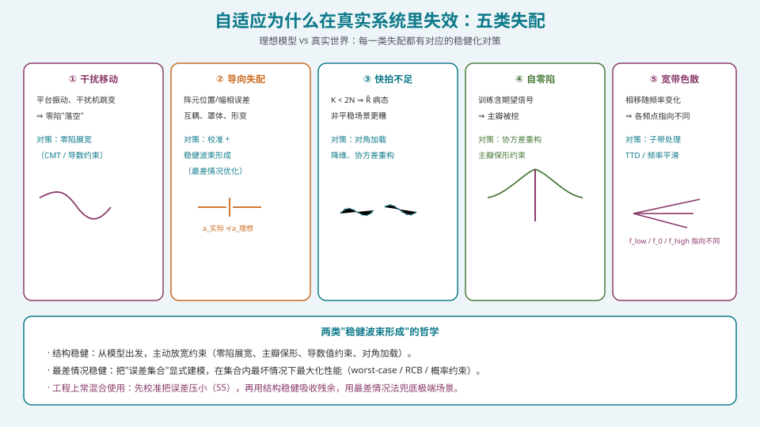
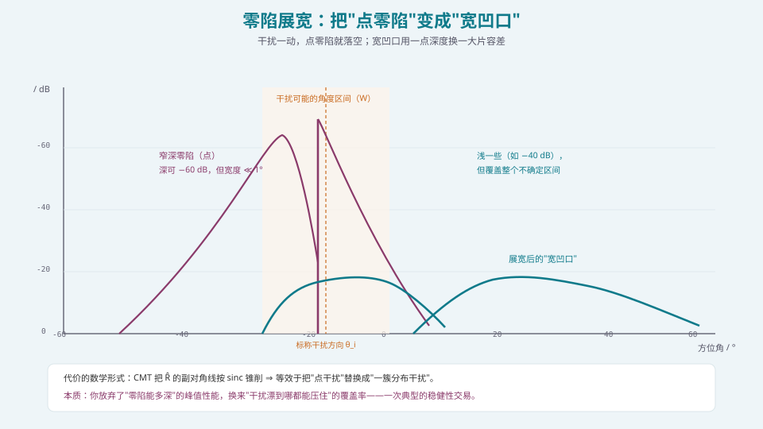
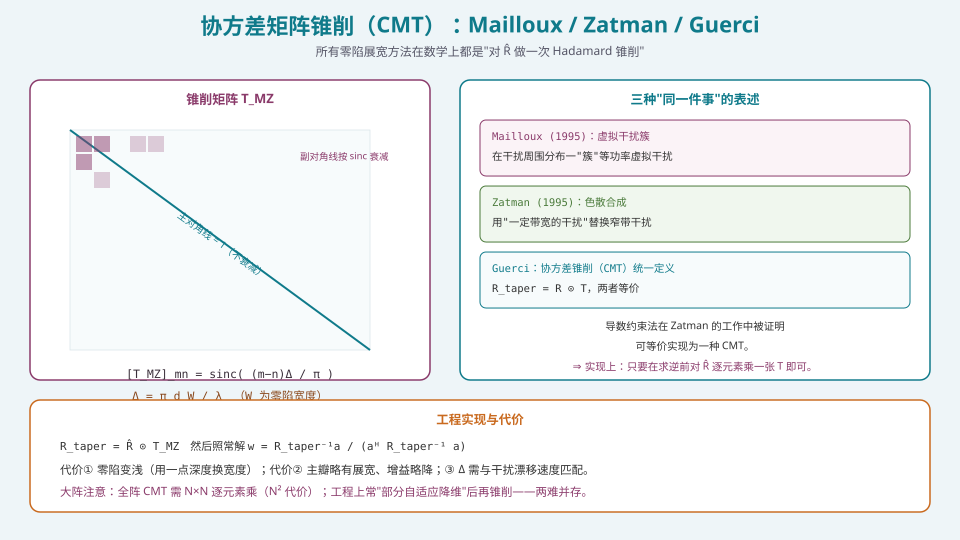

## 本篇要解决什么

[MVDR/LCMV](pa-adaptive-mvdr-lcmv.html) 在纸面上很美：零陷自动对准干扰、深度可达 −60 dB。但工程上，**真实系统里的自适应经常"失效"**——零陷偏了、浅了、主瓣被挖了、宽带下整个指向都飘了。

核心问题：

**为什么在理想模型下成立的算法，到了真实系统就不好用？以及，怎么让它"稳"下来？**

答案是：**现实与模型之间存在系统性的失配**。稳健波束形成的全部工作，就是**为这些失配"上保险"**。这一篇把五类失配与对应的稳健化手段讲透，其中**零陷展宽**是工程上最常用、也最有代表性的一招。

---

## 一、五类失配：诊断表



*图 1：五类失配，各自对应一套稳健化对策；工程上通常"校准 + 结构稳健 + 最差情况"三层叠加。*

| # | 失配 | 症状 | 主要对策 | 关联专题 |
| --- | --- | --- | --- | --- |
| ① | **干扰移动** | 零陷"落空"、抑制量骤降 | **零陷展宽**（CMT / 导数约束） | 本篇 §2 |
| ② | **导向失配** | 零陷偏移、主瓣增益下降 | 校准（S5）+ 最差情况优化/RCB | 本篇 §4 |
| ③ | **快拍不足** | 矩阵病态、结果抖动/发散 | 对角加载、降维、协方差重构 | [MVDR 专题](pa-adaptive-mvdr-lcmv.html) |
| ④ | **自零陷** | 主瓣中间出现凹口 | 协方差重构、主瓣保形约束 | [MVDR 专题](pa-adaptive-mvdr-lcmv.html) |
| ⑤ | **宽带色散** | 指向随频率漂移、波形畸变 | 子带处理、TTD、频率平滑 | [波束斜视](pa-beam-squint-wideband.html) |

**诊断顺序建议**：先看①（干扰动没动）→ ②（校准够不够）→ ③（快拍够不够）→ ④（训练干不干净）→ ⑤（带宽宽不宽）。**大多数"自适应失效"报告，根因落在这五项之内。**

---

## 二、零陷展宽：用"宽度"换"深度"



*图 2：窄深点零陷一旦对不准就失效；宽凹口覆盖整个不确定区间，代价是变浅。*

### 2.1 问题：点零陷对"移动干扰"极其脆弱

MVDR 的零陷是"精确对准估计窗内干扰方向"的**点零陷**，宽度往往远小于 \(1^\circ\)。一旦干扰：

- 因**平台振动/姿态变化**在角域漂移；
- 因**干扰机跳变/机动**改变方向；
- 或 \(\hat{\mathbf{R}}\) 本身估计不准导致零陷位置有偏差；

那么零陷就会**"落空"**，抑制量从 −60 dB 骤降到 −10 dB 甚至更低。**越深的零陷，越窄，越脆弱。**

### 2.2 思路：把"点干扰"换成"一簇/一段"干扰

零陷展宽的核心思想非常直观：

> **与其对准一个点挖一个深坑，不如把干扰建模成"分布在某个角域范围内的干扰簇"，从而挖一个宽而浅的凹口。**

这样，只要干扰漂移未超出这个区间，就始终处于抑制区。**用一点深度换一大片容差。**

---

## 三、CMT：三种方法的统一



*图 3：Mailloux 的虚拟干扰簇、Zatman 的色散合成，都被 Guerci 统一为"对 R̂ 做一次 Hadamard 锥削"。*

### 3.1 Mailloux 方法（1995）

在干扰方向周围**分布一"簇"等功率、不相干的虚拟干扰**，其分布宽度对应期望的零陷宽度 \(W\)（在方向正弦域 \(\sin\theta\) 上定义）。等价地，对协方差矩阵做**锥削**：

\[
\mathbf{R}_{\text{MZ}}=\mathbf{R}\odot\mathbf{T}_{\text{MZ}},\qquad
[\mathbf{T}_{\text{MZ}}]_{mn}=\text{sinc}\!\left(\frac{(m-n)\Delta}{\pi}\right)=\frac{\sin\big((m-n)\Delta\big)}{(m-n)\Delta},
\]

其中

\[
\Delta=\frac{\pi d W}{\lambda},
\]

\(d\) 为阵元间距，\(W\) 为方向正弦域（\(\sin\theta\)）上的零陷宽度。\(\Delta\) 越大 ⇒ 零陷越宽 ⇒ 也越浅。

### 3.2 Zatman 方法（1995）：色散合成

Zatman 用"**具有一定带宽的干扰源**"替换原来的窄带干扰，得到等效的锥削：

\[
[\mathbf{T}_{\text{ZT}}]_{mn}=\text{sinc}\big(b_\omega\tau_{mn}\big),
\]

\(b_\omega\) 为等效带宽，\(\tau_{mn}\) 为信号到达第 \(m,n\) 阵元的时延差。

### 3.3 Guerci 的统一：CMT

Guerci 指出：Mailloux 与 Zatman 的方法**在数学上等价**，都可写成"**协方差矩阵锥削**"（Covariance Matrix Taper, CMT）：

\[
\boxed{\ \mathbf{R}_{\text{taper}}=\mathbf{R}\odot\mathbf{T}\ }
\]

（\(\odot\) 为 Hadamard 逐元素乘）。Zatman 进一步证明：**导数约束法也可等价实现为一种 CMT**。于是：

- **实现上**：只要在求逆前，对 \(\hat{\mathbf{R}}\) **逐元素乘一张 \(\mathbf{T}\)** 即可，改动极小；
- **代价**：零陷变浅、主瓣略展宽、增益略降——**这是"概率/结构稳健"必须付的保险费**。

### 3.4 参数选择：\(\Delta\) 与干扰漂移速度匹配

\(\Delta \leftrightarrow W\)：\(W\) 应覆盖**干扰在权值更新周期内的最大角漂移量**。

- \(W\) 太小 ⇒ 覆盖不住漂移，仍会失效；
- \(W\) 太大 ⇒ 零陷太浅，甚至波及主瓣；
- **工程做法**：由"平台角速率 × 更新周期 + 干扰机动裕量"反推 \(W\)，再映射到 \(\Delta\)。

### 3.5 大阵的实现代价

全阵 CMT 需对 \(N\times N\) 的 \(\hat{\mathbf{R}}\) 逐元素乘，代价 \(O(N^2)\)。**大阵通常先做"部分自适应降维"**（波束域/子阵域），在低维上锥削——这样既降了 CMT 本身的代价，也降了求逆代价。这与 [DOA 的波束域降维](pa-doa-music-esprit.html)、[混合波束成形](pa-hybrid-beamforming.html) 是同一条思路：**降维是万用解药**。

---

## 四、其它稳健化手段

### 4.1 主瓣保形约束（防自零陷与"啃主瓣"）

在 LCMV 的约束矩阵里放入**期望方向附近的多个角度点**，强迫主瓣区域整体保持增益：

\[
\mathbf{C}=\big[\mathbf{a}(\theta_0-\Delta_g),\ \mathbf{a}(\theta_0),\ \mathbf{a}(\theta_0+\Delta_g)\big],\quad
\mathbf{f}=[1,1,1]^{\mathsf T}.
\]

**代价**：每个约束消耗 1 个自由度 ⇒ **可置零数下降**。但这是防"主瓣被挖"的必要保险。

### 4.2 最差情况性能优化（worst-case）

把"导向矢量误差"显式建模成一个**不确定性集合** \(\mathcal{E}\)（如球/椭球约束：\(\|\mathbf{a}-\bar{\mathbf{a}}\|\le\varepsilon\)），然后

\[
\max_{\mathbf{w}}\ \min_{\mathbf{a}\in\mathcal{E}}\ \text{SINR}(\mathbf{w},\mathbf{a})
\quad\text{或}\quad
\min_{\mathbf{w}}\ \mathbf{w}^{\mathsf H}\mathbf{R}\mathbf{w}\ \ \text{s.t.}\ \ |\mathbf{w}^{\mathsf H}\mathbf{a}|\ge1\ \forall\mathbf{a}\in\mathcal{E}.
\]

**Robust Capon Beamforming（RCB）** 是其中代表：它本质上是**一种"自适应确定加载量"的对角加载**——加载量由不确定性集合的椭球参数决定，而非拍脑袋。

**代价**：需要**合理设定不确定性集合的大小**。集合设太小 ⇒ 不稳健；设太大 ⇒ 过于保守、性能退化。而"误差到底多大"在实践中恰恰难以精确知道。

### 4.3 概率约束（probabilistic）

把误差建模成**随机变量**，要求"以不低于 \(1-p\) 的概率满足约束"：

\[
\Pr\big[|\mathbf{w}^{\mathsf H}\mathbf{a}|\ge1\big]\ge1-p .
\]

比最差情况"柔性"一些（允许小概率违例），在工程上往往更合理，但与最差情况法一样，**依赖对误差分布的假设**。

### 4.4 宽带下的频率平滑与子带处理

宽带信号下，同一权值在不同频点的等效相位不同 ⇒ 零陷/主瓣随频率"糊"。两条路：

1. **频率平滑（frequency smoothing）**：把宽带分成若干子带，各子带独立估协方差、独立解权值（**子带 MVDR**），代价是权值数量与更新负荷倍增；
2. **物理消色散**：用 TTD / 子带 TTD（见 [波束斜视与宽带相控阵](pa-beam-squint-wideband.html)）在模拟域先补偿。

**注意**：**"宽带 + 自适应 + 零陷"是最难的一档组合**。带宽越宽，子带越多，控面负担越重。

---

## 五、实现：CMT 与稳健权的代码骨架

### 5.1 CMT 锥削矩阵生成

```python
import numpy as np

def mailloux_taper(N, d_over_lambda, W_sine):
    """Mailloux CMT 锥削矩阵 T（N×N）。
    W_sine: 方向正弦域（sinθ）上的零陷宽度，Δ = π·d/λ·W_sine。"""
    Delta = np.pi * d_over_lambda * W_sine
    m = np.arange(N)[:, None]; n = np.arange(N)[None, :]
    x = (m - n) * Delta
    # sinc：x→0 时取 1（主对角线）
    T = np.where(np.abs(x) < 1e-12, 1.0, np.sin(x) / np.where(x == 0, 1, x))
    return T

def mvdr_tapered(R, a0, T, eps_rel=0.01):
    """CMT + 对角加载的 MVDR 权值。"""
    Rt = R * T                                   # Hadamard 锥削
    N = Rt.shape[0]
    Rdl = Rt + eps_rel * np.trace(Rt).real / N * np.eye(N)
    w = np.linalg.solve(Rdl, a0)
    return w / (a0.conj() @ w)
```

### 5.2 偏差映射：从"角漂移速度"到 \(\Delta\)

```python
def delta_from_drift(drift_deg_per_ms, update_ms, d_over_lambda, margin=1.5):
    """由干扰角漂移速度与权值更新周期，反推零陷宽度 W 与 Δ。
    在 sinθ 域上取宽度：W ≈ 2·cos(θ_i)·sin(Δθ/2)（小角近似）。"""
    dtheta = drift_deg_per_ms * update_ms * margin      # 覆盖整个更新周期的漂移 + 裕量
    # 近似在正弦域上的宽度（以 θ_i≈0 为最坏情形，取保守 cos=1）
    W = 2 * np.sin(np.deg2rad(dtheta / 2))
    return W, np.pi * d_over_lambda * W
```

### 5.3 稳健化后的验收指标

一次好的稳健设计，应能在**干扰漂移**下保持抑制量不塌：

| 指标 | 验收判据（示例） |
| --- | --- |
| 零陷宽度 | 覆盖预测漂移区间（含裕量） |
| 零陷深度 | 展宽后仍 ≥ 指标（如 −40 dB） |
| 主瓣增益损失 | ≤ 0.5~1 dB |
| 主瓣展宽 | ≤ 10~20% |
| 干扰漂移后端到端抑制 | 在区间内保持 ≥ 指标的 80% |

---

## 六、常见误区清单

**误区一：认为"零陷越深越好"。**
**越深的零陷越窄、越脆弱，越容易被平台振动和干扰机动"打飞"。** 工程上要的是"**在干扰可能出现的整个区间内都有足够抑制**"，而不是"在某一个精确角度上挖到 −70 dB"。

**误区二：把零陷展宽当成"免费稳"。**
它的代价很明确：**零陷变浅、主瓣略宽、增益略降**。这是一次**有意的稳健性交易**，必须按指标预算来做。

**误区三：\(\Delta\) 拍脑袋定，不与漂移速度匹配。**
\(\Delta\) 应由"**平台角速率 × 更新周期 + 干扰机动裕量**"反推。\(\Delta\) 太小覆盖不住漂移、太大毁掉主瓣——**它是系统参数，不是算法常数**。

**误区四：只做零陷展宽，不做校准。**
展宽能吸收"**小幅、未知**"的漂移，但如果**导向失配很大**（校准没做），展宽再多也没用——零陷会整体偏移到错误方向。**校准（S5）是前提，展宽是补充。**

**误区五：忘记自零陷，靠展宽去"盖住"它。**
自零陷是**训练数据含期望信号**导致的**功能性错误**，与零陷深度/宽度无关。**必须用协方差重构，不能靠展宽掩盖。**

**误区六：宽带下只做一次自适应。**
宽带信号各频点指向不同，**单套权值会把零陷"糊掉"**。要么子带独立处理，要么物理消色散（TTD）。

**误区七：最差情况优化里把不确定性集合设得过小/过大。**
集合太小 ⇒ 不稳健；太大 ⇒ 过度保守（性能大幅退化）。**它必须由实测/校准残差来定**，而不是虚构。

**误区八：忽略"降维既是复杂度解，也是稳健化前提"。**
对 \(N\times N\) 全阵做 CMT 代价高；且大阵的 \(\hat{\mathbf{R}}\) 本就难估准。**先降维再稳健化，往往同时改善复杂度与稳健性。**

**误区九：把"稳健"理解成"性能变差"。**
稳健不是"承认失败"，而是"**在不确定环境里保证可用**"：一个在标称场景下 −60 dB、在扰动下 −5 dB 的方案，远不如一个标称 −45 dB、扰动下 −40 dB 的方案。**稳健性本身就是一种性能指标。**

---

## 七、快速自测

**Q1.** 写出 Mailloux 零陷展宽的锥削矩阵表达式，并解释 \(\Delta\) 的物理含义与增减趋势。

<details><summary>参考要点</summary>

\[
[\mathbf{T}_{\text{MZ}}]_{mn}=\frac{\sin\big((m-n)\Delta\big)}{(m-n)\Delta}=\text{sinc}\!\left(\frac{(m-n)\Delta}{\pi}\right),\qquad
\Delta=\frac{\pi d W}{\lambda}.
\]

**物理含义**：\(\mathbf{T}\) 是一个"**沿主对角线为 1、随 \(|m-n|\) 按 sinc 衰减**"的 Toeplitz 矩阵。Hadamard 锥削 \(\mathbf{R}\odot\mathbf{T}\) 等价于把"点干扰"替换成"分布在宽度 \(W\)（方向正弦域）上的一簇虚拟干扰"。

**趋势**：\(\Delta \uparrow\)（即 \(W\uparrow\)）⇒ sinc 衰减更快 ⇒ 零陷**更宽但更浅**；\(\Delta \downarrow\) ⇒ 零陷更窄更深（趋近无展宽）。

</details>

**Q2.** 为什么点零陷对移动干扰脆弱？零陷展宽如何"用深度换容差"？

<details><summary>参考要点</summary>

**脆弱性**：MVDR 零陷对准确方向；在 \(-60\) dB 深度下，零陷宽度常远小于 \(1^\circ\)。干扰因平台振动/机动漂移哪怕零点几度，就会滑出零陷 ⇒ 抑制量骤降。

**交易**：把干扰建模为"分布在宽度 \(W\) 上的干扰簇"，得到的零陷在 \(W\) 上保持一定深度（如 −40 dB）。**代价**：峰值深度下降（−60 → −40 dB），主瓣略展宽、增益略降。**收益**：在 \(W\) 内任意干扰位置都获得 ≥ −40 dB 抑制。**这就是"用深度换容差"。**

</details>

**Q3.** Mailloux 与 Zatman 的方法有什么本质联系？为什么说"实现上只是加一步 Hadamard 乘"？

<details><summary>参考要点</summary>

**联系**：Guerci 证明两者**数学等价**，都可写成协方差矩阵锥削 \(\mathbf{R}_{\text{taper}}=\mathbf{R}\odot\mathbf{T}\)：
- **Mailloux**：虚拟干扰簇 → 锥削矩阵元素为 \(\text{sinc}((m-n)\Delta/\pi)\)；
- **Zatman**：色散合成（用带一定带宽的干扰替代窄带） → 锥削矩阵元素为 \(\text{sinc}(b_\omega\tau_{mn})\)。

**为什么实现简单**：两者都归约为"**在求逆前对 \(\hat{\mathbf{R}}\) 逐元素乘一张由参数（\(W\) 或带宽）确定的矩阵 \(\mathbf{T}\)**"。不改变后续 MVDR/LCMV 的求解结构，只是在数据流里插入一步 \(O(N^2)\) 的逐元素乘（或对降维后的低维矩阵做）。

**附加结论**：Zatman 还证明**导数约束法**可等价实现为一种 CMT ⇒ 三种看似不同的方法，落到实现上是**同一段代码**。

</details>

**Q4.** 零陷展宽的宽度参数怎么定？给出定量流程。

<details><summary>参考要点</summary>

**流程**：
1. 估算**干扰/平台的角漂移速度** \(\dot\theta\)（°/ms）——由平台角速率、振动幅度、干扰机机动性给出；
2. 取**权值更新周期** \(T_{\text{upd}}\)；
3. 计算预测漂移量 \(\Delta\theta_{\text{drift}}=\dot\theta\cdot T_{\text{upd}}\)，乘**裕量**（如 1.5）得目标覆盖宽度；
4. 转换到**方向正弦域**：\(W\approx2\cos\theta_i\sin(\Delta\theta_{\text{cov}}/2)\)（小角近似下 \(W\approx\Delta\theta_{\text{cov}}\cos\theta_i\)）；
5. 由 \(W\) 得 \(\Delta=\pi d W/\lambda\)，生成 \(\mathbf{T}\)。

**校验**：仿真在漂移区间内扫干扰位置，确认抑制量在区间内**不塌**（如保持 ≥ 指标的 80%），并检查主瓣损失（≤ 0.5~1 dB）。

</details>

**Q5.** 什么是最差情况稳健波束形成？它与对角加载是什么关系？

<details><summary>参考要点</summary>

**最差情况**：把导向矢量误差建模为不确定集合 \(\mathcal E\)（如 \(\|\mathbf{a}-\bar{\mathbf a}\|\le\varepsilon\)），优化"集合内最坏情况"的性能：

\[
\min_{\mathbf w}\ \mathbf w^{\mathsf H}\mathbf R\mathbf w\ \ \text{s.t.}\ |\mathbf w^{\mathsf H}\mathbf a|\ge1,\ \forall\mathbf a\in\mathcal E .
\]

**与对角加载的关系**：**RCB（Robust Capon Beamforming）本质就是一种对角加载**，但它**由不确定性集合的椭球参数自动确定加载量**，而不是人为拍一个 \(\varepsilon\)。

**意义**：把"凭经验选加载量"变成"由误差模型推导加载量"。
**代价**：需要正确设定集合大小；太小不稳健、太大过度保守。而"误差到底多大"实践中常难精确知道——这正是它的软肋。

</details>

**Q6.** 宽带自适应为什么难？列出至少两条技术路线及各自代价。

<details><summary>参考要点</summary>

**难点**：宽带信号各频率分量在移相阵列中的等效相位不同 ⇒ 单一权值下，零陷与主瓣**随频率"糊化"**；带宽越宽越严重（见 [波束斜视](pa-beam-squint-wideband.html)）。

**路线**：
1. **子带处理（子带 MVDR / 频率平滑）**：分若干子带，各自估协方差、各自解权值。**代价**：权值数量与控面负荷 × 子带数；且各子带需分别满足快拍要求。
2. **物理消色散（TTD / 子阵 TTD + 阵元移相）**：在模拟域用真时延补偿频率相关的相位差，使阵列对全带"同相"。**代价**：TTD 器件体积/插损/成本，且存在时延量化（量化瓣）。

**结论**：**"宽带 + 自适应 + 深零陷"是相控阵里最难的一档组合**，必须在架构阶段就预留方案（TTD 或足够数字通道）。

</details>

**Q7.** 主瓣保形约束有什么代价？它与"自零陷"是什么关系？

<details><summary>参考要点</summary>

**做法**：在 LCMV 的约束矩阵中放入期望方向附近多个角度点（如 \(\theta_0-\Delta_g,\theta_0,\theta_0+\Delta_g\)），响应设为 1，强迫主瓣整体保持增益。

**代价**：每个约束消耗 1 个自由度 ⇒ **可置零的干扰数减少**（自由度守恒，见 [MVDR 专题](pa-adaptive-mvdr-lcmv.html)）。

**与自零陷的关系**：自零陷的根因是**训练数据含期望信号**，使 \(\mathbf{R}^{-1}\) 在期望方向"塌陷"。**主瓣保形约束能"顶住"这个塌陷**——所以它是自零陷的**结构性对策之一**（另一条是协方差重构）。

**注意**：保形只是"顶住"，不是"根除"。若训练数据严重受污，**首选仍是协方差重构**（从数据层面去除期望信号）。

</details>

**Q8.** 一个机载相控阵要求"对地面干扰机抑制 ≥ 40 dB，平台振动 ±0.5°/s，权值更新 5 ms"。请给出你的稳健化方案与关键参数。

<details><summary>参考要点</summary>

**需求分解**：
- 抑制 ≥ 40 dB：可用 MVDR（深度可满足）；
- 平台振动 ±0.5°/s、更新 5 ms ⇒ 单周期角漂移 \(0.5\times5\times10^{-3}=0.0025^\circ\)——**很小**，但**长周期累积（如 1 s）可达 0.5°**，且干扰机可能机动。

**方案**：
1. **MVDR + 对角加载**（加载量按校准残差定，约 0.01·tr/N 起）；
2. **零陷展宽（CMT）**：\(W\) 取覆盖"1~2 个更新周期内的最大漂移 + 干扰机动裕量"，例如按 \(\Delta\theta_{\text{cov}}\approx0.1^\circ\sim0.3^\circ\) 反推 \(\Delta\)（**保守取大一点**，因机载振动与机动不确定）；
3. **主瓣保形约束**（防自零陷、防姿态抖动啃主瓣）；
4. **校准**（S5）：把导向失配压到最小——这是展宽能生效的前提；
5. **降维自适应**（子阵/波束域），降低 CMT 与求逆代价，提高收敛稳健性。

**关键参数**：加载量 \(\varepsilon\)、零陷宽度 \(W\)/\(\Delta\)、保形角域 \(\Delta_g\)、更新周期 \(T_{\text{upd}}\)。
**验收**：在"振动 + 机动"联合扰动下扫干扰角度，确认抑制量在预测区间内保持 ≥ 40 dB（或 ≥ 32 dB 作为 80% 裕度线），主瓣损失 ≤ 1 dB。

</details>

---

## 八、与本站其它专题的连接

| 想了解 | 看哪篇 |
| --- | --- |
| 自适应权值（MVDR/LCMV） | [自适应波束形成：MVDR 与 LCMV](pa-adaptive-mvdr-lcmv.html) |
| DOA 估计与协方差重构 | [DOA 估计：MUSIC / ESPRIT 与工程改良](pa-doa-music-esprit.html) |
| 宽带斜视的成因与补偿 | [波束斜视与宽带相控阵](pa-beam-squint-wideband.html) |
| 混合架构的降维与联合优化 | [混合波束成形（HBF）的子阵设计](pa-hybrid-beamforming.html) |
| 位宽不足如何先在最深零陷暴露 | [定点化：从浮点仿真到硬件指标不退化](pa-fixed-point-quantization.html) |
| 求逆与控面解码 | [FPGA/HLS 实现：数据面与控制面的分工](pa-fpga-hls-implementation.html) |
| 自由度与架构约束 | [四种架构的选型：PESA / AESA / 混合 / 全数字](pa-architecture-selection.html) |
| 校准：把失配压到最小 | S5 · 通道误差的来源与影响 · REV 旋转矢量法 |
| 相控阵的物理机制 | [卫星相控阵天线：从阵元到波束](satellite-phased-array.html) |
| 学习体系全貌 | [相控阵天线学习体系：六阶段路线图](phased-array-roadmap.html) |

---

## 九、延伸阅读

**经典文献**
- Mailloux, "Covariance Matrix Augmentation to Produce Adaptive Array Pattern Troughs," *Electronics Letters*, 1995。**零陷展宽奠基之一**。
- Zatman, "Production of Adaptive Array Troughs by Dispersion Synthesis," *Electronics Letters*, 1995。**色散合成奠基**。
- Guerci, "Theory and Application of Covariance Matrix Tapers for Robust Adaptive Beamforming," *IEEE Trans. SP*, 1999。**CMT 统一理论**。
- Vorobyov, "Principles of Minimum Variance Robust Adaptive Beamforming Design," *Signal Processing*, 2013。**稳健自适应综述**（最差情况、RCB、概率约束）。
- Li, Stoica et al. 关于 **Robust Capon Beamforming** 的系列工作。
- Song et al., "Null Broadening with Snapshot-Deficient Covariance Matrices in Passive Sonar," *IEEE JOE*, 2003。**少快拍下的展宽工程研究**。

**本站衔接**
- 上游：[MVDR/LCMV](pa-adaptive-mvdr-lcmv.html)（怎么压）、[DOA](pa-doa-music-esprit.html)（干扰在哪）；
- 本篇：**为什么压不住、怎么压稳**；
- 至此 S4 的"算法路线"四篇闭环完成（专题 17~20），接下来是"宽带与架构"（[波束斜视](pa-beam-squint-wideband.html)、[混合波束成形](pa-hybrid-beamforming.html)）与"实现"（[定点化](pa-fixed-point-quantization.html)、[FPGA/HLS](pa-fpga-hls-implementation.html)）。
