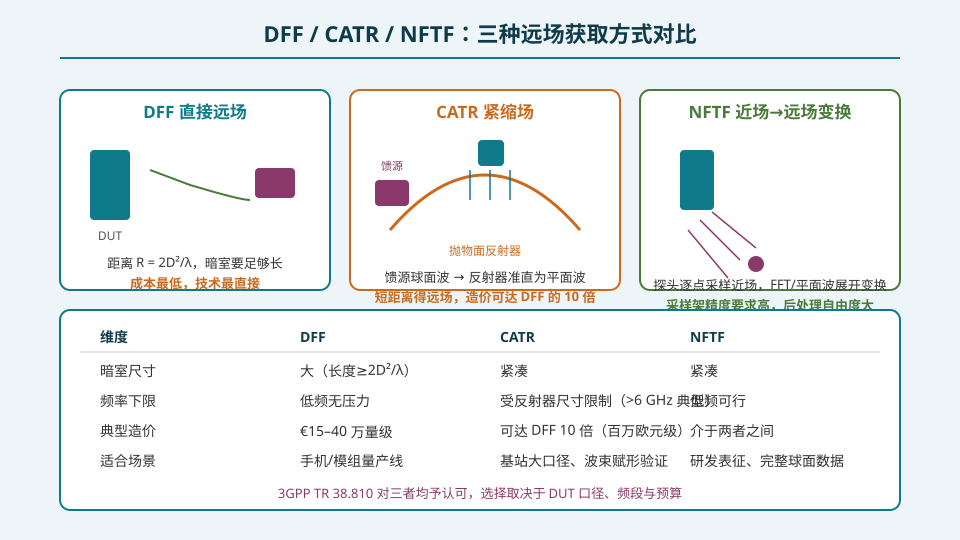
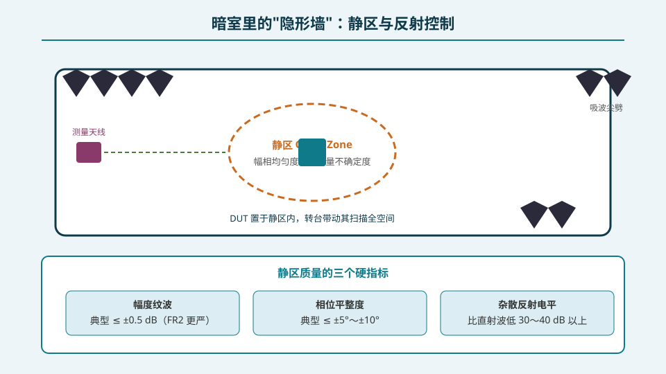
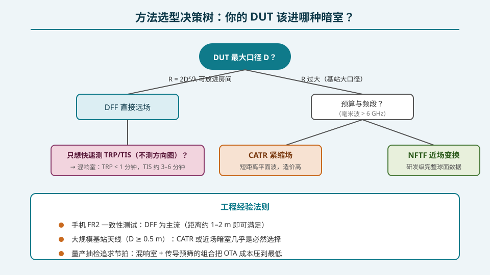

## 本篇要解决什么

上一篇的数字说清了困境：基站大口径天线在 FR2 需要几十到上百米的直接远场距离，暗室根本放不下。但认证与研发都要求"平面波"条件——怎么办？

**核心问题：拿不到真实远场时，如何"造出"等效的远场条件？**

3GPP TR 38.810 认可了三条路线（外加一个补充方法），本篇逐一拆解：

1. **DFF 直接远场**——够得着就用，最便宜；
2. **CATR 紧缩场**——用反射器把球面波折成平面波，距离短了，钱多了；
3. **NFTF 近场→远场变换**——在辐射近场采样，用数学变换重建远场；
4. （补充）**混响室**——不测方向图，专攻 TRP/TIS 的极速测量。

外加暗室工程的"隐形墙"：静区质量。

---

## 一、三种方法全景对比

**DFF（Direct Far Field，直接远场）**：把 DUT 放在 R = 2D²/λ 处直接测。原理最直白、系统误差最小，代价是暗室长度。手机 FR2 模组（D ≈ 8 cm）只需约 1–2 m，DFF 是量产线主流；对基站大口径则直接出局。

**CATR（Compact Antenna Test Range，紧缩场）**：馈源天线发出的球面波打向抛物面反射器，被准直为平面波送入静区。测量距离从"2D²/λ"压缩到"反射器焦距 + 静区长度"，几十厘米量级即可。代价有三：反射器表面精度随频率急剧变严（毫米波段要求 μm 级 RMS 误差）、静区尺寸受反射器口径限制、**造价可达 DFF 暗室的 10 倍**（百万欧元级 vs DFF 的十几万到几十万欧元级）。它是基站级大口径 FR2 天线的几乎唯一选择，且频率下限通常在 6 GHz 以上（低频时反射器不够电大）。

**NFTF（Near-Field to Far-Field，近场变换）**：探头在辐射近场沿平面/柱面/球面栅格逐点采样幅相，再用平面波展开（PWS）/傅里叶变换/球面波展开重建远场方向图。优点：暗室可以紧凑、能拿到完整球面数据、探头补偿理论成熟（探头要求 3–5λ 口径以获得良好方向性，见 S5 近场校准一篇的同款物理）；缺点：采样架机械精度要求高、测量耗时长、数学假设（如 PWS 只在 ≥ 某频段严格成立）需要谨慎核对。

**一个重要的成本锚点**：行业调研与 Berkeley Nucleonics 的 OTA 手册一致指出——CATR 暗室的造价可以达到 DFF 的 10 倍；市售价格区间大致为 DFF 基础暗室 €15–40 万量级、CATR €150–350 万量级。

---

## 二、暗室的"隐形墙"：静区质量

无论 DFF 还是 CATR，测量都发生在**静区（Quiet Zone）**——暗室内近似理想平面波的区域。静区质量由三个硬指标定义：

- **幅度纹波**：静区内平面波幅度的起伏，典型要求 ≤ ±0.5 dB（FR2 高频段更严）；
- **相位平整度**：静区截面上相位起伏，典型 ≤ ±5°～±10°；
- **杂散反射电平**：墙壁/地面/转台反射波比直射波低 30–40 dB 以上。

这三项直接进入测量不确定度预算。工程手段包括：角锥吸波尖劈（低频时劈高要足够，否则反射恶化）、静区边缘时域门控（gating）、以及用探头扫描法实际标定静区。**暗室不是"黑色房间"，而是有明确验收指标的测量仪器**——每面墙的反射系数、转台的散射截面都要入册。

---

## 三、方法选型决策树

把三条路线组织成决策流程：

1. **先算 R = 2D²/λ 能否放进房间** → 能：DFF，收工；
2. **放不下且工作在毫米波（>6 GHz）** → 预算充足选 CATR（尤其基站大口径、波束赋形一致性）；
3. **放不下但要完整球面研发数据** → NFTF（球面近场，后处理拿到任意角度）；
4. **只想快速知道 TRP/TIS、不需要方向图** → **混响室（RC）**：搅拌桨制造统计各向同性、各向极化的场，TRP 可在 1 分钟内测完，TIS 约 3–6 分钟——比球面扫描（小时级）快两个数量级。

混响室的边界也很清楚：它给不出方向图，测不了峰值 EIRP 和球面覆盖，只擅长"总量"类指标。成熟的量产方案常用"混响室快筛 + 抽样 DFF 复测"的组合，把节拍和覆盖两头兼顾。

---

## 误区清单

1. **"CATR 就是个缩小版暗室，应该更便宜"** —— 恰恰相反：反射器表面精度、馈源系统与安装平台使 CATR 造价可达 DFF 的 10 倍，贵在"造平面波"。
2. **"近场测量是退而求其次的低精度方法"** —— NFTF 有严格的理论与探头补偿体系，球面近场能给出优于直接远场的完整数据；它的"低"只体现在直观性上。
3. **"暗室验收只看吸波材料等级"** —— 静区的幅相均匀度和杂散反射电平才是可交付的指标，吸波材料只是手段之一。
4. **"混响室能测方向图"** —— 不能。统计各向同性场天然抹掉方向信息，它只适合 TRP/TIS 这类积分量。
5. **"CATR 什么频段都行"** —— 反射器必须电大尺寸，典型下限在 6 GHz 附近；低频大口径仍要回 DFF 或近场。

---

## 自测（7 题）

**1. CATR 用什么原理把测量距离缩短？**

答案

用偏置抛物面反射器把馈源发出的球面波准直为平面波送入静区。DUT 在静区内即可"享受"远场条件，测量距离从 2D²/λ 压缩到焦距量级。

**2. CATR 为什么造价可达 DFF 的 10 倍？**

答案

毫米波段反射器表面 RMS 精度要求达 μm 级（否则相位误差破坏平面波）、需要高精度馈源与定位系统、静区尺寸受反射器口径限制使有效区域单价极高。行业价格区间：DFF 约 €15–40 万，CATR 约 €150–350 万。

**3. NFTF 的探头为什么常选 3–5λ 口径？**

答案

电大探头方向性更好、对多径与交叉极化更不敏感，且方向图已知可做严格的探头补偿（与 S5 近场校准中的探头选择同源）。口径太小则探头近场耦合与非理想方向图污染采样数据。

**4. 静区的三个硬指标是什么？**

答案

幅度纹波（典型 ≤ ±0.5 dB）、相位平整度（典型 ≤ ±5°～10°）、杂散反射电平（比直射波低 30–40 dB 以上）。三者共同决定方向图与 EIRP 测量的不确定度。

**5. 什么场景下混响室是最佳选择？它的能力边界在哪？**

答案

只需 TRP/TIS 等"总量"指标、追求节拍（TRP < 1 分钟，TIS 3–6 分钟）的量产抽检。边界：给不出方向图，无法测峰值 EIRP、球面覆盖与波束指向质量。

**6. 一个 D = 1 m、工作在 3.5 GHz 的基站阵该选哪条路线？28 GHz 的 D = 0.8 m 基站阵呢？**

答案

3.5 GHz：R = 2D²/λ ≈ 23 m，暗室放不下但 CATR 低频受限（反射器不够电大），宜用球面近场 NFTF。28 GHz：R ≈ 120 m，远超暗室且频段适合反射器 → CATR 是首选。

**7. 为什么"手机量产线多用 DFF"？**

答案

手机 FR2 模组口径小（D ≈ 8 cm → 28 GHz 远场距离约 1.2 m），普通暗室可容纳；DFF 系统误差最小、造价最低、节拍可控，天然适合量产线。

---

## 站内连接

| 相关主题 | 关系 |
|---|---|
| [为什么必须 OTA](/topics/pa-ota-necessity/) | 上一篇：远场判据 R=2D²/λ 的推导——三种方法共同的出发点 |
| [测试量：EIRP/TRP/EIS 与球面扫描](/topics/pa-ota-metrics-spherical-scan/) | 下一篇：在选好的暗室里具体测什么、怎么算 |
| [近场校准与编码标定](/topics/pa-nearfield-encoding-loopback/) | S5：近场采样的物理与探头选择同源 |
| [规范与认证地图](/topics/pa-conformance-standards/) | 收官篇：TR 38.810 如何规定这些方法的适用性 |

## 延伸阅读

- 3GPP TR 38.810《Study on test methods for NR radio frequency (RF) requirements》——DFF/CATR/NFTF/RC 四种方法的官方适用性分析
- IEEE Std 149-2021《Standard Test Procedures for Antennas》——近场扫描与探头补偿的标准流程
- Berkeley Nucleonics《Millimeter Wave OTA Testing》——DFF/CATR 成本对比与毫米波 OTA 工程实践
- Kildal, 《Foundations of Antennas》/ 相关混响室论文——混响室测 TRP/TIS 的统计学基础
