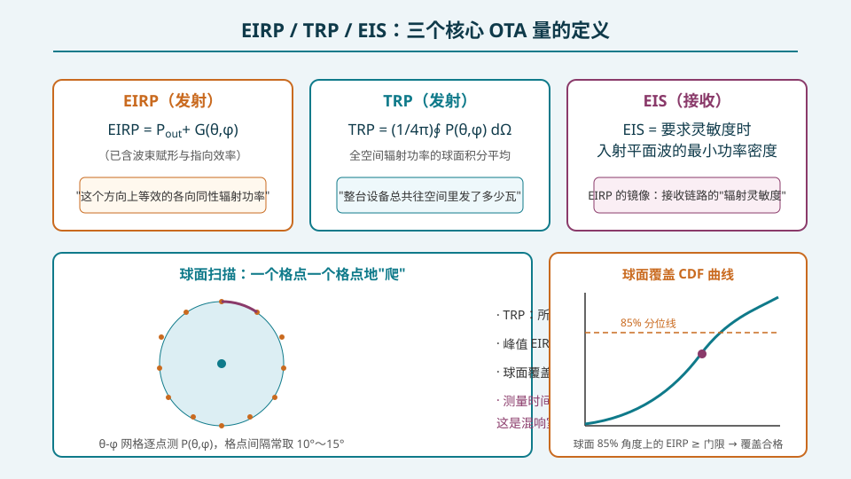
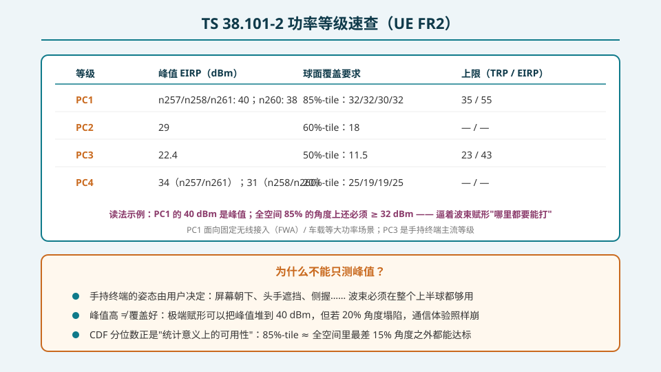
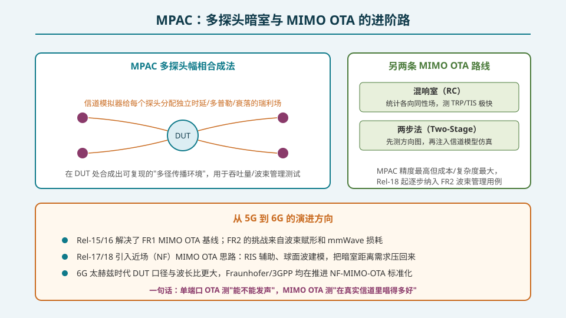

## 本篇要解决什么

前两篇解决了"在哪测、怎么造平面波"，本篇回答**测出什么数**。OTA 报告上的每一行数字都对应一个严格定义的测试量，而这些定义直接决定了相控阵设计的目标函数。

**核心问题：把"辐射性能"翻译成可判定合格/不合格的三个数。**

1. **EIRP** —— 发射的方向性强度；
2. **TRP** —— 发射的全空间总量；
3. **EIS** —— 接收的方向性灵敏度。

以及把它们串起来的方法：**球面扫描 + CDF 分位数**。

---

## 一、三个核心量的定义

**EIRP（Equivalent Isotropic Radiated Power）**：某方向上等效的各向同性辐射功率：

\[
\mathrm{EIRP}(\theta,\phi) = P_{\mathrm{out}} + G(\theta,\phi) \quad (\mathrm{dBm/dBi\ 框架})
\]

它已经把波束赋形增益、指向效率、单元失效的后果全部卷进一个数里——所以它是 FR2 的"第一指标"。

**TRP（Total Radiated Power）**：全空间辐射功率的球面积分平均：

\[
\mathrm{TRP} = \frac{1}{4\pi}\oint P(\theta,\phi)\, d\Omega
\]

它衡量"整台设备总共往空间里发了多少瓦"，对天线效率、热设计与电磁兼容敏感，不关心波束形状。

**EIS（Equivalent Isotropic Sensitivity）**：达到要求灵敏度（如特定吞吐量或 BLER）时入射平面波的最小功率密度。它是 EIRP 的镜像——接收链路连同赋形增益一起被投影到"空间中的灵敏度曲面"。

**三者关系一句话**：EIRP 管"能不能打远"，TRP 管"总共用了多少能量"，EIS 管"能不能听得清"。

---

## 二、38.101-2 功率等级速查

3GPP TS 38.101-2 为 UE FR2 定义了四个功率等级（以表 6.2.1 系列为总账本，数字随版本微调，以下为 R17 框架下的典型值）：

| 等级 | 峰值 EIRP (dBm) | 球面覆盖（CDF 分位） | 上限 TRP / EIRP (dBm) | 典型场景 |
|---|---|---|---|---|
| **PC1** | n257/n258/n261: 40；n260: 38 | 85%-tile：32/32/30/32 | 35 / 55 | FWA CPE、车载 |
| **PC2** | 29 | 60%-tile：18 | — | 增强手持 |
| **PC3** | 22.4 | 50%-tile：11.5 | 23 / 43 | 手持终端主流 |
| **PC4** | n257/n261: 34；n258/n260: 31 | 20%-tile：25/19/19/25 | — | 高功率局部覆盖 |

**正确的读法**：PC1 的 40 dBm 是**峰值**；同时要求全空间 85% 的角度上 EIRP ≥ 32 dBm。这组数字实质上是在规定**方向图的"丰满程度"**——极端赋形可以堆出高峰值，但如果 15% 的角度塌陷，球面覆盖就不合格。

为什么规范这样设计？手持终端的姿态由用户决定：屏幕朝下、头手遮挡、侧握…… 波束必须在整个上半球可用。CDF 分位数正是"统计意义上的可用性"的数学表达。

---

## 三、球面扫描：把 CDF 测出来

球面扫描流程（DFF 暗室为例）：

1. **布网格**：θ × φ 网格（典型间隔 10°–15°），格点数约 12×24 ~ 18×36；间隔选择要在"测量时间"与"方向图混叠"之间权衡（频段越高、方向图越窄，网格需要越密）；
2. **逐点采样**：转台带动 DUT，在每个格点测量接收功率（EIRP）或入射功率密度（EIS）；发射/接收链路校准与探头方向图补偿同时进行；
3. **合成统计量**：
   - **峰值 EIRP**：取格点最大值（可对峰值邻域加密）；
   - **TRP**：所有格点按立体角元加权求和，\(\mathrm{TRP} \approx \frac{\pi}{2NM}\sum_{i}\sum_{j} P(\theta_i,\phi_j)\sin\theta_i\)；
   - **球面覆盖**：把格点 EIRP 排序做累积分布，读出 85%（或 60%/50%/20%）分位点的值与门限比较。

**注意最坏角度问题**：调试阶段的关注点不是"平均值"而是 CDF 曲线的**尾部**——那 15% 的坏角度对应着头手遮挡、大偏轴扫描等最恶劣场景，是波束管理算法与赋形权值优化的直接输入。

---

## 四、进阶：从单端口到 MIMO OTA

上面的 EIRP/TRP/EIS 都是**单端口**量。5G 的性能指标（吞吐量、波束管理）发生在多天线信道里，于是有了 MIMO OTA 的三条路线：

- **MPAC（Multi-Probe Anechoic Chamber）**：环 DUT 布置多个探头，信道模拟器为每个探头分配独立的时延/多普勒/衰落，在 DUT 处合成可复现的瑞利多径场。精度最高、成本与复杂度也最大；Rel-18 起逐步纳入 FR2 波束管理用例；
- **混响室（RC）**：统计各向同性场做吞吐量/TRP/TIS 的快速评估；
- **两步法（Two-Stage）**：先测方向图，再把方向图注入信道模型做链路级仿真，硬件最省。

面向 6G：太赫兹时代 DUT 电尺寸更大，远场距离进一步失控，Fraunhofer HHI 与 3GPP/ETSI 正推进 **近场（NF）MIMO OTA** 标准化——用 RIS/球面波建模把"平面波"假设替换掉。一句话：**单端口 OTA 测"能不能发声"，MIMO OTA 测"在真实信道里唱得多好"。**

---

## 误区清单

1. **"峰值 EIRP 达标就万事大吉"** —— 球面覆盖是独立的合格判据，极端赋形可以峰值超标而 85%-tile 不达标。
2. **"TRP 高 = 性能好"** —— TRP 只管总量；能量散在旁瓣上的设备 TRP 可能不低，但覆盖与干扰表现都差。
3. **"网格越密越好"** —— 测量时间随格点数线性增长；网格选择要按最高频率的方向图带宽（角度奈奎斯特）折中。
4. **"CDF 是纯统计手法，没有物理含义"** —— 85%-tile 对应"全空间最差 15% 角度之外都可用"，直接映射手持姿态与头手遮挡的工程现实。
5. **"MIMO OTA 就是多测几遍单端口"** —— MPAC 测的是"方向图 × 信道"的联合行为（波束选择、空间复用增益），不是方向图的简单叠加。

---

## 自测（8 题）

**1. 写出 EIRP 与 TRP 的定义式。**

答案

EIRP(θ,φ) = P_out + G(θ,φ)（dBm 框架，某方向的等效各向同性辐射功率）；TRP = (1/4π)∮P(θ,φ)dΩ（全空间辐射功率的球面积分平均）。

**2. PC1 终端在 n258 的峰值 EIRP 与球面覆盖要求各是多少？**

答案

峰值 EIRP 40 dBm；85%-tile 球面覆盖 32 dBm——即全空间 85% 的角度上 EIRP ≥ 32 dBm。

**3. 为什么规范用 CDF 分位数而不是单点门限定义球面覆盖？**

答案

终端姿态由用户决定（屏幕朝下、头手遮挡、侧握），波束必须在上半球统计可用。分位数表达"统计意义上的可用性"：85%-tile 即最差 15% 角度之外全部达标，逼着波束赋形覆盖全域而非堆峰值。

**4. 球面扫描中 TRP 如何从格点数据计算？**

答案

对 θ-φ 网格上每个格点的辐射功率按立体角元 dΩ = sinθ·dθ·dφ 加权求和：TRP ≈ (π/2NM)·Σᵢ Σⱼ P(θᵢ,φⱼ)·sinθᵢ。

**5. EIS 和 EIRP 的关系是什么？测 EIS 时判定依据是什么？**

答案

EIS 是 EIRP 的接收镜像：达到要求灵敏度（吞吐量/BLER 判据）时所需入射平面波的最小功率密度，已计入接收赋形增益与天线方向图。

**6. MPAC 相比混响室和两步法的优势与代价各是什么？**

答案

优势：多探头 + 信道模拟器合成可复现的瑞利多径场，能测"方向图×信道"的联合行为（吞吐量、波束管理），精度最高。代价：探头数量多、信道模拟器昂贵、系统复杂度与成本最大。

**7. 混响室测 TRP 为什么快？它测不了什么？**

答案

搅拌桨使腔内场统计各向同性/各向极化，一次或少数几次搅拌状态即可对全空间积分（TRP < 1 分钟，TIS 3–6 分钟）。它给不出方向图，测不了峰值 EIRP、球面覆盖与波束指向质量。

**8. 球面扫描网格间隔的选取原则是什么？**

答案

按最高测试频率的方向图角度带宽做奈奎斯特式选择（方向图越窄、频率越高，间隔要越小），并折中测量时间：典型 10°–15°，峰值邻域可加密。

---

## 站内连接

| 相关主题 | 关系 |
|---|---|
| [OTA 三方法与暗室工程](https://guowu-yu.github.io/knowledge-garden/topics/pa-ota-methods-chamber/) | 上一篇：这些测试量在哪种暗室里测 |
| [规范与认证地图](https://guowu-yu.github.io/knowledge-garden/topics/pa-conformance-standards/) | 收官篇：38.101-2 门限如何进入认证链 |
| [通道误差的来源与影响](https://guowu-yu.github.io/knowledge-garden/topics/pa-channel-error-impact/) | 误差决定了 CDF 尾部——球面覆盖的物理源头 |
| [方向图综合与赋形](https://guowu-yu.github.io/knowledge-garden/topics/pa-pattern-synthesis-shaping/) | 球面覆盖不达标时回到权值设计找原因 |

## 延伸阅读

- 3GPP TS 38.101-2 表 6.2.1.x 系列——UE FR2 功率等级与球面覆盖门限
- 3GPP TR 38.810 ——OTA 测量不确定度框架与球面扫描流程
- CTIA《OTA Test Plan》——EIRP/TRP/TIS 的商用测量方法细则
- 3GPP Rel-18 NF-MIMO-OTA 研究与 Fraunhofer HHI 近场 OTA 论文——6G 时代的方向
