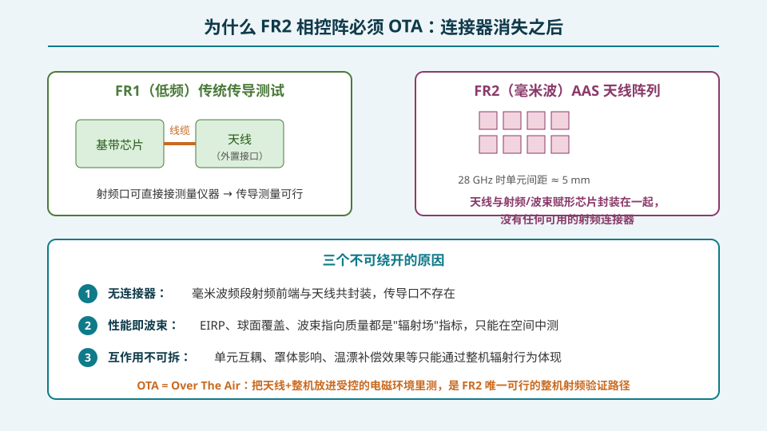
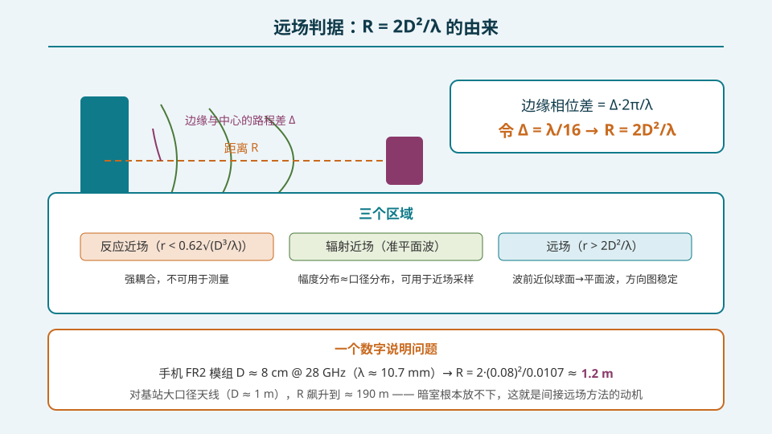
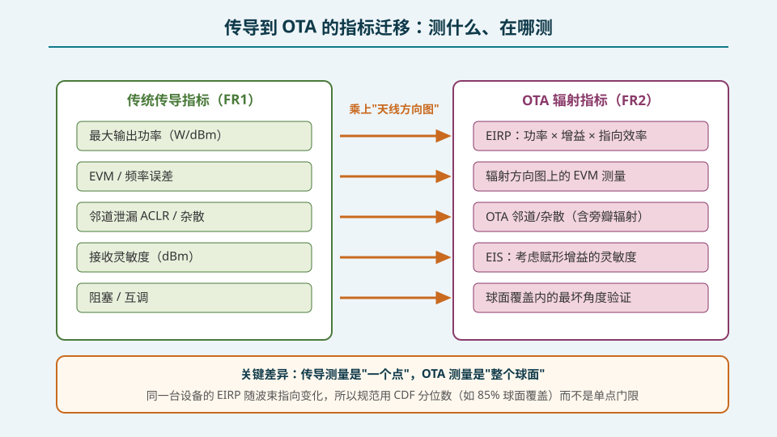

## 本篇要解决什么

前面 28 篇讲完了设计、算法、校准，但都默认一个前提：**我们能拿到通道级的观测量**。到了产品定型与认证阶段，这个前提突然消失——用户拿到的手机和基站，外壳上没有任何射频测试口。

**核心问题：天线和射频前端封装在一起之后，还怎么测？**

答案是唯一的：把设备放进受控的电磁环境，测它的辐射场。这就是 OTA（Over The Air）测试。本篇回答三个递进的问题：

1. 为什么传导测试在 FR2 **物理上**不可行？
2. OTA 测量要求"平面波入射"，这个距离要求（远场判据）**从哪来、有多苛刻**？
3. FR1 的传导指标如何**逐项翻译**成 OTA 指标？

---

## 一、连接器消失：三个不可绕开的原因

**原因 1：无连接器。** 28 GHz 的半波长间距约 5.3 mm，整个射频前端（LNA/PA/移相器/波束赋形芯片）与贴片天线必须 SiP/AiP 封装在一起。没有 SMA 接头，没有测试点，"接电缆"这个动作本身就不存在。这与 FR1 时代外置天线接口、FPC 伸出射频脚的布局是代际差异。

**原因 2：性能即波束。** 5G FR2 最核心的验收指标——EIRP、球面覆盖、波束指向质量——全部定义在**辐射空间**里。即使你能焊出线缆测到 PA 输出口的功率，你也无法回答"这个设备朝 45° 方向能发出多少 dBm"这个规范问题。

**原因 3：互作用不可拆。** 单元互耦、天线罩插损与去极化、温漂补偿的实际效果，都会改变最终的辐射行为。这些效应只有整机 OTA 才能覆盖；任何"传导+理想天线模型"的组合都会把风险漏到量产后。

一句话：**OTA 不是"更贵的传导测试"，而是 FR2 唯一可定义的测试域。**

---

## 二、远场判据 R = 2D²/λ 的由来

OTA 测量假设 DUT 被均匀平面波照射（接收）或向远处辐射球面波（发射）。但 DUT 是有限口径 D 的源，波前永远是球面。把 DUT 放在距测量天线 R 处，口径**边缘与中心到探头的路程差**为：

\[
\Delta = R\left(\sqrt{1+\frac{D^2}{4R^2}} - 1\right) \approx \frac{D^2}{8R}
\]

路程差折算成相位差为 \(\Delta \cdot 2\pi/\lambda\)。工程上规定边缘相位差不超过 π/8（22.5°，对应 λ/16 路程差），代入得：

\[
\frac{D^2}{8R} = \frac{\lambda}{16} \;\Rightarrow\; R = \frac{2D^2}{\lambda}
\]

这就是经典的 **2D²/λ 远场判据**。它把"远场"从模糊感觉变成了硬距离。

**算两个数感受苛刻程度：**

- 手机 FR2 模组，D ≈ 8 cm，f = 28 GHz（λ ≈ 10.7 mm）：R ≈ **1.2 m** —— 普通暗室能放下；
- 宏基站相控阵，D ≈ 1 m，f = 3.5 GHz：R ≈ **23 m**；若在 28 GHz 的 D ≈ 1 m 基站阵：R ≈ **190 m** —— 世界上几乎没有暗室能容纳。

第三种区域（辐射近场，介于 0.62√(D³/λ) 与 2D²/λ 之间）里波前是"准平面波"，幅度分布近似口径分布——这正是近场采样方法的物理基础，下一篇展开。

---

## 三、指标迁移：从传导表到 OTA 表

FR1 的一致性测试在传导口逐项定义；FR2 把每一项都"乘上天线方向图"：

| 传导指标（FR1） | OTA 对应（FR2） | 关键差异 |
|---|---|---|
| 最大输出功率 (dBm) | **EIRP** = 功率 + 方向图增益 | 从"一个点"变成"随角度变化的曲面" |
| EVM / 频率误差 | 辐射方向图上逐角度测 EVM | 需在波束方向上解码 |
| ACLR / 杂散 | OTA 邻道与杂散（含旁瓣辐射） | 旁瓣也要合规 |
| 接收灵敏度 (dBm) | **EIS**（等效全向灵敏度） | EIRP 的镜像，含赋形接收增益 |
| 阻塞 / 互调 | 球面覆盖内的最坏角度验证 | "哪里最弱测哪里" |

最重要的一句：**传导测量是"一个点"，OTA 测量是"整个球面"。** 同一台设备的 EIRP 随波束指向连续变化，所以 3GPP 用 CDF 分位数（例如 85% 球面覆盖处的 EIRP ≥ 门限）而非单点门限来定义"够不够格"。这个思想在第 31 篇展开成完整的测试量体系。

---

## 误区清单

1. **"毫米波不能传导测，所以测不了"** —— 物理上测的是辐射场，工程上不但测得了，还是唯一能测的方法。
2. **"远场判据是 2D²/λ 就随意取，少一点也差不多"** —— 距离不足直接体现为方向图零深变浅、副瓣测偏，静态场下尤其明显；不确定度预算里它是硬项。
3. **"传导功率达标 = EIRP 达标"** —— EIRP 是功率与方向图增益的卷积，指向效率低、赋形错误都会让辐射指标崩掉而传导完全正常。
4. **"OTA 只是认证阶段的事"** —— 波束赋形调试、温漂补偿验证、量产抽检全在 OTA 暗室里做，它贯穿整个研发-生产链路。
5. **"手机和基站用同一套 OTA 思路"** —— 手机 D 小、距离宽松；基站大口径在 FR2 根本放不进远场，必须走紧缩场/近场路线（下一篇）。

---

## 自测（8 题）

**1. 为什么 FR2 相控阵终端没有传导测试口？**

答案

毫米波频段半波长间距仅约 5 mm，射频前端（LNA/PA/移相器/波束赋形芯片）与天线阵列必须共封装（AiP/SiP），外壳上不存在任何可接测量仪器的射频连接器。

**2. 推导 R = 2D²/λ 时对口径边缘相位差做了什么规定？**

答案

规定边缘与中心的路程差不超过 λ/16，即相位差不超过 π/8（22.5°）。由 Δ ≈ D²/(8R) 代入 Δ = λ/16 得 R = 2D²/λ。

**3. 一个 D = 8 cm 的手机模组在 28 GHz 需要多远远场？D = 1 m 的基站阵呢？**

答案

手机模组：R = 2×(0.08)²/0.0107 ≈ 1.2 m，普通暗室可容纳。1 m 口径基站阵：R = 2×1/0.0107 ≈ 190 m，无法在暗室内实现直接远场，必须用紧缩场或近场变换。

**4. 辐射近场区的边界大致在哪？它为什么对测量有用？**

答案

下界约 0.62√(D³/λ)（反应近场之外），上界为 2D²/λ。区内波前接近平面波、幅度分布近似口径分布，可用于近场采样后经 FFT/平面波展开重建远场方向图。

**5. 把 FR1 的"最大输出功率"翻译成 FR2 的 OTA 指标是什么？为什么不再用单点门限？**

答案

EIRP（等效全向辐射功率）= 发射功率 + 对应角度的方向图增益。因为 EIRP 随波束指向在整个球面变化，规范改用 CDF 分位数（如 85% 球面覆盖处 EIRP ≥ 门限）衡量"统计可用性"。

**6. EIS 和 EIRP 是什么关系？**

答案

EIS（等效全向灵敏度）是 EIRP 的接收镜像：达到要求灵敏度所需入射平面波的最小功率密度，已计入接收波束赋形增益与天线方向图。

**7. 为什么说"OTA 不是更贵的传导测试，而是唯一的测试域"？给出两条理由。**

答案

① FR2 无射频连接器，传导路径物理不存在；② 核心验收指标（EIRP、球面覆盖、波束指向、互耦/罩体/温漂的整机效应）定义在辐射空间，只能在 OTA 中测量与判定。

**8. 为什么"传导功率合格、EIRP 不合格"是可能发生的？**

答案

EIRP 是功率与赋形后方向图增益的合成。若波束赋形系数配错、指向效率低或单元失效，辐射能量分散到旁瓣上，主瓣 EIRP 下降；而传导口看到的总功率完全正常。

---

## 站内连接

| 相关主题 | 关系 |
|---|---|
| [OTA 三方法与暗室工程](https://guowu-yu.github.io/knowledge-garden/topics/pa-ota-methods-chamber/) | 下一篇：DFF/CATR/NFTF 三条远场获取路线与暗室工程细节 |
| [测试量：EIRP/TRP/EIS 与球面扫描](https://guowu-yu.github.io/knowledge-garden/topics/pa-ota-metrics-spherical-scan/) | 第三篇：OTA 核心测试量与球面扫描流程 |
| [通道误差的来源与影响](https://guowu-yu.github.io/knowledge-garden/topics/pa-channel-error-impact/) | S5 起点：误差如何损害辐射指标——OTA 要抓的目标 |
| [校准工程化](https://guowu-yu.github.io/knowledge-garden/topics/pa-calibration-engineering/) | 校准补偿效果最终也要在 OTA 里验收 |

## 延伸阅读

- 3GPP TS 38.101-2《NR; User Equipment (UE) radio transmission and reception; Part 2: Range 2 Standalone》——UE FR2 辐射要求总纲
- 3GPP TR 38.810《NR; Study on test methods for NR radio frequency (RF) requirements》——OTA 方法学研究报告
- IEEE Std 149-2021《Standard Test Procedures for Antennas》——天线测量的远场/近场标准流程
- Berkeley Nucleonics《Millimeter Wave OTA Testing》技术手册——DFF/CATR 成本与适用性对比
