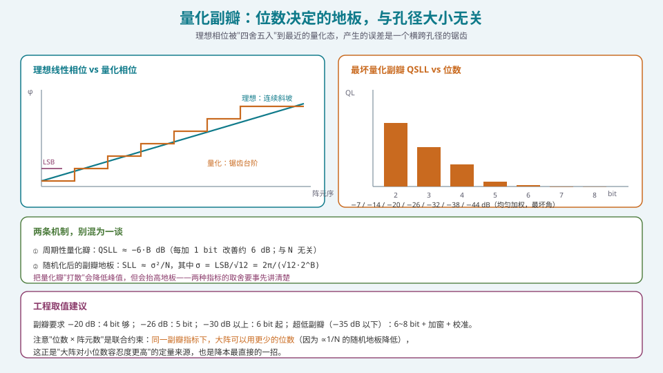
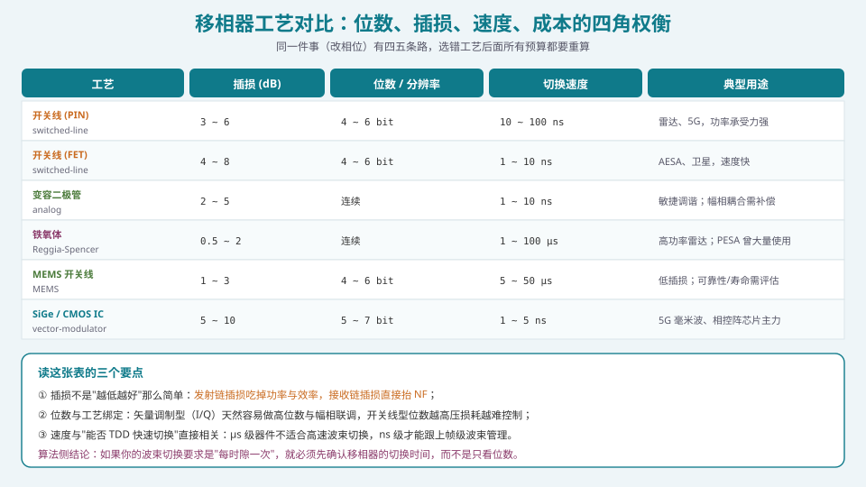
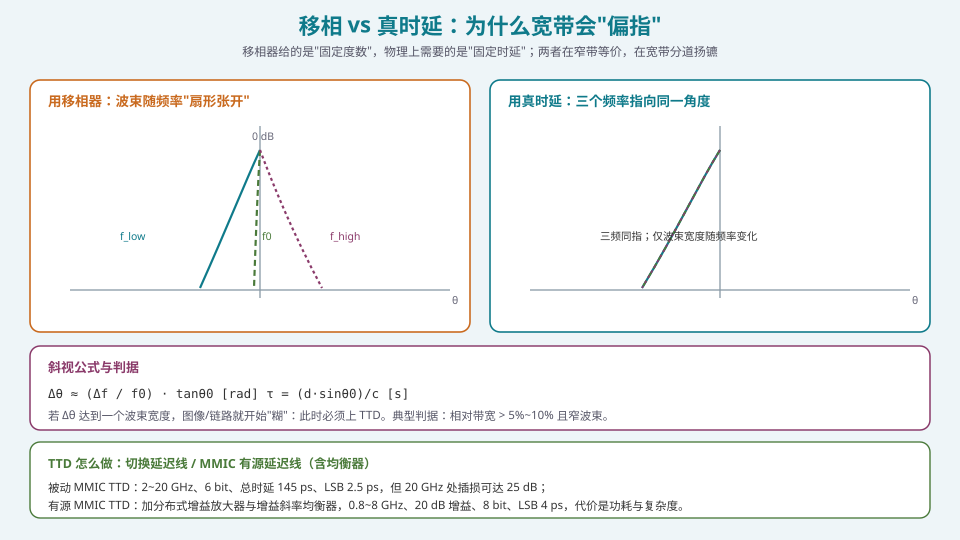

## 本篇要解决什么

上一节 [T/R 组件与射频前端](pa-tr-module-rf-frontend.html) 把移相器当成"一个参数"。但移相器是相控阵里**最贵、最讲究、最直接决定成本的那个器件**——它的位数几乎决定了你能否降本，它的工艺决定了插损与切速，它在宽带下还会失效。

这一篇回答四个非常具体的问题：

1. **位数到底买到了什么？** 量化副瓣的定量关系是什么？
2. **为什么"大阵可以用更少的位数"？** 这句话什么时候成立、什么时候是误导？
3. **窄带相位 vs 宽带时延**：什么条件下移相器会"偏指"，偏多少？
4. **TTD 怎么做、代价是什么？** 值不值得上？

---

## 一、移相器在做什么：从物理需求到器件参数

要让波束指向 \(\theta_0\)，等间距 \(d\) 的线阵上相邻阵元需要的**相位差**是：

\[
\Delta\varphi=\frac{2\pi d\sin\theta_0}{\lambda}
\]

移相器的任务，就是给每个阵元提供 \(\varphi_n=n\Delta\varphi\)（外加加窗的幅度控制）。它是一台"**相位编码器**"，把算法给出的连续相位 \(w_n=a_ne^{j\varphi_n}\) 兑现成最接近的量化态。

### 1.1 数字化与量化

\(B\) bit 数字移相器有 \(2^B\) 个状态，步进为 LSB = \(360°/2^B\)：

| 位数 | 状态数 | 步进 |
| --- | --- | --- |
| 3 bit | 8 | 45° |
| 4 bit | 16 | 22.5° |
| 5 bit | 32 | 11.25° |
| 6 bit | 64 | 5.625° |
| 8 bit | 256 | 1.406° |

6 bit 时 LSB = 5.625°，峰值量化误差 ±2.8125°，**在均匀统计假设下 RMS 误差**：

\[
\sigma_\varphi=\frac{\mathrm{LSB}}{\sqrt{12}}=\frac{5.625°}{3.464}=1.624°=0.0283\ \text{rad}
\]

这个 \(\sigma_\varphi\) 是后面所有副瓣账的输入。

---

## 二、量化副瓣：两条截然不同的机制



*图 1：理想相位被"四舍五入"到最近的量化态，产生的误差是一个横跨孔径的锯齿——这既是量化瓣的来源，也是随机副瓣地板的来源。*

**这是本篇最容易讲错的地方。** 量化误差会产生两类不同的副瓣，必须分开说。

### 2.1 机制一：周期性量化瓣（QSLL）

当相位量化误差在孔径上**呈周期性**（周期性锯齿）时，它等效于一次振幅调制，在特定角度产生**离散的量化瓣**。其高度遵循"每加 1 bit 改善约 6 dB"的定律：

\[
\boxed{\;\mathrm{QSLL}\propto 20\log_{10}2^{-B}\approx-6B\ \text{dB}\;}
\]

均匀加权的实测/仿真对照（宽角最坏值）：

| 位数 B | QSLL (dB) | 另一组文献值 (dB) |
| --- | --- | --- |
| 2 | −7 | −10.5 |
| 3 | −14 | −17.1 |
| 4 | −20 | −23.6 |
| 5 | −26 | −29.8 |
| 6 | −32 | −36.0 |
| 7 | −38 | — |
| 8 | −44 | — |

> **两组数值的差别**：左列来自 Analog Devices 的相控阵方向图系列（100 元阵、Hamming 加窗下最坏 QSLL）；右列来自 Mailloux/ScienceDirect 的经典"phaser quantization lobe height"表。差异来自加窗与否、阵元数与判定口径。**工程上取保守（较差）的那一组。**

### 2.2 机制二：随机化后的副瓣地板

如果**故意**给各通道加随机的相位抖动（dither），或量化误差在孔径上近似随机，那么量化瓣被打散，能量摊平成一个**平均副瓣地板**：

\[
\boxed{\;\mathrm{SLL}\approx\frac{\sigma_\varphi^2}{N},\qquad \sigma_\varphi=\frac{\mathrm{LSB}}{\sqrt{12}}=\frac{2\pi}{\sqrt{12}\cdot2^{B}}\;}
\]

关键推论：

- **地板 ∝ 1/N**：阵元越多，地板越低；
- **地板 ∝ 1/4^B**：每加 1 bit 地板降 4 倍 = **6 dB**（两种机制的斜率巧合地一致，但来源不同）；
- **地板与孔径大小无关的只有"量化瓣"**；"随机地板"是**与 N 有关**的。

**这就是"大阵对小位数容忍度更高"的定量来源**：同样 4 bit，N=16 时的随机地板比 N=1024 时高 \(10\log_{10}(1024/16)=18\) dB。大阵可以用更少位数达到同样的副瓣指标——**这是降本最直接、最被低估的一招。**

> **一个真实量级的例子**：6 bit、N=16、σ=0.0283 rad ⇒ \(\mathrm{SLL}\approx-10\log_{10}(16)-20\log_{10}(1/0.0283)\approx-43\ \text{dBc}\)（理想统计估计）。注意这只是"随机假设下的地板"，实际 4×4 阵在特定扫描角会出现**确定性的量化瓣**，必须用全阵列因子仿真在最坏角上验证，不能只看这个公式。

### 2.3 副瓣指标 ↔ 位数（工程取值）

| 副瓣要求 | 建议位数 | 备注 |
| --- | --- | --- |
| −20 dB | 4 bit | 基本够用 |
| −26 dB | 5 bit | 常见军用雷达 |
| −30 dB 以上 | 6 bit | 低副瓣阵的标准配置 |
| −35 dB 以下 | 6~8 bit + 加窗 + 校准 | 位数不是唯一瓶颈 |

**指向误差**也要算：量化引起的波束指向误差约为 \(\pm0.5\ \mathrm{LSB}/N\) 个波束宽度。3 bit、32 元、3° 波束时约 ±0.7°，通常可接受，但要计入总指向误差预算。

---

## 三、工艺对比：位数、插损、速度、成本的四角权衡



*图 2：同一件事（改相位）有四五条路，选错工艺后面所有预算都要重算。*

| 工艺 | 插损 (dB) | 位数/分辨率 | 切换速度 | 频段 | 典型用途 |
| --- | --- | --- | --- | --- | --- |
| 开关线 (PIN) | 3~6 | 4~6 bit | 10~100 ns | 1~40 GHz | 雷达/5G，功率承受力强 |
| 开关线 (FET) | 4~8 | 4~6 bit | 1~10 ns | 1~60 GHz | AESA、卫星，速度快 |
| 变容二极管（模拟） | 2~5 | 连续 | 1~10 ns | 0.5~20 GHz | 敏捷调谐；幅相耦合需补偿 |
| 铁氧体（Reggia-Spencer） | 0.5~2 | 连续 | 1~100 µs | 1~100 GHz | 高功率雷达；PESA 曾大量使用 |
| MEMS 开关线 | 1~3 | 4~6 bit | 5~50 µs | 1~100 GHz | 低插损；可靠性/寿命需评估 |
| SiGe / CMOS IC（矢量调制） | 5~10 | 5~7 bit | 1~5 ns | 20~80 GHz | 5G 毫米波、相控阵芯片主力 |

### 3.1 读表三要点

1. **插损不是"越低越好"那么简单**：发射链插损吃掉功率与效率，接收链插损**直接加在 NF 上**（见 [T/R 组件](pa-tr-module-rf-frontend.html)）；
2. **位数与工艺绑定**：矢量调制型（I/Q 合成）天然容易做高位数与幅相联调；开关线型位数越高，要级联的开关越多，插损与相位一致性越难控制；
3. **速度决定"系统能做什么"**：µs 级器件做不了时隙级波束切换，ns 级才能跟上帧级波束管理。

### 3.2 矢量调制移相器为什么成了主流

SiGe/CMOS 的矢量调制移相器（vector-modulator phase shifter）用 I/Q 两路可变增益放大器的**矢量合成为任意相位**：

\[
w=A\cdot e^{j\varphi}=A\cos\varphi\cdot I+A\sin\varphi\cdot Q
\]

好处是：相位连续可编程（数字化后仍可做高位数）、**幅度与相位在同一机构里联合控制**（天然适合加窗 + 配相）、易与波束成形芯片集成、切换 ns 级。

代价：插损较大（5~10 dB，但可用片上增益补偿）、功耗、以及**幅相耦合**（必须进校准表）。

> **算法工程师的落点**：如果芯片是矢量调制型，你的"权值"就不是"相位码 + 幅度码"两个独立量，而是 \((I,Q)\) 两个基带量的直接映射。**这实际上把一部分波束形成的工作从"配相表"变成了"复数乘加"**——更接近数字域，也更容易做精细的加窗与误差补偿。

---

## 四、宽带问题：移相 vs 真时延（TTD）



*图 3：移相器给的是"固定度数"，物理上需要的是"固定时延"；两者在窄带等价，在宽带分道扬镳。*

### 4.1 斜视是怎么产生的

移相器对**所有频率给出同一个相位** \(\Delta\varphi\)。但物理上，相邻阵元之间需要的"延时"是：

\[
\tau=\frac{d\sin\theta_0}{c}
\]

这个时延对应的相位 \(\varphi=2\pi f\tau\) **随频率线性变化**。移相器做不到这一点，于是频率一变，等效的扫描角就变了：

\[
\boxed{\;\Delta\theta\approx\frac{\Delta f}{f_0}\cdot\tan\theta_0\quad[\text{rad}]\;}
\]

**判据**：当 \(\Delta\theta\) 达到一个波束宽度量级，图像/链路就"糊"了。典型触发条件：**相对带宽 > 5%~10% 且波束较窄**。

**举个数**：\(f_0=10\) GHz，瞬时带宽 ±180 MHz（相对带宽 3.6%），扫描 30°：
\[
\Delta\theta\approx\frac{0.36}{10}\times\tan30°=0.0208\ \text{rad}=1.19°
\]
对一个 64 元阵（波束约 1.6°）来说，这已经是**接近一个波束宽度**的偏指——图像会跨好几个分辨单元。这也是成像雷达（SAR）必须用 TTD 的原因。

### 4.2 TTD 怎么做

真时延单元（TDU）本质上是一组**切换式延迟线**：用不同长度的传输线（或人工传输线）组合出量化的延时。

**关键数据（真实 MMIC 量级）**：

- **被动 MMIC TTD**：2~20 GHz、**6 bit**、总时延 **145 ps**、LSB **2.5 ps**；但插损很糟，20 GHz 处可达 **25 dB**——所以被动 MMIC 在高频"不 Practical"；
- **有源 MMIC TTD**：0.8~8 GHz、**20 dB 增益**、**8 bit**、LSB **4 ps**、含两个 256 ps 大位 + 6 bit 衰减器；尺寸约 13 mm × 9 mm。加分布式增益放大器与**增益斜率均衡器**来补偿频率相关的损耗，保持群时延平坦。

### 4.3 混合方案：TTD + 移相器

现实里更常见的是**分层**：

- **子阵级用 TTD**（粗时延，消除斜视）；
- **阵元级用移相器**（细相位，控制阵内配相）。

这样既避免了大斜视，又不必给每个阵元都配昂贵的 TTD。这是宽带相控阵的标准解法，也是 [波束斜视与宽带相控阵](pa-beam-squint-wideband.html) 与 [混合波束成形](pa-hybrid-beamforming.html) 的共同基础。

> **第三条路：数字域补偿**。若已经是数字阵或子阵级数字，可以在**每个子带**上用不同的相位补偿（等效于频域实现的时延），用"数字 TTD"替代硬件 TTD。代价是 ADC/DAC 带宽与算力——这是 [ADC/DAC](pa-adc-dac-dynamic-range.html) 与 [FPGA/HLS 实现](pa-fpga-hls-implementation.html) 要接的活。

---

## 五、代码：量化误差仿真与斜视验证

### 5.1 量化副瓣：最坏角搜索

```python
import numpy as np

def quantize(x, bits):
    lsb = 2*np.pi / (2**bits)
    return np.round(x / lsb) * lsb

def array_factor(u, N, d_lambda=0.5, weights=None, phase_err=None):
    n = np.arange(N)
    w = np.ones(N) if weights is None else weights
    ph = 2*np.pi*d_lambda*n*u
    if phase_err is not None:
        ph = ph + phase_err
    return np.abs(np.sum(w * np.exp(1j*ph)))

def worst_qsll(N, bits, d_lambda=0.5, taper=None, n_scan=181):
    """扫描角扫描一圈，返回最坏量化副瓣（dB）。"""
    n = np.arange(N)
    taper = np.ones(N) if taper is None else taper
    worst = -np.inf
    for th_deg in np.linspace(-70, 70, n_scan):
        th = np.deg2rad(th_deg)
        ideal = -2*np.pi*d_lambda*n*np.sin(th)      # 需要的配相
        err = quantize(ideal, bits) - ideal          # 量化误差
        us = np.linspace(-1, 1, 4001)                # u = sin(theta)
        af = np.array([array_factor(u, N, d_lambda, taper, err) for u in us])
        peak = af.max()
        # 排除主瓣区域再找最大副瓣
        main = np.argmax(af)
        mask = np.ones_like(af, bool); mask[max(0,main-40):main+41] = False
        worst = max(worst, 20*np.log10(af[mask].max()/peak))
    return worst

for b in (4,5,6):
    print(b, round(worst_qsll(64, b), 2), "dB")
```

**你会看到**：位数每加 1，最坏量化副瓣约改善 6 dB——这正是 §2.1 的定律，也是最好的"自己验证一遍"的练习。

### 5.2 斜视验证

```python
def beam_angle_vs_freq(f0_hz, f_hz, theta0_deg):
    """移相器固定相位下，实际指向角随频率漂移。"""
    th0 = np.deg2rad(theta0_deg)
    # 移相器按 f0 配相；频率 f 时等效 sin(theta) = (f0/f)*sin(theta0)
    s = (f0_hz / f_hz) * np.sin(th0)
    s = np.clip(s, -1, 1)
    return np.rad2deg(np.arcsin(s))

f0 = 10e9
for df in (100e6, 180e6, 500e6, 1e9):
    th = beam_angle_vs_freq(f0, f0+df, 30.0)
    print(f"+{df/1e6:.0f} MHz -> {th:.3f} deg (Δ={th-30:.3f} deg)")
```

**判读**：相对带宽越大、扫描角越大，偏指越严重。对比"用 TTD"的实现（群时延恒定），指向不随频率变化，只有波束宽度随频率略变。

---

## 六、常见误区清单

**误区一：把"量化瓣"叫成"栅瓣"。**
两者成因不同：栅瓣来自**阵元间距过大**（空间采样不足，见 [λ/2 准则](pa-half-wavelength-criterion.html)），与位数无关；量化瓣来自**相位量化**，与间距无关。混用会导致诊断方向完全错误。

**误区二：认为"位数越多，副瓣越低，所以越多越好"。**
副瓣还受**加窗、通道幅相误差、互耦**限制。6 bit 之后再加位数，收益常常被"通道一致性 + 温度漂移"吃光。**先解决误差源，再考虑位数。**

**误区三：忘了"量化瓣与 N 无关、随机地板 ∝1/N"。**
这两句话必须成对出现。只看"QSLL 与 N 无关"就得出"大阵没有优势"是错的；只看"地板 ∝1/N"就以为"位数随便降"也是错的——因为**确定性量化瓣会先跳出来**。

**误区四：以为随机的 dither 一定更好。**
Dither 把峰值的量化瓣换成更低的平均地板，对**副瓣峰值指标**有利，但对**某些角度的零陷**不利（零陷可能被填平）。做自适应零陷的系统要谨慎。

**误区五：忽略"移相器本身随频率的相位误差"。**
真实移相器不是理想相位器：它在频段内也有相位误差（数度到十几度）。这等价于**额外的随机相位误差**，会抬高副瓣地板。手册上的"RMS 相位误差 5°"常常已经包含这一项。

**误区六：宽带系统还在用"相位 LUT"、不做频点区分。**
宽带下同一指向的配相**随频率不同**。如果 LUT 只按角度索引，宽带信号会斜视。正确做法是 LUT 按 **(角度 × 频点)** 索引，或上 TTD。

**误区七：认为 TTD"只是更贵，性能一样"。**
TTD 不只是消斜视：它也改善宽带下的**群时延平坦度**与**脉冲保真**，直接影响 SAR 成像分辨率与通信的均衡难度。但它的插损（尤其被动 MMIC 在 20 GHz 处 25 dB）会吃掉链路预算，必须权衡。

**误区八：给每个阵元都上 TTD。**
成本爆炸。工程正解是**子阵级 TTD + 阵元级移相器**，或数字域子带补偿。

---

## 七、快速自测

**Q1.** 一个 256 元均匀线阵（d=λ/2），用 4 bit 移相器。求：(a) LSB 与 RMS 相位误差；(b) 均匀加权时最坏量化副瓣的量级；(c) 若副瓣指标是 −30 dB，4 bit 够不够？

<details><summary>参考要点</summary>

(a) LSB = 360°/16 = 22.5°；峰值误差 ±11.25°；\(\sigma=\mathrm{LSB}/\sqrt{12}=6.495°=0.1134\ \text{rad}\)。

(b) 均匀加权的**量化瓣**：4 bit ⇒ 约 **−20 dB**（ADI 口径）到 **−23.6 dB**（Mailloux 口径）。取保守 **−20 dB**。

（若按随机地板估：\(\mathrm{SLL}\approx\sigma^2/N=0.01286/256\Rightarrow-42.9\ \text{dB}\)——但这只在"误差随机化"时成立，实际最坏角会出现确定性量化瓣。）

(c) **不够**。−30 dB 需要 5~6 bit。4 bit 在最坏扫描角只能到 −20 dB 量级。

**工程含义**：要么升到 6 bit，要么在阵列上做量化误差随机化（但地板会抬到 −40 dB 左右，仍受限于"确定性瓣"），要么接受副瓣指标放宽。

</details>

**Q2.** 为什么"量化瓣与 N 无关"，而"随机化后的地板 ∝ 1/N"？请从"能量守恒"的角度解释。

<details><summary>参考要点</summary>

**量化瓣**：周期性锯齿误差等效于在孔径上加了一个确定性的周期调制，它在**特定角度**上相干叠加。量化误差能量占比只与 LSB（即位数）有关，与 N 无关；因为总能量固定、集中到少数瓣上，**单个量化瓣的高度自然与 N 无关**。

**随机地板**：当误差在 N 个通道上相互独立、相位随机时，各通道误差的**功率相加**（而非场相干叠加）：

\[
P_{sidelobe}\propto\sum_{n=1}^{N}|\delta_n|^2 = N\sigma^2
\]

而主瓣功率 \(P_{main}\propto N^2\)。于是比值 \(\mathrm{SLL}=N\sigma^2/N^2=\sigma^2/N\) ⇒ **∝ 1/N**。

**能量守恒视角**：量化误差的总能量 ≈ \(N\sigma^2\)（与 N 成正比）。若集中在少数瓣（周期性），每个瓣高与 N 无关；若摊成 \(N\) 个随机分量铺满整个空间，则平均密度 ∝ 1/N。**同样多的"错误能量"，集中还是分散，决定了峰值行为。**

</details>

**Q3.** 一个 Ku 波段（12 GHz）终端，瞬时带宽 500 MHz，扫描角 60°。用移相器会不会明显斜视？用公式估计偏指角度，并说明是否要上 TTD。

<details><summary>参考要点</summary>

相对带宽 \(=\Delta f/f_0=0.5/12=4.2\%\)；单边 \(\Delta f/f_0\approx2.1\%\)。

\[
\Delta\theta\approx\frac{\Delta f}{f_0}\tan\theta_0=0.0417\times\tan60°=0.0417\times1.732=0.0722\ \text{rad}=4.14°
\]

（按"全带宽两端"算；单边约 2.1°。）

**判断**：若波束宽度在 2°~4° 量级（大阵），4° 的偏指**跨过一个甚至多个波束宽度**，图像/链路会明显退化 ⇒ **需要 TTD 或数字子带补偿**。
若波束宽度较宽（>8°，小阵或低增益终端），4° 尚可容忍，可先用移相器。

**结论**：**大阵 + 大扫描角 + 宽带 = 必须处理斜视**。最经济的是"子阵级 TTD + 阵元级移相器"。

</details>

**Q4.** 为什么被动 MMIC TTD 在高频"不 Practical"，而有源 MMIC TTD 可以？这个差别对系统设计意味着什么？

<details><summary>参考要点</summary>

**被动 TTD 的问题**：延迟线长度与频率成正比（相同时延需要更多波长 → 更长线 → 更大损耗），所以插损随频率急剧上升——2~20 GHz 器件在 20 GHz 处插损可达 **25 dB**。这直接吃掉链路预算，还带来幅相不平坦。

**有源 TTD 的解法**：在延迟线中插入**分布式增益放大器**补偿损耗（甚至提供净增益，如 20 dB），并用**增益斜率均衡器**把频率相关的损耗拉平，保持**群时延平坦**。代价是功耗、噪声（有源器件加噪声）、复杂度与面积。

**对系统设计的含义**：
1. 有源 TTD 的增益可以部分抵消前级损耗，但**它自身引入的噪声/非线性**要算进 NF 与 EVM；
2. 有源 TTD 的功耗会加进整阵热预算——在密集阵里是真实的约束；
3. **不能简单用"插损"比较两种方案**：要看"净增益 + 群时延平坦度 + 功耗 + 噪声"的组合。

**一句话**：TTD 的选择是"用功耗与复杂度换带宽与指向保真"，没有免费午餐。

</details>

**Q5.** 有同事说："既然相位量化副瓣每加 1 bit 改善 6 dB，那 8 bit 一定能做到 −45 dB 副瓣。"请指出这句话的问题。

<details><summary>参考要点</summary>

**问题一：6 dB/bit 是"量化瓣"的定律，不是"总副瓣"的定律。** 总副瓣是"量化瓣、加窗副瓣、通道幅相误差、互耦、单元方向图"的**合成**。6 bit 之后，量化瓣可能已经低于其他误差项，此时再加位数**毫无收益**。

**问题二：−45 dB 副瓣通常需要"加窗 + 严格校准 + 低误差硬件"三件套。** 单靠位数不行：通道随机相位误差 5° 就能把副瓣地板抬到 −35~−40 dB 量级（取决于 N）。

**问题三：忽略了"最坏角"与"宽带"。** 最坏扫描角、频段两端、温度极端下副瓣都会更差。

**问题四：不同文献口径不同。** Mailloux 表 6 bit = −36 dB，ADI 图 6 bit = −32 dB。宣称 −45 dB 需要把口径、N、加窗、误差假设全部写清。

**正确表述**："8 bit 移相器可以把**量化引起的**副瓣压到 −44 dB 量级；系统总副瓣还受加窗、通道一致性、互耦限制，最终值需在全阵列仿真与实测中确认。"

</details>

**Q6.** 为什么"大阵可以用更少位数"？给一个定量例子说明这个结论在哪一步成立、哪一步不成立。

<details><summary>参考要点</summary>

**成立的部分（随机地板）**：
\(\mathrm{SLL}\approx\sigma^2/N\)，\(\sigma=\mathrm{LSB}/\sqrt{12}\)。
N 从 16 增到 1024（+18 dB），可以容忍 \(\sigma^2\) 大 18 dB，即 LSB 可以大 \(\sqrt{18\text{ dB}}=4\) 倍左右 ≈ 少 2 bit。
**所以大阵确实能"用更少位数换同样的随机地板"。**

**不成立的部分（确定性量化瓣）**：
量化瓣高度只与位数有关、与 N 无关。大阵在**最坏扫描角**上依然会出现与 N 无关的量化瓣。**如果系统指标是"最坏角副瓣峰值"，那降位数并不会因为 N 大而变好。** 只有当系统指标是"平均副瓣/统计地板"（例如某些干扰场景）时，"大阵降位数"才真的划算。

**还有一层"不成立"**：大阵的**通道一致性误差会累积更多**，且大阵往往工作在更强的互耦环境里——这些都会把实际副瓣抬高，抵消部分"位数降本"的收益。

**结论**：这句话**在"统计副瓣指标 + 误差随机化"的前提下成立**；在"最坏角峰值副瓣"的前提下要慎用。**报价时把口径写清楚，比争论"能不能降位数"重要得多。**

</details>

**Q7.** 你要为"子阵级 TTD + 阵元级移相器"的宽带阵写一份权值分配方案。请说明 TTD 与移相器各负责什么，以及为什么这样分配。

<details><summary>参考要点</summary>

**分工**：
- **TTD（子阵级）**：提供**与频率无关的时延** \(\tau_s=(x_s\sin\theta_0)/c\)（\(x_s\) 为子阵相位中心坐标），消除**子阵级的斜视**；
- **移相器（阵元级）**：在子阵**内部**提供细相位，使子阵内各阵元同相叠加（阵内配相），并承担**加窗的相位部分**；
- **幅度（阵元级衰减器）**：承担加窗与通道均衡。

**为什么这样分配**：
1. **斜视的严重程度 ∝ 孔径尺度**。子阵级的等效孔径大，斜视最严重，所以时延放在子阵级最有效；
2. **成本**：TTD 昂贵（尤其有源），若每阵元一个会成本爆炸；放在子阵级数量少一个量级；
3. **阵内相位只需"同一子阵内同相"**，这个相位差很小（子阵尺度小 ⇒ 斜视可忽略），用移相器足够；
4. **数字子带补偿可作为补充**：在子阵级数字通道里，对每个子带再补一点残余相位，把剩余斜视抹平。

**验证方法**：把整阵方向图在**频段两端各算一次**，确认主瓣指向差 < 0.1 个波束宽度；若超差，说明 TTD 分配或子带补偿不到位。

</details>

**Q8.** 移相器的"RMS 相位误差 5°"和"6 bit（LSB 5.625°）"是两件事吗？它们如何共同决定副瓣？

<details><summary>参考要点</summary>

**是两件事**：
- **6 bit** 是**量化**引入的确定性误差，\(\sigma_{quant}=\mathrm{LSB}/\sqrt{12}=1.624°\)；
- **RMS 相位误差 5°** 是**器件与系统**引入的误差总和：移相器自身的相位误差、频率相关的相位误差、通道一致性、温度漂移等（不同厂家口径可能不同，有的把量化也含进去）。

**共同决定副瓣**：若两类误差相互独立，总相位误差方差为

\[
\sigma_{total}^2=\sigma_{quant}^2+\sigma_{sys}^2
\]

进而（随机化假设下）

\[
\mathrm{SLL}\approx\frac{\sigma_{total}^2}{N}
\]

**代入 6 bit + 5° 系统误差**：
\(\sigma_{quant}=1.624°\)，\(\sigma_{sys}=5°\) ⇒ \(\sigma_{total}=\sqrt{1.624^2+5^2}=5.257°\)。
量化只贡献了不到 1/4 的方差。**结论：此时"再加位数"几乎无用——瓶颈在 5° 的系统误差上。**

**这正是"先解决误差源、再考虑位数"的定量证明。** 若把系统误差压到 2°，\(\sigma_{total}=\sqrt{1.624^2+2^2}=2.577°\)，副瓣改善约 \(20\log_{10}(5.257/2.577)=6.2\ \text{dB}\)——比单纯加 1 bit 位数更划算。

</details>

---

## 八、与本站其它专题的连接

| 想了解 | 看哪篇 |
| --- | --- |
| 移相器在 T/R 组件里的位置与整机预算 | [T/R 组件与射频前端：一份手册怎么读](pa-tr-module-rf-frontend.html) |
| 栅瓣（与量化瓣完全不同）的成因 | [λ/2 准则：栅瓣的成因、抑制与例外](pa-half-wavelength-criterion.html) |
| 加窗（幅度加权）如何与量化协同 | [加权加窗：低副瓣设计的完整方法](pa-amplitude-tapering.html) |
| 宽带斜视的完整处理路径 | [波束斜视与宽带相控阵](pa-beam-squint-wideband.html) |
| 子阵划分与压缩比如何选择 | [混合波束成形（HBF）的子阵设计](pa-hybrid-beamforming.html) |
| 四种架构（谁用模拟移相、谁用数字） | [四种架构的选型：PESA / AESA / 混合 / 全数字](pa-architecture-selection.html) |
| 权值位宽不足时副瓣如何抬高 | [定点化：从浮点仿真到硬件指标不退化](pa-fixed-point-quantization.html) |
| 通道误差如何转化为副瓣退化 | [通道误差的来源与影响](pa-channel-error-impact.html) |
| 相位这一步的物理基础 | [相控阵的数学语言：复数、相量与相量运算](pa-math-complex-phasor.html) |
| 相控阵的物理机制与架构 | [卫星相控阵天线：从阵元到波束](satellite-phased-array.html) |
| 学习体系全貌 | [相控阵天线学习体系：六阶段路线图](phased-array-roadmap.html) |

---

## 九、延伸阅读

**教材**
- Mailloux, *Phased Array Antenna Handbook*, 3rd ed.。"Phaser quantization"一节给出了量化瓣高度表（本文 §2.1 右列数据来源），并强调"quantization lobes should not be called grating lobes"。
- Hansen, *Phased Array Antennas*, 2nd ed.。低副瓣阵对相位误差与位数的要求。
- Koul & Bhat, *Microwave and Millimeter Wave Phase Shifters*（两卷）。移相器工艺的权威专著。
- Pozar, *Microwave Engineering*。开关线/加载线/反射型移相器的基础理论。

**应用笔记与综述**
- Analog Devices, *Phased-Array Antenna Patterns — Part 6: Sidelobes and Tapering*。包含 QSLL vs 位数的曲线与"6 dB/bit"结论，也讲到"−13.2 dB 是大孔径参考值、4 元阵第一副瓣是 −11.3 dB"这一常被误用的细节。
- Qorvo, *True Time Delay: What Is It and How It Works*。斜视公式与 TTD/移相器对比的工程视角。
- Cadence / 系统分析博客, *True Time Delay in Phased Array Antennas*。TTD 器件类型与实现综述。
- 关于 TTD 的真实器件数据：LRDE/IRSI 的 *True Time Delay Beamforming for Wideband Active Phased Array*（本文 §4.2 的 145 ps/2.5 ps/25 dB 数据来源）。

**标准与监管延伸**
- 量化副瓣与加窗的最终约束常常来自 **ITU-R S.580 / S.465** 的旁瓣包络——"副瓣从公式走到监管桌面"，见 [规范与认证地图](pa-conformance-standards.html)。
