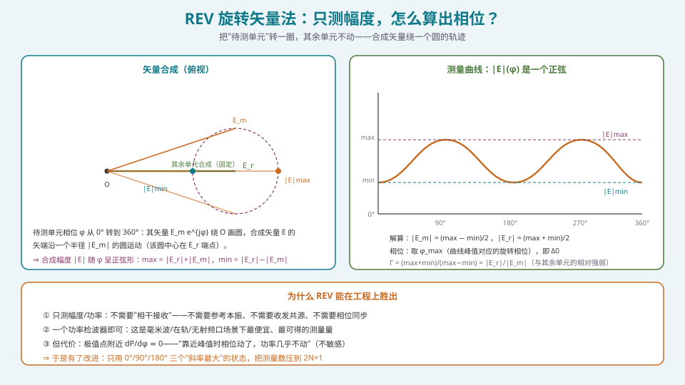
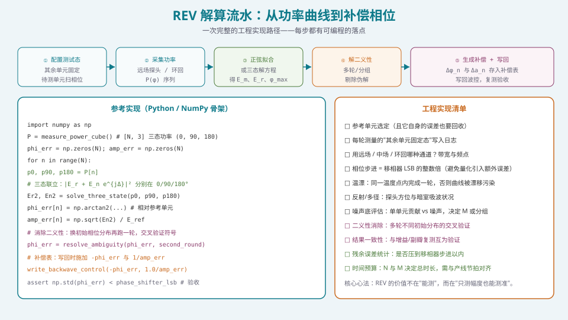

## 本篇要解决什么

[上一篇](pa-channel-error-impact.html)给出了"不校准会损失多少"的定量答案。接下来的问题是：**怎么把那些误差测出来？**

标准答案是：测出每个通道相对参考通道的复数值（幅度 + 相位），然后求逆补偿。但真实系统里经常遇到一个尖锐的限制：

**核心问题：如果系统只能测功率（幅度），完全拿不到相位信息，还能不能校准？**

能。**REV（Rotating Element Electric-field Vector，旋转单元电场矢量）法**就是干这件事的。它用一个极其朴素的观察——**"转一个单元，看总功率怎么变"**——反解出复数激励。本篇把它讲透：

1. 为什么"只测功率能反解复数"在数学上成立；
2. 从 \(|\vec E_r+\vec E_m e^{j\varphi}|\) 到幅相解算的完整推导；
3. 为什么它能**不需要相干接收**，以及这在工程上意味着什么；
4. 三个实用变体（全扫 / 三态 / 最大似然）的测量数与精度权衡；
5. 两个必须处理的坑：**解的二义性**与**大阵中单单元贡献过小**。

---

## 一、问题的本质：一维测量怎么定二维未知量

一个通道的激励是复数 \(E_m e^{j\varphi_m}\)——**两个未知量**（幅度、相位）。而功率检测一次只给**一个标量**。

单次测量必然欠定。**REV 的解法是：多测几次，把"欠定"变成"超定"。**

关键在于：**我们不需要单独测这一个单元**，而是测"这个单元 + 其余所有单元"的**合成功率**。转动待测单元的相位，合成功率就随相位变化——**这条变化曲线里编码了我们要的全部信息。**

---

## 二、REV 原理推导



*图 1：待测单元矢量绕"其余单元合成矢量"端点画圆 ⇒ 合成幅度随相位呈正弦形。*

### 2.1 矢量分解

设第 \(i\) 个单元为**待测单元**，其余所有单元的合成矢量为 \(\vec E_r\)（这一项在测量过程中**固定不变**）。阵列总场：

\[
\vec E_{\text{array}}(\varphi)=\vec E_m\,e^{j\varphi}+\vec E_r
\tag{2.1}
\]

其中 \(\vec E_m\) 是待测单元自身的场（含其所有通道误差），\(\varphi\) 是**我们主动施加**的附加相位。

### 2.2 关键几何：矢端画圆

当 \(\varphi\) 从 \(0^\circ\) 转到 \(360^\circ\)，\(\vec E_m e^{j\varphi}\) 的矢端在复平面上**绕原点画一个半径 \(|\vec E_m|\) 的圆**。于是合成矢量 \(\vec E_{\text{array}}\) 的矢端，就绕 **\(\vec E_r\) 的端点**画同一个圆。

**这就是"旋转矢量法"名字的来源。**

### 2.3 合成幅度是一个正弦

由余弦定理，合成幅度

\[
|\vec E_{\text{array}}(\varphi)|^{2}
=|\vec E_r|^{2}+|\vec E_m|^{2}
+2|\vec E_r||\vec E_m|\cos\!\big(\varphi-\Delta_0\big)
\tag{2.2}
\]

其中 \(\Delta_0\) 是使合成幅度达到最大时对应的旋转相位（即 \(\vec E_m\) 与 \(\vec E_r\) 的相位差）。

**物理结论**：功率（幅度平方）随 \(\varphi\) 是**常数项 + 余弦项**——即严格的**正弦形**。于是：

\[
|\vec E|_{\max}=|\vec E_r|+|\vec E_m|,\qquad
|\vec E|_{\min}=\big|\,|\vec E_r|-|\vec E_m|\,\big|
\tag{2.3}
\]

### 2.4 从极值解出幅相

对式 (2.3) 联立，得到**闭式解**：

\[
\boxed{\
|\vec E_m|=\frac{|\vec E|_{\max}+|\vec E|_{\min}}{2},\qquad
|\vec E_r|=\frac{|\vec E|_{\max}-|\vec E|_{\min}}{2}
\ }
\tag{2.4}
\]

以及常用的**相对强弱比**：

\[
\Gamma=\frac{|\vec E_{\max}|+|\vec E_{\min}|}{|\vec E_{\max}|-|\vec E_{\min}|}
=\frac{|\vec E_r|}{|\vec E_m|}
\tag{2.5}
\]

**相位**：取曲线达到峰值时的旋转相位 \(\Delta_0\)。由于 \(\vec E_r\) 是"其余单元"的合成（可视为参考），\(\Delta_0\) 就包含了待测单元相对于参考的**相位误差**。

> **完整解**：对每个单元做一次旋转扫描，得到它的 \(|\vec E_m|\) 与 \(\Delta_0\)，就得到了它相对参考通道的幅相误差；取逆即为补偿值。

### 2.5 为什么这是"无相位测量"

**这是 REV 最重要的工程性质**：

| 测量量 | REV 需要什么 |
| --- | --- |
| 幅度 / 功率 | **只要这一个** |
| 相位 | 不需要 |
| 相干接收（收发共源、参考本振、相位同步） | **不需要** |
| 昂贵设备 | 一个功率检波器即可 |

**工程含义**：

- 毫米波、在轨、集成度极高（**天线无射频连接器**）的场景，相位信息常常**根本拿不到**；
- REV 只需功率检波 ⇒ **硬件成本极低、可在任意位置部署**；
- 这正是 REV 在**工业界被广泛采用**（并被视为"参考的仅幅度校准法"）的根本原因。

### 2.6 代价：极值附近不敏感

求导就能发现一个麻烦：

\[
\frac{\partial|\vec E|^2}{\partial\varphi}
=-2|\vec E_r||\vec E_m|\sin(\varphi-\Delta_0)
\]

在 \(\varphi=\Delta_0\)（峰值）与 \(\varphi=\Delta_0+\pi\)（谷值）处**导数为零**。也就是说：

> **在极值附近，相位动了一点，功率几乎不动。**

这带来两个后果：
1. **靠单次测量定位极值非常不精确**（噪声下尤其明显）；
2. 启发了一个改进方向：**别在极值附近采点，去斜率最大的地方采**——于是有了下面 3.5 节的"三态法"。

---

## 三、三个工程变体：测量数与精度的权衡


*图 2：从左到右，测量数一路下降；代价是精度裕量与抗噪能力。*

### 3.1 经典 REV（Mano, 1982）

- 待测单元相位从 \(0^\circ\) 步进到 \(360^\circ\)（步长可为 5°~10°，注意**取移相器 LSB 的整数倍**）；
- 每个相位点记录一次合成功率，得到一条含 \(M\) 个点的曲线；
- 拟合正弦，取 max/min/\(\varphi_{\max}\) 解出幅相。

**测量数**：\(N\times M\)（\(M\) 常取 36~72）。

**优点**：精度最高、抗噪最好（点最多）。**缺点**：最慢；\(N=1000\) 的大阵根本不可行。

### 3.2 三态法（Long, 2017 及同期工作）

**核心技巧**：只在 **\(0^\circ / 90^\circ / 180^\circ\)** 三点测量——这三点正好位于**斜率最大**的区域。三个方程解三个未知数（\(|\vec E_r|\)、\(|\vec E_m|\)、相位差）：

\[
\begin{aligned}
P_{0}&=|\vec E_r e^{j\varphi_r}+\vec E_m e^{j\varphi_m}|^{2}\\
P_{90}&=|\vec E_r e^{j\varphi_r}+j\,\vec E_m e^{j\varphi_m}|^{2}\\
P_{180}&=|\vec E_r e^{j\varphi_r}-\vec E_m e^{j\varphi_m}|^{2}
\end{aligned}
\tag{3.1}
\]

**测量数**：\(2N+1\)——**这是已知 REV 改进方案中测量数最少的一档**。

> 注意：Long 的三态方案用 \(0^\circ/90^\circ/180^\circ\) 得到 \(2N+1\)；He（2019）把 \(180^\circ\) 换成"关断待测单元"，测量数同为 \(2N+1\)。

### 3.3 最大似然 / 正交四态（Sorace, 2001）

- 用 4 个**正交**相位状态（间隔 90°）做测量，再用**最大似然估计**解算；
- 对噪声统计最优，抗噪优于三态；
- **测量数**：\(3N+1\)。

### 3.4 三者对比

| 变体 | 测量数 | 抗噪 | 适用 |
| --- | --- | --- | --- |
| 经典全扫 | \(N\times M\)（\(M\)≈36~72） | 最好 | 小阵、实验室高精度 |
| 三态 | **\(2N+1\)** | 一般 | **工程最常用的折中** |
| ML / 正交四态 | \(3N+1\) | 较好 | 中低信噪比链路 |

**选型直觉**：**测量点数就是"抗噪的投资"**。点越多，越能用数据把噪声平均掉；点越少，越快但越脆。

### 3.5 测量数之外：为什么三态"看起来更聪明"

因为它在信息论上更"划算"：**极值附近 \(dP/d\varphi\approx0\)**，采样几乎是浪费；而 \(0/90/180^\circ\) 附近 \(dP/d\varphi\) 最大，每次测量带来的信息量最高。**三态法是"用最少的点采在信息量最大的位置"。**

---

## 四、两个必须处理的工程坑

### 4.1 坑一：解的二义性（\(\pi\) 模糊）

**现象**：用 REV 方程组求解会得到**两组解**，其中一组是**伪解**。

**根源**：从功率曲线我们只能知道 \(|\vec E_r|\) 和 \(|\vec E_m|\) 的**大小关系**，无法直接判定"旋转单元的合成功率是否大于其余单元"。当 \(\varphi\) 的绝对参考不确定时，就会出现 \(\pi\) 的相位模糊。

**解法**：

1. **多轮不同初始相位分布**：改变"其余单元固定态"，再跑一轮，**交叉验证符号**；
2. **分组旋转（CREV）**：一次转一组单元，利用组间关系消除模糊；
3. **先粗后精**：先用保证一定符号关系的初始态（例如把所有单元初始相位约束到相对参考的 \((-90^\circ,+90^\circ)\) 区间），再做 REV。

> **工程提醒**：**二义性不消除，校准结果可能整体"反相"**——表现为校准后副瓣更差，而不是更好。这是现场最容易被误判为"算法失效"的问题。

### 4.2 坑二：大阵中单单元贡献过小

**现象**：\(N\) 很大时，单独转动一个单元对**总功率的影响微乎其微**（贡献 \(1/N\) 量级）⇒ 功率曲线的"正弦幅度"被噪声淹没。

**量化**：正弦分量幅度 \(\propto 2|\vec E_r||\vec E_m|\approx 2N\cdot 1/N^{2}\) 量级相对于总功率 \(N^2\)——**随 \(N\) 单调下降**。

**解法**：

1. **分组旋转（CREV, Combined REV）**：一次转一组单元，等效提高"待测单元"的相对权重，提升信噪比；
2. **分组正交化**：多组分组覆盖 + 正交设计，使每轮贡献可分辨；
3. **多轮组合求解**：把"分组级"的粗结果与"单元级"的精结果联立。

**折中**：**先粗分组定位，再组内精解**——这是大阵在线校准的标准做法。

---

## 五、抗噪：别只信一个极值点



*图 3：从配置测试态到写回补偿的完整流水，以及一份工程实现清单。*

### 5.1 单点极值的脆弱性

\(|\vec E|_{\max}\) / \(|\vec E|_{\min}\) 若只取**单次测量值**，就直接吃一次噪声。而极值附近 \(dP/d\varphi\approx0\)，噪声引起的"功率抖动"会**直接平移极值位置**。

### 5.2 正确处理：把曲线当"带噪正弦"处理

已知模型是一条正弦 + 常数，所以最优做法是**用整条曲线做参数估计**：

1. **最小二乘正弦拟合**：估三个参数（均值、幅度、相位），用 \(M\) 个点做最小二乘，噪声被平均掉；
2. **相关检测 / 匹配滤波**：对基频（\(\varphi\) 的一次谐波）做相关，等效于"自相关检测"，把窄带正弦从宽带噪声里提出来。

**处理增益**（相干检测 \(M\) 点、取一半自由度）：

\[
G\approx 10\log_{10}\!\left(\frac{M}{2}\right)\ \text{dB}
\tag{5.1}
\]

**例**：\(M=36\) ⇒ \(G\approx10\log_{10}18\approx+12.6\) dB 等效信噪比改善。

### 5.3 这解释了"三态 vs 全扫"的真实权衡

三态法丢掉的不只是"多测的点"，而是**丢掉了这部分处理增益**。所以：

- **信噪比好（近场、短距离、高功率）** ⇒ 用三态，追求速度；
- **信噪比差（远场、在轨、低功率）** ⇒ 用多点多轮，追求稳健。

---

## 六、可运行原型：REV 解算脚本

这是 S5 里**最值得亲手写一遍**的练习。下面给出一个完整、可直接跑的最小实现（含噪声）：

```python
import numpy as np

rng = np.random.default_rng(0)

def rev_solve_power_curve(P, phases_deg):
    """输入：功率曲线 P（线性功率）与对应施加相位 phases_deg（度）
       输出：(|Em|, phi_m - phi_r) —— 待测单元相对参考的幅度与相位差
       模型：P(phi) = A + B*cos(phi - d0)"""
    phi = np.deg2rad(phases_deg)
    # 线性最小二乘拟合 P = c0 + c1*cos(phi) + c2*sin(phi)
    M = np.c_[np.ones_like(phi), np.cos(phi), np.sin(phi)]
    c0, c1, c2 = np.linalg.lstsq(M, P, rcond=None)[0]
    A, B = c0, np.hypot(c1, c2)
    d0 = np.arctan2(c2, c1)                  # 峰值对应的旋转相位
    return A, B, d0

def simulate_element(Er, Em, phi_m_deg, n_pts=36, noise=0.01):
    """仿真：E = Er*exp(j*phi_r) + Em*exp(j*(phi_m + delta))，delta 扫 0~360"""
    delta = np.linspace(0, 359, n_pts)
    Er_v = Er * np.exp(1j*0.0)                    # 设参考相位为 0
    Em_v = Em * np.exp(1j*np.deg2rad(phi_m_deg))
    E = Er_v + Em_v * np.exp(1j*np.deg2rad(delta))
    P = np.abs(E)**2 * (1 + noise*rng.standard_normal(n_pts))
    return P, delta

# ---- 自测：能否把已知误差解出来 ----
Er, Em, true_phi = 8.0, 1.0, 37.0            # 真值：Em/Er = 0.125, 相位差 37°
P, delta = simulate_element(Er, Em, true_phi)
A, B, d0 = rev_solve_power_curve(P, delta)

# 由拟合量反解 |Em|、|Er|：
#   A = |Er|^2 + |Em|^2 ,  B = 2|Er||Em|
Em_hat = np.sqrt((A - np.sqrt(A**2 - B**2)) / 2)   # 取"待测单元较小"的解
Er_hat = np.sqrt((A + np.sqrt(A**2 - B**2)) / 2)
phi_hat = np.rad2deg(d0)

print(f"|Em|: 真 {Em:.3f}  估计 {Em_hat:.3f}")
print(f"|Er|: 真 {Er:.3f}  估计 {Er_hat:.3f}")
print(f"相位差: 真 {true_phi:.1f}°  估计 {phi_hat:.1f}° (模 360)")
```

**练习建议**：
1. 把 `noise` 从 0.001 扫到 0.1，看相位估计的**方差**如何变化；
2. 把 `n_pts` 从 4 扫到 72，复现式 (5.1) 的 **+10log₁₀(M/2)** 处理增益；
3. 实现**三态解算**（式 3.1），对比它在大噪声下的表现——你会直观看到"少测点"的代价。

---

## 七、常见误区清单

**误区一：以为"没有相位信息就不能校准"。**
REV 的全部意义就是**只用功率**反解复数。**这一步的关键不是"测得准"，而是"多测几次把欠定变超定"。**

**误区二：在极值附近密集采样。**
极值附近 \(dP/d\varphi\approx0\)，采点几乎不带来信息。**要在斜率最大处采样（如 \(0/90/180^\circ\)）。**

**误区三：忽略解的二义性。**
不消除 \(\pi\) 模糊，校准结果可能**整体反相**，副瓣变得更差。**必须多轮不同初始分布交叉验证。**

**误区四：大阵仍按"逐个单元旋转"做。**
单单元贡献 \(\propto1/N\)，大阵里会被噪声淹没。**必须分组旋转（CREV）+ 多轮正交化。**

**误区五：只取单次测量的 max/min。**
噪声直接进结果。**应该对整条功率曲线做正弦拟合或相关检测，赚取 +10log₁₀(M/2) dB 处理增益。**

**误区六：把参考单元当成"绝对正确"。**
REV 解的是"相对参考通道"的幅相。**参考单元自身的误差不会自动消失**，需要在全阵解完后做一次"零均值化/整体归一"——否则会引入一个共模误差。

**误区七：相位步进不取 LSB 整数倍。**
若施加的相位不是移相器 LSB 的整数倍，实际相位与命令相位存在偏差，**会直接把量化误差混进解算结果**。

**误区八：一轮测量跨越了温度漂移。**
一轮 \(N\times M\) 可能持续数分钟，期间温度在变 ⇒ 曲线被**漂移污染**，拟合出的不是纯正弦。**应在稳定温度窗口内完成，必要时做漂移校正。**

**误区九：以为 REV 只适用于发射或只适用于接收。**
发射与接收的校准流程**基本相同**，只是信号流向不同；但**发射走 PA、接收走 LNA**，两条通路的误差矩阵不同，**必须分别标定**。

---

## 八、快速自测

**Q1.** 写出 REV 的矢量模型，并解释为什么"合成幅度随相位呈正弦形"。

<details><summary>参考要点</summary>

模型：\(\vec E_{\text{array}}(\varphi)=\vec E_m e^{j\varphi}+\vec E_r\)，\(\vec E_r\) 为其余单元合成（固定）。

**正弦原因**：\(\vec E_m e^{j\varphi}\) 的矢端在复平面上画一个**半径 \(|\vec E_m|\) 的圆**，圆心在 \(\vec E_r\) 的端点。合成矢量的长度是"从 \(\vec E_r\) 端点到圆上一点"的距离，由余弦定理：

\[
|\vec E(\varphi)|^2=|\vec E_r|^2+|\vec E_m|^2+2|\vec E_r||\vec E_m|\cos(\varphi-\Delta_0)
\]

这是**常数 + 余弦**，即功率的严格正弦形，故 max = \(|\vec E_r|+|\vec E_m|\)、min = \(\big||\vec E_r|-|\vec E_m|\big|\)。

</details>

**Q2.** 由 max/min 如何解出 \(|\vec E_m|\) 与 \(|\vec E_r|\)？给出公式并说明前提。

<details><summary>参考要点</summary>

\[
|\vec E_m|=\frac{\max+\min}{2},\qquad |\vec E_r|=\frac{\max-\min}{2}
\]

**前提**：\(\max\)、\(\min\) 是**同一轮**旋转中测到的（其余单元状态不变）；且需知道哪个是"max"（即需要相位参考或至少知道峰值位置 \(\Delta_0\)）。

**注意**：当 \(|\vec E_m|>|\vec E_r|\)（待测单元占主导，只见于小阵）时，两者的角色互换——这正是**二义性**的来源。

</details>

**Q3.** 为什么 REV "不需要相干接收"？这在工程上意味着什么？

<details><summary>参考要点</summary>

**因为 REV 只需要测**功率/幅度**这一个标量，不需要相位。**

**工程含义**：
1. **一个功率检波器**即可，不需要参考本振、不需要收发共源、不需要相位同步链路；
2. 可用于**毫米波、在轨、集成度高（无射频连接器）**等"相位信息根本拿不到"的场景；
3. 硬件成本与部署难度大幅降低 ⇒ 这是 REV 在工业界被广泛采用的**根本原因**。

**代价**：需要多测几个相位状态（信息要从"多条功率曲线"里来），且不能利用相干积累的正交性直接分离单元。

</details>

**Q4.** REV 的两个工程坑是什么？各自的解法？

<details><summary>参考要点</summary>

**坑一：解的二义性（\(\pi\) 模糊）**
- 根源：无法判定"旋转单元合成功率是否小于其余单元"，方程组有两组解，一组为伪解。
- 解法：**多轮不同初始相位分布交叉验证**；或**分组旋转（CREV）**；或把初始相位约束在相对参考的 \((-90^\circ,+90^\circ)\) 内。
- 后果若不处理：校准结果**整体反相**，指标反而更差。

**坑二：大阵中单单元贡献过小**
- 根源：单单元功率贡献 \(\propto1/N\)，正弦分量被噪声淹没。
- 解法：**分组旋转（一次转一组）** + **多轮正交化**，先粗分组定位、再组内精解。

</details>

**Q5.** 为什么改进方法普遍从"全扫"转向"只在 \(0/90/180^\circ\) 采样"？代价是什么？

<details><summary>参考要点</summary>

**原因**：极值附近的导数

\[
\frac{\partial|\vec E|^2}{\partial\varphi}=-2|\vec E_r||\vec E_m|\sin(\varphi-\Delta_0)
\]

在峰值/谷值处为 **0**。即在极值附近，相位变化引起功率变化极小 ⇒ **信息量低、对噪声不敏感度差**。\(0/90/180^\circ\) 位于**斜率最大**处，每次测量的信息量最高 ⇒ 用最少的点获得足够信息（三态方案测量数降到 \(2N+1\)）。

**代价**：
1. **丢掉处理增益**：少测的点不再能把噪声平均掉（原本可得约 \(10\log_{10}(M/2)\) dB 的等效改善）；
2. **对噪声更敏感**：在远场/在轨/低信噪比场景下，三态结果可能不可用 ⇒ 需退回多点多轮。

**结论**：三态是"**快**"的方案，多点是"**稳**"的方案，按信噪比选。

</details>

**Q6.** 你用正弦拟合而不是直接取 max/min，能带来多少处理增益？为什么？

<details><summary>参考要点</summary>

**增益**：

\[
G\approx10\log_{10}(M/2)\ \text{dB}
\]

（\(M\) 为采样点数，取 \(M/2\) 是因为正弦幅度有 2 个自由度。）

**为什么**：已知模型是"常数 + 单频余弦"，用整条曲线做最小二乘/相关检测，等价于对**已知频率的窄带信号做相干检测**（匹配滤波）——噪声在 \(M\) 个样本上被平均，而信号相干累加。抽样点越多（在斜率区），增益越大。

**例**：\(M=36\) ⇒ \(+12.6\) dB；这也解释了"为什么多点法比三态法更抗噪"。

**补充**：如果用**相关检测**而非最小二乘，效果类似——核心都是"利用已知的正弦模型做相干处理"。

</details>

**Q7.** 一轮 REV 测量耗时较长（如 \(N=256\)，每单元 36 点，每点 50 ms）。请估算总时长，并给出两条加速路径。

<details><summary>参考要点</summary>

**总时长**：\(256\times36\times0.05\ \text{s}=460.8\ \text{s}\approx7.7\) 分钟——**产线上不可接受**。

**加速路径**：
1. **减少每单元测量点**：改用**三态法**，测量数从 \(256\times36=9216\) 降至 \(2\times256+1=513\)，时间约降 18 倍 ⇒ 约 25 s；
2. **并行/分组**：**分组旋转（CREV）**一次转一组，或多探头并行测多个方向 ⇒ 把轮数压下来；对超大阵可结合**正交编码**思路（下一专题）；
3. **缩短单次测量时间**：提高功率检波带宽、减少每次测量的平均次数（但会牺牲信噪比）。

**权衡提醒**：加速的每一条都在"**抗噪 / 精度 / 时间**"三角里做交换。**必须先明确产线节拍与所需残差，再决定方案**——不能只顾快。

</details>

**Q8.** 如果你的阵列在 REV 校准后副瓣**反而变差**，最可能是什么原因？如何验证？

<details><summary>参考要点</summary>

**最可能原因：解的二义性未被消除**（\(\pi\) 模糊），导致部分通道的补偿相位**整体反相**。

**其他可能**：
- 参考单元的共模误差未做零均值化（引入整体偏移）；
- 相位步进不是 LSB 整数倍；
- 测量跨越温漂窗口，曲线被污染；
- 大阵下单单元贡献过小，结果基本是噪声。

**验证路径**：
1. **看残余误差分布**：若部分通道的 \(\varphi\) 呈"整体偏移 \(\pi\)"，基本可确认二义性；
2. **交叉验证**：换一组初始相位分布再跑一轮，若两次结果差 \(\pi\)，确认；
3. **蒙特卡洛/对拍**：用仿真数据（已知真值）跑同一套解算脚本，先验证算法本身正确；
4. **分组法复算**：用 CREV 分组结果对照单元级结果，找不一致的通道。

**修复**：加入多轮不同初始分布的交叉验证，或改分组旋转；必要时对参考单元做整体归一。

</details>

---

## 九、与本站其它专题的连接

| 想了解 | 看哪篇 |
| --- | --- |
| 通道误差的来源与"要不要校准"的决策 | [通道误差的来源与影响](pa-channel-error-impact.html) |
| 幅相误差 → 副瓣/零陷的定量关系 | [通道误差的来源与影响](pa-channel-error-impact.html) |
| 移相器位数与量化副瓣 | [移相器与真时延器件（TTD）](pa-phase-shifter-ttd.html) |
| 近场扫描、并行编码与环回自校准 | [近场扫描、并行编码与环回自校准](pa-nearfield-encoding-loopback.html) |
| 校准工程化：补偿表与验收 | [校准工程化：流程、补偿表与验收](pa-calibration-engineering.html) |
| 权值解算与查表（控面/数据面分工） | [常规波束形成：数据无关的权值计算](pa-conventional-beamforming.html) |
| 校准解算落地的硬件路径 | [FPGA/HLS 实现：数据面与控制面的分工](pa-fpga-hls-implementation.html) |
| 定点化对校准解算精度的影响 | [定点化：从浮点仿真到硬件指标不退化](pa-fixed-point-quantization.html) |
| 近场/远场条件对校准架台的约束 | [远场条件与近场世界](pa-far-field-near-field.html) |
| 相控阵的物理机制 | [卫星相控阵天线：从阵元到波束](satellite-phased-array.html) |
| 学习体系全貌 | [相控阵天线学习体系：六阶段路线图](phased-array-roadmap.html) |

---

## 十、延伸阅读

**原始文献与核心论文**
- Mano & Katagi, "A method for measuring amplitude and phase of each radiating element of a phased array," *Electronics and Communication in Japan*, 1982——**REV 方法的原始文献**。
- Sorace, "Phased array calibration," *IEEE Trans. AP*, 2001——**4 次正交相位 + 最大似然**的高效方案。
- 关于 **REV 解的二义性及其消除方法** 的研究（中文期刊）——系统分析了伪解的物理意义与多轮消除法。
- Liu & Feng, "Combined rotating-element electric-field vector (CREV) method"——**分组旋转法**，针对大阵。
- 面向仅幅度测量的改进 REV 策略——3 态 \(2N+1\) 测量、分组正交化与噪声鲁棒性分析。

**工程材料**
- 相控阵天线校准方法综述（近场扫描 / 中场 / REV / 线性矩阵求逆 / 互耦 / 正交编码 / 换相）。
- 相控阵校准方法实验对比研究（REV / 快速仅幅度 / 复幅度法三者的实测对照）。
- 光学相控阵（OPA）的改进 REV 实现——**同一套数学在光子学里的复用**，能带来很有价值的跨域直觉。

**本站衔接**
- 本篇是 **S5 的解题篇**：上篇诊断"误差有多大"，本篇给出"**只测功率怎么把它解出来**"；
- 记住 REV 的三句话：**矢端画圆 ⇒ 功率正弦；max/min 解幅相；只测幅度所以不需要相干接收**；
- 下一篇解决 REV 的两个短板（大阵太慢、在轨无法用远场探头）——[近场扫描、并行编码与环回自校准](pa-nearfield-encoding-loopback.html)。
