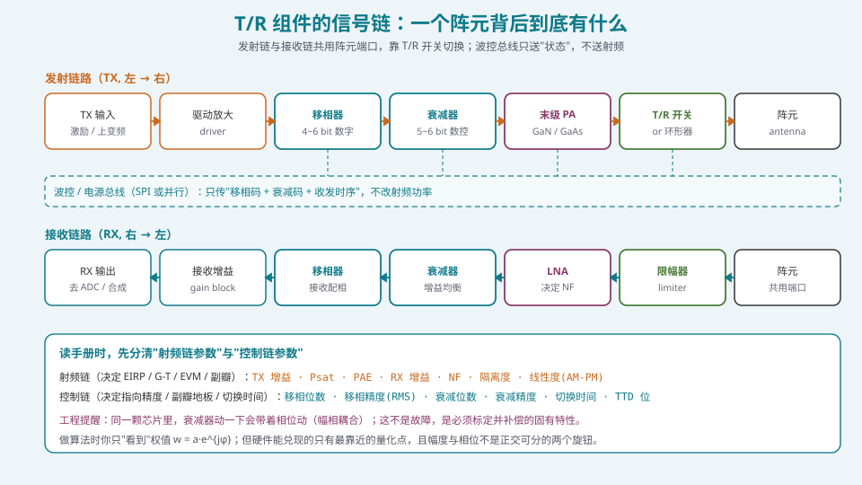
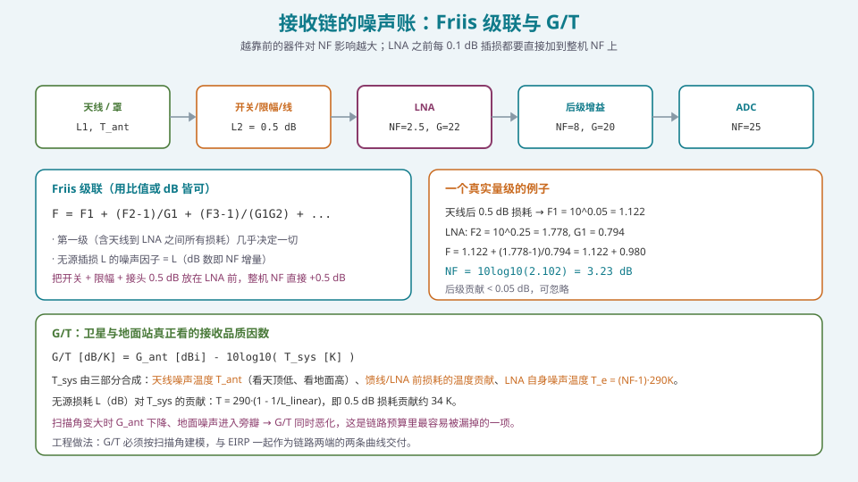

## 本篇要解决什么

到目前为止，这个体系给你的都是**理想世界**：

- [相控阵的数学语言](pa-math-complex-phasor.html) 给了复数与相量；
- [阵列因子](pa-array-factor.html) 给了 \(G=G_e\times|AF|\)；
- [波束宽度、增益与孔径](pa-beamwidth-gain-aperture.html) 给了增益与效率；
- [扫描损耗](pa-scan-loss.html) 给了"为什么实际比理论低"。

但这一切的前提是：**有人能把你要的权值 \(w_n=a_n e^{j\varphi_n}\) 真的做出来**。做这件事的器件，就是 **T/R 组件（Transmit/Receive Module）与射频前端**。

这一篇要回答三个非常务实的问题：

1. **T/R 组件里到底有什么？** 信号从哪进、从哪出？
2. **数据手册上几十个参数，哪七个真正影响系统？** 怎么把它们折算成系统的 dB、deg、开尔文？
3. **一个算法工程师应该读到什么深度？** 哪些必须懂、哪些可以直接跳过？

> **本篇的定位**：不需要你会设计 T/R 组件，但必须能做到——**拿到一份手册，把每一项非理想"翻译"成系统代价**。这是"算法工程师"与"只会跑仿真的人"最明显的分水岭。

---

## 一、T/R 组件是什么：一个阵元背后的完整收发机



*图 1：发射链与接收链共用阵元端口，靠 T/R 开关切换。波控总线只送"相位码 + 衰减码 + 收发时序"，不送射频。*

一个典型的有源相控阵阵元背后，是一套微缩的收发机。以 X 波段（8~12 GHz）四通道集成组件为例，手册常见规格大致是：发射增益 35 dB、饱和输出 40 dBm、接收增益 28 dB、噪声系数 3.0 dB、6 bit 移相（精度 3°）、6 bit 数控衰减（0~31.5 dB）、组件效率 35%（20% 占空比）。

**发射链**：激励信号 → 驱动放大 → **移相器** → **衰减器** → 末级 PA → T/R 开关 → 阵元。
**接收链**：阵元 → T/R 开关 → 限幅器 → **LNA** → 衰减器 → **移相器** → 接收增益级 → 输出。

两个工程事实必须记住：

- **移相器/衰减器往往被收发共用**（通过开关切换），因为它们是"配相"和"加窗"的执行机构，收发都需要；
- **发射链的末级 PA 与接收链的第一级 LNA 是"性能担当"**：前者决定 EIRP 上限与热，后者几乎单独决定整机噪声系数。

### 1.1 砖式（brick）与瓦式（tile）

| 形态 | 结构 | 优点 | 缺点 |
| --- | --- | --- | --- |
| 砖式 brick | T/R 组件"立"在阵面背后，垂直于阵面 | 散热好、射频路径短、易维修 | 厚度大、阵面间距受组件尺寸限制 |
| 瓦式 tile | 一层层"平铺"叠起来，射频走线在层内 | 超薄、易与天线一体化（AiP） | 散热难、设计复杂 |

毫米波（Ka 及以上）的相控阵几乎都是瓦式，因为阵元间距只有几毫米，砖式根本塞不下。**对算法工程师的意义**：瓦式意味着更短的馈网、更小的互耦差异，但也意味着更严峻的热梯度——而这会转化成通道间相位漂移（见 [通道误差的来源与影响](pa-channel-error-impact.html)）。

---

## 二、手册怎么读：七项真正影响系统的参数


*图 2：每一项非理想都要能"翻译"成一个系统级的 dB 或 deg，否则你只是抄了一页表格。*

### 2.1 发射侧三项

**① 饱和输出功率 \(P_{sat}\) 与 \(P_{-1\text{dB}}\)**

- \(P_{sat}\) 决定 EIRP 的绝对上限：\(\text{EIRP}=P_{tx}+G_{ant}\)；
- \(P_{-1\text{dB}}\)（1 dB 压缩点）决定"能动用的功率"——工作点必须在 P1dB 以下才有线性度。

**关键认知**：**P1dB 通常比 Psat 低 2~4 dB**。手册上写 +40 dBm 的组件，能用来传高阶调制的其实只有 +36~38 dBm。所有"我按 Psat 算过链路预算"的说法，都要追问"用什么调制、允许多少 EVM"。

**② PAE（功率附加效率）**

\[
\mathrm{PAE}=\frac{P_{out}-P_{in}}{P_{DC}}
\]

GaN PA 在 X 波段典型 30%~45%（饱和态），Ka 波段饱和 20%~30%，回退后往往只有 10%~20%。这个数字直接决定两件事：

- **热**：\(P_{diss}=P_{DC}-P_{out}\)，剩下的全部变成热；
- **供电**：整阵 DC 功耗 ≈ \(\sum P_{RF}/\mathrm{PAE}\)。

> **一个量级感**：256 元阵、每元输出 0.25 W、PAE 20% ⇒ 每元 DC 1.25 W、发热 1 W ⇒ 整阵 256 W 热负荷，热流密度可达 30 W/cm² 量级——**和高端 CPU 同级**。散热不是机械部门的事，它会反过来限制你能开多高的功率。

**③ AM-PM 与 AM-AM（线性度）**

PA 逼近压缩时：

- **AM-AM**：输入幅度 → 输出幅度压缩（增益非线性）；
- **AM-PM**：输入幅度 → 输出相位偏移，单位 **deg/dB**。

AM-PM 是"用幅度变化污染相位"的机制，对调制信号尤其致命。典型值：接近 P1dB 时 **3~10 deg/dB**。对 EVM 的粗略影响：

| 调制 | EVM 要求 | AM-PM 容忍度（量级） |
| --- | --- | --- |
| QPSK | 宽松 | 高（决策边界宽） |
| 64-QAM | ~8% | 3° 量级 |
| 256-QAM | < 3.5% | **< 1~2°** |

**对算法工程师的意义**：如果系统要跑 256-QAM，你**不能**把 PA 开到饱和附近靠功率去补扫描损耗——那会把 EVM 打爆。这直接约束了 [扫描损耗](pa-scan-loss.html) 的"补偿手段"。

### 2.2 接收侧三项

**④ 接收增益与 ⑤ 噪声系数 NF**

接收链的 NF 决定 G/T、决定接收灵敏度。**NF 由 LNA 与前级损耗共同决定**（见 §3）。

**⑥ 隔离度与切换时间**

- **收发隔离**：TDD 系统里，发射泄漏若不隔离，会淹没接收的弱信号；也决定近端自干扰；
- **切换时间**：T/R 开关的收发切换 + 移相器/衰减器的建立时间，决定**最小可用的波束切换粒度**。µs 级器件的系统不可能做时隙级波束扫描。

### 2.3 控制侧两项（常被漏读，但决定副瓣与指向）

**⑦ 移相位数 / 移相精度（RMS）与衰减位数 / 衰减精度**

- 移相位数决定**量化副瓣地板**（每加 1 bit 约改善 6 dB，见 [移相器与真时延器件](pa-phase-shifter-ttd.html)）；
- 衰减位数决定**加窗的深度上限**：你要做 −30 dB 的泰勒窗，但每通道衰减只能量化到 ±0.5 dB，实际副瓣就压不下去；
- **移相精度用 RMS 表述**：例如"≤5° RMS"是量化误差 + 器件误差 + 温度漂移的综合。

> **必记的幅相耦合**：在同一颗芯片里，**衰减器动一下会带着相位动**（反之亦然）。这不是故障，是矢量调制型器件的固有特性，必须标定并补偿。如果你的代码假设"幅度与相位是正交的两个旋钮"，那它在硬件上一定跑偏。

---

## 三、接收链的噪声账：Friis 级联与 G/T



*图 3：越靠前的器件对 NF 影响越大；LNA 之前每 0.1 dB 插损都要直接加到整机 NF 上。*

### 3.1 Friis 公式

\[
F=F_1+\frac{F_2-1}{G_1}+\frac{F_3-1}{G_1G_2}+\cdots
\]

三个结论：

1. **第一级几乎决定一切**。若第一级有增益 \(G_1\gg1\)，后面所有级都被"除以 \(G_1G_2\cdots\)"压住；
2. **无源插损的噪声因子等于其线性损耗**：0.5 dB 的开关/限幅/接头损耗，直接给整机 NF 加 0.5 dB；
3. **把 LNA 往前挪是最有效的降 NF 手段**——这就是 AESA 相对 PESA 在接收上"低 5 dB 以上 NF"的根本原因（见 [四种架构的选型](pa-architecture-selection.html)）。

**算一个例子**（天线后 0.5 dB 损耗）：

\[
F=1.122+\frac{1.778-1}{0.794}=2.102\Rightarrow \mathrm{NF}=10\log_{10}(2.102)=3.23\ \text{dB}
\]

后级（NF=8 dB 的增益块、NF=25 dB 的 ADC）的贡献加起来不到 0.05 dB，完全可忽略。

### 3.2 G/T：卫星与地面站真正看的指标

$$
\boxed{\;G/T\ [\mathrm{dB/K}]=G_{ant}\ [\mathrm{dBi}]-10\log_{10}(T_{sys}\ [\mathrm{K}])\;}
$$

\(T_{sys}\) 由三部分合成：

- **天线噪声温度 \(T_{ant}\)**：指向冷空（天顶）时约 20~50 K，指向地面/热源时可达 290 K；
- **LNA 前无源损耗的温度贡献**：\(T=290(1-1/L_{linear})\)，即 **0.5 dB 损耗贡献约 34 K**；
- **LNA 自身噪声温度**：\(T_e=(\mathrm{NF}-1)\cdot290\)，NF=3 dB ⇒ \(T_e\approx290\) K。

**两个容易漏掉的点**：

1. **扫描时 G/T 会同时恶化**：\(G_{ant}\) 随扫描角下降，同时旁瓣把地面噪声收进来抬高 \(T_{ant}\)。链路预算里只算 EIRP 不算 G/T 是常见的漏洞；
2. **G/T 必须与 EIRP 一起按扫描角建模**，作为"链路两端的两条曲线"交付，而不是两个数。

---

## 四、把手册变成代码：一个参数解析与预算框架

### 4.1 数据与代码分离

手册参数应该作为**外部配置**（YAML/JSON）存在，与器件版本绑定，而不是散落在代码里：

```yaml
# tr_module_Xband_4ch.yaml
freq_ghz: [8.0, 12.0]
tx:
  gain_db: 35.0
  psat_dbm: 40.0
  p1db_backoff_db: 3.0        # P1dB = Psat - 3
  pae_pct: 35.0               # @20% duty
  am_pm_deg_per_db: 6.0       # near P1dB
rx:
  gain_db: 28.0
  nf_db: 3.0
  isolation_db: 30.0
phase:
  bits: 6
  rms_error_deg: 5.0
atten:
  bits: 6
  range_db: 31.5
  step_db: 0.5
switch:
  tdd_switch_ns: 50
```

### 4.2 级联 NF 与 G/T 计算

```python
import numpy as np

def cascade_nf(nf_db, gain_db):
    """Friis 级联。nf_db/gain_db 为各段（含无源段）的列表。"""
    f = 10 ** (np.array(nf_db) / 10.0)
    g = 10 ** (np.array(gain_db) / 10.0)
    # 无源段：增益为负，NF = -gain（用其自身 NF 传入即可）
    f_total = f[0]
    for i in range(1, len(f)):
        f_total += (f[i] - 1) / np.prod(g[:i])
    return 10 * np.log10(f_total)

def gt_dBK(g_ant_dbi, t_ant_k, pre_lna_loss_db, lna_nf_db):
    loss_lin = 10 ** (pre_lna_loss_db / 10.0)
    t_loss_k = 290.0 * (1 - 1 / loss_lin)          # 无源损耗温度贡献
    t_e_k    = (10 ** (lna_nf_db / 10.0) - 1) * 290.0
    t_sys_k  = t_ant_k + t_loss_k + t_e_k
    return g_ant_dbi - 10 * np.log10(t_sys_k)

# 例：G=34 dBi，天顶 T_ant=40K，前级损耗 0.5 dB，LNA NF=2.5 dB
print(gt_dBK(34.0, 40.0, 0.5, 2.5))   # ≈ 19.2 dB/K 量级
```

### 4.3 发射侧的"可用功率"与热

```python
def tx_eirp_and_heat(psat_dbm, backoff_db, n_elem, gain_ant_dbi, pae_pct, duty):
    p_tx_per = psat_dbm - backoff_db                     # 实际工作点
    eirp_dbm = p_tx_per + 10*np.log10(n_elem) + gain_ant_dbi
    p_rf_w   = 10**((p_tx_per - 30)/10.0)
    p_dc_w   = p_rf_w / (pae_pct/100.0)
    p_heat_w = (p_dc_w - p_rf_w) * duty
    return eirp_dbm, p_heat_w * n_elem
```

### 4.4 三条实现纪律

1. **保守默认值**：查不到 AM-PM、隔离度时，用悲观值（AM-PM 取 8 deg/dB），并在日志里标注"数据缺失"；
2. **断言与边界**：工作点不得超过 P1dB；扫描角超出保证范围要打警告；
3. **参数带来源与版本**：每个数值注明"手册页/批次/温度点"。**评审时被质疑的往往不是算法，而是数据来源。**

---

## 五、常见误区清单

**误区一：用手册的 Psat 做链路预算。**
Psat 是"极限"，不是"能用的功率"。实际工作点由线性度（EVM/ACLR）决定，通常要在 P1dB 以下，比 Psat 低 3~6 dB。

**误区二：认为 NF 是"某个器件"的参数，而不是"链路"的。**
整机 NF 是级联结果。**LNA 前面的任何一点损耗都要直接加到整机 NF 上**。把 LNA 放在开关/限幅/接头之后，等于白送 0.5~1 dB。

**误区三：忽略 G/T 的扫描角依赖。**
扫描时增益下降 + 旁瓣收地面噪声，G/T 双向恶化。只按正扫算 G/T，会让链路预算在边缘明显偏乐观。

**误区四：把幅度与相位当成两个独立旋钮。**
矢量调制型器件的幅相是耦合的。代码里必须假设"改衰减会带相位变化"，并在校准表里一并补偿。

**误区五：只看位数，不看精度与建立时间。**
"6 bit 移相"是分辨率；真正决定副瓣与指向的是 **RMS 精度**（含温漂）；真正决定波束管理能力的是**切换时间**。

**误区六：认为"提高功率就能补偿一切"。**
功率可以补链路余量，但：① 大角处 PA 已接近饱和；② 高功率恶化 AM-PM → EVM 爆掉；③ 热会逼你降额。**这是三堵墙，不是一堵。**

**误区七：把 PAE 当"次要参数"。**
PAE 直接决定热与供电，而热梯度又会转化为通道间相位漂移。**PAE 是"算法稳定性"的间接参数。**

**误区八：读手册只读"典型值"，不看"最坏值/温度范围"。**
典型值是 25 ℃ 的，工作范围是 −40~+70 ℃。相位漂移、增益漂移、NF 退化都以最坏值为准。**链路预算的灵魂是"最坏情况"。**

---

## 六、快速自测

**Q1.** 一个接收链：天线后开关 + 限幅 0.5 dB，LNA NF=2.5 dB / 增益 22 dB，后级增益块 NF=8 dB / 增益 20 dB。求整机 NF。若把 LNA 前移，使前级损耗降到 0.1 dB，NF 变成多少？

<details><summary>参考要点</summary>

用 Friis。前级无源 0.5 dB：\(F_1=10^{0.05}=1.122,\ G_1=10^{-0.05}=0.794\)。
LNA：\(F_2=10^{0.25}=1.778,\ G_2=10^{2.2}=158.5\)。
后级：\(F_3=10^{0.8}=6.31\)。

\[
F=1.122+\frac{1.778-1}{0.794}+\frac{6.31-1}{0.794\times158.5}=1.122+0.980+0.042=2.144
\]
\[
\mathrm{NF}=10\log_{10}(2.144)=3.31\ \text{dB}
\]

前级损耗降到 0.1 dB：\(F_1=1.023,\ G_1=0.977\)。
\[
F=1.023+\frac{0.778}{0.977}+\frac{5.31}{0.977\times158.5}=1.023+0.796+0.034=1.853
\]
\[
\mathrm{NF}=2.68\ \text{dB}
\]

**结论：前级少 0.4 dB 损耗，整机 NF 改善约 0.63 dB**（因为还改善了后级的噪声贡献分摊）。这就是"LNA 尽量往前、开关限幅尽量低损"的定量理由。

</details>

**Q2.** 为什么说"P1dB 比 Psat 更重要"？对 256-QAM 系统，这个差别意味着什么？

<details><summary>参考要点</summary>

**P1dB 是"线性工作上限"**：低于 P1dB，增益与相位基本恒定；高于 P1dB，AM-AM 压缩与 AM-PM 相移迅速增大。Psat 只是"再推也上不去"的极限点，此时非线性已极其严重。

**对 256-QAM**：EVM 要求 < 3.5%，对应 AM-PM 容忍 < 1~2°。PA 在 P1dB 附近 AM-PM 可达 3~10 deg/dB，已经超标。所以：

1. **可用功率往往要在 P1dB 以下再多回退 2~4 dB**（即距 Psat 5~8 dB）；
2. 直接后果是**可用 EIRP 比"按 Psat 算"低 5~8 dB**，这必须体现在链路预算里；
3. 想同时要功率和线性度，只能：数字预失真（DPD）、Doherty/包络跟踪等效率增强技术，或加大阵面（用空间功率合成代替单管功率）。

**一句话**：Psat 是"能不能响"，P1dB 是"能不能用"。

</details>

**Q3.** 某 X 波段 4 通道组件：Psat = 40 dBm，PAE = 35%（20% 占空比），工作回退 3 dB。求单通道 DC 功耗与占空比 20% 下的平均发热功率（不含接收链）。

<details><summary>参考要点</summary>

工作点：\(P_{tx}=40-3=37\ \text{dBm}=5.01\ \text{W}\)。

\(P_{DC}=P_{out}/\mathrm{PAE}=5.01/0.35=14.3\ \text{W}\)。

发热 \(P_{heat}=P_{DC}-P_{out}=14.3-5.01=9.3\ \text{W}\)（脉冲内）。

按 20% 占空比平均：\(\bar P_{heat}=9.3\times0.2=1.86\ \text{W}\)。

**读法**：脉冲内的瞬时热负荷是平均值的 5 倍，所以热设计要按"脉冲内峰值"考虑瞬态温升，按平均值考虑稳态散热。

**推论**：4 通道 ×1.86 W ≈ 7.4 W 平均热负荷，集中在一小块组件上——这就是瓦式阵散热的难点。

</details>

**Q4.** 解释为什么"扫描角变大时 G/T 会同时恶化"，并说明它对链路预算的影响。

<details><summary>参考要点</summary>

**两个方向同时变差**：

1. **\(G_{ant}\) 下降**：平面阵扫描时有效孔径按 \(\cos\theta_0\) 收缩（[扫描损耗](pa-scan-loss.html)），加上单元方向图与失配，总下降 3~6 dB；
2. **\(T_{ant}\) 上升**：波束偏离法线、旁瓣展宽且指向变化，会**把更多地面/热源的噪声收进来**；在低仰角（对卫星终端是最大扫描角）尤其严重，同时还要叠加大气噪声温度上升。

**对链路预算的影响**：

- 接收端的可用 \(C/N_0\) = \(\text{EIRP}-\text{FSPL}-L_{atm}+G/T+228.6\)（dB 形式）。**EIRP 与 G/T 在边缘是"双降"**，比只看 EIRP 更悲观；
- 因此**边缘链路余量必须用"边缘 EIRP + 边缘 G/T"**一起算；
- 对星座设计：这意味着单星覆盖边缘的可用速率比"正扫估算"低一档，可能迫使减小覆盖半径或增加卫星数。

</details>

**Q5.** 什么是幅相耦合？它在硬件上从哪来，在算法上应该怎么处理？

<details><summary>参考要点</summary>

**现象**：改变衰减器（幅度）时，输出相位也会变；改变移相器（相位）时，幅度也会变。二者不是正交的两个旋钮。

**来源**：
- 矢量调制型移相器用 I/Q 两路变增益合成，幅度码变化会改变 I/Q 配比 ⇒ 相位漂移；
- 衰减器用开关切换衰减网络，切换会引入寄生电抗变化 ⇒ 相位漂移；
- 有源器件的输入阻抗随偏置变化。

**算法处理**：
1. **不做"先配相再衰减"的解耦假设**，而是把 (相, 幅) 视为二维联合映射；
2. **标定成查找表**：对每个通道，标出 \((A,\varphi)\to(\hat A,\hat\varphi)\) 的映射，或直接标出"目标相位 + 目标幅度 → 需要的两个码"；
3. **在波束综合里联合优化**：用二维补偿表把幅相耦合吸收掉；
4. **验收判据**：耦合引起的相位偏差应被压到移相器步进以内。

</details>

**Q6.** 一个 Ka 波段终端，宣称 EIRP 与 G/T 都在 ±45° 内保证。你要在文档里怎么呈现这两个指标才不会被评审质疑？

<details><summary>参考要点</summary>

**必须写清四件事**：

1. **条件**：频点/频段、温度（25 ℃ 还是全温区）、占空比、调制方式与 EVM 上限、参考面（是否含天线罩、馈线）；
2. **扫描角依赖**：给出**曲线**而非一个数：EIRP(θ₀) 与 G/T(θ₀) 两条曲线，标注边缘值；
3. **口径一致**：EIRP 是峰值还是含加窗/回退后的值；G/T 的 T 是含天线噪声温度的全系统温度还是只含接收机；避免"我方峰值 vs 竞品平均值"的对比；
4. **最坏情况标注**：注明"以上为最坏情况（最坏频点 + 温度极端 + 最大扫描角）"还是"典型值"。

**判据**：任何"单一数字"的 EIRP/G/T 承诺，都隐含了大量假设。**把假设写在同一页，是专业度的体现，也是保护自己的方式。**

</details>

**Q7.** 你的同事把 4 通道 T/R 组件的"6 bit 衰减、0~31.5 dB"当成"可以做任意 −31.5 dB 的幅度加窗"，这个说法哪里有问题？

<details><summary>参考要点</summary>

**问题一：量化步进**。6 bit / 31.5 dB 意味着步进 0.5 dB。泰勒/切比雪夫窗的幅度分布是连续的，量化到 0.5 dB 会产生**振幅误差**，抬高副瓣地板，并可能把主瓣形状弄歪。要做 −30 dB 副瓣，通常要求幅度误差 RMS < 0.2~0.3 dB，6 bit 偏紧。

**问题二：衰减范围 ≠ 加窗范围**。31.5 dB 的动态范围够用，但**加窗真正需要的是"相对分布"的精度**，而不是绝对范围的宽度。均匀阵只需要边缘比中心低几 dB（低副瓣窗的锥比一般只有 10~20 dB）。

**问题三：幅相耦合**。每次改衰减都带相位变化，若不联合标定，加窗会顺带破坏配相。

**问题四：通道一致性**。每通道的衰减器都有独立的误差与温漂，"名义 31.5 dB"在每通道上都不一样。**加窗的精度下限由"通道间幅度一致性 + 温度漂移"决定，而不是由位数单独决定。**

**正确说法**："衰减器提供 0.5 dB 步进、0~31.5 dB 的幅度控制能力；实际加窗精度受量化步进、幅相耦合与通道不一致共同限制，需配合校准表使用。"

</details>

**Q8.** 假设你要给一个"每 0.5 ms 切一次波束"的 TDD 系统选型，移相器切换时间该看什么？如果器件是 µs 级会怎样？

<details><summary>参考要点</summary>

**要看**：T/R 开关的收发切换时间 + 移相器/衰减器的**建立时间（settling time）**，以及波控总线的更新速率。三者取最大。

**µs 级器件的后果**：
1. **波束切换出现时序空洞**：0.5 ms 内如果切换+建立用了 5 µs，就是 1% 的时间不可用，对高吞吐系统是可观的容量损失；
2. **无法做"快速交替双波束"**：想用时间复用模拟多波束，µs 级切换根本跟不上；
3. **保护间隔被压缩**：TDD 上下行转换的保护间隔要容下切换时间，µs 级会显著压缩可用符号数。

**选型建议**：
- 需要**时隙级**波束切换 → ns~百 ns 级器件（FET/SiGe 开关线、矢量调制）；
- 需要**帧级或更慢**的波束更新 → µs 级（铁氧体、MEMS）也可接受，但 MEMS 还要评估寿命与可靠性；
- 别忘了把**波控总线带宽**一起算：256 通道 × 每通道 12 bit，更新一次需要多少时间？

</details>

---

## 七、与本站其它专题的连接

| 想了解 | 看哪篇 |
| --- | --- |
| 权值为什么是复数、配相是什么 | [相控阵的数学语言：复数、相量与相量运算](pa-math-complex-phasor.html) |
| 增益、孔径与效率的账本 | [波束宽度、增益与孔径](pa-beamwidth-gain-aperture.html) |
| 扫描时增益为什么降、降多少 | [扫描损耗：波束越偏增益越低](pa-scan-loss.html) |
| 加窗（幅度加权）的完整方法 | [加权加窗：低副瓣设计的完整方法](pa-amplitude-tapering.html) |
| 移相器位数与量化副瓣的定量关系 | [移相器与真时延器件（TTD）](pa-phase-shifter-ttd.html) |
| 馈网插损、互耦与有源驻波 | [功分合成网络与互耦效应](pa-feed-network-mutual-coupling.html) |
| 收发架构怎么选（PESA/AESA/混合/全数字） | [四种架构的选型：PESA / AESA / 混合 / 全数字](pa-architecture-selection.html) |
| 单元方向图与互耦的物理 | [电磁地基（结论级）：阵元、极化、互耦、表面波](pa-electromagnetics-basics.html) |
| 通道误差如何转化为副瓣与零陷退化 | [通道误差的来源与影响](pa-channel-error-impact.html) |
| 相控阵的物理机制与架构 | [卫星相控阵天线：从阵元到波束](satellite-phased-array.html) |
| 学习体系全貌 | [相控阵天线学习体系：六阶段路线图](phased-array-roadmap.html) |

---

## 八、延伸阅读

**教材**
- Mailloux, *Phased Array Antenna Handbook*, 3rd ed., 第 3、4 章。T/R 组件与馈电网络的经典处理，"扫描时的阻抗变化"讲得最系统。
- Hansen, *Phased Array Antennas*, 2nd ed.。阵列效率与"每个 0.1 dB 都算数"的预算意识。
- Balanis, *Antenna Theory*, 4th ed.，关于阵列增益与孔径效率的章节。
- Pozar, *Microwave Engineering*。Friis 级联、噪声温度、P1dB 与 AM-PM 的定义来源。

**厂商应用笔记（最高效的学习材料）**
- **Analog Devices / Qorvo / NXP 的相控阵芯片应用笔记**：直接告诉你每颗芯片的真实参数与系统影响，胜过读教科书。
- Analog Devices, *Phased-Array Antenna Patterns* 系列（Part 1~6，其中 Part 6 讲量化副瓣）。
- Keysight, *How to Design and Test a Phased Array Antenna*，关于 T/R 组件测试与一致性章节。

**工程文献**
- B. A. Kopp, "X-band transmit/receive module overview"（T/R 组件工程实践综述）。
- 关于 AM-PM 与 DPD：Morgan et al., "A Generalized Memory Polynomial Model for Digital Predistortion"（IEEE TSP, 2006）。
- 关于瓦式阵热设计：IEEE 相关相控阵封装与热管理论文。

**与本站的衔接**
- 让每一项非理想"可算"的终点，是 [通道误差的来源与影响](pa-channel-error-impact.html) 与 [校准工程化](pa-calibration-engineering.html)；
- 让"数字自由度"变成能力的架构选择，见 [四种架构的选型](pa-architecture-selection.html)；
- 硬件能兑现多少动态范围，见 [ADC/DAC：位宽、动态范围与零陷能力](pa-adc-dac-dynamic-range.html)。
