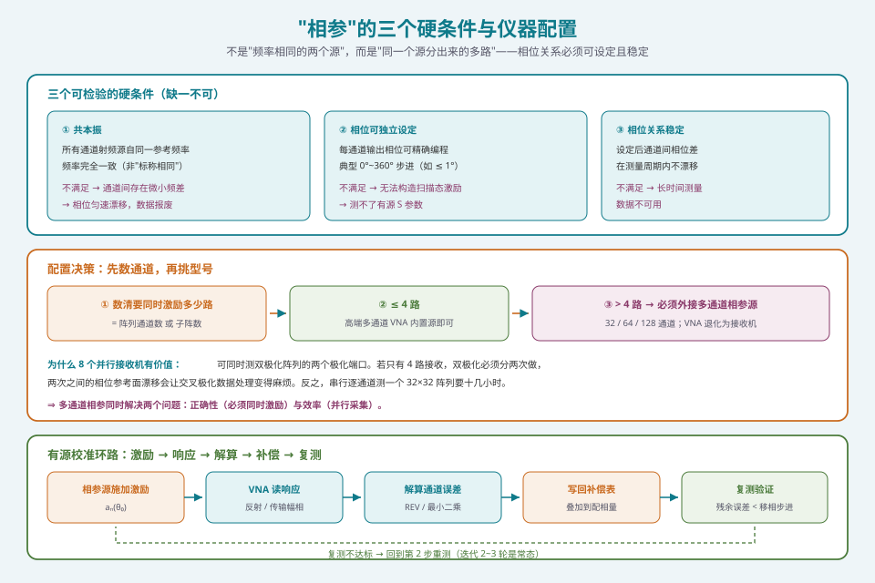
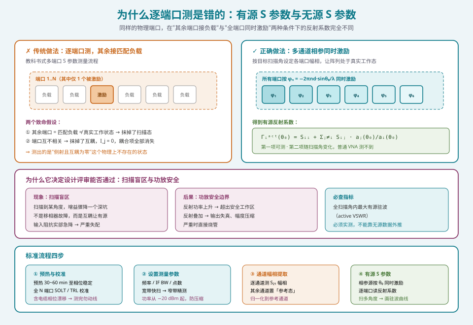

## 本篇要解决什么

[通道幅相校准](pa-rev-calibration.html) 那篇讲了"**怎么从响应反解出误差**"——REV 旋转矢量法、近场扫描、编码法都是解算算法。

但那篇留了一个前提没有交代：**响应是从哪来的？** 你怎么知道"当前时刻每个通道真实的幅相是多少"？

答案是测量。而在相控阵里，"测量"这件事本身就不简单——它和测一根普通天线、一个普通滤波器有本质区别。

本篇回答四个问题：

1. **为什么必须多通道相参？** 逐端口轮流测到底错在哪？
2. **"相参"确切的含义是什么？** 仪器需要满足什么条件？
3. **有源 S 参数与无源 S 参数差在哪？** 为什么它决定你阵列能不能过设计评审？
4. **一次标准测量怎么走？** 以及四个几乎人人都会踩的坑。

> **一句话概括**：普通天线的端口可以"一个测完测下一个"，因为它们是独立的；相控阵的端口**不能**，因为它们工作时的激励是**同时存在、互相耦合**的。你用错误的激励测出的参数，描述的不是真实工作中的那个阵列。

---

## 一、问题的起点：为什么逐端口测是错的

### 1.1 传统做法及其隐含假设

测一个多端口网络的 S 参数，教科书写法是这样的：

> 源接端口 \(i\)，**其余所有端口接匹配负载**，测量各端口的响应，得到 \(S_{ji}\) 这一列。换下一个 \(i\)，重复。

这套流程在**无源、互不相关**的网络里完全正确。但它偷偷带进了两个假设：

| 隐含假设 | 在相控阵中是否成立 |
| --- | --- |
| 其余端口处于"匹配负载"状态 = 真实工作状态 | ❌ **不成立**。真实工作时其余端口被激励源驱动，端口的等效阻抗完全不同 |
| 端口之间相互独立 | ❌ **不成立**。阵元间距接近 \(\lambda/2\) 时，单元间互耦强到能改变每个单元的输入阻抗 |

两个假设全错，那么测出来的东西**必然不能描述真实工作状态**。

### 1.2 互耦：让"单元阻抗"这个词失去意义

先看第一个后果。单元的自阻抗 \(Z_{ii}\) 是真空中孤立振子的阻抗，但放进阵列后，第 \(i\) 个端口的输入阻抗是

\[
Z_i^{\text{in}} = \sum_{j} Z_{ij}\,\frac{I_j}{I_i}
\]

其中 \(Z_{ij}\) 是第 \(i\)、\(j\) 单元之间的互阻抗，\(I_j/I_i\) 是它们的电流比。

关键就是这个 \(I_j/I_i\) ——**它由激励决定，因此随扫描角变化**。

- 侧射（\(\theta_0 = 0°\)）：各单元电流同相，\(I_j/I_i \approx 1\)
- 扫描到 \(\theta_0 = 60°\)：相邻单元存在 \(kd\sin\theta_0\) 的相位差，电流比是个复数

于是同一个物理端口，**在侧射和扫描时呈现出不同的输入阻抗**。当扫描到某个角度、某个单元的有源输入阻抗的实部急剧下降时，就会出现那个著名的现象：

> **扫描盲区（scan blindness）** —— 扫描到某个角度，增益突然掉下去一个深坑。它不是"移相器坏了"，而是**互耦让单元的有源阻抗在该角度上严重失配**。

这类问题**逐端口接负载的测量法永远发现不了**，因为那个测法里 \(I_j = 0\)（\(j \ne i\)），互耦项全部消失了。

### 1.3 扫描态：激励本身就是角度相关的

第二个后果更直接。相控阵工作时，第 \(n\) 个单元的激励是

\[
a_n(\theta_0) = w_n\, e^{\,j\,k\,n\,d\,\sin\theta_0}
\]

这个激励**随扫描角变化**。你用"只有一个端口有源、其余接负载"的激励去测，测出的是"侧射且互耦为零"这个**物理上不存在**的虚拟状态。

所以正确的做法只有一条：

> **用多个相参源同时激励所有端口，并按目标扫描角设定各自的幅相** —— 让阵列处于真实扫描状态，此时测出的才是**有源 S 参数**。

---

## 二、什么才算"多通道相参"

"相参"（phase-coherent）这个词经常被含糊使用。它有一组可检验的硬条件。

### 2.1 三个硬条件

| 条件 | 含义 | 不满足会怎样 |
| --- | --- | --- |
| **共本振** | 所有通道的射频信号源自同一个参考频率，频率**完全一致** | 通道间存在频率差 → 相位随时间线性漂移，测量值漂移 |
| **相位可独立设定** | 每个通道的输出相位可以按需要精确设定（如 \(0°\sim 360°\) 步进） | 无法构造扫描态激励 |
| **相位关系稳定** | 设定好之后，通道间的相位差在测量周期内**不漂移** | 长时间测量数据不可用 |

注意第一条的严格性：不是"频率相同的两个源"，而是"**同一个源分出来的多路**"。两个独立源哪怕标称频率相同，也有微小的频率偏差，相位差会随时间匀速旋转，几十秒后就乱了。

> **实务判据**：需要**多个相位相干的内置信号源**，且各源频率/幅度/相位可独立编程。只有 2~4 路内置源的普通 VNA 无法覆盖大阵，必须外接**多通道相参信号源**。



*图 2：相参的三个可检验条件、按通道数的配置决策路径，以及激励 → 响应 → 解算 → 补偿 → 复测的完整校准环路*

### 2.2 为什么相位精度要求这么高

通道相位设定精度有一个明确的下界：**它必须优于被测移相器的步进**。

理由很直接——你在测移相器，测量系统的误差必须显著小于被测对象的分辨率，否则测出的"移相器误差"里有一半是测量系统的。典型要求：

| 参数 | 典型指标 | 约束来源 |
| --- | --- | --- |
| 相位设定精度 | ≤ 1° | 优于 6 bit 移相器（5.625°）一个量级 |
| 幅度设定精度 | ≤ 0.1 dB | 优于衰减器步进 |
| 通道间隔离度 | ≥ 60 dB | 抑制串扰污染弱通道 |

---

## 三、无源 S 参数 vs 有源 S 参数

这是本篇最核心的概念区分。它们只差一个字，含义却完全不同。

### 3.1 定义对比

| | 无源 S 参数 | 有源 S 参数 |
| --- | --- | --- |
| **激励条件** | 单端口激励，其余端口接匹配负载 | **所有端口同时激励**，幅相按扫描角设定 |
| **符号** | \(S_{ij}\) | 常记 \(S^{\text{act}}_{ii}(\theta_0)\) |
| **依赖变量** | 频率 | 频率 **+ 扫描角** |
| **物理含义** | 孤立单元的散射特性 | 阵列处于该扫描态时的真实端口反射 |
| **测得方法** | 普通 VNA 逐端口测 | **多通道相参源 + VNA 接收** |

### 3.2 有源反射系数

对第 \(i\) 个端口，有源反射系数定义为

\[
\Gamma_i^{\text{act}}(\theta_0) = \frac{\sum_{j} S_{ij}\,a_j(\theta_0)}{a_i(\theta_0)}
\]

它的一个等价形式更直观：

\[
\Gamma_i^{\text{act}}(\theta_0) = S_{ii} + \sum_{j \ne i} S_{ij}\,\frac{a_j(\theta_0)}{a_i(\theta_0)}
\]

读一下这个式子，你就会明白全部要点：

- 第一项 \(S_{ii}\) 是**自反射**——这是普通 VNA 能测到的部分；
- 求和项是**来自所有其他端口的耦合贡献**——普通 VNA 测不到，因为它要求 \(a_j = 0\)（\(j\ne i\)）；
- 比值 \(a_j/a_i = e^{jk(j-i)d\sin\theta_0}\) 是**扫描角的函数** —— 所以有源反射系数**必然随角度变化**。

**结论**：无源 S 参数是有源 S 参数在 \(\theta_0\) 处互耦项恰好可以忽略时的特例。在任何阵元间距接近半波长的实用阵列里，这个特例**不存在**。



*图 1：传统逐端口测法的两个致命假设（抹掉互耦、抹掉扫描态），以及有源 S 参数的完整表达式与它的实际后果*

### 3.3 为什么它决定设计评审能否通过

有源驻波是**功率放大器最怕的东西**。T/R 组件末级功放的输出匹配是按某个负载设计的，如果某一扫描角上 \(\Gamma^{\text{act}}\) 突然变大：

1. 功放承受的反射功率上升 → **可能超出安全工作区**
2. 反射回来的功率叠加 → 输出失真、幅度压缩
3. 严重时直接烧管

所以设计评审里有一项必查指标：

> **全扫描角范围内的有源驻波比（active VSWR）最大值**

它必须由**实测的有源 S 参数**给出，不能靠无源数据外推。这也是为什么**多通道相参测量不是"更精细的测法"，而是"唯一正确的测法"**。

---

## 四、一次标准测量的完整流程

下面给出一条可以直接照着走的流程。它分成四步：准备、参数设置、通道幅相提取、有源 S 参数测量。

### 4.1 第一步 · 预热与校准

**预热**

1. 仪器开机预热，典型 **30~60 分钟**，直到相位漂移稳定（可打开相位监视看曲线是否走平）
2. 这是必做项，不是仪式——晶振与内部源的频率/相位需要达到热平衡

**端口校准**

3. 做**全 N 端口 SOLT 或 TRL 校准**（不要只校部分端口）
4. 校准件必须与被测频段匹配，且在**校准件自身的有效期**内
5. **把测试电缆的相位漂移也校准掉**——这一步不是常规操作，但毫米波测试必须做

> **为什么电缆要单独校**：毫米波频段，电缆弯曲几厘米就能引入几十度相位误差。做法是走一遍完整测量路径的校准（含电缆），然后**测完不再动线**。如果你在测量中途挪动了电缆，前面所有相位数据的参考面就变了，**整批作废**。

### 4.2 第二步 · 设置测量参数

```text
频率范围：覆盖工作频段 + 10% 余量
中频带宽 IF BW：先用宽（如 10 kHz）快速扫，确认无误后收窄到 100 Hz ~ 1 kHz 提精度
扫描点数：满足分辨率需求；通道一致性测试点数要足够
功率电平：从低功率起（如 −20 dBm），逐步升高确认线性
```

**关于 IF BW 的取舍**：它是一个经典的精度—速度权衡。

- 噪声底 ∝ \(\sqrt{\text{IF BW}}\)，收窄 100 倍 → 噪声改善 10 dB
- 但扫描时间也近似线性增加

所以工程做法永远是：**宽带宽快速概览 → 收窄带宽精细测量**。

**关于功率电平**：低功率起测的原因见第五节"功率压缩"。

### 4.3 第三步 · 通道幅相提取

目标是得到"每个通道相对参考通道的幅度差与相位差"。

1. 逐个切换被测通道，其余通道置为**参考态**（保持统一状态，不要全关——全关会改变互耦环境）
2. 记录每个通道的 \(S_{21}\)（或传输响应）的幅度与相位
3. **归一化**：选一个参考通道（通常取中心单元），算出所有通道相对它的

\[
\Delta A_n = 20\log_{10}\frac{|A_n|}{|A_{\text{ref}}|}\ \text{(dB)}, \qquad
\Delta\varphi_n = \angle A_n - \angle A_{\text{ref}}
\]

4. 这两组数就是后续校准算法（[REV](pa-rev-calibration.html) / 编码法）的输入

> **注意第 1 条**："其余通道置为参考态"而不是"全部关闭"，这一点容易被忽略。因为互耦环境会影响被测通道的响应，**关闭所有其他通道 ≠ 真实工作状态**，会让提取出的幅相带上一个系统偏差。保持统一参考态能让这个偏差对所有通道一致，从而在归一化时被消掉。

### 4.4 第四步 · 有源 S 参数测量（关键一步）

这是前面所有铺垫的落点。

1. 用**多通道相参源**按目标扫描角 \(\theta_0\) 同时激励所有端口：

   \[
   \varphi_n = -\,2\pi\,\frac{n\,d\,\sin\theta_0}{\lambda}
   \]

2. 把 \(\varphi_n\)（叠加补偿量）写入相参源各通道
3. VNA 逐端口读取反射系数 → 得到该扫描角下的**有源 S 参数**
4. **扫多个 \(\theta_0\) 重复** \((\theta_0 = 0°, 15°, 30°, 45°, 60°\dots)\)，画出**有源驻波随扫描角的变化曲线**
5. 找出最恶劣的角度点，回到设计里检查是否需要匹配网络或降耦结构

**判据**：全扫描角内，有源 VSWR 应控制在一个由功放安全区反推的门限内（常见工程值 ≤ 2.0 或更低，取决于器件）。

---

## 五、四个几乎人人都会踩的坑

设备手册可以列成表，但坑必须讲清楚"为什么"，才不会被踩第二次。

### 坑一 · 功率压缩

**现象**：测有源阵列时，输入功率稍高，测出的幅度就偏低，一致性也变差。

**原因**：T/R 组件的末级放大器进入了**压缩区**。此时输出不再与输入成线性比例，测出的"通道幅度"里混入了非线性。

**做法**：

- **先做一次功率扫描**：固定频率与配置，从很低功率逐步升高，画出输出 vs 输入曲线
- 找到 **1 dB 压缩点**，工作点取在它下方 **10 dB 以上**
- 之后所有测量都固定在这个功率点

> 这一条之所以是大坑，是因为**它不会报错**。仪器一切正常，数据也"像那么回事"，只是系统性地偏低。你只有在做了功率扫描之后才会发现问题。

### 坑二 · 电缆相位漂移

**现象**：同一组通道，重新接线或挪动电缆后测出的相位差不一样。

**原因**：电缆的电长度随弯曲、温度、应力变化。毫米波频段，几厘米的弯曲量级就能引入几十度。

**做法**：

- 校准包含电缆的完整路径，测完**固化走线**（扎带固定、标记位置）
- 测量过程中**不要碰线**
- 长时间测量要**定期复测一个基准通道**，监视漂移
- 如果必须移动，**重做校准**

### 坑三 · 参考面不统一

**现象**：不同批次、不同人测的数据放在一起比对，相位对不上。

**原因**：校准参考面不一致。参考面可能定在"阵列端口""连接器端面""探头端面""暗室坐标系原点"——每个选择都让相位数据平移一个不同的量。

**做法**：

- 项目开始前**统一定义参考面**，写进测试规范
- 报告里**必须注明参考面**
- 跨批次数据比对前，先做**参考面归一化**

> 这一条是"团队协作坑"：单次测量完全正确，但两次测量之间不可比。相位数据的价值高度依赖参考面的一致性。

### 坑四 · 串扰与时序

**现象**：并行测量时，某些弱通道的数据被污染。

**原因**：多个通道同时工作时，通道间串扰（串扰度有限，如 60 dB 隔离）会让弱信号通道的测量结果里混入强通道的泄漏。

**做法**：

- 在动态范围不足的场景，**降低并行度**或对强通道**加衰减**
- 用**分段扫描 + 时序触发**保证采集时刻各通道状态已知
- 如果发现某个通道数据异常，先怀疑串扰，再怀疑器件

### 附带一提 · 时间成本

逐通道**串行**测量极慢。一个 \(32\times 32\) 的阵列逐通道测，动辄十几小时。

而 8 通道并行接收能把同样的测量压到 1 小时量级——这就是为什么**多通道相参不是"奢侈品"而是"必需品"**：它同时解决了**正确性**（必须同时激励）与**效率**（并行采集）两个问题。

---

## 六、仪器选型：先数通道，再挑型号

选型的顺序很容易搞反——很多人先看型号再看通道数，结果买回来发现激励不了自己的阵列。

**正确的顺序**：

```text
① 数清要同时激励多少路（= 阵列通道数，或子阵数）
        ↓
② 4 路以内 → 高端多通道 VNA 的内置相参源即可（如 R&S ZNA 的 4 个内部源）
        ↓
③ 4 路以上 → 必须外接多通道相参源（32 / 64 / 128 通道）
              VNA 退化为"接收机"，只负责幅相提取
```

| 类别 | 代表 | 关键规格 | 适用 |
| --- | --- | --- | --- |
| 高端多通道 VNA | R&S ZNA | 4 个内部相参源 · 最多 4 TX / 8 RX · 直出 67 GHz | 小阵、子阵级、双极化并行 |
| 高端 VNA | Keysight PNA-X（N5245B / N5227B） | 内置双源 + 噪声接收机 · 到 67 GHz · 动态范围 ~140 dB | 线性与非线性一站式 |
| 国产 | 中电科思仪 3671 / 3672 / 3674 | 配 S 参数模块，按频段配置 | 国产近场系统常用配套 |
| 多通道相参源 | （外接）32 / 64 / 128 通道 | 共本振 · 相位 ≤ 1° · 幅度 ≤ 0.1 dB · 隔离 ≥ 60 dB | 大阵有源 S 参数测试（必需） |
| 经济型 4 端口 VNA | 通用型号 | 通道数少 | 只适合小阵或逐通道测试 |

> **8 个并行接收机的实际价值**：可以**同时**测双极化阵列的两个极化端口。如果只有 4 路接收，双极化测量就必须分两次做，两次之间的相位参考面漂移会让交叉极化数据处理变得麻烦。

---

## 七、与其他测试环节的衔接

VNA 测量不是孤立的，它在整条测试链上有明确的上游与下游。

```text
【上游】校准 → 阵列被调到"已知状态"
        ↓
【VNA 多通道相参测量】← 本篇
        ↓  产出：各通道幅相、有源 S 参数
【下游】③ 方向图 / 增益 / 扫描特性测试（L3 阵列级）
        ④ EIRP / G/T / EVM 系统级测试（L4）
```

分工可以这样记：

> **多通道相参源负责"给激励"，VNA 负责"读响应"，校准算法负责"从响应解出误差"。**

三者组成一个有源校准的完整环路：

1. 相参源按扫描角 \(\theta_0\) 施加激励 \(a_n(\theta_0)\)
2. VNA 测量各端口的反射/传输响应
3. 校准算法（REV / 最小二乘）从响应解出每个通道的幅相误差
4. 生成补偿表，写回波控
5. **用 VNA 复测**，验证残余误差是否小于移相器步进

第 5 步很关键——**校准完必须复测**，否则你不知道校准到底起没起作用。

---

## 本篇要点回顾

| # | 要点 | 一句话 |
| --- | --- | --- |
| 1 | 逐端口接负载是错的 | 它同时抹掉了互耦 \((I_j=0)\) 与扫描态（激励固定为侧射） |
| 2 | 相参的硬条件 | 共本振 + 相位可独立设定 + 相位关系稳定 |
| 3 | 有源 S 参数 | \(\Gamma_i^{\text{act}} = S_{ii} + \sum_{j\ne i}S_{ij}a_j/a_i\)，**随扫描角变化** |
| 4 | 它为什么重要 | 全扫描角有源驻波决定功放能否安全工作，是设计评审必查项 |
| 5 | 标准流程四步 | 预热校准 → 参数设置 → 通道幅相提取 → 有源 S 参数测量 |
| 6 | 四个坑 | 功率压缩（先做功率扫描）· 电缆相位漂移（固化走线）· 参考面（统一并注明）· 串扰（降并行度） |
| 7 | 选型顺序 | **先数通道，再挑型号**；>4 路必须外接相参源 |
| 8 | 环路闭环 | 激励 → 响应 → 解算 → 补偿 → **复测**，缺一不可 |

---

## 延伸阅读与衔接

**相关专题**

- [通道幅相校准：把 N 个"不一样"的通道拉成一副天线](pa-rev-calibration.html) —— 本篇产出的数据在这里被解算成误差
- [为什么必须 OTA：从连接器消失说起](pa-ota-necessity.html) —— 从有线测量走向空口测量
- [OTA 三方法与暗室工程：DFF / CATR / NFTF](pa-ota-methods-chamber.html) —— 场地选型的完整对比
- [暗室静区验证：测试结果的"合法性证明"](pa-chamber-quiet-zone.html) —— 本篇的下游场地前提

**标准与资料**

| 文件 | 内容 |
| --- | --- |
| SJ 20884-2003 | 相控阵天线测试方法 |
| SJ 20882 | 有源相控阵天线测试方法 |
| Keysight《How to Design and Test a Phased Array Antenna》 | 从原理到工作流的完整链路，**入门最好的免费材料** |
| R&S ZNA / Keysight PNA-X 应用手册 | 多通道相参配置与有源 S 参数测量的操作细节 |

**自测**

1. 写出有源反射系数的表达式，指出哪一项是普通 VNA 能测到的、哪一项不能，并解释为什么后者随扫描角变化。
2. 为什么"其余端口接匹配负载"在相控阵里是错的？给出两个理由。
3. 毫米波测试中为什么必须把电缆相位漂移也校准掉？
4. 你做了一次有源 S 参数测量，发现某角度驻波异常，下一步应该怀疑什么？
